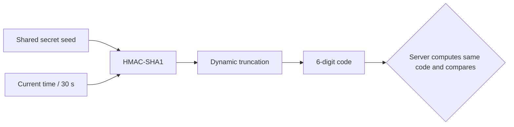
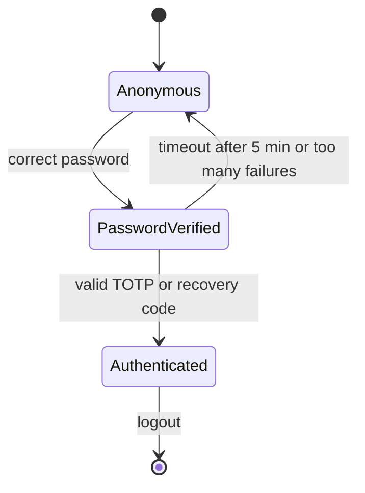

# Multi-Factor Authentication

## Introduction

A password is a single secret. If it leaks through phishing, malware, reuse or a breach at another site, an attacker who has it *is* the user as far as your login form can tell. **Multi-factor authentication (MFA)** fixes that by requiring a second, different kind of proof, so a stolen password alone is no longer enough.

A house key and an alarm code are a good analogy. A burglar who copies your key still has to know the code, and a neighbor who overheard the code still cannot open the door. The two factors fail in different ways, which is the whole point.

MFA is one of the most effective controls you can add, but not every second factor is equally strong. In this page you will:

- Compare the main MFA methods: SMS, email codes, TOTP apps, push, and phishing-resistant keys.
- Understand exactly how **TOTP** (the 6-digit authenticator app code) works, by building it from scratch.
- Implement TOTP enrollment and verification in Python with `pyotp`, including replay protection.
- Design recovery codes and account recovery without creating a back door.
- Choose which MFA method fits which users.

:::note
You only learn how these attacks work so you can defend against them. Test MFA bypass techniques only on systems you own or have written permission to test, for example a local lab with OWASP Juice Shop.
:::

## The MFA Methods Compared

| Method | Factor | Phishing-resistant? | Main weaknesses |
| --- | --- | --- | --- |
| SMS one-time code | Something you have (phone number) | No | SIM swapping, number porting, SMS interception, phishing |
| Email one-time code or link | Something you have (inbox) | No | Only as strong as the email account, phishing |
| TOTP authenticator app | Something you have (seed on phone) | No | Phishing proxies relay codes in real time, seed theft |
| Push approval | Something you have (enrolled app) | No, unless bound to the origin | "MFA fatigue": spamming prompts until the user taps Approve |
| Push with number matching | Something you have | Partially | Still relayable by a real-time proxy |
| FIDO2 security key or passkey | Something you have, often plus something you are | **Yes** | Recovery design, device loss, older platform support |

**Phishing resistance** is the line that matters most today. Kits known as **adversary-in-the-middle (AiTM)** proxies sit between the user and the real site. The user types their password and TOTP code into the fake page, the proxy forwards both to the real site within seconds, and steals the resulting session cookie. Codes cannot stop this, because the code does not know which website it was typed into. WebAuthn credentials do: the browser binds every signature to the real origin. That is why [Passkeys and WebAuthn](./3-sec-passkeys.mdx) has its own page.

### What NIST says about SMS

NIST SP 800-63B-4 classifies authentication through the public phone network (SMS or voice codes) as a **restricted** authenticator. It is still permitted, but organizations that use it must assess the extra risk, offer users an alternative, and have a plan to migrate away. At AAL2, verifiers must also *offer* a phishing-resistant option. These are federal rules, but the reasoning applies everywhere. Check the [current SP 800-63B text](https://pages.nist.gov/800-63-4/sp800-63b.html) for exact wording.

SMS is still much better than nothing. For a consumer app where many users have no smartphone app, SMS MFA can block most automated credential stuffing. Just do not use it for administrators or high-value accounts.

## How TOTP Works

TOTP (Time-based One-Time Password) is defined in **RFC 6238**, built on HOTP (**RFC 4226**). Both sides share a secret key, called the seed. Every 30 seconds, each side computes:

1. `counter = floor(unix_time / 30)`
2. `mac = HMAC-SHA1(secret, counter as 8 bytes)`
3. Pick 4 bytes from the MAC using the last nibble as an offset ("dynamic truncation").
4. Take that number modulo 10^6 to get a 6-digit code.



No network connection is needed. The phone and the server just need roughly synchronized clocks.

Here is TOTP from scratch with only the standard library, checked against an RFC 6238 test vector:

```python
import hashlib
import hmac
import struct

def hotp(secret: bytes, counter: int, digits: int = 6) -> str:
    mac = hmac.new(secret, struct.pack(">Q", counter), hashlib.sha1).digest()
    offset = mac[-1] & 0x0F
    code = struct.unpack(">I", mac[offset:offset + 4])[0] & 0x7FFFFFFF
    return str(code % 10**digits).zfill(digits)

def totp(secret: bytes, unix_time: int, step: int = 30, digits: int = 6) -> str:
    return hotp(secret, unix_time // step, digits)

# RFC 6238 Appendix B test secret (ASCII "12345678901234567890"), time = 59 s
secret = b"12345678901234567890"
print(totp(secret, 59, digits=8))  # RFC expects 94287082
print(totp(secret, 59))            # 6-digit version
```

Output:

```text
94287082
287082
```

You should **not** use your own implementation in production. Use a maintained library. But seeing the steps makes the security properties obvious:

- The secret seed is as sensitive as a password. Anyone with it can generate codes forever.
- A code is valid for one 30-second window (plus whatever clock drift you allow).
- A 6-digit code has only a million possibilities, so the verify endpoint **must be rate limited**.

## Implementing TOTP with pyotp

Install the libraries:

```bash
pip install pyotp cryptography
```

### Step 1: Enrollment

Enrollment generates a random seed, shows it to the user as a QR code, and only activates MFA after the user proves they saved it by entering a valid code.

```python
import pyotp

def start_enrollment(email: str) -> tuple[str, str]:
    secret = pyotp.random_base32()  # 160 random bits, Base32 encoded
    uri = pyotp.TOTP(secret).provisioning_uri(name=email, issuer_name="Acme Learn")
    return secret, uri

secret, uri = start_enrollment("alice@example.com")
print(len(secret))
print(uri.split("?")[0])
```

Example output:

```text
32
otpauth://totp/Acme%20Learn:alice%40example.com
```

The `otpauth://` URI is what the QR code encodes. Authenticator apps read it, store the secret, and start showing codes. You can render it with a QR library such as `qrcode`, entirely on your server. Do not send the secret to a third-party QR image API.

### Step 2: Store the seed encrypted

Unlike a password, the server needs the original seed to compute codes, so you cannot hash it. Encrypt it at rest with a key that lives outside the database, for example in a secret manager or KMS.

```python
from cryptography.fernet import Fernet

FERNET = Fernet(Fernet.generate_key())  # in production: load the key from a secret manager

def seal(secret: str) -> bytes:
    return FERNET.encrypt(secret.encode())

def unseal(token: bytes) -> str:
    return FERNET.decrypt(token).decode()

stored = seal("JBSWY3DPEHPK3PXP")
print(stored[:10], "...")
print(unseal(stored))
```

Example output:

```text
b'gAAAAABo8l' ...
JBSWY3DPEHPK3PXP
```

If the database leaks without the key, the seeds stay safe. See [Key Management](../1-sec-cryptography/8-sec-key-management.mdx) for where the key should live.

### Step 3: Verification with replay protection

`pyotp.TOTP.verify(code, valid_window=1)` accepts the current code plus one step either side to tolerate clock drift. But it does not remember which codes were already used, so a code shoulder-surfed or relayed within its window could be replayed. RFC 6238 recommends rejecting a code once it has been accepted. Track the last accepted time step:

**Vulnerable:**

```python
def verify_mfa_bad(user: dict, code: str) -> bool:
    return pyotp.TOTP(unseal(user["totp_secret"])).verify(code, valid_window=10)  # 5-minute window, reusable
```

**Fixed:**

```python
import hmac
from datetime import datetime, timedelta, timezone

def verify_mfa(user: dict, code: str, now: datetime | None = None) -> bool:
    now = now or datetime.now(timezone.utc)
    totp = pyotp.TOTP(unseal(user["totp_secret"]))
    code = code.strip().replace(" ", "")
    for drift in (-1, 0, 1):  # allow one step of clock drift each way
        when = now + timedelta(seconds=drift * totp.interval)
        step = totp.timecode(when)
        if step <= user.get("last_totp_step", -1):
            continue  # this step (or an older one) was already used
        if hmac.compare_digest(totp.at(when), code):
            user["last_totp_step"] = step  # persist this in the database
            return True
    return False

user = {"totp_secret": seal("JBSWY3DPEHPK3PXP")}
fixed_time = datetime(2026, 1, 1, 12, 0, 0, tzinfo=timezone.utc)
code = pyotp.TOTP("JBSWY3DPEHPK3PXP").at(fixed_time)
print(verify_mfa(user, code, fixed_time))      # first use
print(verify_mfa(user, code, fixed_time))      # replay in same window
print(verify_mfa(user, "000000", fixed_time))  # wrong code
```

Output:

```text
True
False
False
```

`hmac.compare_digest` compares in constant time so response timing does not reveal how many digits matched.

### Step 4: Fit it into login

MFA turns login into a two-step flow. The important rule: **the user is not logged in after step one**. Store a short-lived "password verified" marker, and only create the real session after the second factor.



```python
from flask import Flask, session, request, jsonify
import time

app = Flask(__name__)
app.secret_key = "dev-only-change-me"
USERS = {1: {"totp_secret": seal("JBSWY3DPEHPK3PXP")}}

@app.post("/login/mfa")
def login_mfa():
    pending = session.get("mfa_pending")  # set by the password step
    if not pending or time.time() - pending["at"] > 300:
        session.clear()
        return jsonify(error="Start login again."), 401
    pending["tries"] = pending.get("tries", 0) + 1
    session["mfa_pending"] = pending
    if pending["tries"] > 5:
        session.clear()
        return jsonify(error="Too many attempts."), 429
    user = USERS[pending["user_id"]]
    if not verify_mfa(user, request.form.get("code", "")):
        return jsonify(error="Invalid code."), 401
    session.clear()                      # fresh session for the authenticated user
    session["user_id"] = pending["user_id"]
    session["amr"] = ["pwd", "otp"]      # record how they authenticated
    session["mfa_at"] = time.time()      # used later for step-up checks
    return jsonify(ok=True)
```

Recording the **authentication methods** (`amr`) lets later code ask "did this user use MFA?" before sensitive actions. The values `pwd` and `otp` come from the registry defined in RFC 8176, which OpenID Connect also uses.

## Recovery Codes

Phones get lost. Without a recovery path, users get locked out and your support team gets flooded. Without a *secure* recovery path, attackers just use the recovery path instead of MFA.

Recovery codes are a set of single-use random codes shown once at enrollment. Treat them like passwords: hash them before storage.

```python
import hashlib
import secrets

def new_recovery_codes(n: int = 10) -> tuple[list[str], set[str]]:
    codes = [f"{secrets.token_hex(4)}-{secrets.token_hex(4)}" for _ in range(n)]
    hashes = {hashlib.sha256(c.encode()).hexdigest() for c in codes}
    return codes, hashes  # show `codes` once, store only `hashes`

def use_recovery_code(stored: set[str], code: str) -> bool:
    h = hashlib.sha256(code.strip().lower().encode()).hexdigest()
    if h in stored:
        stored.remove(h)  # single use
        return True
    return False

codes, stored = new_recovery_codes()
print(len(codes), codes[0].count("-"))
print(use_recovery_code(stored, codes[0]))
print(use_recovery_code(stored, codes[0]))
```

Output:

```text
10 1
True
False
```

Plain SHA-256 is acceptable here because each code has 64 random bits, so it cannot be brute-forced like a human-chosen password. Rate limit the endpoint anyway.

Other recovery rules:

- Let users register **more than one** strong factor (two security keys, or a passkey plus TOTP).
- A support-desk reset is a social-engineering target. Require identity proofing and a delay, and notify the user through every channel you have.
- Never let "email me a link" silently bypass MFA for accounts that have it enabled.

## Push Notifications and MFA Fatigue

Push MFA ("Approve sign-in?") is convenient but has a known abuse pattern. An attacker with the password triggers prompt after prompt, late at night, until the tired user taps Approve. Defenses:

- **Number matching**: the login page shows a number that the user must type into the app, so a blind tap is not enough.
- Show **context** in the prompt: app, location, device.
- **Rate limit** prompts and alert on bursts of denials.
- Give users a "This wasn't me" button that triggers a password reset and alerts security.

## Step-Up Authentication

You do not have to ask for MFA on every click. A common pattern is **step-up authentication**: a normal session is enough to browse, but sensitive actions (change email, add a payout account, delete the project) require a fresh second factor within the last few minutes.

```python
def require_recent_mfa(max_age_seconds: int = 300) -> bool:
    last = session.get("mfa_at", 0)
    return "otp" in session.get("amr", []) and time.time() - last < max_age_seconds
```

In OpenID Connect you can request the same thing from an identity provider with the `max_age` and `acr_values` parameters. See [OpenID Connect](./7-sec-oidc.mdx).

## Real-World Scenario

Your team runs a B2B project-management SaaS. A customer's admin account was compromised through a phishing email. The attacker used a real-time phishing proxy, so the customer's TOTP MFA did not help. Enterprise customers now ask what you will do.

### The solution

1. **Tier MFA by risk.** All users must enroll MFA. Admins and anyone with billing or export rights must use a **phishing-resistant** method: a passkey or hardware security key.
2. **Keep TOTP as a fallback** for regular users, with replay protection, encrypted seeds and rate limits.
3. **Remove SMS** for admin accounts, and keep it only as a temporary method for regular users who cannot use an app.
4. **Step-up for dangerous actions**: exporting all data or adding an SSO connection requires a fresh WebAuthn assertion.
5. **Let enterprise customers enforce MFA through their own identity provider** via SSO, so their IT team controls policy. See [Single Sign-On and SAML](./8-sec-sso-and-saml.mdx).
6. **Detect session theft**: alert when a session cookie appears from a new country or device fingerprint shortly after login.

### Why this approach

The attack defeated TOTP because TOTP codes are not bound to the website origin. Only origin-bound credentials (WebAuthn) stop AiTM phishing. Forcing hardware keys on every user, however, would create friction and support cost, so the strongest method goes where the risk is highest.

### When to use it, and when not to

- Use phishing-resistant MFA for admins, developers with production access, finance and anyone a targeted attacker would want.
- TOTP is a reasonable baseline for general users, especially where passkey support is uneven.
- For low-risk consumer apps, mandatory MFA may cost more in drop-off than it saves. Offer it, encourage it, and require it on suspicious logins.

### Alternatives and trade-offs

| Approach | Pros | Cons | Best for |
| --- | --- | --- | --- |
| SMS codes | Works on any phone, familiar | SIM swap, phishable, cost per message, NIST "restricted" | Temporary fallback for consumers |
| TOTP app | Free, offline, open standard | Phishable, seed must be protected, users lose phones | Default MFA for most users |
| Push with number matching | Smooth UX | Needs your own app or a vendor, still relayable | Workforce apps with a managed authenticator |
| Hardware security key | Strongest, phishing-resistant, meets AAL3 with the right device | Cost, distribution logistics, users need two | Admins, high-value targets |
| Passkeys (synced) | Phishing-resistant, easy UX, no extra device | Recovery depends on platform account; not AAL3 | Most users going forward |
| SSO-enforced MFA via customer IdP | Customer controls policy | Depends on the customer's IdP setup | Enterprise B2B |

## Common Mistakes

- **Logging users in before the second factor**, or letting API endpoints accept a session that only passed step one.
- **No rate limit on code verification.** A 6-digit code falls to brute force without one.
- **Huge verification windows** such as `valid_window=10`, and no replay protection.
- **Storing TOTP seeds in plain text** next to the user table.
- **Recovery flows that skip MFA**, such as "forgot password" logging the user in directly.
- **Allowing MFA to be disabled without re-authentication**, so a stolen session can turn MFA off.
- **Assuming MFA stops session theft.** Once a session cookie is stolen, MFA has already happened. Protect cookies and watch for anomalies.
- **Calling MFA "phishing-proof" when it uses codes or plain push.** Only origin-bound methods are.

## Summary

- MFA combines independent factors so one stolen secret is not enough.
- TOTP is HMAC over a time counter. Protect the seed, rate limit verification, allow small drift and reject replays.
- SMS is restricted under NIST SP 800-63B-4 and weak against SIM swaps. Avoid it for privileged users.
- Push MFA needs number matching and rate limits to resist fatigue attacks.
- Only WebAuthn-based methods (security keys and passkeys) resist real-time phishing.
- Recovery codes must be random, hashed and single use, and every recovery path must be as strong as the login it replaces.

## Exercises

1. Combine the password login from [Secure Password Authentication](./1-sec-password-authentication.mdx) with the `/login/mfa` endpoint here so that the password step sets `mfa_pending`. Write tests for timeout, replay and too many attempts.
2. Generate a QR code for the provisioning URI with the `qrcode` package, scan it with an authenticator app, and verify a live code.
3. Add a "disable MFA" endpoint that requires a fresh password and a valid code, and emails the user afterwards.
4. Write a one-page MFA policy for a fictional company with three user groups: customers, support agents and engineers with production access. Justify each choice.

Next: [Passkeys and WebAuthn](./3-sec-passkeys.mdx). Related: [Social Engineering and Phishing](../10-sec-offensive-security/8-sec-social-engineering.mdx) and [Digital Signatures and MACs](../1-sec-cryptography/5-sec-digital-signatures.mdx).
