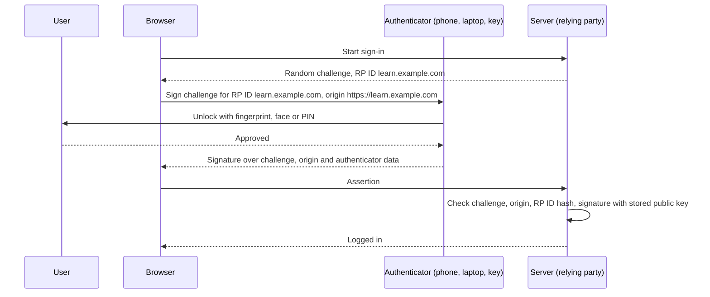
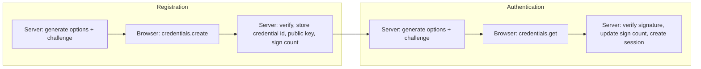

# Passkeys and WebAuthn

## Introduction

Passwords and one-time codes share a fatal flaw: they are secrets that a human types into a web page. If the page is fake, the human hands the secret to an attacker. **Passkeys** remove that flaw. There is no shared secret to type, and the browser refuses to use a credential on the wrong website.

A passkey is a **public-key credential** created by the user's device (phone, laptop or hardware security key) for one specific website. The private key never leaves the device or the user's password manager. Your server stores only the public key. To log in, the server sends a random challenge, the device signs it after the user unlocks it with a fingerprint, face or PIN, and the server checks the signature.

An analogy: a password is like telling the bouncer a secret word. Anyone who overhears it can reuse it, and you might tell it to a fake bouncer at a fake door. A passkey is like a wax seal only you own, stamped on a fresh note the real bouncer hands you. A fake bouncer gets a stamp on the wrong note, which is useless at the real door.

The technology underneath is:

- **WebAuthn** (Web Authentication), a W3C standard. **WebAuthn Level 3 became a W3C Recommendation in August 2026**, superseding Level 2.
- **CTAP** (Client to Authenticator Protocol) from the FIDO Alliance, which lets browsers talk to security keys and phones.
- **Passkey** is the friendly name for a *discoverable* FIDO credential, often synced between a user's devices by their platform or password manager.

In this page you will learn how passkeys work, why they resist phishing, and how to build registration and sign-in with **Flask** and the **`webauthn`** Python library (py_webauthn).

## Why Passkeys Resist Phishing

Three properties do the work:

1. **Origin binding.** The browser includes the page's origin (for example `https://learn.example.com`) in the signed data and only offers credentials registered for that site's **relying party ID** (RP ID). A look-alike domain gets nothing to sign with.
2. **No shared secret.** The server stores a public key. A database breach leaks nothing that can log in.
3. **Fresh challenges.** Each login signs a new random challenge, so a captured response cannot be replayed.



Compare this with the MFA methods in [Multi-Factor Authentication](./2-sec-mfa.mdx). A real-time phishing proxy can relay a TOTP code, but it cannot make the browser sign for `learn.example.com` while the user is on `learn-example.co`.

## Key Concepts

| Term | Meaning |
| --- | --- |
| Relying party (RP) | Your website or app, which relies on the credential |
| RP ID | The domain the credential is scoped to, such as `example.com`. It must equal or be a registrable suffix of the page origin's host |
| Authenticator | The thing holding the private key: platform authenticator (Touch ID, Windows Hello, Android) or roaming authenticator (USB/NFC security key, phone via hybrid flow) |
| Discoverable credential | A credential the authenticator can find without the server naming it first. Enables username-less sign-in. Passkeys are discoverable |
| User verification (UV) | The authenticator checked the user with biometrics or PIN, not just a tap |
| User presence (UP) | Someone touched or approved the authenticator |
| Attestation | Optional statement about the authenticator's make and model. Most consumer sites request `none` |
| Synced vs device-bound | Synced passkeys are backed up to a cloud account and appear on the user's other devices. Device-bound keys never leave one device |
| Backup flags (BE/BS) | Flags in authenticator data telling you whether a credential is backup-eligible and currently backed up |

### Synced vs device-bound passkeys

Synced passkeys solve the biggest usability problem of hardware keys: losing the device means losing access. The trade-off is that the security of the credential now also depends on the user's sync account (Apple, Google, Microsoft or a third-party password manager). NIST SP 800-63B-4 accepts syncable authenticators at **AAL2** when the sync account is itself protected properly, while **AAL3** requires non-exportable, device-bound keys. For admins of critical systems, hardware security keys remain the gold standard.

## The Two Ceremonies

WebAuthn calls its flows *ceremonies*:

- **Registration** (`navigator.credentials.create()`): the authenticator creates a new key pair and returns the public key.
- **Authentication** (`navigator.credentials.get()`): the authenticator signs a challenge with the private key.



## Building It: Server Side

Install the libraries. At the time of writing, py_webauthn is at version 3.x. Check [PyPI](https://pypi.org/project/webauthn/) for the current release and changelog, since the API has changed across major versions.

```bash
pip install flask webauthn
```

### Generating registration options

```python
# passkeys_app.py
import json
import secrets
from flask import Flask, jsonify, request, session, abort
from webauthn import (
    generate_registration_options,
    verify_registration_response,
    generate_authentication_options,
    verify_authentication_response,
    options_to_json,
)
from webauthn.helpers import base64url_to_bytes, bytes_to_base64url
from webauthn.helpers.structs import (
    AuthenticatorSelectionCriteria,
    PublicKeyCredentialDescriptor,
    ResidentKeyRequirement,
    UserVerificationRequirement,
)

RP_ID = "localhost"                 # your registrable domain, e.g. "example.com"
RP_NAME = "Acme Learn"
ORIGIN = "http://localhost:5000"    # must match the browser origin exactly; https in production

app = Flask(__name__)
app.secret_key = "dev-only-change-me"

USERS = {"alice@example.com": {"id": secrets.token_bytes(16), "credentials": []}}
CREDENTIALS = {}  # credential_id (base64url) -> {"user": email, "public_key": bytes, "sign_count": int}

@app.post("/passkeys/register/options")
def register_options():
    email = session.get("user_email")  # user must already be logged in to add a passkey
    if not email:
        abort(401)
    user = USERS[email]
    options = generate_registration_options(
        rp_id=RP_ID,
        rp_name=RP_NAME,
        user_name=email,
        user_id=user["id"],  # random, stable, not the email address
        authenticator_selection=AuthenticatorSelectionCriteria(
            resident_key=ResidentKeyRequirement.REQUIRED,          # discoverable = passkey
            user_verification=UserVerificationRequirement.REQUIRED,
        ),
        exclude_credentials=[  # stop the same authenticator registering twice
            PublicKeyCredentialDescriptor(id=base64url_to_bytes(c)) for c in user["credentials"]
        ],
    )
    session["reg_challenge"] = bytes_to_base64url(options.challenge)
    return app.response_class(options_to_json(options), mimetype="application/json")
```

A few decisions here:

- **`user_id` is random bytes**, not an email or database ID. It is stored on the authenticator, and WebAuthn guidance says it should contain no personal information.
- **`resident_key=REQUIRED`** makes a discoverable credential, which is what users know as a passkey.
- **`user_verification=REQUIRED`** means the authenticator must check biometrics or a PIN, so the passkey counts as two factors (something you have, plus something you are or know).
- **The challenge is stored server-side** in the session, so the browser cannot choose it.

Example output of the options JSON (shortened):

```json
{
  "rp": {"name": "Acme Learn", "id": "localhost"},
  "user": {"id": "q2x...", "name": "alice@example.com", "displayName": "alice@example.com"},
  "challenge": "ifua-4HH289Kg2565F3YheY6SKJpGfaA-zWYwTbT59Ej",
  "pubKeyCredParams": [{"type": "public-key", "alg": -8}, {"type": "public-key", "alg": -7}, {"type": "public-key", "alg": -257}],
  "timeout": 60000,
  "excludeCredentials": [],
  "authenticatorSelection": {"residentKey": "required", "requireResidentKey": true, "userVerification": "required"},
  "attestation": "none"
}
```

The `alg` numbers are COSE algorithm IDs: `-8` is EdDSA, `-7` is ECDSA with P-256 and SHA-256, and `-257` is RSA PKCS#1 v1.5 with SHA-256.

### Verifying registration

```python
@app.post("/passkeys/register/verify")
def register_verify():
    email = session.get("user_email")
    challenge = session.pop("reg_challenge", None)  # single use
    if not email or not challenge:
        abort(400)
    try:
        verified = verify_registration_response(
            credential=request.get_json(),
            expected_challenge=base64url_to_bytes(challenge),
            expected_rp_id=RP_ID,
            expected_origin=ORIGIN,
            require_user_verification=True,
        )
    except Exception as exc:  # the library raises on any failed check
        app.logger.warning("passkey registration failed: %s", exc)
        abort(400)
    cred_id = bytes_to_base64url(verified.credential_id)
    CREDENTIALS[cred_id] = {
        "user": email,
        "public_key": verified.credential_public_key,
        "sign_count": verified.sign_count,
        "backed_up": verified.credential_backed_up,
    }
    USERS[email]["credentials"].append(cred_id)
    return jsonify(ok=True)
```

The library checks the challenge, origin, RP ID hash, flags and attestation format. What you store is small: the credential ID, the public key, the signature counter, and a few flags for display ("synced passkey" vs "security key").

### Authentication: options and verification

```python
@app.post("/passkeys/login/options")
def login_options():
    options = generate_authentication_options(
        rp_id=RP_ID,
        user_verification=UserVerificationRequirement.REQUIRED,
        # allow_credentials left empty: the authenticator offers any passkey for this RP ID
    )
    session["auth_challenge"] = bytes_to_base64url(options.challenge)
    return app.response_class(options_to_json(options), mimetype="application/json")

@app.post("/passkeys/login/verify")
def login_verify():
    challenge = session.pop("auth_challenge", None)
    body = request.get_json(silent=True) or {}
    stored = CREDENTIALS.get(body.get("id", ""))
    if not challenge or stored is None:
        abort(401)
    try:
        verified = verify_authentication_response(
            credential=body,
            expected_challenge=base64url_to_bytes(challenge),
            expected_rp_id=RP_ID,
            expected_origin=ORIGIN,
            credential_public_key=stored["public_key"],
            credential_current_sign_count=stored["sign_count"],
            require_user_verification=True,
        )
    except Exception:
        abort(401)
    stored["sign_count"] = verified.new_sign_count
    session.clear()
    session["user_email"] = stored["user"]
    session["amr"] = ["hwk", "user"]  # RFC 8176 values: hardware-backed key, user presence
    return jsonify(ok=True, user=stored["user"])
```

Because `allow_credentials` is empty, the user does not have to type a username. The authenticator shows the passkeys it has for `localhost`, and the response's `id` tells you which credential (and thus which user) signed.

:::tip
Many synced passkeys always report a sign count of `0`. py_webauthn handles that case. A counter that goes *backwards* on a device-bound key may mean the key was cloned, so log and investigate it.
:::

## Building It: Browser Side

Modern browsers can parse the server's JSON options and serialize the result directly, with `PublicKeyCredential.parseCreationOptionsFromJSON()`, `parseRequestOptionsFromJSON()` and `credential.toJSON()`. MDN lists the parse methods as Baseline 2025 (Chrome and Edge 129, Firefox 119, Safari 18.4). For older browsers, use a helper such as the `@simplewebauthn/browser` package.

```javascript
// passkeys.js
async function postJSON(url, body) {
  const resp = await fetch(url, {
    method: "POST",
    headers: { "Content-Type": "application/json" },
    body: body ? JSON.stringify(body) : undefined,
    credentials: "same-origin",
  });
  if (!resp.ok) throw new Error(`${url} failed: ${resp.status}`);
  return resp.json();
}

export async function registerPasskey() {
  const optionsJSON = await postJSON("/passkeys/register/options");
  const publicKey = PublicKeyCredential.parseCreationOptionsFromJSON(optionsJSON);
  const credential = await navigator.credentials.create({ publicKey });
  return postJSON("/passkeys/register/verify", credential.toJSON());
}

export async function signInWithPasskey() {
  const optionsJSON = await postJSON("/passkeys/login/options");
  const publicKey = PublicKeyCredential.parseRequestOptionsFromJSON(optionsJSON);
  const assertion = await navigator.credentials.get({ publicKey });
  return postJSON("/passkeys/login/verify", assertion.toJSON());
}
```

WebAuthn requires a **secure context**: HTTPS, or `http://localhost` for development.

### Passkey autofill (conditional UI)

The smoothest UX shows passkeys inside the browser's autofill menu on a normal username field. Add `autocomplete="username webauthn"` to the input and call `navigator.credentials.get()` with `mediation: "conditional"` when the page loads:

```javascript
// conditional-ui.js
export async function startConditionalSignIn() {
  if (!window.PublicKeyCredential?.isConditionalMediationAvailable) return;
  if (!(await PublicKeyCredential.isConditionalMediationAvailable())) return;
  const optionsJSON = await (await fetch("/passkeys/login/options", { method: "POST" })).json();
  const publicKey = PublicKeyCredential.parseRequestOptionsFromJSON(optionsJSON);
  const assertion = await navigator.credentials.get({ publicKey, mediation: "conditional" });
  await fetch("/passkeys/login/verify", {
    method: "POST",
    headers: { "Content-Type": "application/json" },
    body: JSON.stringify(assertion.toJSON()),
  });
  window.location.assign("/dashboard");
}
```

WebAuthn Level 3 also standardizes **conditional create** (offering to create a passkey automatically after a password sign-in) and a **Signals API** so a site can tell the password manager when a credential was deleted or a user's name changed. Browser support for these newer features is still uneven, so check the [web.dev passkey guides](https://web.dev/articles/passkey-form-autofill) and use feature detection.

## Account Recovery and Rollout

Passkeys are only as strong as the weakest path into the account. Plan these before launch:

- **Let users register several passkeys** (phone, laptop, security key) and show them in account settings with names and last-used dates.
- **Keep a fallback** during rollout, such as password plus TOTP, but treat it as weaker. Many sites prompt users to add a passkey after a successful password login.
- **Recovery must not be a back door.** An email link that adds a new passkey without other checks makes the passkey only as strong as email.
- **Revoke** a credential when the user removes it, and notify the user when one is added.

## Real-World Scenario

Your team runs an online brokerage. Customers log in with a password plus SMS code. Fraud reports show account takeovers through SIM swaps and phishing pages that relay SMS codes in real time. Leadership asks whether passkeys, a WAF, or stronger SMS checks would help.

### The solution

1. **Offer passkeys to all customers** and prompt for enrollment right after a successful login. Use discoverable credentials with `user_verification="required"`.
2. **Use passkeys as a full sign-in method**, not just a second factor, because user verification already gives two factors.
3. **Step-up with passkeys** for money movement and changing bank details, even inside a session.
4. **Restrict SMS** to a recovery and fallback role, with extra delays and notifications on any change to phone number or credentials.
5. **Offer hardware security keys** to high-net-worth customers and require them for employees with back-office access.

### Why this approach

Both attack paths (SIM swap and real-time phishing) depend on a code the user can be tricked into giving away or that can be redirected. Passkeys contain no such code, and origin binding defeats the phishing proxy. A WAF cannot tell a phished login from a real one, because the requests are genuine.

### When to use it, and when not to

- Passkeys fit almost every consumer and workforce app today. Major platforms and password managers support them.
- Be careful with shared devices (kiosks, family tablets) where a synced passkey might be available to others, and with users who cannot use biometrics or have no compatible device. Keep an accessible fallback.
- In regulated environments needing AAL3, synced passkeys are not enough. Use device-bound security keys.

### Alternatives and trade-offs

| Approach | Pros | Cons | Best for |
| --- | --- | --- | --- |
| Password plus SMS | Familiar, any phone | SIM swap, phishing relay, SMS costs | Legacy fallback only |
| Password plus TOTP | Free, offline | Still phishable in real time | Interim step |
| Synced passkeys | Phishing-resistant, easy, survive device loss | Depend on the sync account; not AAL3 | Most consumer and workforce users |
| Device-bound security keys | Strongest, attestation possible, AAL3 | Cost, users need a spare, logistics | Admins, regulated roles |
| WAF or bot rules | Quick, no app change | Cannot detect genuine-looking phished logins | Credential stuffing noise, not phishing |

## Common Mistakes

- **Not checking the origin and RP ID** in custom verification code. Use a maintained library and always pass `expected_origin` and `expected_rp_id`.
- **Letting the client choose or reuse challenges.** Generate random challenges server-side and use each once.
- **Putting personal data in `user.id`.** Use random bytes.
- **Choosing an RP ID that is too narrow or too broad.** Passkeys for `login.example.com` will not work on `app.example.com`. Using `example.com` lets any subdomain use them, so all subdomains must be trustworthy. WebAuthn Level 3 also defines Related Origin Requests for multiple domains.
- **Weak recovery** that lets an attacker add their own passkey through an email link.
- **Requiring attestation without a reason.** Most sites should request `none`. Use attestation only when you must restrict to approved hardware.
- **Assuming passkeys fix session theft.** After login, the session cookie is still a bearer credential. Protect it as shown in [Sessions and Cookies](./4-sec-sessions-and-cookies.mdx).

## Summary

- Passkeys are discoverable WebAuthn credentials: a key pair per site, private key kept by the authenticator, public key on your server.
- Origin binding, no shared secrets and fresh challenges make passkeys phishing-resistant.
- Registration uses `credentials.create()`, sign-in uses `credentials.get()`, and the server verifies challenge, origin, RP ID and signature with a library such as py_webauthn.
- Synced passkeys meet AAL2-level needs. Device-bound security keys are required for AAL3.
- Recovery and fallback paths decide the real security of a passkey deployment.

## Exercises

1. Run the Flask example on `http://localhost:5000` with a simple HTML page that calls `registerPasskey()` and `signInWithPasskey()`. Register a passkey with your laptop or phone.
2. Add a "Your passkeys" settings page that lists credentials with a creation date, last-used date and whether `credential_backed_up` is true, plus a delete button that requires re-authentication.
3. Change the RP ID to a value that does not match the origin and observe the browser error. Explain why this protects users.
4. Write a rollout plan for adding passkeys to an existing password-based app, including how you measure adoption and what fallback remains.

Next: [Sessions and Cookies](./4-sec-sessions-and-cookies.mdx). Related: [Asymmetric Encryption](../1-sec-cryptography/4-sec-asymmetric-encryption.mdx) and [Digital Signatures and MACs](../1-sec-cryptography/5-sec-digital-signatures.mdx).
