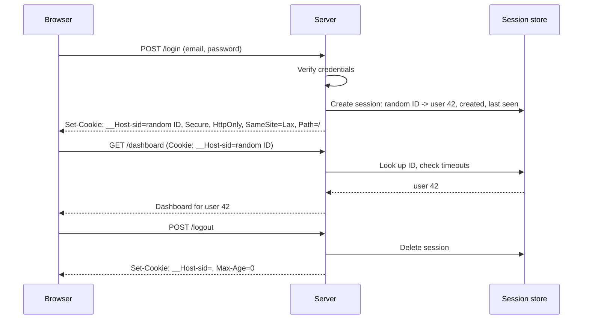
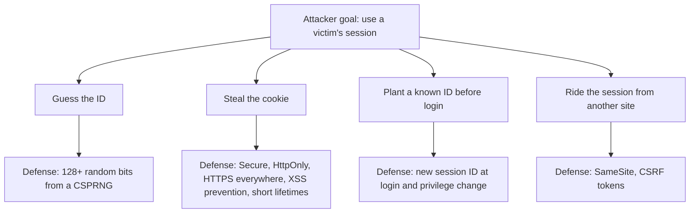

# Sessions and Cookies

## Introduction

HTTP is stateless. Each request arrives on its own, with no memory of the last one. Yet users expect to log in once and stay logged in while they click around. The mechanism that bridges this gap is the **session**: after a successful login, the server hands the browser a token, the browser sends it back on every request, and the server uses it to remember who the user is.

In most web apps that token lives in a **cookie**. That makes the session cookie one of the most valuable things an attacker can steal. With it, they skip the password, the MFA prompt and even the passkey, because authentication already happened.

Think of a session as a cloakroom ticket. You show ID once at the door (login), and get a numbered ticket (session ID). From then on, the ticket is all you need. If someone copies your ticket, they get your coat. Good session design makes tickets hard to guess, hard to steal, short-lived and easy to cancel.

In this page you will learn:

- The two main session designs: **server-side sessions** and **client-side signed sessions**.
- Every security-relevant **cookie attribute** and what it protects against.
- How to prevent **session fixation** and **session hijacking**.
- How to implement **timeouts** and a logout that actually logs out.
- How to choose a session design for a real application.

## How a Session Works



## Server-Side vs Client-Side Sessions

There are two common ways to keep session state.

**Server-side sessions** store a random session ID in the cookie. All data (user ID, roles, timestamps) lives in a server-side store such as Redis or a database table.

**Client-side sessions** store the data itself in the cookie, signed (and sometimes encrypted) so the user cannot change it. Flask's default `session`, Rails' cookie store and many JWT-based setups work this way.

| Aspect | Server-side session | Client-side signed session |
| --- | --- | --- |
| Cookie contents | Opaque random ID | The data itself, signed |
| Revocation (logout, "log out everywhere") | Delete from store, takes effect immediately | Hard: the cookie stays valid until it expires unless you add a server-side denylist or version check |
| Server storage | Needs a shared store | None |
| Data visible to user | No | Yes, unless also encrypted (Flask's default is signed, not encrypted) |
| Size | Small cookie | Grows with data, 4 KB cookie limit |
| Secret key compromise | Not applicable | Attacker can forge any session |

Signed cookies are convenient for small apps. Server-side sessions are the safer default for anything that needs real logout, admin "kill session" features, or compliance requirements around session termination.

:::caution
Flask's built-in session cookie is signed but **not encrypted**. Anyone can base64-decode it and read what you put in it. Never store secrets or personal data there.
:::

## Cookie Attributes That Matter

A `Set-Cookie` header has several attributes. Each closes a specific attack.

| Attribute | What it does | Attack it limits |
| --- | --- | --- |
| `Secure` | Only send over HTTPS | Network sniffing on HTTP |
| `HttpOnly` | JavaScript cannot read it via `document.cookie` | Session theft through XSS (the attacker can still act *as* the user while the XSS runs) |
| `SameSite=Lax` | Not sent on cross-site subrequests and cross-site POSTs; sent on top-level GET navigations | Most CSRF |
| `SameSite=Strict` | Never sent on any cross-site request | CSRF, but users arriving from links appear logged out |
| `SameSite=None` | Always sent, requires `Secure` | Nothing; only for genuine cross-site embedding |
| `Path=/` | Cookie scope by URL path | Not a security boundary on its own |
| `Domain` | When set, the cookie is shared with subdomains | Omit it so a compromised subdomain cannot read or overwrite the cookie |
| `Max-Age` / `Expires` | Persistent cookie lifetime; omit for a browser-session cookie | Long-lived stolen cookies |
| `__Host-` name prefix | Browser rejects the cookie unless it is `Secure`, has `Path=/` and has **no** `Domain` | Cookie injection from subdomains or HTTP |

Chromium-based browsers treat cookies without a `SameSite` attribute as `Lax`, but not every browser does the same, so always set it explicitly. See the [MDN Set-Cookie reference](https://developer.mozilla.org/en-US/docs/Web/HTTP/Reference/Headers/Set-Cookie) for current browser behavior. CSRF in depth is covered in [Cross-Site Request Forgery (CSRF)](../3-sec-web-security/5-sec-csrf.mdx).

A strong session cookie looks like this:

```text
Set-Cookie: __Host-sid=Jw3m8nQz0oVb0f1D9cX5pS2u7yK4eR6tA1hL8gU3iO0; Path=/; Secure; HttpOnly; SameSite=Lax
```

## Building Secure Sessions in Flask

### Vulnerable: insecure configuration and predictable IDs

```python
# Vulnerable
import hashlib
import time
from flask import Flask, make_response, request

app = Flask(__name__)
SESSIONS = {}

@app.post("/login")
def login():
    user_id = 42  # assume the password was checked
    sid = hashlib.md5(f"{user_id}{int(time.time())}".encode()).hexdigest()  # guessable!
    SESSIONS[sid] = user_id
    resp = make_response("ok")
    resp.set_cookie("sid", sid)  # no Secure, no HttpOnly, no SameSite, lives forever in SESSIONS
    return resp
```

Problems: the ID is derived from the user ID and the time, so an attacker can compute it. The cookie can be read by JavaScript, sent over HTTP and sent cross-site. Sessions never expire.

### Fixed: random IDs, hashed storage, strict attributes, timeouts

The fixed version is a minimal server-side session layer. In production you would back it with Redis (for example with Flask-Session), but the logic is the same.

```python
# sessions_app.py
import hashlib
import secrets
import time
from flask import Flask, g, jsonify, make_response, request, abort

app = Flask(__name__)

COOKIE = "__Host-sid"
IDLE_TIMEOUT = 30 * 60          # 30 minutes without activity
ABSOLUTE_TIMEOUT = 12 * 60 * 60  # 12 hours after login, no matter what
STORE = {}  # sha256(session_id) -> session dict. Use Redis or a DB table in production.

def _key(sid: str) -> str:
    # Store only a hash, so a leaked store or log does not reveal live session IDs
    return hashlib.sha256(sid.encode()).hexdigest()

def create_session(user_id: int) -> str:
    sid = secrets.token_urlsafe(32)  # 256 bits from the OS CSPRNG
    now = time.time()
    STORE[_key(sid)] = {"user_id": user_id, "created": now, "last_seen": now}
    return sid

def destroy_session(sid: str) -> None:
    STORE.pop(_key(sid), None)

def destroy_all_sessions(user_id: int) -> int:
    keys = [k for k, s in STORE.items() if s["user_id"] == user_id]
    for k in keys:
        del STORE[k]
    return len(keys)

def set_session_cookie(resp, sid: str):
    resp.set_cookie(COOKIE, sid, secure=True, httponly=True, samesite="Lax", path="/")
    return resp

@app.before_request
def load_session():
    g.user_id = None
    sid = request.cookies.get(COOKIE)
    if not sid:
        return
    s = STORE.get(_key(sid))
    now = time.time()
    if s is None:
        return
    if now - s["last_seen"] > IDLE_TIMEOUT or now - s["created"] > ABSOLUTE_TIMEOUT:
        destroy_session(sid)
        return
    s["last_seen"] = now
    g.user_id = s["user_id"]

@app.post("/login")
def login():
    old_sid = request.cookies.get(COOKIE)
    if old_sid:
        destroy_session(old_sid)  # never reuse a pre-login session ID (prevents fixation)
    user_id = 42                  # assume email, password and MFA were verified
    return set_session_cookie(make_response(jsonify(ok=True)), create_session(user_id))

@app.get("/me")
def me():
    if g.user_id is None:
        abort(401)
    return jsonify(user_id=g.user_id)

@app.post("/logout")
def logout():
    sid = request.cookies.get(COOKIE)
    if sid:
        destroy_session(sid)
    resp = make_response(jsonify(ok=True))
    resp.delete_cookie(COOKIE, path="/", secure=True, httponly=True, samesite="Lax")
    return resp

@app.post("/logout-everywhere")
def logout_everywhere():
    if g.user_id is None:
        abort(401)
    count = destroy_all_sessions(g.user_id)
    return jsonify(revoked=count)
```

Try it with Flask's test client. The test client sends `Secure` cookies to `https://localhost`:

```python
if __name__ == "__main__":
    c = app.test_client()
    base = "https://localhost"
    r = c.post(f"{base}/login")
    print(r.headers["Set-Cookie"].split("=", 1)[0], "...", r.headers["Set-Cookie"].split(";", 1)[1])
    print(c.get(f"{base}/me").get_json())
    print(c.post(f"{base}/logout").get_json())
    print(c.get(f"{base}/me").status_code)
```

Output:

```text
__Host-sid ...  Secure; HttpOnly; Path=/; SameSite=Lax
{'user_id': 42}
{'ok': True}
401
```

What this gives you:

- **Unguessable IDs** from `secrets.token_urlsafe(32)`.
- **Hashed IDs at rest**, so a dump of Redis or a debug log of the store does not hand out live sessions.
- **Idle and absolute timeouts**, checked on the server, not just via cookie expiry.
- **Real logout** and "log out everywhere".
- **Fixation protection**: a new ID is issued at login.

### If you keep Flask's signed-cookie sessions

For a small app, Flask's built-in session can be fine if you harden it:

```python
from datetime import timedelta
from flask import Flask

app = Flask(__name__)
app.config.update(
    SECRET_KEY="load-a-long-random-value-from-your-secret-manager",
    SESSION_COOKIE_NAME="__Host-session",
    SESSION_COOKIE_SECURE=True,
    SESSION_COOKIE_HTTPONLY=True,   # Flask's default is already True
    SESSION_COOKIE_SAMESITE="Lax",
    PERMANENT_SESSION_LIFETIME=timedelta(hours=8),
)
```

Remember the limits: you cannot revoke one specific cookie, and anyone who learns `SECRET_KEY` can forge sessions for any user. A common pattern is to store a `session_version` per user in the database, put it in the cookie, and reject cookies whose version is older than the user's current one. Bumping the version logs out all of that user's devices.

## Session Attacks and Defenses



### Session fixation

In a fixation attack, the attacker gets the victim to use a session ID the attacker already knows, for example through a link with a session ID in the URL or a cookie set from a vulnerable subdomain. When the victim logs in, the server attaches their identity to that ID, and the attacker's copy is now logged in. **Always issue a new session ID at login**, and also when privileges change (such as entering an admin mode). Never accept session IDs from URLs.

### Session hijacking

If an attacker steals a live session cookie, through XSS, malware on the user's machine, a logging mistake or an adversary-in-the-middle phishing proxy, they can replay it. Defenses in layers:

- `HttpOnly` stops simple XSS cookie theft. Preventing XSS stops the rest. See [Cross-Site Scripting (XSS)](../3-sec-web-security/4-sec-xss.mdx).
- Short idle and absolute timeouts limit the window.
- Re-authentication for sensitive actions (step-up) means a stolen cookie cannot change the email or password.
- Anomaly detection: alert or require re-authentication when the same session suddenly appears from a different country or device.
- **Device Bound Session Credentials (DBSC)** is an emerging browser feature that binds a session to a key held in the device's secure hardware, so a copied cookie stops working on another machine. Chrome made it generally available on Windows in 2026. Support in other browsers and platforms is still limited, so check its current status before relying on it.

### Never put session IDs in URLs

URLs end up in browser history, proxy logs, `Referer` headers and screenshots. Keep session identifiers in cookies (or `Authorization` headers for APIs) only.

## Timeouts: How Long Should a Session Live?

There is no single right answer. It depends on risk:

| App type | Idle timeout | Absolute timeout | Notes |
| --- | --- | --- | --- |
| Online banking | 5 to 15 minutes | A few hours | Often required by regulators |
| Internal admin console | 15 to 30 minutes | 8 to 12 hours | Plus step-up for dangerous actions |
| SaaS productivity app | Hours | Days to weeks, with "remember me" | Re-authenticate for sensitive settings |
| Social or content site | Long | Weeks to months | Offer "log out of all devices" |

OWASP's Session Management Cheat Sheet discusses these trade-offs in detail. Whatever you choose, enforce timeouts on the server.

## Real-World Scenario

Your team runs a healthcare scheduling portal with a server-rendered web app and a small JavaScript widget. A security review found that sessions are Flask signed cookies that last 30 days, logging out only deletes the cookie in the browser, and the support team cannot terminate a compromised user's sessions. The auditor also asks how you would respond if a laptop with an active session was stolen.

### The solution

1. Move to **server-side sessions in Redis**, with hashed session IDs as keys and a per-user index so you can revoke all of a user's sessions.
2. Set the cookie as `__Host-sid` with `Secure`, `HttpOnly` and `SameSite=Lax`.
3. Enforce a **15-minute idle timeout** and an **8-hour absolute timeout** for staff, and longer for patients with step-up re-authentication before viewing medical records.
4. Rotate the session ID at login and when a staff member switches into an admin role.
5. Add **"log out all devices"** for users and **"terminate sessions"** for support, both logged for audit.
6. Keep CSRF tokens on state-changing forms as a second layer next to `SameSite`.

### Why this approach

The key requirements are immediate revocation and auditability, which client-side signed sessions cannot provide without adding server-side state anyway. The app is server-rendered on one domain, so cookies work naturally, and `HttpOnly` keeps the session out of reach of JavaScript.

### When to use it, and when not to

- Server-side sessions are the right default for browser-based apps on a single site, especially with sensitive data.
- For a public, read-mostly site with no account data, signed cookies are simpler and good enough.
- For APIs consumed by third parties or mobile apps, bearer tokens (often [JWTs](./5-sec-jwt.mdx) or opaque OAuth access tokens) are more common than cookies.

### Alternatives and trade-offs

| Approach | Pros | Cons | Best for |
| --- | --- | --- | --- |
| Server-side session (Redis/DB) | Instant revocation, small opaque cookie, data hidden | Shared store to run and scale | Most web apps with logins |
| Signed cookie session | No store, simple | No per-session revocation, data readable, key compromise is total | Small apps, low-risk data |
| JWT in `localStorage` | Easy for SPAs calling APIs | Exposed to any XSS, hard to revoke | Rarely the best choice for browsers |
| JWT in `HttpOnly` cookie | Hidden from JavaScript, stateless checks | Still hard to revoke, larger cookies, needs CSRF defenses | Stateless microservices behind one domain |
| Backend-for-frontend (BFF) with cookie session | Tokens never reach the browser, recommended for browser OAuth apps | Extra backend component | SPAs that call OAuth-protected APIs |

## Common Mistakes

- **Predictable session IDs** built from user IDs, timestamps or `random`.
- **Missing `Secure`, `HttpOnly` or `SameSite`.**
- **Setting `Domain=example.com`** without need, which exposes the cookie to every subdomain.
- **Not rotating the session ID at login**, allowing fixation.
- **Logout that only deletes the browser cookie** while the session stays valid on the server.
- **Only client-side expiry.** An attacker with the cookie ignores `Max-Age`.
- **Storing sensitive data in Flask's signed (not encrypted) cookie.**
- **Logging full cookies or `Authorization` headers** in access logs or error trackers.

## Summary

- A session turns one login into many authenticated requests. The session cookie is a bearer credential and must be protected like a password.
- Server-side sessions give instant revocation. Signed client-side sessions avoid a store but are hard to revoke.
- Use `Secure`, `HttpOnly`, `SameSite=Lax` (or `Strict`) and the `__Host-` prefix, and do not set `Domain` unless you must.
- Generate IDs with a CSPRNG, rotate them at login, and enforce idle and absolute timeouts on the server.
- Logout and "log out everywhere" must delete server-side state.

## Exercises

1. Run the `sessions_app.py` example. Add a test that sets `last_seen` 31 minutes in the past and confirms `/me` returns `401`.
2. Replace the dictionary store with Redis using `SETEX` so idle expiry is handled by Redis TTLs. Keep the hashed keys.
3. Add a session version to the Flask signed-cookie variant and write a "log out everywhere" endpoint for it.
4. Open your browser's developer tools on a site you use and inspect its session cookie attributes. Which ones are set, and which are missing?

Next: [JSON Web Tokens](./5-sec-jwt.mdx). Related: [Security Headers, CORS and CSP](../3-sec-web-security/9-sec-security-headers.mdx) and [Randomness and Secure Tokens](../1-sec-cryptography/9-sec-randomness.mdx).
