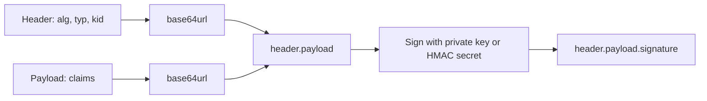
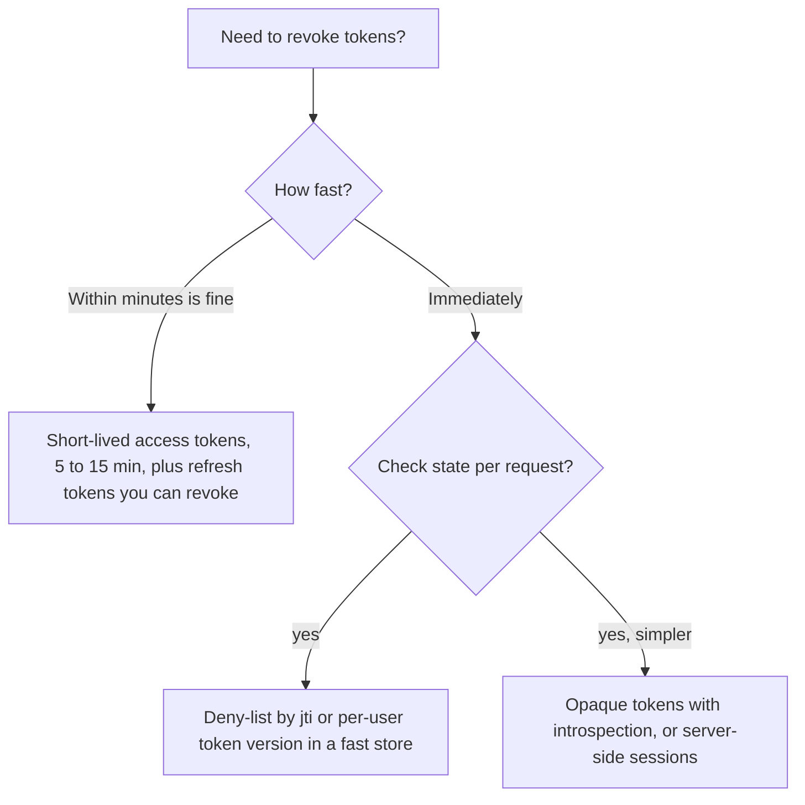

# JSON Web Tokens

## Introduction

A **JSON Web Token (JWT, pronounced "jot")** is a compact, URL-safe string that carries a set of claims, such as "this is user 42, the token was issued by auth.example.com, and it expires at 10:15". The claims are **signed**, so anyone with the right key can check that nobody changed them.

JWTs are everywhere: OAuth 2.0 access tokens, OpenID Connect ID tokens, service-to-service calls, and email verification links. They are popular because a service can validate one **without calling a database or the issuer**. That property is also the source of most JWT problems: a valid JWT stays valid until it expires, even if the user logged out or was fired five minutes ago.

An analogy: a JWT is like a festival wristband. The organizer prints your access level on it and adds a hologram that is hard to fake. Gate staff can check the hologram without phoning the box office. But if someone steals your wristband, the gates will let them in, and the box office has no easy way to cancel a wristband already in the wild.

In this page you will learn:

- How a JWT is built and what each part means.
- The registered claims and the signing algorithms you should and should not use.
- Real JWT vulnerabilities (`alg: none`, algorithm confusion, missing audience checks) with **vulnerable** and **fixed** code.
- How to issue and validate tokens with **PyJWT**, including key rotation with JWKS.
- When a JWT is the right tool, and when a plain session is better.

The core specs are **RFC 7519** (JWT), **RFC 7515** (JWS signatures), **RFC 7516** (JWE encryption), **RFC 7518** (algorithms) and **RFC 8725** (JWT Best Current Practices).

## Anatomy of a JWT

A signed JWT (technically a JWS in compact form) has three base64url-encoded parts separated by dots:

```text
eyJhbGciOiJFUzI1NiIsImtpZCI6IjIwMjYtMTAta2V5LTEiLCJ0eXAiOiJKV1QifQ.eyJpc3MiOiJodHRwczovL2F1dGguZXhhbXBsZS5jb20iLCJzdWIiOiJ1c2VyLTQyIn0.MEUCIQ...signature
```



- **Header**: which algorithm signed it (`alg`), the token type (`typ`) and often a key ID (`kid`).
- **Payload**: the claims.
- **Signature**: computed over `base64url(header) + "." + base64url(payload)`.

:::warning
A signed JWT is **not encrypted**. Base64url is an encoding, not encryption. Anyone holding the token can read every claim. Never put passwords, API keys or sensitive personal data in a JWT payload. If you need confidentiality, use JWE or, better, keep the data on the server.
:::

You can see this in a few lines of Python:

```python
import base64
import json

token = ("eyJhbGciOiJIUzI1NiIsInR5cCI6IkpXVCJ9."
         "eyJzdWIiOiJ1c2VyLTQyIiwicm9sZSI6InN0YWZmIn0."
         "c2lnbmF0dXJlLWdvZXMtaGVyZQ")

def b64url_decode(part: str) -> bytes:
    return base64.urlsafe_b64decode(part + "=" * (-len(part) % 4))

header, payload, _ = token.split(".")
print(json.loads(b64url_decode(header)))
print(json.loads(b64url_decode(payload)))
```

Output:

```text
{'alg': 'HS256', 'typ': 'JWT'}
{'sub': 'user-42', 'role': 'staff'}
```

## Registered Claims

| Claim | Name | What to check |
| --- | --- | --- |
| `iss` | Issuer | Exactly matches the issuer you trust |
| `sub` | Subject | The user or client the token is about |
| `aud` | Audience | Contains *your* service's identifier |
| `exp` | Expiration time | In the future (allow small clock skew) |
| `nbf` | Not before | In the past |
| `iat` | Issued at | Reasonable; useful for "tokens issued before X are invalid" |
| `jti` | JWT ID | Unique ID; lets you detect replay or deny-list a token |

The **audience check** is the one most often forgotten. Without it, a token issued for your low-security reporting service is also accepted by your payments service if both trust the same issuer.

## Choosing an Algorithm

| `alg` | Type | Key | Notes |
| --- | --- | --- | --- |
| `HS256` | HMAC with SHA-256 | Shared secret | Fast. Every verifier can also *mint* tokens. Secret must be long and random (at least 32 bytes) |
| `RS256` | RSA PKCS#1 v1.5 | RSA key pair | Widely supported. Large keys and signatures |
| `PS256` | RSA-PSS | RSA key pair | Modern RSA padding |
| `ES256` | ECDSA P-256 | EC key pair | Small signatures, widely supported |
| `EdDSA` | Ed25519 | Ed25519 key pair | Fast, simple, deterministic. Support is broad but check each verifier |
| `none` | No signature | None | **Never accept** |

**Rule of thumb:** use HMAC (`HS256`) only when the issuer and the verifier are the same service. When different services verify tokens, use asymmetric keys (`ES256`, `EdDSA` or `RS256`) so verifiers hold only the public key and cannot forge tokens.

## Issuing and Validating with PyJWT

```bash
pip install "pyjwt[crypto]"
```

The `[crypto]` extra installs `cryptography`, which PyJWT needs for RSA, EC and EdDSA. These examples were checked against PyJWT 2.15. See the [PyJWT API reference](https://pyjwt.readthedocs.io/en/stable/api.html) for the current version.

### Issuing a token

```python
# issue.py
from datetime import datetime, timedelta, timezone
import secrets
import jwt
from cryptography.hazmat.primitives.asymmetric import ec

PRIVATE_KEY = ec.generate_private_key(ec.SECP256R1())  # load from a KMS or secret store in production
PUBLIC_KEY = PRIVATE_KEY.public_key()
ISSUER = "https://auth.example.com"

def issue_access_token(user_id: str, audience: str, scopes: list[str]) -> str:
    now = datetime.now(timezone.utc)
    claims = {
        "iss": ISSUER,
        "sub": user_id,
        "aud": audience,
        "iat": now,
        "nbf": now,
        "exp": now + timedelta(minutes=10),  # short-lived
        "jti": secrets.token_urlsafe(16),
        "scope": " ".join(scopes),
    }
    return jwt.encode(claims, PRIVATE_KEY, algorithm="ES256",
                      headers={"kid": "2026-10-key-1", "typ": "at+jwt"})

token = issue_access_token("user-42", "orders-api", ["orders:read"])
print(jwt.get_unverified_header(token))
```

Output:

```text
{'alg': 'ES256', 'kid': '2026-10-key-1', 'typ': 'at+jwt'}
```

The `typ` value `at+jwt` comes from **RFC 9068**, the JWT profile for OAuth 2.0 access tokens. Explicit types help verifiers reject an ID token or other JWT that is presented where an access token is expected.

### Vulnerable validation

These are real patterns found in production code:

```python
# Vulnerable: three different mistakes
def get_user_bad(token: str) -> dict:
    # 1. Reads claims without checking the signature at all
    claims = jwt.decode(token, options={"verify_signature": False})
    return claims

def get_user_bad2(token: str, key) -> dict:
    # 2. Lets the attacker choose the algorithm through the header
    alg = jwt.get_unverified_header(token)["alg"]
    # 3. No audience or issuer check: any token from any issuer and for any service passes
    return jwt.decode(token, key, algorithms=[alg], options={"verify_aud": False})
```

- **Mistake 1** means anyone can write `{"sub": "admin"}`, base64 it, and be admin.
- **Mistake 2** enables the classic attacks: `alg: none` (no signature at all) and **algorithm confusion**, where an attacker switches `RS256` to `HS256` and signs with the server's *public* key as if it were an HMAC secret. Libraries have had CVEs for both.
- **Mistake 3** lets tokens meant for other services, or other issuers sharing the key infrastructure, be replayed against yours.

### Fixed validation

```python
# Fixed
from jwt import InvalidTokenError

def validate_access_token(token: str) -> dict:
    return jwt.decode(
        token,
        PUBLIC_KEY,
        algorithms=["ES256"],          # allow-list chosen by the server, never by the token
        audience="orders-api",         # this service's identifier
        issuer=ISSUER,
        leeway=30,                      # seconds of clock skew
        options={"require": ["exp", "iat", "iss", "aud", "sub"]},
    )

claims = validate_access_token(token)
print(claims["sub"], claims["scope"])

wrong_aud = issue_access_token("user-42", "reports-api", ["reports:read"])
try:
    validate_access_token(wrong_aud)
except InvalidTokenError as e:
    print(type(e).__name__, "-", e)
```

Output:

```text
user-42 orders:read
InvalidAudienceError - Audience doesn't match
```

Notes on PyJWT behavior:

- `algorithms` is effectively mandatory. PyJWT raises an error when you verify a signature without it.
- Some claims (`exp`, `nbf`, `iat`) are only checked **if present**. The `require` option makes sure they are present.
- PyJWT refuses to use an asymmetric public key as an HMAC secret, which blocks the classic algorithm confusion attack:

```python
import base64, hashlib, hmac, json
from cryptography.hazmat.primitives import serialization

def b64(b: bytes) -> str:
    return base64.urlsafe_b64encode(b).rstrip(b"=").decode()

pub_pem = PUBLIC_KEY.public_bytes(serialization.Encoding.PEM,
                                  serialization.PublicFormat.SubjectPublicKeyInfo)
h = b64(json.dumps({"alg": "HS256", "typ": "JWT"}).encode())
p = b64(json.dumps({"sub": "admin", "aud": "orders-api", "iss": ISSUER, "exp": 9999999999}).encode())
forged = f"{h}.{p}." + b64(hmac.new(pub_pem, f"{h}.{p}".encode(), hashlib.sha256).digest())

for algs in (["ES256"], ["ES256", "HS256"]):
    try:
        jwt.decode(forged, pub_pem, algorithms=algs, audience="orders-api")
    except jwt.PyJWTError as e:  # base class of InvalidTokenError and InvalidKeyError
        print(algs, type(e).__name__)
```

Output:

```text
['ES256'] InvalidAlgorithmError
['ES256', 'HS256'] InvalidKeyError
```

Even so, never mix symmetric and asymmetric algorithms in one allow-list. Defense in depth means not relying on one library check.

### Verifying tokens from an identity provider with JWKS

When tokens come from an external issuer (Auth0, Okta, Microsoft Entra ID, Keycloak, Google), you fetch its public keys from a **JWKS** (JSON Web Key Set) URL, usually listed in its OpenID Connect discovery document. Keys rotate, so pick the key by `kid` and cache the set:

```python
from jwt import PyJWKClient

JWKS_URL = "https://auth.example.com/.well-known/jwks.json"
jwks_client = PyJWKClient(JWKS_URL, cache_keys=True)

def validate_from_idp(token: str) -> dict:
    signing_key = jwks_client.get_signing_key_from_jwt(token)  # looks up the token's kid
    return jwt.decode(
        token,
        signing_key.key,
        algorithms=["RS256", "ES256"],  # only the asymmetric algorithms your IdP uses
        audience="api://orders",
        issuer="https://auth.example.com/",
    )
```

Fetch keys only from the **configured** JWKS URL. Never follow `jku` or `x5u` URLs found inside the token header, since an attacker controls those.

## The Revocation Problem

A JWT is valid until `exp`, regardless of what happens on the server. Options to handle logout, password changes and compromised tokens:



- **Short expiry plus refresh tokens** is the standard approach. The refresh token is long-lived but stored server-side or rotated on each use, so it *can* be revoked. See [OAuth 2.0](./6-sec-oauth2.mdx) for refresh token rotation.
- **A deny-list** of `jti` values (or a per-user "tokens issued before time T are invalid" marker) gives immediate revocation, at the cost of a lookup per request. That lookup is often still cheaper than a full session lookup because it only stores revoked entries.
- If you need to look up state on every request anyway, ask whether a server-side session or an opaque token would be simpler.

## Where to Store JWTs in a Browser

| Storage | XSS can steal it? | Sent automatically (CSRF risk)? | Verdict |
| --- | --- | --- | --- |
| `localStorage` / `sessionStorage` | Yes | No | Avoid for long-lived or powerful tokens |
| JavaScript memory only | Yes, while the page runs | No | Better, but lost on reload |
| `HttpOnly; Secure; SameSite` cookie | Not readable, but XSS can still make requests | Yes, so add CSRF protection | Reasonable for same-site apps |
| Not in the browser at all (BFF) | No tokens to steal | Session cookie only | Recommended for sensitive browser apps |

The IETF's **OAuth 2.0 for Browser-Based Applications** guidance (published in 2026 as RFC 10017, a Best Current Practice) strongly recommends the backend-for-frontend (BFF) pattern for business and sensitive applications. More on this in [OAuth 2.0](./6-sec-oauth2.mdx).

## Real-World Scenario

Your team is splitting a monolithic e-commerce app into services: `catalog`, `orders` and `payments`. Each service needs to know who the caller is. A teammate proposes "JWTs everywhere, signed with one shared HS256 secret, valid for 24 hours, stored in `localStorage`."

### The solution

1. **Browser to backend:** keep a server-side session cookie between the browser and a BFF or API gateway. The browser never sees a JWT.
2. **Gateway to services:** the gateway exchanges the session for a **short-lived (5 minute) ES256 JWT** per request or per session, with `aud` set to the target service and only the scopes needed.
3. **Signing keys** live in a KMS. Services fetch public keys from an internal JWKS endpoint and select by `kid`, so keys can rotate without redeploys.
4. **Each service validates** algorithm, issuer, audience and expiry, then performs its own object-level authorization (a valid token does not mean "may access order 1002").
5. **Revocation:** user logout deletes the session at the gateway, so no new tokens are minted, and outstanding tokens expire within 5 minutes. Payments additionally checks a deny-list for immediate kills.

### Why this approach

- A shared HS256 secret means any compromised service can mint tokens for every other service. Asymmetric keys limit verifiers to verifying.
- Per-service audiences stop a token stolen from `catalog` (low value) from working against `payments`.
- 24-hour tokens in `localStorage` turn any XSS bug into a day-long account takeover. Short tokens kept server-side shrink that window.

### When to use JWTs, and when not to

- **Use them** for stateless verification across services or organizations, for OAuth access tokens consumed by several APIs, and for short-lived signed links.
- **Avoid them** as a replacement for browser sessions in a single app. A session cookie is simpler, smaller and revocable.

### Alternatives and trade-offs

| Approach | Pros | Cons | Best for |
| --- | --- | --- | --- |
| Server-side session cookie | Simple, instant revocation | Needs shared session store; awkward across many domains | Browser apps on one site |
| JWT (asymmetric, short-lived) | Stateless verification, carries claims, works across services | Revocation is delayed; easy to misconfigure | Service-to-service, multi-API OAuth |
| Opaque token plus introspection (RFC 7662) | Instant revocation, no claims leaked | Network call to the auth server per validation (cacheable) | High-security APIs, third-party clients |
| PASETO or other alternative token formats | Fewer algorithm choices to get wrong | Smaller ecosystem, less IdP support | Internal systems where you control both ends |
| Mutual TLS between services | Strong service identity, no tokens to steal | Certificate management; does not carry end-user identity | Service identity in a mesh |

## Common Mistakes

- **Decoding without verifying**, or verifying with `algorithms` taken from the token header.
- **Accepting `alg: none`** or mixing HMAC and RSA/EC algorithms in one allow-list.
- **Not checking `aud` and `iss`.**
- **Weak HMAC secrets** like `secret` or a short word. They can be brute-forced offline from any captured token. PyJWT now warns when an HMAC key is shorter than the hash output.
- **Long expiry with no revocation plan.**
- **Sensitive data in the payload**, which any holder can read.
- **Trusting `kid`, `jku` or `x5u` blindly.** A `kid` should only select among keys you already trust, never become a file path or SQL value.
- **Using the ID token as an API access token.** ID tokens are for the client app, not for APIs. See [OpenID Connect](./7-sec-oidc.mdx).

## Summary

- A JWT is a signed (not encrypted) set of claims: header, payload and signature in base64url.
- Always validate the signature with a server-chosen algorithm allow-list, and check `exp`, `iss` and `aud`.
- Use asymmetric algorithms (ES256, EdDSA, RS256) when other services verify tokens. Keep HMAC for same-service use with long random secrets.
- Rotate keys with `kid` and JWKS, and fetch keys only from configured URLs.
- Keep access tokens short-lived and plan for revocation with refresh tokens, deny-lists or opaque tokens.
- For browser apps, prefer session cookies or a BFF over storing JWTs in `localStorage`.

## Exercises

1. Using PyJWT, issue an EdDSA token with an Ed25519 key and validate it. Then change one character in the payload and confirm validation fails.
2. Add a `jti` deny-list to `validate_access_token` and a `/logout` function that adds the current token's `jti` with a TTL equal to its remaining lifetime.
3. In a local OWASP Juice Shop instance or PortSwigger Web Security Academy's JWT labs (both built for practice), study how the unverified-signature and algorithm-confusion labs work. Write down which line of the fixed code above would have blocked each.
4. Write a short design note for your team comparing JWTs and server-side sessions for your current project, using the trade-off table.

Next: [OAuth 2.0](./6-sec-oauth2.mdx). Related: [Digital Signatures and MACs](../1-sec-cryptography/5-sec-digital-signatures.mdx), [Key Management](../1-sec-cryptography/8-sec-key-management.mdx) and [Sessions and Cookies](./4-sec-sessions-and-cookies.mdx).
