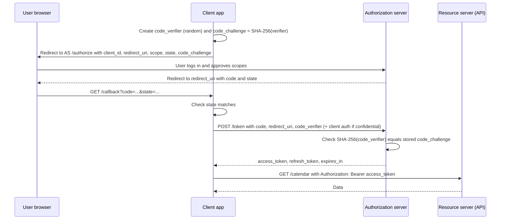

# OAuth 2.0

## Introduction

Before OAuth, if a photo-printing site wanted your pictures from another service, it asked for your password for that service. You handed over the keys to everything, forever, with no way to limit or take back access except changing your password.

**OAuth 2.0** (RFC 6749) solves that. It is a framework for **delegated authorization**: a user lets one application (the *client*) access their data at another service (the *resource server*) with limited permissions, without sharing their password. The client gets an **access token** that says "this app may read this user's photos for the next hour" and nothing more.

The usual analogy is a hotel key card. The front desk (authorization server) checks who you are and programs a card (access token) that opens your room and the gym (scopes) until checkout (expiry). The card does not open other rooms, the reception safe or the manager's office, and the desk can cancel it at any time.

:::info
OAuth 2.0 is about **authorization**, not authentication. An access token tells an API what a client may do. It does not tell the client who the user is in a standard way. For login, use [OpenID Connect](./7-sec-oidc.mdx), which is built on top of OAuth 2.0.
:::

In this page you will learn:

- The four OAuth roles and the main grant types.
- How the **authorization code flow with PKCE** works, step by step, with Python code.
- **Client credentials** for machine-to-machine calls.
- **Refresh tokens** with rotation and reuse detection.
- The current security rules from **RFC 9700** (OAuth 2.0 Security Best Current Practice, January 2025), and where OAuth 2.1 fits.

## The Four Roles

| Role | Who it is | Example |
| --- | --- | --- |
| Resource owner | The user who owns the data | Alice |
| Client | The application wanting access | A calendar-sync app |
| Authorization server (AS) | Authenticates the user, asks for consent, issues tokens | Google's or Microsoft's identity platform, Keycloak, Auth0, Okta |
| Resource server (RS) | The API holding the data, which accepts access tokens | The Calendar API |

Clients come in two types:

- **Confidential clients** can keep a secret, such as a server-side web app.
- **Public clients** cannot, such as single-page apps, mobile apps and CLIs, because anyone can extract a secret from code shipped to users.

## Grant Types: Which Flow When

| Grant | Use it for | Status |
| --- | --- | --- |
| Authorization code **with PKCE** | Any app acting on behalf of a user (web, SPA, mobile, desktop) | Recommended for all clients |
| Client credentials | Machine-to-machine, no user involved | Recommended |
| Device authorization (RFC 8628) | TVs, CLIs and devices without a good browser | Recommended for those devices |
| Refresh token | Getting new access tokens without user interaction | Recommended, with rotation or sender-constraining for public clients |
| Implicit | Old SPA flow returning tokens in the URL | **Deprecated**. RFC 9700 says clients should not use it |
| Resource owner password credentials (ROPC) | Client collects the user's password | **Must not be used** according to RFC 9700 |

The draft **OAuth 2.1** specification consolidates these rules: it requires PKCE for the authorization code flow, removes the implicit and password grants, and requires exact redirect URI matching. As of late 2026 it is still an IETF Internet-Draft, not an RFC, but most providers already behave this way. Check the [datatracker page](https://datatracker.ietf.org/doc/draft-ietf-oauth-v2-1/) for its current status.

## The Authorization Code Flow with PKCE



The **authorization code** is a short-lived, single-use ticket that travels through the browser. The **tokens** are only delivered on the back channel from the AS to the client. That keeps access tokens out of browser history, logs and `Referer` headers, which was the main problem with the implicit flow.

### What PKCE adds

**PKCE** (Proof Key for Code Exchange, RFC 7636, pronounced "pixy") protects against stolen authorization codes. The client makes up a random secret (`code_verifier`) for each login, sends only its hash (`code_challenge`) in the first request, and reveals the verifier when redeeming the code. An attacker who intercepts the code through a malicious app, a log or a leaked redirect cannot redeem it without the verifier.

```python
import base64
import hashlib
import secrets

def make_pkce_pair() -> tuple[str, str]:
    verifier = secrets.token_urlsafe(64)[:96]  # 43 to 128 characters allowed
    digest = hashlib.sha256(verifier.encode("ascii")).digest()
    challenge = base64.urlsafe_b64encode(digest).rstrip(b"=").decode("ascii")
    return verifier, challenge

def challenge_for(verifier: str) -> str:
    digest = hashlib.sha256(verifier.encode("ascii")).digest()
    return base64.urlsafe_b64encode(digest).rstrip(b"=").decode("ascii")

# Test vector from RFC 7636 Appendix B
print(challenge_for("dBjftJeZ4CVP-mB92K27uhbUJU1p1r_wW1gFWFOEjXk"))
v, c = make_pkce_pair()
print(len(v), len(c))
```

Output:

```text
E9Melhoa2OwvFrEMTJguCHaoeK1t8URWbuGJSstw-cM
86 43
```

Always use the `S256` method, never `plain`.

### Building the client in Flask

In real projects, use a well-maintained library such as Authlib, or your identity provider's SDK. The manual version below shows each security check so you know what the library is doing for you.

```bash
pip install flask requests
```

```python
# oauth_client.py
import secrets
from urllib.parse import urlencode
import requests
from flask import Flask, abort, redirect, request, session

app = Flask(__name__)
app.secret_key = "dev-only-change-me"

AS_AUTHORIZE = "https://auth.example.com/oauth2/authorize"
AS_TOKEN = "https://auth.example.com/oauth2/token"
CLIENT_ID = "calendar-sync"
CLIENT_SECRET = "load-from-secret-manager"   # confidential client only
REDIRECT_URI = "https://sync.example.org/callback"  # registered exactly at the AS

@app.get("/connect")
def connect():
    verifier, challenge = make_pkce_pair()
    state = secrets.token_urlsafe(32)
    session["oauth"] = {"state": state, "verifier": verifier}
    params = {
        "response_type": "code",
        "client_id": CLIENT_ID,
        "redirect_uri": REDIRECT_URI,
        "scope": "calendar.read",          # ask for the least you need
        "state": state,                    # CSRF protection for the callback
        "code_challenge": challenge,
        "code_challenge_method": "S256",
    }
    return redirect(f"{AS_AUTHORIZE}?{urlencode(params)}")

@app.get("/callback")
def callback():
    pending = session.pop("oauth", None)  # single use
    if not pending or not secrets.compare_digest(request.args.get("state", ""), pending["state"]):
        abort(400, "Invalid state")
    if "error" in request.args:
        abort(400, "Authorization denied")
    resp = requests.post(
        AS_TOKEN,
        data={
            "grant_type": "authorization_code",
            "code": request.args["code"],
            "redirect_uri": REDIRECT_URI,
            "code_verifier": pending["verifier"],
        },
        auth=(CLIENT_ID, CLIENT_SECRET),  # HTTP Basic client authentication
        timeout=10,
    )
    resp.raise_for_status()
    tokens = resp.json()
    store_tokens_encrypted(user_id=session["user_id"], tokens=tokens)
    return redirect("/settings/integrations")

def store_tokens_encrypted(user_id, tokens):
    ...  # encrypt refresh tokens at rest; never log them
```

Things to notice:

- `state` is random per request, stored server-side, compared in constant time and used once. Without it, an attacker can feed their own authorization code into your callback and link *their* account to the victim's session (login CSRF).
- The `redirect_uri` is a fixed, pre-registered value, never built from user input.
- Tokens go into encrypted server-side storage, not into the browser.

## Vulnerable vs Fixed: Redirect URI Validation

If you build or configure an authorization server, redirect URI checks are critical. A loose check lets an attacker send authorization codes (or, in the old implicit flow, tokens) to a site they control.

**Vulnerable:**

```python
REGISTERED = {"calendar-sync": "https://sync.example.org/callback"}

def redirect_allowed_bad(client_id: str, redirect_uri: str) -> bool:
    # Prefix match: also allows https://sync.example.org.attacker.net/... and /callback/../evil
    return redirect_uri.startswith(REGISTERED[client_id].rsplit("/", 1)[0])
```

**Fixed:**

```python
REGISTERED_URIS = {"calendar-sync": {"https://sync.example.org/callback"}}

def redirect_allowed(client_id: str, redirect_uri: str) -> bool:
    # RFC 9700: exact string matching against pre-registered URIs
    return redirect_uri in REGISTERED_URIS.get(client_id, set())

for uri in ["https://sync.example.org/callback",
            "https://sync.example.org.attacker.net/callback",
            "https://sync.example.org/callback?next=https://evil.test"]:
    print(redirect_allowed_bad("calendar-sync", uri), redirect_allowed("calendar-sync", uri), uri)
```

Output:

```text
True True https://sync.example.org/callback
True False https://sync.example.org.attacker.net/callback
True False https://sync.example.org/callback?next=https://evil.test
```

RFC 9700 allows one exception: native apps using loopback redirects (`http://127.0.0.1:PORT/...`) may vary the port number.

## Client Credentials: Machine to Machine

When no user is involved, such as a nightly billing job calling an invoicing API, the client authenticates as itself:

```python
import requests

def get_service_token() -> str:
    resp = requests.post(
        "https://auth.example.com/oauth2/token",
        data={"grant_type": "client_credentials", "scope": "invoices.write"},
        auth=("billing-job", "load-from-secret-manager"),
        timeout=10,
    )
    resp.raise_for_status()
    body = resp.json()
    return body["access_token"]  # cache until shortly before body["expires_in"]
```

Client secrets are still shared secrets. For stronger setups, authenticate the client with a **private key JWT** (`private_key_jwt`, defined in OpenID Connect and RFC 7523) or **mutual TLS** (RFC 8705), so no secret is sent over the wire. See [API Keys and Service Authentication](./10-sec-api-authentication.mdx).

## Scopes and Consent

Scopes describe *what* the client may do: `calendar.read`, `repo:status`, `invoices.write`. Good scope design:

- Separate read from write, and narrow from broad.
- Ask for the minimum at first, and request more later (incremental authorization) when the user uses a feature.
- On the resource server, check scopes **and** object ownership. A token with `calendar.read` for Alice must not read Bob's calendar.

## Refresh Tokens: Rotation and Reuse Detection

Access tokens should be short-lived (minutes). Refresh tokens let the client get new ones without asking the user again. Because a refresh token is long-lived and powerful, RFC 9700 says refresh tokens for public clients must be **sender-constrained** (bound to a key, as with DPoP or mutual TLS) or use **refresh token rotation**.

With rotation, every refresh returns a *new* refresh token and invalidates the old one. If an old token is ever used again, someone has a copy, so the server revokes the whole token family.

```python
import hashlib
import secrets

FAMILIES = {}  # token_hash -> {"family": id, "used": bool}
REVOKED_FAMILIES = set()

def _h(t: str) -> str:
    return hashlib.sha256(t.encode()).hexdigest()

def issue_refresh(family: str | None = None) -> str:
    token = secrets.token_urlsafe(32)
    FAMILIES[_h(token)] = {"family": family or secrets.token_hex(8), "used": False}
    return token

def rotate(old: str) -> str | None:
    rec = FAMILIES.get(_h(old))
    if rec is None or rec["family"] in REVOKED_FAMILIES:
        return None
    if rec["used"]:
        REVOKED_FAMILIES.add(rec["family"])  # reuse detected: kill the whole family
        return None
    rec["used"] = True
    return issue_refresh(rec["family"])

t1 = issue_refresh()
t2 = rotate(t1)            # legitimate client refreshes
print(t2 is not None)
print(rotate(t1))          # attacker replays the stolen old token
print(rotate(t2))          # legitimate client is now also cut off and must log in again
```

Output:

```text
True
None
None
```

Cutting off the legitimate client is intentional. It forces a fresh login and signals that a token was stolen.

### Sender-constrained tokens

A normal access token is a **bearer token**: whoever holds it can use it. Two standards bind tokens to a key held by the client, so a stolen token is useless alone:

- **DPoP** (RFC 9449): the client signs a small proof JWT for each request with its own key.
- **Mutual TLS** (RFC 8705): the token is bound to the client's TLS certificate.

These are increasingly required in high-security profiles such as FAPI 2.0 for open banking.

## OAuth in Browser Apps

Single-page apps are public clients and run in an environment exposed to XSS. The IETF's **OAuth 2.0 for Browser-Based Applications** (published in 2026 as RFC 10017, a Best Current Practice) ranks three architectures:

1. **Backend for Frontend (BFF)**: a small server acts as a confidential client and keeps all tokens. The browser only gets an `HttpOnly` session cookie. Strongly recommended for business, sensitive and personal-data apps.
2. **Token-mediating backend**: the backend gets tokens and passes access tokens to the browser, keeping refresh tokens server-side.
3. **Browser-only client**: the SPA does the full flow and stores tokens itself. Not recommended for sensitive apps.

## Real-World Scenario

Your team runs a project-management SaaS. Customers want two things: a "Connect Google Calendar" feature, and a public API so they can build their own integrations. The current public API uses a single static API key per account that has full admin rights, and customers paste it into many third-party tools.

### The solution

1. **For Google Calendar**, act as a confidential OAuth client: authorization code with PKCE, `state`, a minimal read-only calendar scope, and encrypted storage of the refresh token.
2. **For your public API**, run your own authorization server (or a managed one such as Keycloak, Auth0 or Okta) and let third-party apps register as OAuth clients. Users approve scopes like `tasks:read` and `tasks:write` per app.
3. **For customer scripts and back-office jobs**, offer client credentials with narrow scopes, or scoped API keys for simple cases.
4. **Show users their connected apps** with scopes and last use, and a "Revoke" button that kills that app's refresh token family.

### Why this approach

The static admin API key gives every integration full access, cannot be limited to one feature, and cannot be revoked for one app without breaking all the others. OAuth gives per-app, per-user, per-scope tokens that expire and can be revoked individually, and users never share passwords with third parties.

### When to use it, and when not to

- Use OAuth whenever a **third party** acts on behalf of **your users**, or when one identity platform issues tokens for many APIs.
- Do not use OAuth to log users into your own single web app without OIDC. That is a job for sessions plus OIDC or plain password and passkey login.
- For a single internal script calling one internal API, a scoped API key or a workload identity may be simpler.

### Alternatives and trade-offs

| Approach | Pros | Cons | Best for |
| --- | --- | --- | --- |
| Sharing the user's password | None worth having | Full access, no revocation, trains users to be phished | Never |
| Static account API key | Very simple | Over-privileged, long-lived, shared across tools | Quick internal scripts with narrow keys |
| OAuth authorization code + PKCE | Per-user, per-app consent, scoped, revocable | More moving parts, needs an AS | Third-party integrations, mobile and web apps |
| OAuth client credentials | Standard M2M, short-lived tokens | Client secret still needs protection | Service-to-service and scheduled jobs |
| Sender-constrained tokens (DPoP, mTLS) | Stolen tokens are useless alone | More client complexity, uneven library support | Finance, health, high-value APIs |

## Common Mistakes

- **Using the implicit or password grant** in new code.
- **Missing or static `state`**, enabling login CSRF and code injection.
- **Skipping PKCE** because the client is confidential. RFC 9700 recommends PKCE for confidential clients too.
- **Loose redirect URI matching** (prefixes, wildcards, open redirects on the registered domain).
- **Over-broad scopes** such as requesting full mailbox access to read one calendar.
- **Storing tokens in `localStorage`** in a SPA handling sensitive data.
- **Logging tokens** in URLs, access logs or error reports.
- **Treating an access token as proof of login.** Use OIDC ID tokens for authentication.
- **Long-lived refresh tokens without rotation or binding** for public clients.

## Summary

- OAuth 2.0 delegates limited, revocable access without sharing passwords. It is authorization, not authentication.
- Use authorization code with PKCE (`S256`) for anything with a user, client credentials for machines, and the device flow for input-limited devices.
- RFC 9700 deprecates implicit and password grants, requires exact redirect URI matching, and recommends PKCE everywhere.
- Validate `state`, keep tokens server-side where possible, and request minimal scopes.
- Rotate refresh tokens with reuse detection, or bind tokens with DPoP or mTLS.
- For browser apps, prefer the BFF pattern.

## Exercises

1. Run a local Keycloak in Docker, register a confidential client, and complete the authorization code + PKCE flow with the Flask example. Inspect each request in your browser's network tab.
2. Modify `redirect_allowed_bad` in three different ways an attacker might exploit, and confirm `redirect_allowed` rejects all of them.
3. Extend the refresh token example to expire families after 30 days of inactivity and to record which client and user each family belongs to.
4. List the OAuth apps connected to one of your own accounts (Google, GitHub or Microsoft). Revoke any you no longer use, and note which scopes each one had.

Next: [OpenID Connect](./7-sec-oidc.mdx). Related: [JSON Web Tokens](./5-sec-jwt.mdx), [API Security Introduction](../7-sec-api-security/0-sec-api-security-introduction.mdx) and [Webhook Security](../7-sec-api-security/6-sec-webhook-security.mdx).
