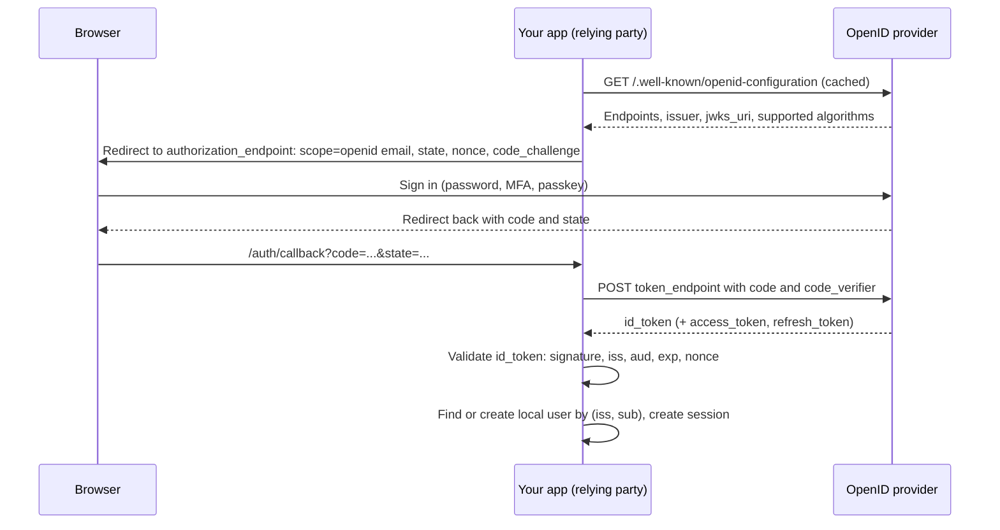

# OpenID Connect

## Introduction

[OAuth 2.0](./6-sec-oauth2.mdx) lets an app get an access token to call an API. But many teams want something else: "Let users **sign in** with their Google, Microsoft or company account." OAuth alone does not define how a client learns *who* logged in. Early "Login with X" integrations each invented their own way, and many got it wrong, for example by treating any access token as proof of identity.

**OpenID Connect (OIDC)** is the standard identity layer on top of OAuth 2.0. It adds:

- An **ID token**: a signed JWT that tells the client who the user is, who vouched for them, and when and how they authenticated.
- A **UserInfo endpoint** for profile claims.
- **Discovery** (`/.well-known/openid-configuration`) so clients can find endpoints and keys automatically.
- Standard **scopes** (`openid`, `profile`, `email`) and **claims** (`sub`, `email`, `name`).

Using the hotel analogy from the OAuth page: the access token is the key card for rooms. The ID token is the front desk's signed note to the restaurant saying "this guest is Alice Chen, checked in at 3 p.m. with a passport". The restaurant (your app) uses that note to know who you are, not to open doors.

In this page you will:

- Learn the OIDC flow and what is inside an ID token.
- Validate ID tokens correctly, including the **nonce**.
- Build "Sign in with ..." in Flask using **Authlib**.
- Avoid the account-takeover bugs caused by matching users by email.
- Choose between social login, enterprise login and your own passwords.

## The OIDC Flow

OIDC reuses the OAuth authorization code flow with PKCE, adding the `openid` scope and a `nonce`.



In OIDC terms, your app is the **relying party (RP)** and the identity provider is the **OpenID Provider (OP)**.

After validation, your app creates its **own session** for the user (see [Sessions and Cookies](./4-sec-sessions-and-cookies.mdx)). The ID token is consumed at login. It is not something you send to your APIs on every request.

## Inside an ID Token

A decoded ID token payload:

```json
{
  "iss": "https://accounts.example-idp.com",
  "sub": "248289761001",
  "aud": "my-client-id",
  "exp": 1791374400,
  "iat": 1791370800,
  "auth_time": 1791370790,
  "nonce": "n-0S6_WzA2Mj",
  "amr": ["pwd", "otp"],
  "acr": "urn:example:mfa",
  "email": "alice@example.com",
  "email_verified": true,
  "name": "Alice Chen"
}
```

| Claim | Meaning | Validation |
| --- | --- | --- |
| `iss` | Issuer identifier | Must exactly equal the issuer from discovery |
| `sub` | Subject: stable, unique user ID **within that issuer** | Use `(iss, sub)` as the user's key |
| `aud` | Audience | Must contain your `client_id` |
| `azp` | Authorized party | If present with multiple audiences, must be your `client_id` |
| `exp`, `iat` | Expiry and issue time | Within allowed clock skew |
| `nonce` | Value you sent in the auth request | Must match the value stored in your session |
| `auth_time` | When the user actually authenticated | Check against `max_age` if you requested it |
| `amr`, `acr` | How the user authenticated, and the assurance level | Check for MFA when your policy requires it |

### Why `sub` and not `email`

`sub` never changes for that user at that provider. Email addresses change, get recycled and, at some providers, are not verified. Many account-takeover bugs come from code like "if an existing account has this email, log them in".

## Validating an ID Token Yourself

Libraries do this for you, but you should know exactly what they check. Here is a validator with PyJWT and a locally generated key, so it runs offline:

```python
# validate_id_token.py
import secrets
from datetime import datetime, timedelta, timezone
import jwt
from cryptography.hazmat.primitives.asymmetric import rsa

ISSUER = "https://accounts.example-idp.com"
CLIENT_ID = "my-client-id"

# Simulate the provider's signing key. Real code fetches keys from jwks_uri (PyJWKClient).
idp_key = rsa.generate_private_key(public_exponent=65537, key_size=2048)

def provider_issues_id_token(nonce: str, aud: str = CLIENT_ID) -> str:
    now = datetime.now(timezone.utc)
    return jwt.encode(
        {"iss": ISSUER, "sub": "248289761001", "aud": aud, "iat": now,
         "exp": now + timedelta(minutes=5), "auth_time": int(now.timestamp()),
         "nonce": nonce, "email": "alice@example.com", "email_verified": True},
        idp_key, algorithm="RS256", headers={"kid": "k1"},
    )

def validate_id_token(id_token: str, expected_nonce: str, max_age: int | None = None) -> dict:
    claims = jwt.decode(
        id_token,
        idp_key.public_key(),
        algorithms=["RS256"],
        audience=CLIENT_ID,
        issuer=ISSUER,
        leeway=60,
        options={"require": ["iss", "sub", "aud", "exp", "iat"]},
    )
    if not secrets.compare_digest(claims.get("nonce", ""), expected_nonce):
        raise ValueError("nonce mismatch: possible replayed or injected ID token")
    aud = claims["aud"]
    if isinstance(aud, list) and len(aud) > 1 and claims.get("azp") != CLIENT_ID:
        raise ValueError("azp does not match client_id")
    if max_age is not None:
        age = datetime.now(timezone.utc).timestamp() - claims["auth_time"]
        if age > max_age + 60:
            raise ValueError("authentication too old; re-authenticate")
    return claims

nonce = secrets.token_urlsafe(16)
good = provider_issues_id_token(nonce)
print(validate_id_token(good, nonce)["sub"])

for label, token, n in [
    ("replayed token, different login", good, secrets.token_urlsafe(16)),
    ("token for another app", provider_issues_id_token(nonce, aud="other-app"), nonce),
]:
    try:
        validate_id_token(token, n)
    except Exception as e:
        print(label, "->", type(e).__name__)
```

Output:

```text
248289761001
replayed token, different login -> ValueError
token for another app -> InvalidAudienceError
```

The **nonce** binds the ID token to *this* browser's login attempt. Without it, an attacker who obtained an ID token elsewhere could inject it into your callback.

## Sign In with OIDC Using Authlib and Flask

For production, use a certified or well-maintained library. **Authlib** handles discovery, `state`, `nonce`, PKCE, token exchange and ID token validation. The following was checked against Authlib 1.8. See the [Authlib Flask client docs](https://docs.authlib.org/) for the current API.

```bash
pip install flask authlib requests
```

```python
# oidc_app.py
import os
from authlib.integrations.flask_client import OAuth
from flask import Flask, abort, redirect, session, url_for

app = Flask(__name__)
app.secret_key = os.environ.get("FLASK_SECRET_KEY", "dev-only-change-me")
app.config.update(SESSION_COOKIE_SECURE=True, SESSION_COOKIE_SAMESITE="Lax")

oauth = OAuth(app)
oauth.register(
    name="idp",
    client_id=os.environ.get("OIDC_CLIENT_ID", "my-client-id"),
    client_secret=os.environ.get("OIDC_CLIENT_SECRET", "change-me"),
    server_metadata_url="https://accounts.example-idp.com/.well-known/openid-configuration",
    client_kwargs={
        "scope": "openid email profile",
        "code_challenge_method": "S256",  # turn on PKCE
    },
)

USERS_BY_IDENTITY = {}  # (iss, sub) -> local user dict. Use a database table in production.

@app.get("/login")
def login():
    redirect_uri = url_for("auth_callback", _external=True)
    return oauth.idp.authorize_redirect(redirect_uri)  # adds state, nonce and PKCE

@app.get("/auth/callback")
def auth_callback():
    token = oauth.idp.authorize_access_token()  # checks state, exchanges code, validates ID token and nonce
    claims = token.get("userinfo")
    if not claims:
        abort(401)
    key = (claims["iss"], claims["sub"])
    user = USERS_BY_IDENTITY.get(key)
    if user is None:
        user = {"id": len(USERS_BY_IDENTITY) + 1,
                "email": claims.get("email") if claims.get("email_verified") else None}
        USERS_BY_IDENTITY[key] = user
    session.clear()                    # new session after login
    session["user_id"] = user["id"]
    session["auth_time"] = claims.get("auth_time")
    return redirect("/")

@app.post("/logout")
def logout():
    session.clear()
    return redirect("/")
```

What the library does in `authorize_redirect` and `authorize_access_token`:

1. Fetches and caches the discovery document and JWKS.
2. Generates `state`, `nonce` and the PKCE verifier, and stores them in the session.
3. On callback, checks `state`, exchanges the code with the verifier, and validates the ID token's signature, `iss`, `aud`, `exp` and `nonce`.

Your job is the part after that: **map `(iss, sub)` to a local account** and create a session.

## Vulnerable vs Fixed: Account Linking by Email

Many apps support both password login and "Sign in with Google". The question is what to do when an OIDC login arrives with an email that matches an existing account.

**Vulnerable:**

```python
def find_or_create_user_bad(claims: dict, users_by_email: dict) -> dict:
    email = claims["email"].lower()
    if email in users_by_email:
        return users_by_email[email]  # logs into ANY account with this email
    user = {"email": email}
    users_by_email[email] = user
    return user
```

If any configured provider lets users set an unverified email (or a provider lets anyone create accounts at any address, as some multi-tenant enterprise IdPs do), an attacker registers `victim@example.com` there and signs in to the victim's account in your app.

**Fixed:**

```python
class LinkRequired(Exception):
    """The user must prove ownership of the existing account before linking."""

def find_or_create_user(claims: dict, identities: dict, users_by_email: dict) -> dict:
    key = (claims["iss"], claims["sub"])
    if key in identities:
        return identities[key]                      # known identity: normal login
    email = (claims.get("email") or "").lower()
    if email in users_by_email:
        # Do not auto-link. Ask the user to log in to the existing account first,
        # then link this identity from account settings.
        raise LinkRequired(email)
    user = {"email": email if claims.get("email_verified") else None}
    identities[key] = user
    if user["email"]:
        users_by_email[email] = user
    return user

identities, by_email = {}, {"alice@example.com": {"email": "alice@example.com"}}
try:
    find_or_create_user({"iss": "https://evil-idp.test", "sub": "1", "email": "alice@example.com",
                         "email_verified": True}, identities, by_email)
except LinkRequired as e:
    print("Link required for", e)
print(find_or_create_user({"iss": "https://accounts.example-idp.com", "sub": "77",
                           "email": "bob@example.com", "email_verified": True}, identities, by_email))
```

Output:

```text
Link required for alice@example.com
{'email': 'bob@example.com'}
```

Automatic linking is only reasonable for a short list of providers you trust to be **authoritative** for those email domains (for example, your company's own IdP for `@yourcompany.com`), and only when `email_verified` is true.

## Step-Up and Fresh Authentication

OIDC gives you standard request parameters to control *how* the user logs in:

| Parameter | Effect |
| --- | --- |
| `prompt=login` | Force the user to re-enter credentials even if they have a session at the provider |
| `max_age=300` | The provider must re-authenticate if the last login was over 5 minutes ago. Verify `auth_time` in the ID token |
| `acr_values=...` | Request an assurance level, such as MFA. Values are provider-specific. Check `acr` and `amr` in the result |
| `login_hint=alice@example.com` | Pre-fill the username |

Always **verify** the result in the ID token. A user can edit request parameters in the browser, so requesting `acr_values` is not proof that MFA happened.

```python
@app.get("/settings/security/reauth")
def reauth():
    return oauth.idp.authorize_redirect(
        url_for("auth_callback", _external=True), prompt="login", max_age=0
    )
```

## Logout

Logging out of your app (clearing your session) does not log the user out of the provider. OIDC defines extra specs:

- **RP-Initiated Logout**: redirect to the provider's `end_session_endpoint` with `id_token_hint` and `post_logout_redirect_uri`.
- **Back-Channel Logout**: the provider calls your server with a signed logout token when the user logs out elsewhere, so you can kill their sessions.
- **Front-Channel Logout**: uses hidden iframes. It is less reliable as browsers block third-party cookies.

For workforce apps where a terminated employee must lose access quickly, back-channel logout plus short session lifetimes, or SCIM deprovisioning (see [Single Sign-On and SAML](./8-sec-sso-and-saml.mdx)), are the reliable options.

## Real-World Scenario

You are building a consumer recipe-sharing app. Product wants "Sign in with Google" and "Sign in with Apple" to reduce sign-up friction. Later, a B2B version for restaurant chains will need login through each customer's Microsoft Entra ID or Okta.

### The solution

1. Implement OIDC with Authlib (or a hosted identity service) using the authorization code flow with PKCE, `state` and `nonce`.
2. Store identities in a separate table keyed by `(issuer, subject)`, with a foreign key to the local user. One user can have several identities.
3. Do **not** auto-link by email. Offer linking from settings after the user is logged in.
4. Keep your own session cookie after login. Do not keep ID tokens in the browser.
5. For the B2B version, register one OIDC connection per customer tenant and route users by email domain to their company's IdP (home realm discovery). Require `email_verified` and check the tenant's issuer exactly.

### Why this approach

The provider handles password storage, MFA, breach detection and account recovery, which removes a lot of risk from a small team. Keying on `(iss, sub)` makes accounts stable even when emails change, and avoids the cross-provider takeover bug.

### When to use it, and when not to

- Use OIDC for social login, workforce SSO and whenever another system already owns the user's identity.
- Some users do not want to tie accounts to big platforms. Offering email and passkey login next to social login avoids excluding them.
- Avoid building your own OpenID Provider unless identity is your product. Use Keycloak, a managed service or your cloud provider.

### Alternatives and trade-offs

| Approach | Pros | Cons | Best for |
| --- | --- | --- | --- |
| Own passwords + MFA | Full control, no third-party dependency | You own breaches, resets, MFA, recovery | Apps with special requirements |
| Social login via OIDC | Low friction, provider handles MFA and recovery | Dependency on providers, privacy concerns for some users | Consumer apps |
| Enterprise OIDC per customer | Customer controls policy, offboarding | Per-tenant configuration and support | B2B SaaS |
| SAML | Universal in enterprise IdPs | XML complexity, history of signature bugs | Enterprises that only offer SAML |
| Hosted identity service (Auth0, Cognito, Entra External ID, Keycloak) | Many providers behind one integration | Cost, lock-in, another vendor to trust | Teams wanting fast, broad provider support |

## Common Mistakes

- **Using an access token to identify the user**, or sending ID tokens to APIs as access tokens.
- **Skipping `nonce` or `state`** in custom implementations.
- **Not checking `aud`**, so tokens issued to other apps at the same provider log users into yours.
- **Identifying users by `email`** instead of `(iss, sub)`, or trusting `email` without `email_verified`.
- **Accepting any issuer** in multi-tenant setups, such as accepting all tenants of a cloud IdP when you meant one customer's tenant.
- **Trusting requested `acr_values`** without checking the returned `acr` or `amr`.
- **Keeping ID tokens in `localStorage`** and treating them as long-lived sessions.

## Summary

- OIDC adds authentication to OAuth 2.0 with signed ID tokens, discovery and standard claims.
- Validate ID tokens' signature, `iss`, `aud`, `exp` and `nonce`. Prefer a library like Authlib that does this for you.
- Key users by `(iss, sub)`. Never auto-link accounts by email from untrusted providers.
- Use `prompt`, `max_age` and `acr_values` for step-up, and verify `auth_time`, `acr` and `amr`.
- After login, use your own session. Plan logout with back-channel logout or short sessions.

## Exercises

1. Run Keycloak locally in Docker, create a realm and client, and point the Authlib example at its discovery URL. Log in and print the ID token claims.
2. Add a `/settings/link/<provider>` flow that links a new identity to the currently logged-in user only after a fresh login.
3. Request `max_age=0` for a sensitive page and write code that rejects the result if `auth_time` is older than 60 seconds.
4. Using the trade-off table, write a recommendation for a nonprofit volunteer-management app that must support both individuals and partner organizations.

Next: [Single Sign-On and SAML](./8-sec-sso-and-saml.mdx). Related: [OAuth 2.0](./6-sec-oauth2.mdx) and [JSON Web Tokens](./5-sec-jwt.mdx).
