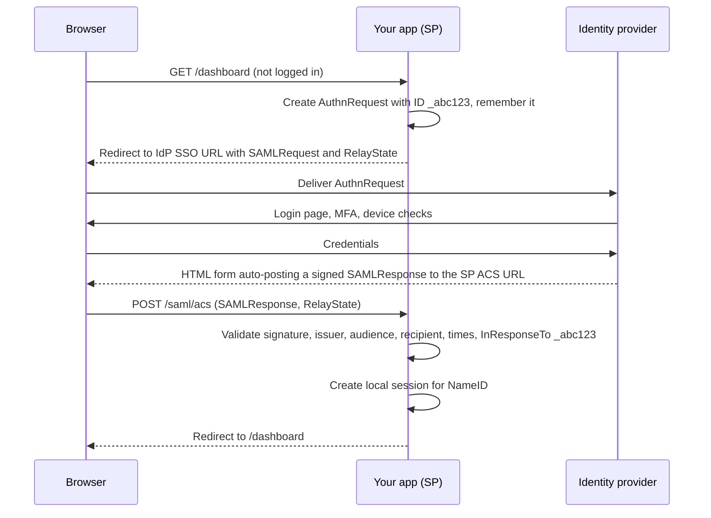
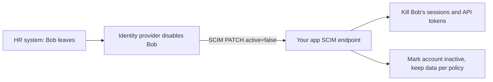

# Single Sign-On and SAML

## Introduction

In a typical company, employees use dozens of applications: email, chat, the HR portal, the code host, the CRM, the expense tool. If each one had its own password, people would reuse passwords, forget them constantly, and keep access long after they leave the company.

**Single sign-on (SSO)** fixes that. Users log in once at a central **identity provider (IdP)**, such as Microsoft Entra ID, Okta, Google Workspace, Ping or Keycloak, and every connected application (**service provider**, SP) trusts the IdP's statement about who they are. The IdP enforces password rules, MFA and device checks in one place, and when someone leaves, IT disables one account instead of fifty.

Think of a music festival with many stages. Instead of buying a ticket at every stage, you show ID once at the main gate and get a wristband. Each stage just checks the wristband. If the festival bans you, they cut the wristband once and every stage stops letting you in.

Two protocols dominate SSO:

- **SAML 2.0** (Security Assertion Markup Language), an OASIS standard from 2005 that uses signed XML. It is still everywhere in enterprise software.
- **OpenID Connect**, the modern JSON/JWT-based protocol covered in [OpenID Connect](./7-sec-oidc.mdx).

In this page you will learn:

- The SSO building blocks and the SAML SP-initiated flow.
- What a SAML assertion contains and how it must be validated.
- Why SAML has a long history of signature bypass bugs, and how to avoid them.
- How to add SAML SSO to a Flask app with **python3-saml**.
- How **SCIM** handles user provisioning and deprovisioning, which SSO alone does not.
- When to choose SAML vs OIDC.

## SSO Building Blocks

| Term | Meaning |
| --- | --- |
| Identity provider (IdP) | Authenticates users and issues signed statements about them |
| Service provider (SP) | Your application, which consumes those statements |
| Entity ID | A unique name (usually a URL) for each IdP and SP |
| Metadata | XML document describing an entity: endpoints, entity ID, signing certificates |
| Assertion | The signed XML statement: "this user authenticated at this time, with these attributes" |
| ACS (Assertion Consumer Service) | The SP endpoint that receives assertions via HTTP POST |
| NameID | The user identifier in the assertion, such as an email or a persistent opaque ID |
| Bindings | How messages travel: HTTP-Redirect (in the URL) or HTTP-POST (auto-submitted form) |

## The SP-Initiated Flow



There is also an **IdP-initiated** flow, where the user clicks an app tile on the IdP portal and the IdP posts an unsolicited assertion to your ACS. It is convenient, but without a matching request (`InResponseTo`) your app cannot tell whether the assertion was requested by this browser, which makes some injection and replay attacks easier. Accept IdP-initiated logins only if customers need them, and then rely strictly on replay protection and short validity windows.

## Inside a SAML Response

A simplified (unsigned for readability) SAML response:

```xml
<samlp:Response xmlns:samlp="urn:oasis:names:tc:SAML:2.0:protocol"
                xmlns:saml="urn:oasis:names:tc:SAML:2.0:assertion"
                ID="_resp1" InResponseTo="_abc123" Version="2.0"
                IssueInstant="2026-10-11T09:00:00Z"
                Destination="https://app.example.com/saml/acs">
  <saml:Issuer>https://idp.customer.com/saml</saml:Issuer>
  <samlp:Status>
    <samlp:StatusCode Value="urn:oasis:names:tc:SAML:2.0:status:Success"/>
  </samlp:Status>
  <saml:Assertion ID="_assert1" IssueInstant="2026-10-11T09:00:00Z" Version="2.0">
    <saml:Issuer>https://idp.customer.com/saml</saml:Issuer>
    <saml:Subject>
      <saml:NameID Format="urn:oasis:names:tc:SAML:2.0:nameid-format:persistent">u-8f2c91</saml:NameID>
      <saml:SubjectConfirmation Method="urn:oasis:names:tc:SAML:2.0:cm:bearer">
        <saml:SubjectConfirmationData InResponseTo="_abc123"
            NotOnOrAfter="2026-10-11T09:05:00Z"
            Recipient="https://app.example.com/saml/acs"/>
      </saml:SubjectConfirmation>
    </saml:Subject>
    <saml:Conditions NotBefore="2026-10-11T08:59:30Z" NotOnOrAfter="2026-10-11T09:05:00Z">
      <saml:AudienceRestriction>
        <saml:Audience>https://app.example.com/saml/metadata</saml:Audience>
      </saml:AudienceRestriction>
    </saml:Conditions>
    <saml:AuthnStatement AuthnInstant="2026-10-11T08:59:58Z" SessionIndex="_sess42"/>
    <saml:AttributeStatement>
      <saml:Attribute Name="email"><saml:AttributeValue>alice@customer.com</saml:AttributeValue></saml:Attribute>
      <saml:Attribute Name="groups"><saml:AttributeValue>finance</saml:AttributeValue></saml:Attribute>
    </saml:AttributeStatement>
  </saml:Assertion>
</samlp:Response>
```

Almost every field here is something your SP must check. In a real message, a `ds:Signature` element inside the assertion covers it (and often a second signature covers the whole response). It is left out above to keep the example readable.

## The SAML Validation Checklist

| Check | Why |
| --- | --- |
| Signature is valid, made by the **configured** IdP certificate | Otherwise anyone can write an assertion |
| The signature covers the **same** assertion you read data from | Prevents XML signature wrapping |
| `Issuer` equals the configured IdP entity ID | Stops assertions from other IdPs |
| `Audience` equals your SP entity ID | Stops assertions meant for other apps |
| `Destination` and `Recipient` equal your ACS URL | Stops forwarding an assertion from another SP |
| `NotBefore` / `NotOnOrAfter` with small clock skew | Limits replay window |
| `InResponseTo` matches an outstanding request from this browser | Ties the response to your login attempt |
| Assertion `ID` not seen before (replay cache until expiry) | Stops replay of a captured assertion |
| Status is `Success` | Obvious, but sometimes forgotten |
| XML parser has DTDs and external entities disabled | Prevents XXE attacks |
| Reject weak algorithms such as SHA-1 | Reduces cryptographic risk |

### Why SAML is easy to get wrong

XML signatures (XMLDSig) sign a *part* of a document, identified by an ID reference. Your code then reads data from the document, often with a different lookup. If the signature check finds the signed element in one place while your code reads the NameID from a different, unsigned copy, an attacker can insert their own assertion next to a legitimately signed one. This class of bug is called **XML signature wrapping (XSW)**.

A related problem is **parser differentials**: two XML parsers in the same library disagreeing about a document. In March 2025, GitHub's security team disclosed **CVE-2025-25291 and CVE-2025-25292** in the Ruby library ruby-saml, where the REXML and Nokogiri parsers could be made to see different signature elements, allowing authentication bypass. The fix shipped in ruby-saml 1.18.0. Python's pysaml2 had its own signature wrapping issues fixed years earlier (for example CVE-2020-5390).

The lesson: **never write your own SAML validation**, keep SAML libraries patched quickly, and subscribe to their security advisories.

**Vulnerable:**

```python
# Vulnerable: reads the NameID without verifying any signature
import base64
import xml.etree.ElementTree as ET

NS = {"saml": "urn:oasis:names:tc:SAML:2.0:assertion"}

def acs_bad(saml_response_b64: str) -> str:
    root = ET.fromstring(base64.b64decode(saml_response_b64))
    return root.find(".//saml:NameID", NS).text  # first NameID anywhere: trivially forged
```

Anyone can build an XML document with their chosen `NameID`, base64 it, and POST it to the ACS. Even code that *does* verify a signature somewhere, then reads "the first NameID" like this, is exposed to signature wrapping.

## SAML in Flask with python3-saml

The **python3-saml** toolkit (from OneLogin, now maintained under SAML-Toolkits) implements the full validation checklist in strict mode except replay tracking, which you add. It depends on `xmlsec`, which needs system libraries (`libxmlsec1`). These examples were checked against python3-saml 1.16.

```bash
sudo apt-get install -y libxml2-dev libxmlsec1-dev libxmlsec1-openssl pkg-config
pip install flask python3-saml
```

### Settings

```json
{
  "strict": true,
  "debug": false,
  "sp": {
    "entityId": "https://app.example.com/saml/metadata",
    "assertionConsumerService": {
      "url": "https://app.example.com/saml/acs",
      "binding": "urn:oasis:names:tc:SAML:2.0:bindings:HTTP-POST"
    },
    "NameIDFormat": "urn:oasis:names:tc:SAML:2.0:nameid-format:persistent"
  },
  "idp": {
    "entityId": "https://idp.customer.com/saml",
    "singleSignOnService": {
      "url": "https://idp.customer.com/saml/sso",
      "binding": "urn:oasis:names:tc:SAML:2.0:bindings:HTTP-Redirect"
    },
    "x509cert": "MIIC...the IdP signing certificate from its metadata..."
  },
  "security": {
    "wantAssertionsSigned": true,
    "wantMessagesSigned": false,
    "rejectDeprecatedAlgorithm": true,
    "requestedAuthnContext": false
  }
}
```

Key choices:

- `"strict": true` enables audience, destination, recipient, time and issuer checks. Never turn it off in production.
- `wantAssertionsSigned` requires a signature on the assertion itself, not just the outer response.
- `rejectDeprecatedAlgorithm` rejects SHA-1 based signatures.
- The IdP certificate comes from the IdP's metadata, received through a trusted channel, and is pinned here. Do not trust a certificate embedded inside an incoming response.

### Login and ACS endpoints

```python
# saml_app.py
import json
import time
from flask import Flask, abort, redirect, request, session
from onelogin.saml2.auth import OneLogin_Saml2_Auth

app = Flask(__name__)
app.secret_key = "dev-only-change-me"
app.config.update(SESSION_COOKIE_SECURE=True, SESSION_COOKIE_SAMESITE="None")  # see note below

with open("saml_settings.json") as f:
    SAML_SETTINGS = json.load(f)

SEEN_ASSERTIONS = {}  # assertion ID -> expiry timestamp. Use Redis with TTL in production.

def saml_request_data():
    return {
        "https": "on" if request.scheme == "https" else "off",
        "http_host": request.host,
        "script_name": request.path,
        "get_data": request.args.copy(),
        "post_data": request.form.copy(),
    }

@app.get("/saml/login")
def saml_login():
    auth = OneLogin_Saml2_Auth(saml_request_data(), SAML_SETTINGS)
    url = auth.login(return_to="/dashboard")
    session["saml_request_id"] = auth.get_last_request_id()
    return redirect(url)

@app.post("/saml/acs")
def saml_acs():
    auth = OneLogin_Saml2_Auth(saml_request_data(), SAML_SETTINGS)
    request_id = session.pop("saml_request_id", None)
    auth.process_response(request_id=request_id)  # checks signature, audience, times, InResponseTo
    if auth.get_errors() or not auth.is_authenticated():
        app.logger.warning("SAML login failed: %s", auth.get_last_error_reason())
        abort(401)

    assertion_id = auth.get_last_assertion_id()
    now = time.time()
    if assertion_id in SEEN_ASSERTIONS and SEEN_ASSERTIONS[assertion_id] > now:
        abort(401)  # replay
    SEEN_ASSERTIONS[assertion_id] = auth.get_last_assertion_not_on_or_after() or now + 300

    session.clear()
    session["user"] = {
        "idp": SAML_SETTINGS["idp"]["entityId"],
        "name_id": auth.get_nameid(),
        "groups": auth.get_attributes().get("groups", []),
    }
    session["saml_session_index"] = auth.get_session_index()
    return redirect("/dashboard")  # never redirect to an unvalidated RelayState URL
```

:::note
The ACS receives a cross-site POST from the IdP. With `SameSite=Lax`, the browser does not send your session cookie on that POST, so the stored `saml_request_id` would be missing. Common fixes are a dedicated short-lived `SameSite=None; Secure` cookie used only for the SAML request ID, or storing the request ID server-side keyed by a value in `RelayState`. Keep your main session cookie `Lax` and issue it fresh after the ACS succeeds.
:::

## Provisioning and Deprovisioning with SCIM

SSO decides who can log in *right now*. It does not tell your app that Bob left the company yesterday, so Bob's existing session and any API tokens he created may keep working. It also cannot pre-create accounts before first login.

**SCIM 2.0** (System for Cross-domain Identity Management, RFC 7643 and RFC 7644) is a REST API your app exposes so the IdP can create, update and deactivate users and groups automatically.



A minimal SCIM deactivate handler, added to the Flask app above:

```python
import hashlib
import secrets

@app.patch("/scim/v2/Users/<user_id>")
def scim_patch_user(user_id):
    presented = request.headers.get("Authorization", "").removeprefix("Bearer ")
    if not secrets.compare_digest(hash_token(presented), load_scim_token_hash_for_tenant()):
        abort(401)
    ops = request.get_json().get("Operations", [])
    for op in ops:
        if op.get("op", "").lower() == "replace" and op.get("value", {}).get("active") is False:
            deactivate_user_and_revoke_sessions(user_id)
    return {"schemas": ["urn:ietf:params:scim:schemas:core:2.0:User"], "id": user_id, "active": False}

def hash_token(token: str) -> str:
    return hashlib.sha256(token.encode()).hexdigest()

def load_scim_token_hash_for_tenant() -> str:
    ...  # per-tenant random token, stored only as a SHA-256 hash

def deactivate_user_and_revoke_sessions(user_id):
    ...  # delete sessions, revoke refresh tokens and personal API keys
```

Real SCIM servers also implement user creation, listing with filters and group membership. The token handling follows the same pattern as in [API Keys and Service Authentication](./10-sec-api-authentication.mdx).

## SAML vs OpenID Connect

| Aspect | SAML 2.0 | OpenID Connect |
| --- | --- | --- |
| Format | XML, XMLDSig signatures | JSON, JWT (JWS) signatures |
| Transport | Browser redirects and auto-POST forms | Redirects plus back-channel token endpoint |
| Mobile and SPA support | Awkward | Designed for it |
| API access tokens | Not part of the spec | Comes with OAuth 2.0 access tokens |
| Enterprise IdP support | Universal | Very broad today |
| Implementation risk | Historically high (XSW, parser bugs) | Lower, but JWT pitfalls exist |
| Typical use | Legacy and enterprise SaaS SSO | New apps, consumer login, workforce SSO |

## Real-World Scenario

Your B2B analytics SaaS is moving upmarket. A bank wants to buy, but its security questionnaire requires: SSO with its IdP, MFA enforced by the bank, no local passwords for its users, and access removed within one hour of an employee leaving. The bank's IdP supports both SAML and OIDC. Some smaller prospects only support SAML.

### The solution

1. **Support both OIDC and SAML** behind one internal "enterprise connection" abstraction. Prefer OIDC when the customer supports it, and use python3-saml in strict mode for SAML-only customers.
2. **Per-tenant configuration**: each customer has its own IdP entity ID, certificate and allowed email domains. Accept only assertions from that tenant's IdP.
3. **Enforce SSO** for the tenant: disable password login for users in the bank's email domain once SSO is verified, with a break-glass admin account protected by a hardware key.
4. **SCIM provisioning** so the IdP deactivates users, which immediately revokes sessions and API tokens.
5. **Short sessions** (8 hours) with re-authentication through the IdP, so policy changes at the IdP take effect quickly.
6. **Patch fast**: track SAML library advisories and treat them as emergencies.

### Why this approach

The bank wants control of authentication policy and offboarding. SSO moves authentication policy to their IdP, and SCIM covers offboarding, which SSO alone cannot. Supporting OIDC first reduces exposure to the XML signature risks of SAML, while SAML support keeps the door open for prospects that require it.

### When to use it, and when not to

- Use SSO for any B2B product with business customers. Many enterprises will not buy without it.
- For consumer apps, enterprise SAML is unnecessary. Social login via OIDC plus passkeys is a better fit.
- Avoid IdP-initiated SAML unless customers insist, and do not build SAML validation yourself.

### Alternatives and trade-offs

| Approach | Pros | Cons | Best for |
| --- | --- | --- | --- |
| Local passwords per app | No integration work | Password sprawl, no central offboarding | Small internal tools only |
| SAML SSO | Universal enterprise support | XML complexity, signature bypass history, no API tokens | Enterprise customers that require it |
| OIDC SSO | Modern, JSON-based, works with mobile and APIs | Some older IdPs lack good support | New B2B and workforce apps |
| SSO broker or hosted identity service | One integration for many IdPs, handles SAML parsing | Cost, vendor dependency | Teams without identity specialists |
| SSO plus SCIM | Automated joiner, mover and leaver handling | Extra API to build and secure | Customers with compliance requirements |

## Common Mistakes

- **Writing your own SAML parsing or signature checks.**
- **Disabling strict mode** to "make it work" during setup and never turning it back on.
- **Accepting unsigned assertions** when only the response is signed, or vice versa, without understanding what is covered.
- **No replay cache** for assertion IDs.
- **Trusting `RelayState` as a redirect URL**, creating an open redirect.
- **Using a mutable email NameID as the primary key** instead of a persistent identifier.
- **Sharing one IdP configuration across tenants** so one customer's IdP can assert users of another.
- **Relying on SSO for offboarding** while sessions and API tokens live for weeks.
- **Leaving SAML libraries unpatched.** Their bugs are often full authentication bypasses.

## Summary

- SSO centralizes authentication at an identity provider, so policy, MFA and offboarding happen in one place.
- SAML 2.0 uses signed XML assertions delivered through the browser to your ACS endpoint.
- Validate signature, issuer, audience, destination, recipient, times, `InResponseTo` and replay, using a maintained library in strict mode.
- XML signature wrapping and parser differentials have caused real authentication bypasses, including the 2025 ruby-saml CVEs. Patch quickly.
- SCIM handles provisioning and deprovisioning, which SSO alone does not.
- Prefer OIDC for new integrations, and support SAML where customers require it.

## Exercises

1. Run Keycloak locally and configure it as a SAML IdP for the Flask example. Log in and print the NameID and attributes.
2. Modify a captured SAMLResponse in your lab (change the NameID) and confirm python3-saml rejects it. Note the error reason.
3. Implement the replay cache with Redis `SET key value NX EX seconds` and test it by replaying a captured response in your lab.
4. Design the database tables for per-tenant enterprise connections that can hold either SAML or OIDC configuration.

Next: [RBAC, ABAC and ReBAC](./9-sec-rbac-abac.mdx). Related: [OpenID Connect](./7-sec-oidc.mdx), [PKI and Certificates](../1-sec-cryptography/6-sec-pki-and-certificates.mdx) and [Insecure Deserialization](../3-sec-web-security/8-sec-insecure-deserialization.mdx).
