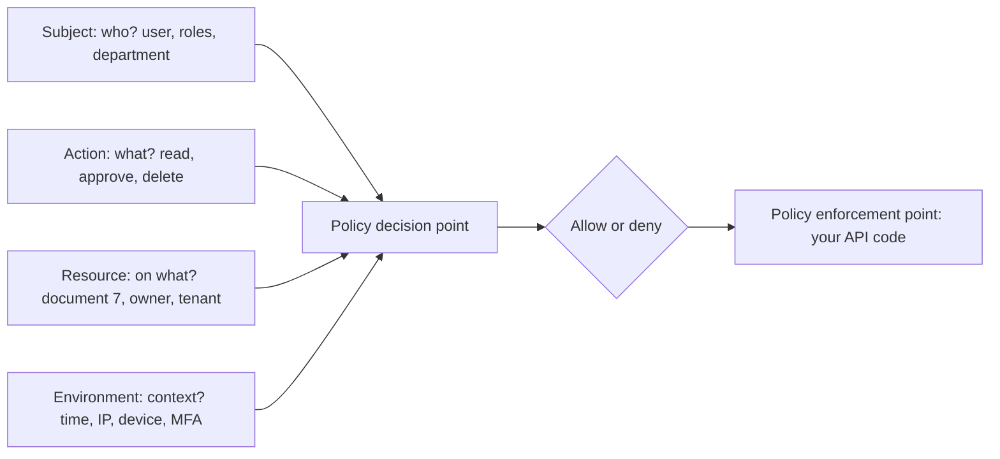
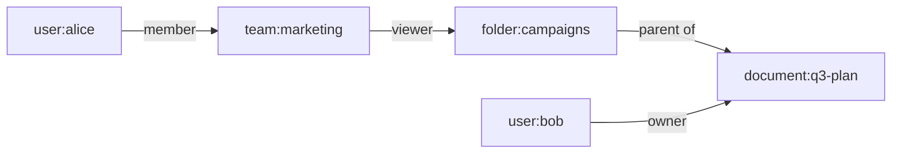

# RBAC, ABAC and ReBAC

## Introduction

Once your app knows *who* a user is, it needs to decide *what they may do*. In a small app, that logic often starts as a few `if user.is_admin` checks. As the product grows, you get teams, customers, sharing, approvals, regions and contractors. The `if` statements multiply, get copied into different places, drift apart, and eventually one is missing. That missing check is how **Broken Access Control** became **A01 in the OWASP Top 10:2025**.

An **access control model** is a structured way to express those rules so they are consistent, testable and auditable. The three models you will meet most often are:

- **RBAC (Role-Based Access Control)**: permissions attach to roles, and users get roles. "Editors can publish articles."
- **ABAC (Attribute-Based Access Control)**: decisions use attributes of the user, the resource, the action and the environment. "Managers can approve expenses under 10,000 in their own department during business hours."
- **ReBAC (Relationship-Based Access Control)**: decisions follow relationships in a graph. "You can view a document if you are a member of a team that has access to the folder containing it."

An analogy: RBAC is a job title on an office badge ("Facilities staff open all supply rooms"). ABAC is a smart lock reading several facts ("Facilities staff, on shift, in this building, during the day"). ReBAC is the guest list for a private party: you get in because you came with someone who was invited.

In this page you will implement all three in Python, see a **vulnerable** and **fixed** pattern for each, and learn when to move from code to a policy engine such as **OPA**, **Cedar** or **OpenFGA**.

## The Decision Model

Every model answers the same question, using the same four inputs:



The **policy decision point (PDP)** computes the answer. The **policy enforcement point (PEP)** is the code that asks and obeys, such as a decorator or a check in your service layer. Keeping these separate is what makes policies testable and consistent.

## RBAC: Role-Based Access Control

RBAC is the default for most business apps. Users get roles, roles get permissions, and code checks **permissions**, never role names.

### Vulnerable: role names scattered through the code

```python
# Vulnerable
def delete_article(user, article):
    if user["role"] == "admin" or user["role"] == "editor":   # copy-pasted in 14 places
        ...

def publish_article(user, article):
    if user["role"] != "viewer":   # deny-list: a new "intern" role can suddenly publish
        ...
```

Problems: adding a role means editing every check, deny-lists grant access to roles nobody thought of, and there is no single place to answer "what can an editor do?".

### Fixed: permission-based RBAC

```python
# rbac.py
ROLE_PERMISSIONS = {
    "viewer": {"article:read"},
    "author": {"article:read", "article:create", "article:edit_own"},
    "editor": {"article:read", "article:create", "article:edit_own", "article:edit_any", "article:publish"},
    "admin": {"*"},
}
ROLE_INHERITS = {"editor": {"author"}, "author": {"viewer"}}  # optional role hierarchy

def permissions_for(roles: set[str]) -> set[str]:
    perms, stack, seen = set(), list(roles), set()
    while stack:
        role = stack.pop()
        if role in seen:
            continue
        seen.add(role)
        perms |= ROLE_PERMISSIONS.get(role, set())   # unknown roles grant nothing
        stack.extend(ROLE_INHERITS.get(role, set()))
    return perms

def has_permission(user: dict, permission: str) -> bool:
    perms = permissions_for(set(user["roles"]))
    return "*" in perms or permission in perms

alice = {"id": 1, "roles": ["author"]}
erin = {"id": 2, "roles": ["editor"]}
ivan = {"id": 3, "roles": ["intern"]}
for user in (alice, erin, ivan):
    print(user["roles"], has_permission(user, "article:publish"), has_permission(user, "article:read"))
```

Output:

```text
['author'] False True
['editor'] True True
['intern'] False False
```

Wire it into Flask with a decorator, so every route declares the permission it needs:

```python
from functools import wraps
from flask import abort, g

def requires(permission: str):
    def decorator(view):
        @wraps(view)
        def wrapper(*args, **kwargs):
            if g.get("user") is None:
                abort(401)
            if not has_permission(g.user, permission):
                abort(403)
            return view(*args, **kwargs)
        return wrapper
    return decorator

# @app.post("/articles/<int:article_id>/publish")
# @requires("article:publish")
# def publish(article_id): ...
```

### RBAC limits: role explosion

RBAC struggles with rules that depend on the **resource**. "Authors may edit **their own** articles" is not a role. Teams try to encode it as roles like `editor_team_a_region_eu`, and soon have thousands of roles. That is the signal to add attributes or relationships.

## ABAC: Attribute-Based Access Control

ABAC evaluates rules over attributes. It handles ownership, departments, data classification, time and device posture naturally.

Scenario: an expense tool. Rules:

1. Employees can view their own expenses.
2. Managers can approve expenses in their own department if the amount is under 10,000 and they are not approving their own expense.
3. Finance can approve any amount, but only from a managed device with MFA.

```python
# abac.py
from dataclasses import dataclass

@dataclass
class Subject:
    id: int
    roles: set[str]
    department: str

@dataclass
class Expense:
    id: int
    owner_id: int
    department: str
    amount: float

@dataclass
class Env:
    mfa: bool = False
    managed_device: bool = False

def can(subject: Subject, action: str, expense: Expense, env: Env | None = None) -> bool:
    env = env or Env()
    if action == "view":
        return expense.owner_id == subject.id or (
            "manager" in subject.roles and expense.department == subject.department
        )
    if action == "approve":
        if expense.owner_id == subject.id:
            return False                       # separation of duties
        if "finance" in subject.roles:
            return env.mfa and env.managed_device
        if "manager" in subject.roles:
            return expense.department == subject.department and expense.amount < 10_000
    return False                               # default deny

mia = Subject(1, {"manager"}, "sales")
fred = Subject(2, {"finance"}, "finance")
e_small = Expense(10, owner_id=7, department="sales", amount=850)
e_big = Expense(11, owner_id=7, department="sales", amount=25_000)
e_own = Expense(12, owner_id=1, department="sales", amount=40)

print(can(mia, "approve", e_small))                         # manager, same dept, small
print(can(mia, "approve", e_big))                           # too large
print(can(mia, "approve", e_own))                           # own expense
print(can(fred, "approve", e_big, Env(mfa=True, managed_device=True)))
print(can(fred, "approve", e_big, Env(mfa=True)))           # unmanaged laptop
```

Output:

```text
True
False
False
True
False
```

### Where attributes come from

ABAC is only as trustworthy as its attributes:

- **Subject attributes** come from your user database or the identity provider (OIDC claims, SAML attributes). Never from the request body.
- **Resource attributes** come from the loaded object in your database.
- **Environment attributes** come from the session (MFA used, `auth_time`), device management, or network context.

### Policy as code with OPA

When rules grow or must be shared across services, move them into a policy engine. **Open Policy Agent (OPA)**, a CNCF graduated project, evaluates policies written in **Rego**. The manager rule looks like this (OPA 1.0 syntax):

```text
package expenses.authz

default allow := false

allow if {
    input.action == "approve"
    "manager" in input.subject.roles
    input.subject.department == input.resource.department
    input.resource.amount < 10000
    input.resource.owner_id != input.subject.id
}
```

Your service sends a JSON `input` document to OPA (as a sidecar, library or service) and gets back `allow`. Policies live in Git, get code review, and have their own unit tests.

**Cedar**, created by AWS and used by Amazon Verified Permissions, is a policy language built specifically for application authorization. It joined the CNCF as a Sandbox project. The same rule in Cedar:

```text
permit (
    principal,
    action == Action::"approve",
    resource is Expense
)
when {
    principal.role == "manager" &&
    principal.department == resource.department &&
    resource.amount < 10000 &&
    resource.owner != principal
};
```

Cedar's language is deliberately limited so policies can be analyzed automatically, for example to prove that no policy lets a user approve their own expense.

## ReBAC: Relationship-Based Access Control

ReBAC models access as a graph of relationships: users belong to teams, teams have access to folders, folders contain documents. Google described its global system for this, **Zanzibar**, in a 2019 paper, and it inspired open-source systems like **OpenFGA** (a CNCF incubating project since October 2025) and **SpiceDB**.



Question: can Alice view `document:q3-plan`? Yes: Alice is a member of marketing, marketing can view the campaigns folder, and documents inherit viewers from their parent folder.

### A tiny ReBAC engine

Real systems store billions of relationship tuples and answer checks in milliseconds. The core idea fits in a few lines:

```python
# rebac.py
TUPLES = {
    ("team:marketing", "member", "user:alice"),
    ("folder:campaigns", "viewer", "team:marketing#member"),
    ("document:q3-plan", "parent", "folder:campaigns"),
    ("document:q3-plan", "owner", "user:bob"),
}

# Rewrite rules: a relation can be implied by other relations
IMPLIED_BY = {
    "viewer": ["owner", "editor"],     # owners and editors are also viewers
}
INHERIT_FROM_PARENT = {"viewer", "editor"}

def check(obj: str, relation: str, user: str, depth: int = 0) -> bool:
    if depth > 10:
        return False  # guard against cycles
    for (o, r, subject) in TUPLES:
        if o != obj or r != relation:
            continue
        if subject == user:
            return True
        if "#" in subject:                              # userset, e.g. team:marketing#member
            group, group_rel = subject.split("#")
            if check(group, group_rel, user, depth + 1):
                return True
    for stronger in IMPLIED_BY.get(relation, []):
        if check(obj, stronger, user, depth + 1):
            return True
    if relation in INHERIT_FROM_PARENT:
        for (o, r, parent) in TUPLES:
            if o == obj and r == "parent" and check(parent, relation, user, depth + 1):
                return True
    return False

print(check("document:q3-plan", "viewer", "user:alice"))   # via team -> folder -> document
print(check("document:q3-plan", "viewer", "user:bob"))     # owner implies viewer
print(check("document:q3-plan", "owner", "user:alice"))
print(check("document:q3-plan", "viewer", "user:mallory"))
```

Output:

```text
True
True
False
False
```

In OpenFGA, the same rules are an **authorization model**:

```text
model
  schema 1.1

type user

type team
  relations
    define member: [user]

type folder
  relations
    define viewer: [user, team#member]

type document
  relations
    define parent: [folder]
    define owner: [user]
    define editor: [user, team#member]
    define viewer: [user, team#member] or owner or editor or viewer from parent
```

Your app writes tuples when things happen ("Alice joined marketing", "Bob shared the folder with marketing") and calls `check` before each access. ReBAC also answers **list** questions like "which documents can Alice see?", which are hard to do efficiently with hand-written code.

## Comparing the Models

| Model | Rules based on | Strengths | Weaknesses | Typical tools |
| --- | --- | --- | --- | --- |
| ACL | Per-object lists of users | Simple, explicit | Hard to manage at scale | File systems, S3 ACLs (legacy) |
| RBAC | Roles and permissions | Easy to understand and audit | Role explosion, no ownership or context | Framework permissions, Django groups, Kubernetes RBAC |
| ABAC | Attributes and conditions | Expressive, handles context | Harder to audit "who can access X?" | OPA, Cedar, AWS IAM conditions |
| ReBAC | Relationship graph | Natural for sharing and hierarchies, list queries | Needs tuple sync, new infrastructure | OpenFGA, SpiceDB, Zanzibar-style services |

In practice, systems mix them: RBAC for coarse roles, ABAC conditions for context, ReBAC for sharing.

## Real-World Scenario

Your team builds a document-collaboration SaaS. Today, authorization is a mix of `is_admin` flags and `if doc.owner_id == user.id` checks. Customers now want: workspaces with admin, member and guest roles; sharing documents and folders with people and teams; "only from company devices" policies for some enterprise customers; and an audit report of who can see a given document. A recent bug let guests list all documents in a workspace through the search API.

### The solution

1. **RBAC for workspace roles**: admin, member and guest map to permissions such as `workspace:invite` and `document:create`.
2. **ReBAC for sharing**: model workspaces, teams, folders and documents in OpenFGA (or SpiceDB). Every share writes a tuple. Every document read calls `check`, and search results are filtered with a `list objects` call or by checking each result.
3. **ABAC for context**: the enterprise "company devices only" rule is evaluated from session attributes (device managed, MFA) in a central policy function or a Cedar/OPA policy before the ReBAC check.
4. **One enforcement layer**: a service-layer function `authorize(user, action, resource)` is the only way to load documents. The search bug is fixed by routing search results through it.
5. **Tests and audit**: policy unit tests for each rule, and the "who can see document X" report uses the relationship graph's expand API.

### Why this approach

Sharing and nested folders are relationships, which RBAC cannot express without role explosion. Device rules are context, which fits ABAC. Centralizing enforcement fixes the class of bug where one endpoint (search) forgot the check.

### When to use it, and when not to

- Plain RBAC plus ownership checks in code is enough for many apps. Do not introduce a policy engine for five rules.
- Reach for OPA or Cedar when policies must be shared across services, reviewed by security, or changed without redeploying.
- Reach for ReBAC when users share resources with each other and hierarchies matter (Google Drive, GitHub, Notion-style products).

### Alternatives and trade-offs

| Approach | Pros | Cons | Best for |
| --- | --- | --- | --- |
| Hard-coded checks in views | Fast to write | Inconsistent, easy to miss one | Prototypes |
| Central permission module (RBAC + ownership) | Simple, testable, no new infrastructure | Gets complex with sharing and context | Most small to medium apps |
| Policy engine (OPA, Cedar) | Policy as code, shared across services, analyzable (Cedar) | New language, latency if remote, data must be passed in | Multi-service, compliance-heavy systems |
| ReBAC service (OpenFGA, SpiceDB) | Sharing, hierarchies, list queries at scale | Tuple synchronization, consistency questions, more infrastructure | Collaboration products |
| Database row-level security | Enforced even if app code forgets | Database-specific, hard to express complex rules | Tenant isolation as a safety net |

## Common Mistakes

- **Checking role names instead of permissions**, and copying checks across files.
- **Deny-lists** (`role != "guest"`) instead of allow-lists.
- **Trusting roles or attributes from the client**, such as a `role` field in the request body or an unsigned cookie.
- **Checking access on the detail page but not on list, search, export or bulk endpoints.**
- **Stale attributes or tuples**: a user removed from a team in the IdP keeps access because your copy did not update.
- **No separation of duties**: approvers can approve their own requests.
- **Fail-open on policy errors**: if OPA or OpenFGA is unreachable, deny, and alert.
- **Untested policies.** Authorization rules deserve the most unit tests in your codebase.

## Summary

- RBAC assigns permissions to roles. Check permissions, use allow-lists, and keep role definitions in one place.
- ABAC evaluates attributes of subject, resource, action and environment. It handles ownership and context.
- ReBAC follows relationships in a graph and suits sharing and hierarchies. OpenFGA and SpiceDB implement Zanzibar-style ReBAC.
- Policy engines such as OPA (Rego) and Cedar move rules into reviewed, tested code. OpenFGA and SpiceDB handle relationship data at scale.
- Whatever the model, enforce it in one layer, deny by default, and cover every path that returns data.

## Exercises

1. Extend `rbac.py` with a `moderator` role that inherits from `viewer` and adds `comment:delete`. Write tests showing an `author` cannot delete comments.
2. Add an environment rule to `abac.py`: approvals over 5,000 require `env.mfa`. Update the outputs.
3. Add `editor` tuples and a `document:q4-plan` with no parent to `rebac.py`, then write a `list_objects(user, relation, type)` function.
4. Install OPA locally, save the Rego policy above, and evaluate it with `opa eval` against two input JSON files, one allowed and one denied.

Next: [API Keys and Service Authentication](./10-sec-api-authentication.mdx). Related: [Authentication vs Authorization](./0-sec-authn-vs-authz.mdx), [Broken Access Control](../3-sec-web-security/2-sec-broken-access-control.mdx), [Least Privilege and Zero Trust](../0-sec-fundamentals/5-sec-least-privilege.mdx) and [Cloud IAM Security](../8-sec-cloud-and-container/1-sec-cloud-iam.mdx).
