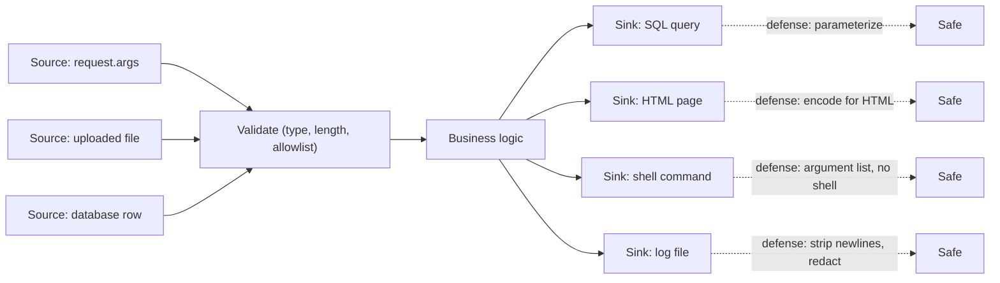
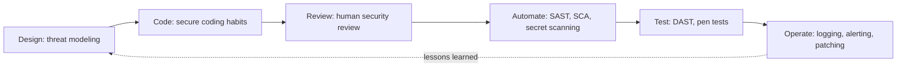

# Secure Coding Introduction

## Introduction

Most security incidents in software do not start with a genius attacker. They start with an ordinary line of code: a query built with an f-string, an error page that prints a stack trace, an API key pasted into a config file, or a permission check that someone forgot to add to one new endpoint.

**Secure coding** is the set of habits that stop those lines from being written, or catch them before they ship. It is not a separate phase at the end of a project, and it is not only the security team's job. It is how you write the code in the first place.

An analogy: a restaurant kitchen does not rely on a food inspector visiting once a year. Cooks wash their hands, keep raw meat on the bottom shelf, and label everything with a date, every single shift. Inspections still matter, but the daily habits prevent most of the problems. Secure coding is the hand-washing of software.

The data backs this up. The [2025 CWE Top 25 Most Dangerous Software Weaknesses](https://cwe.mitre.org/top25/archive/2025/2025_cwe_top25.html), published by MITRE and CISA from real CVE records, is led by cross-site scripting (CWE-79), SQL injection (CWE-89), cross-site request forgery (CWE-352) and missing authorization (CWE-862). Every one of those is a coding mistake that a known pattern prevents.

In this section you will learn those patterns:

| Page | What you learn |
| --- | --- |
| [Input Validation and Output Encoding](./1-sec-input-validation.mdx) | Checking data on the way in and encoding it on the way out |
| [Secure Error Handling and Logging](./2-sec-error-handling-and-logging.mdx) | Failing closed, safe error messages, useful and safe logs |
| [Secrets Management in Code](./3-sec-secrets-in-code.mdx) | Keeping keys and passwords out of source code |
| [Memory Safety](./4-sec-memory-safety.mdx) | Buffer overflows, use-after-free, and memory-safe languages |
| [Race Conditions and TOCTOU](./5-sec-race-conditions.mdx) | Concurrency bugs that break security checks |
| [Secure Defaults and Configuration](./6-sec-secure-defaults.mdx) | Making the safe setting the default one |
| [Security Code Review](./7-sec-code-review-for-security.mdx) | Reviewing pull requests with a security eye |
| [Language-Specific Security Pitfalls](./8-sec-language-specific-pitfalls.mdx) | Traps in Python, JavaScript, Java, Go and C |

## The Core Idea: Trust Boundaries

Almost every secure coding rule follows from one question: **where does this data come from, and do I trust it?**

A **trust boundary** is any point where data moves from something you do not control into something you do. Data crossing a boundary is **untrusted** until your code has checked it.

Common sources of untrusted data:

- HTTP request bodies, query strings, headers and cookies
- Uploaded files and their names
- Messages from queues, webhooks and partner APIs
- Rows in your own database that a user originally wrote
- Environment variables and config files in a shared environment
- Output from a large language model (see [Security for AI and LLM Applications](../13-sec-governance/5-sec-ai-security.mdx))

That fourth bullet surprises many beginners. A comment that a user saved last week is still user input today. "It came from our database" does not make it safe.

### Sources and sinks

Security reviewers describe code in terms of **sources** (where untrusted data enters) and **sinks** (dangerous places where that data can cause harm). A vulnerability is usually an unprotected path from a source to a sink.



Notice that the defenses sit in two places. **Validation** happens near the source, where you still know what the data is supposed to be. **Encoding or parameterization** happens at the sink, where you know which language (SQL, HTML, shell) the data is about to enter. You need both. Validation alone cannot know every sink, and sink defenses alone let garbage flow through your business logic.

| Sink | What goes wrong | Primary defense | Covered in |
| --- | --- | --- | --- |
| SQL query | SQL injection | Parameterized queries | [SQL Injection](../3-sec-web-security/3-sec-sql-injection.mdx) |
| HTML page | Cross-site scripting | Context-aware output encoding | [XSS](../3-sec-web-security/4-sec-xss.mdx) |
| Shell command | Command injection | Argument lists, no shell | [Command Injection](../3-sec-web-security/7-sec-command-injection.mdx) |
| File path | Path traversal | Resolve and check against a base directory | [Command Injection and Path Traversal](../3-sec-web-security/7-sec-command-injection.mdx) |
| Deserializer | Remote code execution | Safe formats such as JSON | [Insecure Deserialization](../3-sec-web-security/8-sec-insecure-deserialization.mdx) |
| Outbound HTTP request | SSRF | Allowlisted destinations | [SSRF](../3-sec-web-security/6-sec-ssrf.mdx) |
| Log file | Log forging, data leaks | Neutralize newlines, redact secrets | [Error Handling and Logging](./2-sec-error-handling-and-logging.mdx) |

## The Habits That Prevent Most Bugs

OWASP publishes the [Top 10 Proactive Controls (2024)](https://top10proactive.owasp.org/the-top-10/), a developer-focused list of what to *do*, as opposed to the [OWASP Top 10](../3-sec-web-security/1-sec-owasp-top-10.mdx) list of what goes wrong. The 2024 controls are: implement access control, use cryptography to protect data, validate all input and handle exceptions, address security from the start, secure by default configurations, keep your components secure, secure digital identities, leverage browser security features, implement security logging and monitoring, and stop server-side request forgery.

Condensed into everyday habits for a developer, they look like this:

1. **Treat all external data as untrusted.** Validate it at the boundary with an allowlist of what is acceptable.
2. **Keep data and code separate.** Use parameterized queries, template engines with auto-escaping, and argument lists for processes. Never build code by gluing strings together.
3. **Check authorization on every request, on the server.** Hiding a button is not access control.
4. **Fail closed.** When something unexpected happens, deny access and roll back. Do not continue as if the check passed.
5. **Keep secrets out of code.** Load them from the environment or a secret manager.
6. **Use safe defaults.** Debug off, strict cookies, deny by default.
7. **Use proven libraries for hard things.** Crypto, password hashing, authentication and HTML sanitizing are not weekend projects.
8. **Log security events, but not secrets.** You cannot respond to what you cannot see.
9. **Keep dependencies patched.** Your code includes everyone else's code.
10. **Get a second pair of eyes.** Code review and automated scanners catch what you miss.

## A Small Example: Five Habits in Twenty Lines

Here is a small note-taking endpoint written the way many first drafts look. Read it and try to spot the problems before reading the list below.

**Vulnerable:**

```python
# vulnerable_app.py  (Vulnerable: do not deploy)
import sqlite3
from flask import Flask, request

app = Flask(__name__)
app.config["SECRET_KEY"] = "dev-key-123"          # hard-coded secret
app.config["DEBUG"] = True                       # debugger exposed to the network

db = sqlite3.connect(":memory:", check_same_thread=False)
db.executescript("""
CREATE TABLE notes (id INTEGER PRIMARY KEY, owner TEXT, body TEXT);
INSERT INTO notes VALUES (1, 'alice', 'Buy milk'), (2, 'bob', 'Bob''s private note');
""")

@app.get("/notes/<note_id>")
def show_note(note_id):
    # No authentication, no ownership check, string-built SQL, raw HTML output
    row = db.execute(f"SELECT body FROM notes WHERE id = {note_id}").fetchone()
    return f"<p>{row[0]}</p>"
```

The problems, mapped to the [OWASP Top 10:2025](https://owasp.org/Top10/2025/):

| Line | Problem | OWASP Top 10:2025 |
| --- | --- | --- |
| `SECRET_KEY = "dev-key-123"` | Secret in source code, anyone with repo access can forge sessions | A04 Cryptographic Failures, A07 Authentication Failures |
| `DEBUG = True` | Interactive debugger and stack traces exposed | A02 Security Misconfiguration |
| `f"... WHERE id = {note_id}"` | SQL injection | A05 Injection |
| No owner check | Any user can read any note (IDOR) | A01 Broken Access Control |
| `f"<p>{row[0]}</p>"` | Stored XSS if a note contains a script | A05 Injection |
| `row[0]` when `row` is `None` | Crash with a 500 error, possibly with a stack trace | A10 Mishandling of Exceptional Conditions |

**Fixed:**

```python
# fixed_app.py
import logging
import os
import sqlite3

from flask import Flask, abort, request
from markupsafe import escape

app = Flask(__name__)
app.config["SECRET_KEY"] = os.environ["APP_SECRET_KEY"]        # 1. secret from the environment
log = logging.getLogger("notes")

db = sqlite3.connect(":memory:", check_same_thread=False)
db.executescript("""
CREATE TABLE notes (id INTEGER PRIMARY KEY, owner TEXT, body TEXT);
INSERT INTO notes VALUES (1, 'alice', 'Buy milk'), (2, 'bob', 'Bob''s private note');
""")

def current_user():
    # Stand-in for real session auth (see the Authentication section).
    user = request.headers.get("X-Demo-User", "")
    if user not in {"alice", "bob"}:
        abort(401)
    return user

@app.get("/notes/<int:note_id>")                                # 2. type-checked path parameter
def show_note(note_id):
    user = current_user()
    row = db.execute(
        "SELECT body FROM notes WHERE id = ? AND owner = ?",      # 3. parameterized + owner check
        (note_id, user),
    ).fetchone()
    if row is None:
        abort(404)                                               # 4. same answer for "missing" and "not yours"
    return f"<p>{escape(row[0])}</p>"                            # 5. encode output for HTML

@app.errorhandler(500)
def server_error(err):
    log.exception("unhandled error")                             # 6. details go to the log...
    return {"error": "internal error"}, 500                      # ...not to the user
```

Debug mode is gone from the code. You turn it on only on your laptop with `flask --app fixed_app run --debug`, which keeps it out of production by default.

You can exercise the fixed version with Flask's test client, without starting a server:

```python
# test_fixed_app.py
import os
os.environ["APP_SECRET_KEY"] = "test-only"

from fixed_app import app

client = app.test_client()
cases = [
    ("/notes/1", "alice"),             # her own note
    ("/notes/2", "alice"),             # Bob's note
    ("/notes/1%20OR%201=1", "alice"),  # injection attempt
    ("/notes/1", ""),                  # not logged in
]
for path, user in cases:
    r = client.get(path, headers={"X-Demo-User": user})
    print(r.status_code, path, user or "(none)")
```

Output:

```text
200 /notes/1 alice
404 /notes/2 alice
404 /notes/1%20OR%201=1 alice
401 /notes/1 (none)
```

The injection attempt never reaches the database: the `int` converter in the route rejects anything that is not a number, and even if it did not, the parameterized query would treat the whole string as a value. That is **defense in depth** at the scale of a single function.

:::tip The fix is usually boring
Notice that none of the fixes were clever. They used features that Flask, SQLite and MarkupSafe already provide. Secure coding is mostly about knowing which built-in safe option exists and using it every time.
:::

## Five Questions to Ask About Every Function

You do not need to memorize hundreds of rules. Most issues surface if you ask these five questions while writing or reviewing a function:

| Question | What it catches | Example |
| --- | --- | --- |
| Where does each input come from, and who controls it? | Injection, trusting the client | A `price` field sent by the browser in a checkout request |
| Who is allowed to do this, and where is that checked? | Broken access control, IDOR | `GET /invoices/42` without checking the invoice belongs to the caller |
| What happens when something fails halfway? | Fail-open logic, inconsistent state | An exception in the permission check that is caught and ignored |
| What could run twice, or at the same time? | Race conditions, replay | Redeeming the same gift card in two parallel requests |
| What ends up in logs, errors and responses? | Information disclosure | A stack trace with a database password in the connection string |

The third question deserves an example, because "fail open" bugs are easy to write and hard to spot:

```python
# fail_open.py
def is_admin_vulnerable(user_id, lookup):
    try:
        return lookup(user_id)["role"] == "admin"
    except Exception:
        return True          # Vulnerable: "if the role service is down, let them in"

def is_admin_fixed(user_id, lookup):
    try:
        return lookup(user_id)["role"] == "admin"
    except Exception:
        return False         # Fixed: fail closed, deny when unsure

def broken_lookup(user_id):
    raise TimeoutError("role service unavailable")

print("vulnerable:", is_admin_vulnerable(7, broken_lookup))
print("fixed:     ", is_admin_fixed(7, broken_lookup))
```

Output:

```text
vulnerable: True
fixed:      False
```

Nobody writes `return True` on purpose to let attackers in. It usually arrives as "make the page work during the outage", and then stays. The OWASP Top 10:2025 added a whole category for this, A10 Mishandling of Exceptional Conditions, covered in [Secure Error Handling and Logging](./2-sec-error-handling-and-logging.mdx).

## Standards You Can Lean On

You do not have to invent your own rules. These references are free and widely used:

| Reference | What it is | Use it for |
| --- | --- | --- |
| [OWASP Top 10 Proactive Controls](https://top10proactive.owasp.org/) | Ten developer-focused controls (2024 edition) | Training and a team coding standard |
| [OWASP ASVS](https://owasp.org/www-project-application-security-verification-standard/) | Detailed, testable security requirements (version 5.0) | Requirements for features and audits |
| [OWASP Cheat Sheet Series](https://cheatsheetseries.owasp.org/) | Short how-to guides per topic | Looking up "how do I do X safely" |
| [CWE Top 25](https://cwe.mitre.org/top25/) | Most dangerous weakness types, from CVE data | Prioritizing what to learn and scan for |
| [CISA Secure by Design](https://www.cisa.gov/securebydesign) | Guidance for software makers, including a list of product security bad practices | Product-level decisions such as defaults and memory safety |
| [SEI CERT Coding Standards](https://wiki.sei.cmu.edu/confluence/display/seccode) | Language-specific rules for C, C++, Java and others | Systems code and strict environments |

Versions of these documents change every few years, so check each site for the current edition.

## Where Secure Coding Fits in the Bigger Picture

Secure coding is one layer. It works best alongside design-time and pipeline-time practices:



- Before you code, [threat modeling](../6-sec-appsec-and-devsecops/1-sec-threat-modeling.mdx) tells you which risks matter most.
- While you code, the habits on this page and in this section prevent the common bugs.
- After you code, [security code review](./7-sec-code-review-for-security.mdx), [static analysis](../6-sec-appsec-and-devsecops/2-sec-sast.mdx) and [dependency scanning](../6-sec-appsec-and-devsecops/4-sec-dependency-scanning.mdx) catch what slipped through.
- In production, [logging and SIEM](../11-sec-defensive-operations/1-sec-logging-and-siem.mdx) help you notice when something gets through anyway.

No single layer is enough. A scanner will not notice that your discount logic lets a coupon be used twice. A code reviewer will miss things on a 2,000-line pull request. Habits and tools cover each other's gaps.

## Real-World Scenario

**Your team of six builds a B2B invoicing SaaS in Flask.** A customer's security questionnaire asks how you prevent common vulnerabilities. Honestly, you have no process: each developer does what they think is right. A recent bug bounty report found an IDOR (one customer could download another's invoice PDF by changing an ID). You have limited time. Where do you start?

### The approach

1. **Fix the class, not just the bug.** The IDOR happened because each route did its own ownership check. Add a single helper, such as `get_invoice_for_user(invoice_id, user)`, that always filters by tenant, and make it the only way routes load invoices. Search the codebase for direct queries on the invoices table.
2. **Write a one-page secure coding standard.** Not a 40-page policy. Ten rules like the habits list above, each with a "do this" code snippet from your own codebase. Put it in the repo.
3. **Automate the easy checks.** Add [Bandit](https://bandit.readthedocs.io/) or Semgrep and a secret scanner to CI (covered in [Static Analysis](../6-sec-appsec-and-devsecops/2-sec-sast.mdx) and [Secret Scanning](../6-sec-appsec-and-devsecops/7-sec-secret-scanning.mdx)). Start in warning mode so the team is not flooded.
4. **Add a security question to the pull request template.** For example: "Does this change touch auth, payments, file uploads, or a new data source? If yes, tag a second reviewer." See [Security Code Review](./7-sec-code-review-for-security.mdx).
5. **Use the framework's safe defaults.** Jinja auto-escaping on, `SESSION_COOKIE_SECURE` on, debug off in production. See [Secure Defaults](./6-sec-secure-defaults.mdx).

### Why this approach

The bug was a symptom of a missing pattern. A central helper turns "remember to check ownership" into "the only API you can call already checks ownership". The written standard gives new hires a concrete target, the automation catches regressions cheaply, and the PR question focuses scarce reviewer attention on risky changes.

### When to use it, and when not to

This lightweight approach fits small and medium teams that ship often. It is not enough on its own if you handle payment card data, health records or safety-critical systems. There, compliance frameworks (see [Compliance](../13-sec-governance/2-sec-compliance.mdx)) require formal secure SDLC processes, documented reviews and often external penetration tests.

### Alternatives and trade-offs

| Approach | Pros | Cons | Best for |
| --- | --- | --- | --- |
| Rely on developers' judgment | No overhead | Inconsistent, knowledge leaves with people | Prototypes only |
| One-page standard + safe helpers | Cheap, concrete, fixes bug classes | Needs someone to keep it current | Small to medium teams |
| Automated scanning only | Scales, runs on every commit | Misses logic and authorization bugs, false positives | A baseline layer for everyone |
| Formal secure SDLC (training, gates, sign-offs) | Thorough, auditable | Slower, costly to run | Regulated or high-risk products |
| External pen test once a year | Fresh eyes, finds real issues | Point in time, expensive, late feedback | Validating the other layers |

Most teams end up combining the second, third and fifth rows.

## Common Mistakes

- **Relying on the frontend for security.** Client-side validation is a usability feature. Attackers call your API directly with `curl` or a proxy such as Burp Suite.
- **Using a denylist.** Blocking `<script>` or `' OR` misses endless variants. Allow what is valid; reject everything else.
- **Rolling your own crypto or auth.** Use vetted libraries (see [Cryptography Introduction](../1-sec-cryptography/0-sec-crypto-introduction.mdx)).
- **Fixing the single bug a scanner reported.** Ask "where else does this pattern appear?" and fix all of them, ideally with a shared helper.
- **Treating secure coding as a final checklist.** By the time a release is ready, design flaws are expensive to change. Think about trust boundaries while you design the endpoint.
- **Assuming internal services are trusted.** Internal callers can be compromised too. Zero trust applies inside the network (see [Least Privilege and Zero Trust](../0-sec-fundamentals/5-sec-least-privilege.mdx)).

## Summary

- Secure coding is the everyday habit of writing code that resists attack, not a final audit.
- Most of the [2025 CWE Top 25](https://cwe.mitre.org/top25/archive/2025/2025_cwe_top25.html) are coding mistakes with well-known fixes.
- Think in **trust boundaries**, **sources** and **sinks**. Validate near the source; encode or parameterize at the sink.
- Core habits: separate data from code, check authorization server-side, fail closed, keep secrets out of code, use safe defaults, use proven libraries, log security events, patch dependencies, and review.
- Fix bug **classes** with shared helpers and safe APIs rather than patching one line at a time.
- Secure coding is one layer of a lifecycle that also includes threat modeling, review, automated scanning, testing and monitoring.

## Exercises

1. Take a small web app you have written (or a route from the [Flask tutorial](/docs/framework/flask)). List every source of untrusted data and every sink. Draw lines from sources to sinks and mark which paths have a defense.
2. Rewrite the vulnerable example on this page in FastAPI. Which of the fixes does FastAPI give you "for free" through type hints, and which do you still have to write?
3. Write a one-page secure coding standard for a team you know, with ten rules and one code snippet per rule.
4. Look up three entries in the [2025 CWE Top 25](https://cwe.mitre.org/top25/archive/2025/2025_cwe_top25.html) that you have not heard of. For each, write one sentence on how it happens and one on how to prevent it.

Next, start with the most important habit of all: [Input Validation and Output Encoding](./1-sec-input-validation.mdx).
