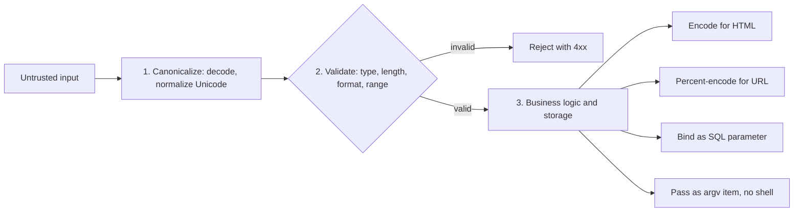

# Input Validation and Output Encoding

## Introduction

Two habits prevent a large share of all web vulnerabilities:

- **Input validation:** when data arrives, check that it is what you expect (the right type, length, format and range) and reject it otherwise.
- **Output encoding:** when data leaves your code for another language, such as HTML, a URL, SQL or a shell, convert it so it can only be read as *data* in that language, never as *instructions*.

Think of an airport. Check-in validates your passport and bag weight: wrong document or a 40 kg suitcase, and you do not get through. But the airport does not stop there. Every bag is still X-rayed before it goes on a plane, because check-in cannot know every danger. Validation is check-in. Encoding is the X-ray at each gate.

Beginners often think one replaces the other. It does not. A perfectly valid surname like `O'Brien` contains a quote that breaks naive SQL. A perfectly valid comment like "I love the `<b>` tag" contains angle brackets that break naive HTML. Validation decides what is *allowed*; encoding makes allowed data *safe* in each place it goes.

The OWASP Top 10 Proactive Controls list this as [C3: Validate all Input and Handle Exceptions](https://top10proactive.owasp.org/the-top-10/), and the failures it prevents (injection, XSS) sit at the top of the [2025 CWE Top 25](https://cwe.mitre.org/top25/archive/2025/2025_cwe_top25.html).

## Where Each Defense Belongs



The order matters:

1. **Canonicalize first.** Decode and normalize data into one standard form *before* checking it. Otherwise `%2e%2e%2f` or full-width letters slip past a check that only looks for `../` or `admin`.
2. **Validate at the trust boundary,** as early as possible, on the **server**.
3. **Encode at the sink,** as late as possible, for the **specific context** where the data is used.

## Input Validation

### Allowlist, not denylist

There are two ways to validate: list what is **allowed** (allowlist) or list what is **forbidden** (denylist). Denylists feel natural and fail constantly, because attackers have endless ways to write the same payload.

**Vulnerable:**

```python
# denylist_filter.py  (Vulnerable: a denylist that looks reasonable)
def clean_comment(text: str) -> str:
    for bad in ("<script>", "</script>", "javascript:"):
        text = text.replace(bad, "")
    return text

attempts = [
    "<script>alert(1)</script>",
    "<scr<script>ipt>alert(1)</scr</script>ipt>",
    "<SCRIPT>alert(1)</SCRIPT>",
    "",
    '<a href="jav&#x61;script:alert(1)">click</a>',
]
for a in attempts:
    print(clean_comment(a))
```

Output:

```text
alert(1)
<script>alert(1)</script>
<SCRIPT>alert(1)</SCRIPT>

<a href="jav&#x61;script:alert(1)">click</a>
```

Only the first, most obvious attempt was stopped. Removing the inner `<script>` even *assembled* a working tag from the second one. The right fix for comments is output encoding or an HTML sanitizer, both shown later on this page. For fields with a known format, the right fix is an allowlist: "a username is 3 to 20 lowercase letters, digits or underscores", and nothing else gets in.

### Syntactic and semantic validation

OWASP's [Input Validation Cheat Sheet](https://cheatsheetseries.owasp.org/cheatsheets/Input_Validation_Cheat_Sheet.html) separates two levels:

| Level | Question | Examples |
| --- | --- | --- |
| Syntactic | Is it the right shape? | Is `age` an integer? Is `email` a valid address? Is `country` a two-letter code? |
| Semantic | Does it make sense here? | Is the start date before the end date? Is the quantity positive? Does this user own the referenced account? |

Syntactic checks belong in a schema. Semantic checks often need business context, such as the database or the current user, so they live in your service code. That last example, ownership, is really **authorization**. It is covered in [Broken Access Control](../3-sec-web-security/2-sec-broken-access-control.mdx).

### Validating with a schema (Pydantic)

Hand-written `if` statements for every field are tedious and easy to get wrong. A schema library declares the rules once. In Python, [Pydantic v2](https://docs.pydantic.dev/latest/) is the standard choice, and FastAPI uses it automatically.

```python
# signup_models.py
import re
import unicodedata
from typing import Annotated, Literal

from pydantic import BaseModel, ConfigDict, EmailStr, Field, ValidationError, field_validator

USERNAME_RE = re.compile(r"[a-z0-9_]{3,20}")

class SignupRequest(BaseModel):
    model_config = ConfigDict(extra="forbid", str_strip_whitespace=True)

    username: str
    email: EmailStr
    age: Annotated[int, Field(ge=13, le=120)]
    plan: Literal["free", "pro", "team"]
    bio: Annotated[str, Field(max_length=500)] = ""

    @field_validator("username")
    @classmethod
    def check_username(cls, v: str) -> str:
        v = unicodedata.normalize("NFKC", v).lower()     # canonicalize first
        if not USERNAME_RE.fullmatch(v):                   # then validate (fullmatch = anchored)
            raise ValueError("3-20 chars: lowercase letters, digits, underscore")
        return v

good = {"username": "Ada_Lovelace", "email": "ada@example.com", "age": 36, "plan": "pro"}
print(SignupRequest(**good))

bad = {"username": "ad", "email": "not-an-email", "age": "lots", "plan": "enterprise",
       "is_admin": True}
try:
    SignupRequest(**bad)
except ValidationError as e:
    for err in e.errors():
        print(err["loc"], "->", err["msg"])
```

Install with `pip install pydantic email-validator` (`EmailStr` needs the `email-validator` package).

Output:

```text
username='ada_lovelace' email='ada@example.com' age=36 plan='pro' bio=''
('username',) -> Value error, 3-20 chars: lowercase letters, digits, underscore
('email',) -> value is not a valid email address: An email address must have an @-sign.
('age',) -> Input should be a valid integer, unable to parse string as an integer
('plan',) -> Input should be 'free', 'pro' or 'team'
('is_admin',) -> Extra inputs are not permitted
```

Each line of the model is a security decision:

- `Literal["free", "pro", "team"]` is an allowlist. An attacker cannot invent an `enterprise` plan.
- `Field(ge=13, le=120)` and `max_length=500` enforce ranges and sizes, which also limits abuse such as megabyte-long bios.
- `extra="forbid"` rejects unknown fields. This blocks **mass assignment**, where an attacker adds `"is_admin": true` hoping your code copies every field into the user record.

### Using the schema in a Flask route

```python
# signup_app.py
from flask import Flask, jsonify, request
from pydantic import ValidationError

from signup_models import SignupRequest

app = Flask(__name__)
app.config["MAX_CONTENT_LENGTH"] = 16 * 1024          # reject bodies over 16 KB before parsing

@app.post("/signup")
def signup():
    payload = request.get_json(silent=True)
    if not isinstance(payload, dict):
        return jsonify(error="expected a JSON object"), 400
    try:
        data = SignupRequest.model_validate(payload)
    except ValidationError as e:
        # Report which fields failed and why, without echoing the input back
        problems = [{"field": ".".join(map(str, err["loc"])), "problem": err["msg"]}
                    for err in e.errors(include_input=False)]
        return jsonify(error="invalid input", details=problems), 422
    # From here on, `data` is typed and trusted to match the schema
    return jsonify(created=data.username, plan=data.plan), 201
```

To try it, remove the demo lines at the bottom of `signup_models.py` (everything after the class), then run:

```python
# try_signup.py
from signup_app import app

c = app.test_client()
r = c.post("/signup", json={"username": "grace_h", "email": "grace@example.com",
                            "age": 40, "plan": "team"})
print(r.status_code, r.get_json())
r = c.post("/signup", json={"username": "grace_h", "email": "grace@example.com",
                            "age": 9, "plan": "team", "role": "admin"})
print(r.status_code, r.get_json())
r = c.post("/signup", data="x" * 20000, content_type="application/json")
print(r.status_code)
```

Output:

```text
201 {'created': 'grace_h', 'plan': 'team'}
422 {'details': [{'field': 'age', 'problem': 'Input should be greater than or equal to 13'}, {'field': 'role', 'problem': 'Extra inputs are not permitted'}], 'error': 'invalid input'}
413
```

Three layers worked here: a size limit (413) before any parsing, a type check that the body is a JSON object (400), and the schema (422). In FastAPI you get the schema step automatically by declaring `def signup(body: SignupRequest)`. For API-specific validation, including OpenAPI schemas, see [Schema Validation for APIs](../7-sec-api-security/4-sec-api-input-validation.mdx).

### Regex traps

Regular expressions are a common way to write allowlists, and they have three classic traps:

```python
# regex_pitfalls.py
import re
import time
import unicodedata

# Pitfall 1: re.match only anchors the start; "$" also matches before a trailing newline
print(bool(re.match(r"[a-z]+", "abc; rm -rf /")))     # True: only the prefix was checked
print(bool(re.match(r"^[a-z]+$", "abc\n")))           # True: "$" matches before the final \n
print(bool(re.fullmatch(r"[a-z]+", "abc\n")))         # False: fullmatch checks the whole string

# Pitfall 2: look-alike characters
fullwidth = "ａｄｍｉｎ"                                  # fullwidth letters
print(unicodedata.normalize("NFKC", fullwidth) == "admin")   # True: NFKC folds them
cyrillic_a = "аdmin"                               # Cyrillic 'а' + "dmin"
print(unicodedata.normalize("NFKC", cyrillic_a) == "admin")  # False: still a different string
print(bool(re.fullmatch(r"[a-z0-9_]{3,20}", cyrillic_a)))   # False: ASCII allowlist rejects it

# Pitfall 3: catastrophic backtracking (ReDoS)
evil = re.compile(r"(a+)+$")
for n in (16, 20, 24):
    start = time.perf_counter()
    evil.match("a" * n + "!")
    print(n, f"{time.perf_counter() - start:.3f}s")
```

Example output (timings vary by machine):

```text
True
True
False
True
False
False
16 0.001s
20 0.023s
24 0.407s
```

1. **Anchoring.** Use `re.fullmatch()` in Python. `re.match` with `^...$` still accepts a trailing newline, which matters if the value later lands in a header or a log line.
2. **Unicode.** Normalize with NFKC before validating, so different encodings of the same text compare equal. Normalization does *not* catch every look-alike (the Cyrillic `а` survives), so for identifiers such as usernames, an ASCII allowlist is the simplest strong defense. If you must allow international names, see the Unicode [UTS #39 security mechanisms](https://www.unicode.org/reports/tr39/) for confusable detection.
3. **ReDoS.** Nested quantifiers like `(a+)+` take exponential time on inputs that *almost* match. Each extra character roughly doubles the time. Avoid nested quantifiers, limit input length *before* running the regex, and consider a linear-time engine such as RE2 (the `google-re2` package) for user-supplied or complex patterns.

### What to validate, field by field

| Data | Validate with | Watch out for |
| --- | --- | --- |
| IDs | Integer or UUID type | Strings like `1 OR 1=1` in "numeric" fields |
| Enums (status, sort order, plan) | `Literal` / allowlist set | Free text where only a few values are valid |
| Free text (names, comments) | Max length, valid UTF-8, no control characters | Trying to "clean" it with a denylist |
| Email, phone, dates | Dedicated parsers (`email-validator`, `datetime.fromisoformat`) | Hand-written regexes that miss edge cases |
| URLs | Parse with `urllib.parse`, allowlist scheme and host | `javascript:` URLs, SSRF to internal hosts (see [SSRF](../3-sec-web-security/6-sec-ssrf.mdx)) |
| File names and paths | Generate your own names; resolve and check paths | Path traversal (see [Path Traversal](../3-sec-web-security/7-sec-command-injection.mdx)) |
| Uploaded files | Size, type by content, not by extension | See [Secure File Uploads](../3-sec-web-security/10-sec-file-upload-security.mdx) |
| Structured data (JSON, XML) | Schema, depth and size limits | XML external entities, deeply nested JSON |

## Output Encoding

Validation cannot make every value safe everywhere. A valid comment may legitimately contain `<`, `&`, quotes and `/`. Output encoding converts those characters into a form that the **target language** treats as plain data.

The key word is **context**. The same string needs different encoding depending on where it goes:

```python
# encoding_contexts.py
import json
from urllib.parse import quote, urlsplit

import nh3
from markupsafe import escape

name = '">'
search = "cats & dogs/?#"
homepage = "javascript:alert(document.cookie)"

# 1. HTML body and quoted attribute: HTML-escape
print(f"<p>Hello {escape(name)}</p>")
print(f'<input value="{escape(name)}">')

# 2. URL query parameter: percent-encode the value
print(f'<a href="/search?q={quote(search, safe="")}">search</a>')

# 3. URL in href: validate the scheme, then HTML-escape
def safe_url(url: str) -> str:
    return url if urlsplit(url).scheme in {"http", "https"} else "#"
print(f'<a href="{escape(safe_url(homepage))}">homepage</a>')

# 4. Data for JavaScript: JSON-encode, then put it in an HTML attribute
data = {"name": name}
print(f"<div id=\"app\" data-user=\"{escape(json.dumps(data))}\"></div>")

# 5. User-supplied rich text: sanitize with an allowlist
comment = '<b>Nice post!</b><script>steal()</script><a href="javascript:x()" onclick="y()">link</a>'
print(nh3.clean(comment, tags={"b", "i", "a", "p"}, attributes={"a": {"href"}}))
```

Install with `pip install markupsafe nh3`.

Output:

```text
<p>Hello &#34;&gt;&lt;img src=x onerror=alert(1)&gt;</p>
<input value="&#34;&gt;&lt;img src=x onerror=alert(1)&gt;">
<a href="/search?q=cats%20%26%20dogs%2F%3F%23">search</a>
<a href="#">homepage</a>
<div id="app" data-user="{&#34;name&#34;: &#34;\&#34;&gt;&lt;img src=x onerror=alert(1)&gt;&#34;}"></div>
<b>Nice post!</b><a rel="noopener noreferrer">link</a>
```

What happened in each context:

| Context | Encoding | Why the payload failed |
| --- | --- | --- |
| HTML body or quoted attribute | HTML entities (`&lt;`, `&#34;`) | The quote and `<` became text, so no new tag or attribute could start |
| URL parameter | Percent-encoding | `&`, `/`, `?`, `#` cannot split the URL into new parameters |
| URL in `href` | Scheme allowlist + HTML escaping | `javascript:` is not an allowed scheme, so the link became `#` |
| Data for JavaScript | JSON, then HTML attribute escaping | The script reads `JSON.parse(el.dataset.user)`; the data never becomes code |
| Rich text | HTML sanitizer with an allowlist | `script` and `onclick` are not on the list, and the `javascript:` href was dropped |

:::caution Prefer frameworks over hand encoding
You rarely need to call `escape()` yourself. Jinja2 templates in Flask auto-escape `.html` templates, React escapes values in JSX, and Django templates escape by default. Your job is mostly to **not turn auto-escaping off**: avoid `|safe`, `Markup(user_input)`, `dangerouslySetInnerHTML` and `innerHTML` with user data. The details are in [Cross-Site Scripting (XSS)](../3-sec-web-security/4-sec-xss.mdx).
:::

### Sanitizing versus encoding

Encoding shows the user's text exactly as typed: `<b>` appears literally on the page. Sometimes you *want* some HTML to render, for example bold text in a comment or output from a Markdown editor. Then you need an **HTML sanitizer**, which parses the HTML and keeps only allowlisted tags and attributes.

- In Python, [nh3](https://pypi.org/project/nh3/) (bindings to the Rust `ammonia` library) is the maintained choice. The older `bleach` library was deprecated by Mozilla in 2023.
- In the browser, [DOMPurify](https://github.com/cure53/DOMPurify) is the standard.
- Never write your own sanitizer with regexes. HTML parsing has too many edge cases.

### Other sinks use other techniques

Not every sink has an "encoding" function. For several important sinks, the safe technique is to **keep data and code in separate channels**:

| Sink | Do not | Do |
| --- | --- | --- |
| SQL | Escape quotes yourself | Parameterized queries (see [SQL Injection](../3-sec-web-security/3-sec-sql-injection.mdx)) |
| Shell | `shell=True` with escaping | `subprocess.run([...])` with an argument list |
| LDAP, XPath | String concatenation | Library APIs with parameter binding |
| Logs | Write raw user text | Strip or encode newlines (see [Error Handling and Logging](./2-sec-error-handling-and-logging.mdx)) |

## Real-World Scenario

**You run a community recipe site in Flask.** Users post recipes with titles, ingredient lists and a free-text "story" field. Product wants the story to support bold, italics and links. A security researcher reports that a recipe story containing an `` payload runs JavaScript for every visitor (stored XSS). Your options: add a WAF rule, validate the story harder, sanitize it, or encode it.

### The solution

1. **Title and ingredients:** these never need HTML. Validate with a schema (max lengths, no control characters), store as plain text, and let Jinja auto-escaping encode them on output. No special code needed.
2. **Story:** it needs a few formatting tags, so store the raw text and **sanitize on output** (or on save, keeping the original) with `nh3.clean()` and a tight allowlist: `b`, `i`, `p`, `ul`, `li`, `a` with `href` limited to `http` and `https`.
3. **Defense in depth:** add a strict [Content Security Policy](../3-sec-web-security/9-sec-security-headers.mdx) that blocks inline scripts. If a sanitizer bug ever lets something through, CSP stops it from running.
4. **Fix the class:** search templates for `|safe` and `Markup(` to find every other place that bypasses auto-escaping.

### Why this approach

Each field gets the cheapest defense that fully fits it. Plain-text fields need nothing beyond the framework default. Only the one field that must render HTML gets a sanitizer, which keeps the risky code in one place. CSP is a safety net that turns a sanitizer bypass from "account takeover" into "broken formatting".

### When to use it, and when not to

Sanitizing is only right when you truly need user-supplied HTML. If the product can live with Markdown, render Markdown to HTML **and then sanitize** the result, since Markdown renderers often pass raw HTML through. If no formatting is needed, encoding alone is simpler and safer.

### Alternatives and trade-offs

| Approach | Pros | Cons | Best for |
| --- | --- | --- | --- |
| Output encoding (template auto-escape) | Simple, complete for its context, zero config | No formatting at all | All plain-text fields |
| HTML sanitizer (nh3, DOMPurify) | Allows safe formatting | Must be configured carefully; library bugs happen | Rich text fields |
| Strict input validation of the story | Rejects junk early | Cannot express "safe HTML" with regexes; blocks legitimate text | Structured fields, not free text |
| WAF rule | Fast to deploy, no code change | Bypassable, false positives, does not fix the bug | Temporary shield while the fix ships |
| Content Security Policy | Blocks script execution even after a bug | Needs effort to remove inline scripts | Every site, as an extra layer |

The answer to "WAF or code fix?" is almost always **both, in that order of urgency**: a WAF rule today if the bug is actively exploited, the code fix this week, and CSP as a permanent backstop.

## Common Mistakes

- **Validating only in the browser.** HTML `required` and `pattern` attributes help users; they do nothing against `curl`.
- **Encoding at input time.** Storing `&lt;b&gt;` in the database corrupts data for every non-HTML consumer (APIs, CSV exports, emails) and leads to double encoding. Store raw, encode on output.
- **Using the wrong encoder for the context.** HTML-escaping a value placed inside a `<script>` block or an unquoted attribute is not enough. Keep untrusted data out of those contexts.
- **Turning auto-escaping off "just this once".** Every `|safe` on user data is a potential XSS.
- **Trusting `Content-Type` or file extensions.** Both are attacker-controlled.
- **Forgetting size limits.** Unbounded strings, arrays and JSON nesting enable denial of service.
- **Echoing invalid input in error messages.** Reflecting the bad value back is itself a common XSS source.

## Summary

- **Validate input** at the server's trust boundary: canonicalize, then check type, length, format and range with an **allowlist**.
- Use a **schema library** such as Pydantic; set `extra="forbid"` to block mass assignment.
- Use `re.fullmatch`, normalize Unicode with NFKC, and avoid nested quantifiers that cause **ReDoS**.
- **Encode output** for the exact context (HTML, attribute, URL, JavaScript data) at the moment of output, ideally via framework auto-escaping.
- Use an **HTML sanitizer** like nh3 or DOMPurify only when users truly need to submit HTML.
- For SQL, shell and similar sinks, **keep data and code in separate channels** (parameters, argument lists).
- Validation and encoding work together. Neither replaces the other.

## Exercises

1. Extend `SignupRequest` with a `website` field that accepts only `https` URLs on any host except `localhost` and private IP ranges. Write three test cases that should fail.
2. Find a regular expression in a project you know. Is it anchored with `fullmatch` (or equivalent)? Does it have nested quantifiers? Test it with a long almost-matching input.
3. Build a Flask route that renders a user comment three ways: raw (vulnerable), escaped, and sanitized with nh3. Try the five payloads from the denylist example against each, in a local app only.
4. Practice spotting validation and encoding failures in a safe lab such as [OWASP Juice Shop](https://owasp.org/www-project-juice-shop/) or the [PortSwigger Web Security Academy](https://portswigger.net/web-security) XSS labs. Only test systems you own or have written permission to test.

Related pages: [Cross-Site Scripting (XSS)](../3-sec-web-security/4-sec-xss.mdx), [SQL Injection](../3-sec-web-security/3-sec-sql-injection.mdx), [Schema Validation for APIs](../7-sec-api-security/4-sec-api-input-validation.mdx). Next: [Secure Error Handling and Logging](./2-sec-error-handling-and-logging.mdx).
