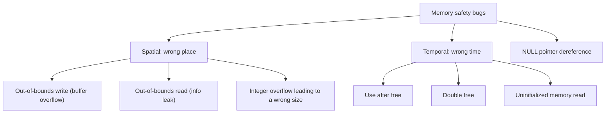
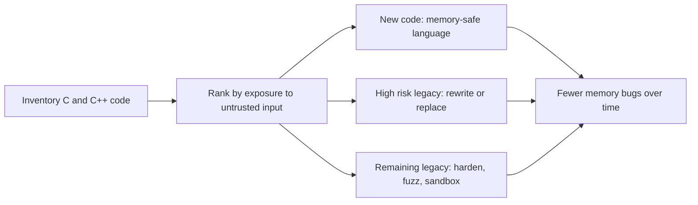

# Memory Safety

## Introduction

Programs keep their data in memory: a buffer for a username, an object for a session, an array of pixels. **Memory safety** means the program can only read and write the memory it is supposed to, and only while that memory is still valid.

Languages like C and C++ give the programmer direct control over memory and trust them to get every size and every lifetime right. When they do not, the program may write past the end of a buffer or use an object after it was freed. Those bugs do not just crash programs. Attackers can sometimes turn them into reading secrets from memory or taking control of the program's execution.

An analogy: memory is a row of numbered lockers. A memory-safe language is a locker room with an attendant who checks your ticket every time: you can only open your own lockers, and only until you hand back the key. In C, there is no attendant. If your code says "put this coat in locker 17", it happens, even if locker 17 belongs to someone else, or you returned it an hour ago and it now holds another person's wallet.

This matters to every developer, not only systems programmers:

- Memory-safety weaknesses are a large part of the [2025 CWE Top 25](https://cwe.mitre.org/top25/archive/2025/2025_cwe_top25.html): out-of-bounds write (#5), use after free (#7), out-of-bounds read (#8), classic buffer overflow (#11), NULL pointer dereference (#13), stack-based (#14) and heap-based (#16) buffer overflow.
- Your Python, Node or Java app runs on top of C and C++: the interpreter, the OS, TLS libraries, image and XML parsers, database drivers.
- Google reported in 2024 that memory safety issues made up [76% of Android vulnerabilities in 2019 and 24% in 2024](https://security.googleblog.com/2024/09/eliminating-memory-safety-vulnerabilities-Android.html), describing the industry norm as around 70%, after it shifted new code to memory-safe languages.
- In June 2025, CISA and the NSA published joint guidance, [Memory Safe Languages: Reducing Vulnerabilities in Modern Software Development](https://www.cisa.gov/news-events/alerts/2025/06/24/new-guidance-released-reducing-memory-related-vulnerabilities), recommending memory-safe languages as the most comprehensive mitigation for this class of bugs.

This page is about recognizing and preventing these bugs as a builder. You do not need to write exploits to defend against them.

## The Main Bug Classes

Memory bugs come in two families: **spatial** (accessing the wrong *place*) and **temporal** (accessing at the wrong *time*).



| Bug | What happens | Typical impact | CWE |
| --- | --- | --- | --- |
| Out-of-bounds write | Data written past the end of a buffer overwrites neighbors | Crash, corrupted data, possible code execution | CWE-787 |
| Out-of-bounds read | Code reads past the end of a buffer | Leaks secrets from memory (Heartbleed was this class) | CWE-125 |
| Use after free | Memory is used after being returned to the allocator | Attacker-controlled data reused as a live object | CWE-416 |
| Double free | The same memory is freed twice | Allocator corruption | CWE-415 |
| Integer overflow | A size calculation wraps around to a small number | Undersized buffer, then overflow | CWE-190 |
| NULL dereference | Code uses a pointer that is NULL | Usually a crash (denial of service) | CWE-476 |
| Uninitialized read | Code reads memory before writing it | Leaks old data | CWE-457 |

## A Buffer Overflow, Up Close

Here is the classic mistake: copying input into a fixed-size buffer without checking its length.

**Vulnerable:**

```c
/* greet.c  (Vulnerable: classic stack buffer overflow) */
#include <stdio.h>
#include <string.h>

void greet(const char *name) {
    char buf[16];
    strcpy(buf, "Hi, ");      /* 4 bytes */
    strcat(buf, name);        /* no bounds check: writes past buf if name is long */
    printf("%s\n", buf);
}

int main(int argc, char **argv) {
    greet(argc > 1 ? argv[1] : "world");
    return 0;
}
```

`buf` has room for 16 bytes. `"Hi, "` uses 4, so any name longer than 11 characters (plus the terminating zero) writes into whatever sits next to `buf` on the stack, which can include the function's return address.

Compile it on your own machine without protections and give it a long name:

```bash
gcc -O0 -fno-stack-protector -U_FORTIFY_SOURCE -o greet_plain greet.c
./greet_plain Ada
./greet_plain AAAAAAAAAAAAAAAAAAAAAAAA
```

Example output:

```text
Hi, Ada
Segmentation fault (core dumped)
```

A crash is the *lucky* outcome. With carefully chosen bytes instead of `A`s, the overwritten memory can redirect the program. Modern defenses make that much harder, but they do not make the bug safe.

**Fixed:** use a bounded function and treat truncation as an error.

```c
/* greet_fixed.c  (Fixed: bounded write, truncation detected) */
#include <stdio.h>

int greet(const char *name) {
    char buf[16];
    int n = snprintf(buf, sizeof buf, "Hi, %s", name);   /* never writes more than 16 bytes */
    if (n < 0 || (size_t)n >= sizeof buf) {
        fprintf(stderr, "name too long (%d bytes needed)\n", n);
        return -1;                                       /* fail closed: refuse, do not truncate silently */
    }
    printf("%s\n", buf);
    return 0;
}

int main(int argc, char **argv) {
    return greet(argc > 1 ? argv[1] : "world") == 0 ? 0 : 1;
}
```

```bash
gcc -Wall -Wextra -O2 -o greet_fixed greet_fixed.c
./greet_fixed Ada
./greet_fixed AAAAAAAAAAAAAAAAAAAAAAAA
```

Output:

```text
Hi, Ada
name too long (28 bytes needed)
```

`snprintf` returns how many bytes it *wanted* to write, so you can detect truncation. Silently truncating can cause its own bugs, for example when a truncated path or username suddenly matches a different one.

## Finding Memory Bugs: Sanitizers

You cannot rely on crashes to find memory bugs: many corrupt memory silently. **AddressSanitizer (ASan)**, built into GCC and Clang, adds checks around every memory access and reports the exact problem.

```bash
gcc -g -fsanitize=address -fno-omit-frame-pointer -o greet greet.c
./greet AAAAAAAAAAAAAAAAAAAAAAAA
```

Example output (shortened):

```text
==3218610==ERROR: AddressSanitizer: stack-buffer-overflow on address 0x74d8184f0030 ...
WRITE of size 25 at 0x74d8184f0030 thread T0
    #0 0x78d81ab23256 in strcat
    #1 0x5fc4f6632327 in greet greet.c:8
    #2 0x5fc4f66323df in main greet.c:13
  This frame has 1 object(s):
    [32, 48) 'buf' (line 6) <== Memory access at offset 48 overflows this variable
SUMMARY: AddressSanitizer: stack-buffer-overflow greet.c:8 in greet
```

It names the bug class, the variable (`buf`), and the line (`greet.c:8`). Temporal bugs are caught too:

```c
/* uaf.c  (Vulnerable: use after free) */
#include <stdio.h>
#include <stdlib.h>
#include <string.h>

struct session { char user[32]; int is_admin; };

int main(void) {
    struct session *s = malloc(sizeof *s);
    strcpy(s->user, "alice");
    s->is_admin = 0;
    free(s);                       /* session ends... */
    printf("user=%s admin=%d\n", s->user, s->is_admin);   /* ...but the pointer is still used */
    return 0;
}
```

```bash
gcc -g -fsanitize=address -o uaf uaf.c && ./uaf
```

Example output (shortened):

```text
==3221946==ERROR: AddressSanitizer: heap-use-after-free on address 0x7a74a31e0030 ...
READ of size 4 at 0x7a74a31e0030 thread T0
    #0 0x61ab6415932a in main uaf.c:13
```

Without ASan this program would probably print `user=alice admin=0` and look fine. In a real server, the freed memory might be reused for another user's data by then, and `is_admin` might read as `1`.

Other useful tools:

| Tool | Finds | When to use |
| --- | --- | --- |
| AddressSanitizer (`-fsanitize=address`) | Out-of-bounds, use-after-free, double free | Tests and fuzzing builds |
| UndefinedBehaviorSanitizer (`-fsanitize=undefined`) | Integer overflow, misaligned access, other undefined behavior | Tests and fuzzing builds |
| MemorySanitizer (Clang) | Reads of uninitialized memory | Tests, needs all code instrumented |
| ThreadSanitizer (`-fsanitize=thread`) | Data races | Concurrent code |
| Valgrind | Many memory errors, without recompiling | Debugging existing binaries, slower |
| Fuzzers (libFuzzer, AFL++) | Inputs that trigger crashes | Parsers and anything handling untrusted bytes |

Sanitizers slow programs down and are meant for testing, not production. Combine them with **fuzzing**: a fuzzer feeds millions of generated inputs to a parser while ASan watches for memory errors. Google's [OSS-Fuzz](https://google.github.io/oss-fuzz/) runs this continuously for many open-source projects.

## Hardening: Making Bugs Harder to Exploit

Compilers and operating systems add defenses that do not fix bugs but make them much harder to exploit. Compiling the same vulnerable `greet.c` with fortification and stack protection:

```bash
gcc -O2 -U_FORTIFY_SOURCE -D_FORTIFY_SOURCE=3 -fstack-protector-strong -o greet_hard greet.c
./greet_hard AAAAAAAAAAAAAAAAAAAAAAAA
```

Example output:

```text
*** buffer overflow detected ***: terminated
Aborted (core dumped)
```

The program still has the bug, but it now stops in a controlled way instead of continuing with corrupted memory. The OpenSSF [Compiler Options Hardening Guide for C and C++](https://best.openssf.org/Compiler-Hardening-Guides/Compiler-Options-Hardening-Guide-for-C-and-C++.html) maintains a recommended baseline. At the time of writing it includes flags such as:

```bash
# Excerpt of the OpenSSF baseline for GCC and Clang; check the guide for the current list
CFLAGS="-O2 -Wall -Wformat -Wformat=2 -Wconversion -Wimplicit-fallthrough \
  -Werror=format-security \
  -U_FORTIFY_SOURCE -D_FORTIFY_SOURCE=3 \
  -D_GLIBCXX_ASSERTIONS \
  -fstrict-flex-arrays=3 \
  -fstack-clash-protection -fstack-protector-strong \
  -Wl,-z,nodlopen -Wl,-z,noexecstack -Wl,-z,relro -Wl,-z,now"
```

| Defense | What it does | Limitation |
| --- | --- | --- |
| Stack canaries (`-fstack-protector-strong`) | Detect overwrites of the stack before a function returns | Does not catch heap bugs or reads |
| `_FORTIFY_SOURCE` | Adds size checks to `strcpy`, `memcpy` and similar when sizes are known | Only where the compiler can see the buffer size |
| ASLR | Randomizes memory addresses each run | Defeated by information leaks |
| Non-executable stack and heap (NX) | Data memory cannot run as code | Code-reuse techniques work around it |
| RELRO, `-z now` | Makes some internal tables read-only | Narrow scope |
| Control-flow integrity (CFI), shadow stacks | Restrict where indirect jumps and returns can go | Needs compiler and hardware support |

Most Linux distributions already enable many of these by default for their packages. For your own C or C++ code, check your build flags explicitly.

## Memory-Safe Languages

Mitigations reduce risk; **memory-safe languages remove most of the bug class**. They check bounds automatically and manage object lifetimes for you, either with a garbage collector (Java, C#, Go, Python, JavaScript, Swift's reference counting) or with compile-time ownership rules (Rust).

### What happens on an out-of-bounds access

| Language | Code | Result |
| --- | --- | --- |
| C | `int a[3]; a[10] = 1;` | Silent memory corruption (undefined behavior) |
| Python | `a = [1, 2, 3]; a[10] = 1` | `IndexError: list assignment index out of range` |
| Java | `int[] a = new int[3]; a[10] = 1;` | `ArrayIndexOutOfBoundsException` |
| Go | `a := []int{1, 2, 3}; a[10] = 1` | Panic: index out of range |
| Rust | `let mut a = vec![1, 2, 3]; a[10] = 1;` | Panic: index out of bounds |

A crash or exception is still a bug (and possibly a denial of service), but it cannot be turned into reading another user's data or running attacker code.

### Rust: safety without a garbage collector

Rust catches temporal bugs at **compile time** through ownership and borrowing. The use-after-free pattern from `uaf.c` does not compile:

```rust
struct Session {
    user: String,
    is_admin: bool,
}

fn end_session(s: Session) {
    // takes ownership; the session is dropped (freed) when this function returns
    println!("ending session for {}", s.user);
}

fn main() {
    let s = Session { user: String::from("alice"), is_admin: false };
    end_session(s);                      // ownership moves into end_session
    println!("admin = {}", s.is_admin);  // compile error: s was moved
}
```

The compiler rejects this with error `E0382` ("use of moved value" / "borrow of moved value") and points at both lines. The bug never reaches a test, let alone production. The trade-off is a steeper learning curve, especially around lifetimes and shared mutable state. See the [Rust tutorial](/docs/language/rust) to get started.

### Memory-safe does not mean bug-free

- **Escape hatches** exist: `unsafe` blocks in Rust, `ctypes` and C extensions in Python, `sun.misc.Unsafe` and JNI in Java, `unsafe` and cgo in Go. Review these carefully and keep them small.
- **Native dependencies** are not memory-safe. A Python app that parses images with a C library inherits that library's bugs. Keep those dependencies patched (see [Dependency Scanning](../6-sec-appsec-and-devsecops/4-sec-dependency-scanning.mdx)).
- **Data races** can break safety in some languages. Go's memory model allows races on multi-word values like slices and interfaces to corrupt memory, so run tests with `go test -race`. Race conditions in general are covered in [Race Conditions and TOCTOU](./5-sec-race-conditions.mdx).
- **Logic bugs** such as injection and broken access control are unaffected. Most of this tutorial still applies.

### Migrating realistically

The CISA and NSA guidance does not ask anyone to rewrite everything at once. It recommends incremental adoption: write **new** components in memory-safe languages, prioritize rewriting the riskiest parts (code that parses untrusted input, network-facing services), and protect remaining legacy code with the hardening, sanitizers and fuzzing above. CISA's [Product Security Bad Practices](https://www.cisa.gov/resources-tools/resources/product-security-bad-practices) guidance also asks manufacturers of existing memory-unsafe products to publish a **memory safety roadmap**.



Google's Android data is the most cited evidence for this strategy: the share of memory-safety vulnerabilities fell as new code moved to memory-safe languages, even though much old C and C++ code remained.

## Real-World Scenario

**Your SaaS lets users upload profile pictures.** A Python service creates thumbnails using an image library that wraps a C decoder. A CVE is published for a heap overflow in that decoder, triggered by a crafted image file. You patch within a day, but the CTO asks: "This is the third image-parsing CVE this year. What should we change structurally?"

### The options

1. **Keep patching quickly** with automated dependency updates.
2. **Sandbox the decoder:** run thumbnailing in a separate, short-lived worker process or container with no network access, no secrets, a read-only filesystem, a seccomp profile and strict CPU and memory limits.
3. **Switch to a memory-safe decoder** for the formats you accept (several image codecs now have Rust implementations).
4. **Reduce attack surface:** accept only JPEG and PNG, check file size and dimensions before decoding, and re-encode every image.
5. **Fuzz** your own image-handling code path if you maintain native code.

### The recommendation

Do 1, 2 and 4 now, and evaluate 3. Fast patching is necessary but always lags behind disclosure. Sandboxing turns a future decoder bug from "attacker runs code next to your database credentials" into "attacker crashes an isolated worker with nothing to steal". Limiting formats removes whole decoders from the attack surface. A memory-safe decoder is the long-term fix, but it needs testing for compatibility and performance first.

### Why this approach

You cannot audit a third-party C decoder yourself, so the strategy assumes it *will* have more bugs and limits the damage. This is [defense in depth](../0-sec-fundamentals/4-sec-defense-in-depth.mdx) and [least privilege](../0-sec-fundamentals/5-sec-least-privilege.mdx) applied to memory safety.

### Alternatives and trade-offs

| Approach | Pros | Cons | Best for |
| --- | --- | --- | --- |
| Patch quickly | Low effort, always needed | Reactive; zero-days hit before patches | Everyone, as a baseline |
| Sandbox the native code | Contains future bugs, no rewrite | Infrastructure work, some latency | Parsers of untrusted files |
| Memory-safe replacement library | Removes the bug class | Compatibility and performance risk, migration effort | Long-term, high-exposure components |
| Rewrite in-house code in Rust or Go | Full control and safety | Expensive, skills needed | Code you own that parses untrusted input |
| Hardening flags + fuzzing | Cheap for code you build | Makes exploitation harder, does not remove bugs | Legacy C and C++ you maintain |
| Reduce formats and features | Removes attack surface entirely | May annoy some users | Upload features |

## Common Mistakes

- **Using unbounded functions:** `strcpy`, `strcat`, `sprintf`, `gets` (removed from C11). Use bounded versions and check their return values.
- **Trusting a length field from the input.** A packet that says "I am 64 KB long" while being 1 byte long is how Heartbleed-style over-reads happen.
- **Size arithmetic without overflow checks:** `malloc(count * size)` can wrap around. Use `calloc` or checked multiplication.
- **Keeping pointers after `free`.** Set them to `NULL`, and prefer clear ownership rules or smart pointers (`std::unique_ptr`) in C++.
- **Only running sanitizers locally once.** Run ASan and UBSan builds in CI with your test suite.
- **Assuming a memory-safe language makes the whole stack safe.** Native dependencies, `unsafe` blocks and FFI need the same care as C.
- **Waiting for a full rewrite.** Start with new code and the most exposed components.

## Summary

- Memory safety bugs are **spatial** (out-of-bounds read and write) or **temporal** (use after free, double free), and they rank high in the 2025 CWE Top 25.
- In C and C++, use bounded APIs, check sizes and return values, and treat truncation as an error.
- **Sanitizers** (ASan, UBSan, TSan) and **fuzzing** find bugs that tests miss; run them in CI.
- **Hardening flags** (stack protector, `_FORTIFY_SOURCE=3`, RELRO, NX, ASLR) make exploitation harder but do not fix bugs.
- **Memory-safe languages** remove most of the class; CISA and NSA recommend them and incremental migration.
- Memory-safe apps still depend on native code: patch it, sandbox it, and review `unsafe` and FFI code.

## Exercises

1. Compile `greet.c` four ways (plain, ASan, hardened, fixed) and compare the behavior with a 30-character name.
2. Write a tiny C function that parses a "length-prefixed" message (first byte is the length). Make it vulnerable to an over-read, catch the bug with ASan, then fix it.
3. List the native (C or C++) dependencies of a Python or Node project you know, for example with `pip show` or by looking for compiled `.so` files. Which of them parse untrusted input?
4. Read Google's post on [eliminating memory safety vulnerabilities at the source](https://security.googleblog.com/2024/09/eliminating-memory-safety-vulnerabilities-Android.html) and summarize, in five sentences, why focusing on new code worked.

Related pages: [Language-Specific Security Pitfalls](./8-sec-language-specific-pitfalls.mdx), [Exploitation Basics](../10-sec-offensive-security/5-sec-exploitation-basics.mdx) (lab-only), [Linux Hardening](../9-sec-system-hardening/0-sec-linux-hardening.mdx). Next: [Race Conditions and TOCTOU](./5-sec-race-conditions.mdx).
