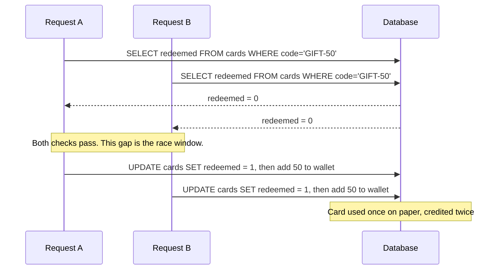
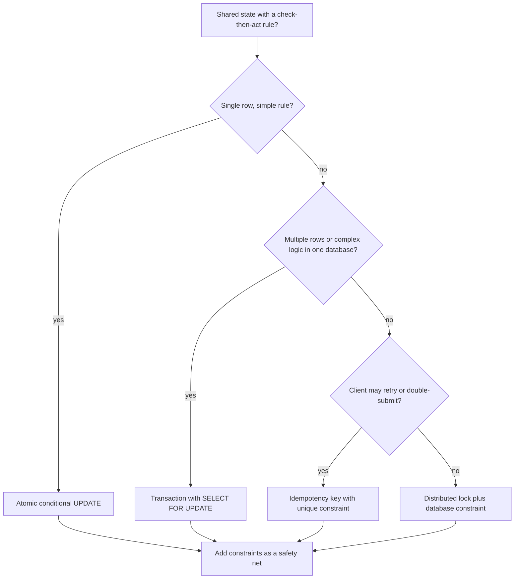

# Race Conditions and TOCTOU

## Introduction

A **race condition** happens when the result of a program depends on the timing of events it does not control, such as two requests arriving at the same moment. In security, the most common form is **TOCTOU**: *Time Of Check to Time Of Use*. The code checks something ("has this coupon been used?"), then acts on the answer ("apply the discount"). If the world changes in between, the check is no longer true when the action happens.

An analogy: two people share a bank account with 100 dollars. They stand at two different ATMs and both ask "is there at least 100 dollars?" at the same second. Both ATMs say yes. Both dispense 100 dollars. The check was correct when it ran; the problem is that **check and act were two separate steps**, and someone else acted in the gap.

Web applications are full of this pattern because they handle many requests in parallel: threads, processes, containers and servers all touching the same database. Attackers do not need luck. Tools like Burp Suite can send 20 to 30 requests in a single TCP packet over HTTP/2, the [single-packet attack](https://portswigger.net/web-security/race-conditions) described by PortSwigger, so they all arrive within a millisecond of each other.

Race conditions map to CWE-362 (Concurrent Execution using Shared Resource with Improper Synchronization) and CWE-367 (TOCTOU), and they are one of the example scenarios in OWASP's [A10:2025 Mishandling of Exceptional Conditions](https://top10.owasp.org/2025/A10_2025-Mishandling_of_Exceptional_Conditions).

:::warning Only test what you own
The examples on this page run against a local SQLite file and a temporary directory. To practice race attacks over HTTP, use the [PortSwigger Web Security Academy race condition labs](https://portswigger.net/web-security/race-conditions) or your own local app. Never send parallel attack traffic to systems you do not own or have written permission to test.
:::

## Where Races Hide

| Pattern | Example | Impact |
| --- | --- | --- |
| Limit overrun | Use a single-use coupon, gift card or invite code many times | Money or credit created from nothing |
| Balance check | Withdraw or transfer more than the balance | Negative balances, theft |
| Rate limit bypass | Many login attempts arrive before the counter updates | Brute force past the limit |
| Duplicate actions | Double-submitted payment or order | Double charges, duplicated stock |
| Multi-step state | Change email and confirm it in parallel | Account takeover in some flows |
| File system TOCTOU | Check a path, then open it after an attacker swaps in a symlink | Overwriting or reading protected files |

PortSwigger calls the first group **limit-overrun** races: anything with a "you can only do this N times" rule enforced by a check followed by an update.

## The Anatomy of a Limit-Overrun Race



The race window is the time between the `SELECT` and the `UPDATE`. Anything that takes time in between (another query, a call to a fraud service, even Python running some business logic) widens it.

### Demonstration

This script redeems one 50-unit gift card from ten threads at once, against a local SQLite file. Each thread uses its own connection, just like separate web requests would.

```python
# giftcard_race.py
import os
import sqlite3
import tempfile
import threading
import time

DB = os.path.join(tempfile.mkdtemp(), "shop.db")

def setup():
    with sqlite3.connect(DB) as c:
        c.executescript("""
        DROP TABLE IF EXISTS cards; DROP TABLE IF EXISTS wallet;
        CREATE TABLE cards (code TEXT PRIMARY KEY, amount INTEGER, redeemed INTEGER DEFAULT 0);
        CREATE TABLE wallet (user TEXT PRIMARY KEY, balance INTEGER);
        INSERT INTO cards (code, amount) VALUES ('GIFT-50', 50);
        INSERT INTO wallet VALUES ('mallory', 0);
        """)

def redeem_vulnerable(code, user):
    conn = sqlite3.connect(DB, timeout=10, isolation_level=None)
    row = conn.execute("SELECT amount, redeemed FROM cards WHERE code = ?", (code,)).fetchone()
    if row is None or row[1]:                       # CHECK
        return "rejected"
    time.sleep(0.05)                                # simulate network or business logic latency
    conn.execute("UPDATE cards SET redeemed = 1 WHERE code = ?", (code,))            # USE
    conn.execute("UPDATE wallet SET balance = balance + ? WHERE user = ?", (row[0], user))
    return "ok"

def redeem_fixed(code, user):
    conn = sqlite3.connect(DB, timeout=10, isolation_level=None)
    conn.execute("BEGIN IMMEDIATE")                 # take the write lock for the whole transaction
    try:
        cur = conn.execute(
            "UPDATE cards SET redeemed = 1 WHERE code = ? AND redeemed = 0 RETURNING amount",
            (code,))                                # check and change in ONE atomic statement
        row = cur.fetchone()
        if row is None:
            conn.execute("ROLLBACK")
            return "rejected"
        time.sleep(0.05)
        conn.execute("UPDATE wallet SET balance = balance + ? WHERE user = ?", (row[0], user))
        conn.execute("COMMIT")
        return "ok"
    except Exception:
        conn.execute("ROLLBACK")
        raise

def attack(fn, n=10):
    setup()
    results = []
    threads = [threading.Thread(target=lambda: results.append(fn("GIFT-50", "mallory")))
               for _ in range(n)]
    for t in threads: t.start()
    for t in threads: t.join()
    balance = sqlite3.connect(DB).execute("SELECT balance FROM wallet").fetchone()[0]
    print(f"{fn.__name__}: {results.count('ok')} of {n} redemptions succeeded, balance = {balance}")

attack(redeem_vulnerable)
attack(redeem_fixed)
```

Output:

```text
redeem_vulnerable: 10 of 10 redemptions succeeded, balance = 500
redeem_fixed: 1 of 10 redemptions succeeded, balance = 50
```

A 50-unit gift card became 500 units. The vulnerable code is not "wrong" in any way a single-user test would catch: every individual request did the right check. The `sleep` only makes the window easy to hit; in production, real latency and an attacker's synchronized requests do the same job.

### Why the fix works

The fixed version makes two changes:

1. **The check and the change are one statement.** `UPDATE ... WHERE redeemed = 0` only matches a row that is still unredeemed, and the database applies it atomically. Only one request can flip `0` to `1`; every other request matches zero rows. `RETURNING` (SQLite 3.35+, PostgreSQL, MariaDB) hands back the amount in the same statement. Without `RETURNING`, check `cursor.rowcount == 1`.
2. **The whole operation is one transaction.** Marking the card and crediting the wallet commit together or not at all, so a crash in the middle cannot leave the card redeemed but unpaid, or paid twice.

## Fixing Races: Your Toolbox

### 1. Atomic conditional updates

The simplest and fastest fix. Put the condition inside the `UPDATE`:

```sql
-- Withdraw only if the balance covers it; the database checks and updates atomically
UPDATE accounts
SET balance = balance - 100
WHERE id = 42 AND balance >= 100;
-- rowcount 1 = success, rowcount 0 = insufficient funds (or no such account)
```

Notice `balance = balance - 100` rather than reading the balance into Python, subtracting, and writing it back. "Read, compute in the app, write back" is a race even for a single field (the classic **lost update**).

### 2. Row locks inside a transaction

When the logic is too complex for one statement, lock the row first. In PostgreSQL or MySQL (InnoDB):

```sql
BEGIN;
SELECT balance, daily_limit_used FROM accounts WHERE id = 42 FOR UPDATE;  -- other writers wait here
-- application checks limits, fraud rules, etc.
UPDATE accounts SET balance = balance - 100, daily_limit_used = daily_limit_used + 100 WHERE id = 42;
INSERT INTO ledger (account_id, amount) VALUES (42, -100);
COMMIT;
```

`SELECT ... FOR UPDATE` blocks other transactions that try to lock or update the same row until you commit. In SQLAlchemy this is `select(Account).where(...).with_for_update()`; in Django, `Account.objects.select_for_update().get(...)` inside `transaction.atomic()`.

Keep locked transactions short, and do **not** call slow external services while holding the lock. Otherwise you trade a race condition for a performance problem.

### 3. Constraints as a safety net

Let the database enforce invariants even if application code has a bug:

```sql
CREATE TABLE redemptions (
    card_code TEXT NOT NULL,
    user_id   TEXT NOT NULL,
    UNIQUE (card_code)                        -- a card can appear here only once
);

ALTER TABLE accounts ADD CONSTRAINT balance_not_negative CHECK (balance >= 0);
```

With the unique constraint, the second concurrent `INSERT` fails with an integrity error no matter how the application code is written. PortSwigger's prevention guidance lists uniqueness constraints as a defense-in-depth measure for exactly this reason.

### 4. Idempotency keys for "do this once"

For actions like payments, the client sends a unique key with each logical request. Retries and double clicks reuse the same key, and the server performs the action only once:

```python
# idempotency.py
import sqlite3

conn = sqlite3.connect(":memory:", isolation_level=None)
conn.executescript("""
CREATE TABLE payments (
    idempotency_key TEXT PRIMARY KEY,      -- the database enforces "only once"
    user_id TEXT NOT NULL,
    amount_cents INTEGER NOT NULL,
    status TEXT NOT NULL
);
""")

def charge(key, user_id, amount_cents):
    try:
        conn.execute("INSERT INTO payments VALUES (?, ?, ?, 'pending')",
                     (key, user_id, amount_cents))
    except sqlite3.IntegrityError:
        row = conn.execute("SELECT status FROM payments WHERE idempotency_key = ?",
                           (key,)).fetchone()
        return f"duplicate request, returning existing result: {row[0]}"
    # ... call the payment provider here, then record the outcome ...
    conn.execute("UPDATE payments SET status = 'succeeded' WHERE idempotency_key = ?", (key,))
    return "charged"

print(charge("7c1e-checkout-42", "alice", 1999))
print(charge("7c1e-checkout-42", "alice", 1999))   # user double-clicked, or the client retried
print(conn.execute("SELECT COUNT(*) FROM payments").fetchone()[0], "payment row(s)")
```

Output:

```text
charged
duplicate request, returning existing result: succeeded
1 payment row(s)
```

The primary key turns "only once" into a database guarantee. Payment APIs such as Stripe support idempotency keys on their side too, so you can pass the same key through. In production, scope keys per user so one user cannot replay another's key.

### 5. Distributed locks (use carefully)

When the shared resource is not a single database row (for example, "only one worker may rebuild this report"), teams use a lock in Redis or a similar store:

```python
# redis_lock.py  (sketch: requires a running Redis and the redis package)
import uuid
import redis

r = redis.Redis()

def with_lock(name, ttl_ms, fn):
    token = uuid.uuid4().hex
    if not r.set(f"lock:{name}", token, nx=True, px=ttl_ms):    # acquire only if absent
        return "busy"
    try:
        return fn()
    finally:
        # release only if we still own it (compare-and-delete in one atomic script)
        r.eval("if redis.call('get', KEYS[1]) == ARGV[1] then "
               "return redis.call('del', KEYS[1]) else return 0 end",
               1, f"lock:{name}", token)
```

Distributed locks have sharp edges: a lock can expire while the holder is paused (for example by garbage collection), so two workers can still overlap. For anything involving money or permissions, back the lock with a database constraint or a version check (optimistic concurrency). Prefer options 1 to 4 where they fit.

### Choosing a technique



## File System TOCTOU

The original TOCTOU bugs were in file handling. A program checks a path (does it exist? may I write to it?) and then opens it. Between those calls, an attacker who can write to the same directory swaps the file for a **symbolic link** to something sensitive. The check and the open were about different files.

The demo below plants the symlink before the check so the result is deterministic; in a real attack, the swap happens in the gap.

```python
# safe_create.py
import errno
import os
import tempfile

workdir = tempfile.mkdtemp()
report = os.path.join(workdir, "report.txt")
secret = os.path.join(workdir, "secret.txt")
with open(secret, "w") as f:
    f.write("do not overwrite\n")

# An attacker who can write to workdir plants a symlink where the report will go
os.symlink(secret, report)

def write_report_vulnerable(path, text):
    if not os.path.exists(path) or os.access(path, os.W_OK):   # CHECK (follows the symlink)
        with open(path, "w") as f:                              # USE (also follows it)
            f.write(text)

def write_report_fixed(path, text):
    flags = os.O_WRONLY | os.O_CREAT | os.O_EXCL | os.O_NOFOLLOW
    try:
        fd = os.open(path, flags, 0o600)          # create-only: fails if anything is already there
    except OSError as e:
        if e.errno in (errno.EEXIST, errno.ELOOP):
            print("refusing to write: path already exists or is a symlink")
            return
        raise
    with os.fdopen(fd, "w") as f:
        f.write(text)

write_report_fixed(report, "quarterly numbers\n")
print("secret after fixed:     ", open(secret).read().strip())
write_report_vulnerable(report, "quarterly numbers\n")
print("secret after vulnerable:", open(secret).read().strip())
```

Output (Linux or macOS):

```text
refusing to write: path already exists or is a symlink
secret after fixed:      do not overwrite
secret after vulnerable: quarterly numbers
```

Rules for file handling:

- **Do not check, then open. Open, then check.** Open once with the right flags, then inspect the open file descriptor with `os.fstat()` if you need to.
- **Use `O_CREAT | O_EXCL`** for files that must be new, and `O_NOFOLLOW` to refuse symlinks.
- **Use `tempfile.mkstemp()`, `NamedTemporaryFile` or `TemporaryDirectory`**, never `tempfile.mktemp()`, which only returns a name and is deprecated for exactly this reason.
- **Avoid shared writable directories** such as `/tmp` for sensitive files; use a private directory with `0o700` permissions.
- `os.access()` is especially misleading: the Python docs warn that using it to check before `open()` creates a security hole.

## Real-World Scenario

**Your e-commerce platform offers "first order 20% off" codes and a loyalty-points wallet.** Finance notices some accounts with negative point balances and a few promo codes used dozens of times within the same second. A bug bounty researcher confirms that sending parallel requests to `/redeem` and `/points/transfer` bypasses the limits.

### The solution

1. **Promo codes:** create a `redemptions` table with `UNIQUE (user_id, promo_code)` and insert into it inside the order transaction. The second parallel request fails on the constraint and returns "code already used".
2. **Points transfers:** rewrite as one conditional statement, `UPDATE wallets SET points = points - :n WHERE user_id = :u AND points >= :n`, plus a `CHECK (points >= 0)` constraint as a backstop. Write the ledger entry in the same transaction.
3. **Checkout:** require an idempotency key from the frontend, so double clicks and retries cannot create two orders.
4. **Find the rest:** search the codebase for "read a value, check it in Python, then write" patterns around anything limited, counted or paid.
5. **Detect:** alert when a single user triggers many identical requests within a few milliseconds.

### Why this approach

Each fix moves the "only once" or "never below zero" rule into the **database**, which is the one component that sees every request in a consistent order. Application-level locks would only cover one server, and session-based checks do not help: PortSwigger specifically warns against relying on one storage layer (like sessions) to protect another (like the database).

### When to use it, and when not to

Atomic updates and constraints should be the default for any limit or balance. Row locks are appropriate for multi-step logic within one database. Distributed locks are for coordinating work across systems, not for protecting money on their own. If a business rule can tolerate small overruns (for example, a "first 1,000 sign-ups" banner), an approximate counter may be fine. Decide that explicitly.

### Alternatives and trade-offs

| Approach | Pros | Cons | Best for |
| --- | --- | --- | --- |
| Atomic conditional `UPDATE` | Fast, simple, no lock management | Only for rules expressible in one statement | Balances, counters, single-use flags |
| `SELECT ... FOR UPDATE` in a transaction | Handles complex logic | Lock contention, deadlock risk, keep it short | Multi-row business rules in one database |
| Unique and check constraints | Guaranteed by the database, catches app bugs | Needs good error handling for violations | Every limit-type rule, as a backstop |
| Idempotency keys | Safe retries, no double charges | Key storage and expiry design | Payments, orders, external side effects |
| Distributed lock (Redis) | Coordinates across services | Expiry and pause pitfalls, extra dependency | Background jobs, non-financial coordination |
| Optimistic concurrency (version column) | No locks held, scales well | Retries needed on conflict | Edit forms, low-contention updates |
| Rate limiting | Slows abuse | Does not fix the race; parallel requests still arrive together | Defense in depth |

## Common Mistakes

- **Checking in application code, then updating.** Move the condition into the `UPDATE` or lock the row.
- **Read, modify, write** (`balance = get(); set(balance - x)`). Use `balance = balance - x` in SQL.
- **Trusting your ORM to handle transactions.** Many ORMs autocommit each statement unless you open a transaction explicitly.
- **Relying on in-process locks** (`threading.Lock`) in a web app that runs several processes or servers.
- **Calling slow external APIs inside a locked transaction.** Do the external call with an idempotency key, outside or after the lock.
- **Using `os.access()` or `os.path.exists()` before `open()`.** Open first with safe flags.
- **Testing only with one request at a time.** Write a concurrency test like the gift card demo for every limit in your app.

## Summary

- A race condition lets parallel requests slip through the gap between a **check** and the **action** (TOCTOU).
- Attackers can line requests up within a millisecond, so "it is a tiny window" is not a defense.
- Fix races by making check-and-act **atomic**: conditional `UPDATE`, transactions with `SELECT ... FOR UPDATE`, and **constraints** as a backstop.
- Use **idempotency keys** for payments and other once-only actions.
- Treat distributed locks as coordination tools, not as the only protection for money.
- In file handling, **open once with safe flags** (`O_EXCL`, `O_NOFOLLOW`), use `tempfile` safely, and never check a path before opening it.

## Exercises

1. Modify `giftcard_race.py` so each card can be redeemed **three** times (a `uses_left` column). Write a vulnerable and a fixed version, and verify with 20 threads.
2. Add a `CHECK (balance >= 0)` constraint to a wallet table and show that it stops an overdraft even when the application code forgets the balance check.
3. Find a "check then act" pattern in a codebase you know (search for code that reads a count, flag or balance before updating it). Rewrite it atomically.
4. Complete the race condition labs in the [PortSwigger Web Security Academy](https://portswigger.net/web-security/race-conditions) and write down which fix from this page would have prevented each one.

Related pages: [Business Logic Vulnerabilities](../3-sec-web-security/11-sec-business-logic-flaws.mdx), [Rate Limiting and Abuse Prevention](../7-sec-api-security/3-sec-rate-limiting.mdx), [Memory Safety](./4-sec-memory-safety.mdx) (data races in native code). Next: [Secure Defaults and Configuration](./6-sec-secure-defaults.mdx).
