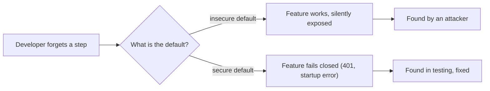

# Secure Defaults and Configuration

## Introduction

Most people never change default settings. That is not laziness; it is how people use software. If a product ships with debug mode on, an `admin/admin` login, or an open storage bucket, a large share of installations will run that way in production.

**Secure by default** means the out-of-the-box configuration is the safe one, and making it less safe takes a deliberate, visible step. **Secure configuration** means your own deployment actually uses safe settings, and you can prove it.

An analogy: a new car comes with seat belts, airbags and automatic emergency braking already on. You do not need to find a settings menu to enable them. If you really want to disable a safety feature, it takes effort and shows a warning light. Software should work the same way.

This is a mainstream expectation now:

- **A02:2025 Security Misconfiguration** is second in the [OWASP Top 10:2025](https://top10.owasp.org/2025/).
- OWASP's Proactive Controls list **C5: Secure By Default Configurations**.
- CISA's [Secure by Design](https://www.cisa.gov/securebydesign) program and its [Product Security Bad Practices](https://www.cisa.gov/resources-tools/resources/product-security-bad-practices) guidance call out universal default passwords as a bad practice and recommend instance-unique initial passwords or forcing users to set one during setup.

This page covers three levels: **your code** (deny by default), **your framework and server settings** (harden and verify), and **what you ship to others** (safe defaults for customers and API users). Cloud and infrastructure misconfigurations are covered in [Common Cloud Misconfigurations](../8-sec-cloud-and-container/2-sec-cloud-misconfigurations.mdx) and [CIS Benchmarks](../9-sec-system-hardening/5-sec-cis-benchmarks.mdx).

## The Principles

| Principle | Insecure default | Secure default |
| --- | --- | --- |
| Deny by default | Every new route is public unless someone adds a check | Every new route requires login unless explicitly marked public |
| Least functionality | Debug endpoints, sample apps and admin consoles enabled | Only what the feature needs is on |
| No shared secrets | Every install has the same admin password | Unique credentials generated at setup |
| Safe failure | Missing config falls back to a dev value | Missing config stops the app from starting |
| Explicit danger | `render(html)` trusts input unless told otherwise | `render(text)` escapes, `render(html, trusted=True)` is the visible exception |
| Minimal exposure | Service listens on all interfaces | Service listens on localhost unless configured |

The common thread: **mistakes of omission should be safe.** If a developer forgets a line, the result should be "too locked down" (which someone will notice and fix), not "wide open" (which an attacker will notice first).



## Level 1: Deny by Default in Your Code

The most valuable default in a web app is **authentication required unless stated otherwise**. Compare two ways of protecting routes.

**Vulnerable pattern:** each route opts *in* to protection.

```python
@app.get("/reports")
@login_required          # forget this decorator on one new route, and it is public
def reports():
    ...
```

**Fixed pattern:** every route is protected, and public routes opt *out* visibly. Here is a complete app factory that also applies hardened settings and refuses to start with an insecure configuration:

```python
# app_factory.py
import os

from flask import Flask, abort, g, jsonify, request

class InsecureConfigError(RuntimeError):
    pass

SECURE_DEFAULTS = {
    "SESSION_COOKIE_SECURE": True,       # Flask default is False
    "SESSION_COOKIE_HTTPONLY": True,     # Flask default is already True
    "SESSION_COOKIE_SAMESITE": "Lax",    # Flask default is None
    "MAX_CONTENT_LENGTH": 1 * 1024 * 1024,   # Flask default is None (no limit)
    "TRUSTED_HOSTS": ["app.example.com"],    # Flask 3.1+; default None accepts any Host
}

def validate(app: Flask) -> None:
    problems = []
    key = app.config.get("SECRET_KEY") or ""
    if len(key) < 32:
        problems.append("SECRET_KEY missing or shorter than 32 characters")
    if app.debug:
        problems.append("debug mode is on")
    if not app.config["SESSION_COOKIE_SECURE"]:
        problems.append("SESSION_COOKIE_SECURE is off")
    if problems and os.environ.get("APP_ENV", "production") == "production":
        raise InsecureConfigError("; ".join(problems))

def public(view):
    view.is_public = True                # explicit opt-out of authentication
    return view

def create_app(overrides=None) -> Flask:
    app = Flask(__name__)
    app.config.update(SECURE_DEFAULTS)
    app.config["SECRET_KEY"] = os.environ.get("FLASK_SECRET_KEY")
    app.config.update(overrides or {})
    validate(app)

    @app.before_request
    def require_login():                 # deny by default: every route needs a user...
        view = app.view_functions.get(request.endpoint)
        if view is not None and getattr(view, "is_public", False):
            return                       # ...unless it is explicitly marked public
        user = request.headers.get("X-Demo-User")   # stand-in for real session auth
        if not user:
            abort(401)
        g.user = user

    @app.after_request
    def security_headers(resp):
        resp.headers.setdefault("X-Content-Type-Options", "nosniff")
        resp.headers.setdefault("Referrer-Policy", "strict-origin-when-cross-origin")
        resp.headers.setdefault("Content-Security-Policy", "default-src 'self'")
        return resp

    @app.get("/health")
    @public
    def health():
        return jsonify(status="ok")

    @app.get("/reports")
    def reports():                       # a developer forgot to think about auth: still protected
        return jsonify(owner=g.user, reports=[])

    return app
```

Exercise it with the test client:

```python
# try_factory.py
import os
from app_factory import create_app, InsecureConfigError

try:
    create_app()
except InsecureConfigError as e:
    print("refused to start:", e)

os.environ["FLASK_SECRET_KEY"] = "x" * 48          # demo only: use a random value in real life
app = create_app()
c = app.test_client()
for path, headers in [("/health", {}), ("/reports", {}), ("/reports", {"X-Demo-User": "alice"})]:
    r = c.get(path, headers=headers, base_url="https://app.example.com")
    print(r.status_code, path, r.headers.get("Content-Security-Policy"))
r = c.get("/reports", headers={"X-Demo-User": "alice"}, base_url="https://evil.example.net")
print(r.status_code, "Host: evil.example.net")
```

Output:

```text
refused to start: SECRET_KEY missing or shorter than 32 characters
200 /health default-src 'self'
401 /reports default-src 'self'
200 /reports default-src 'self'
400 Host: evil.example.net
```

What each default buys you:

- **A forgotten decorator is now a 401, not a data leak.** The only way to make a route public is the visible `@public` marker, which is easy to search for and review.
- **The app will not start insecurely in production.** `APP_ENV` defaults to `production`, so forgetting to set it gives you the strict behavior. Developers set `APP_ENV=development` locally.
- **Unknown `Host` headers are rejected** (`TRUSTED_HOSTS`, added in Flask 3.1), which blocks host-header tricks such as poisoned password-reset links.
- **Request bodies are capped,** so a single huge upload cannot exhaust memory.
- **Baseline security headers are on everywhere.** See [Security Headers, CORS and CSP](../3-sec-web-security/9-sec-security-headers.mdx) for a full policy.

The same deny-by-default idea applies to authorization (see [RBAC, ABAC and ReBAC](../4-sec-authentication/9-sec-rbac-abac.mdx)), CORS (an explicit list of origins, never a wildcard with credentials), feature flags (new risky features default to off), and network policies (default-deny, then allow).

## Level 2: Harden and Verify Framework Settings

Frameworks choose defaults that make the "hello world" tutorial work, which is not the same as production-safe. Know which defaults to change.

### Flask (3.1)

| Setting | Flask default | Production value | Why |
| --- | --- | --- | --- |
| `DEBUG` | `False` | `False`, and never set in code | The debugger can run code |
| `SECRET_KEY` | `None` | Long random value from a secret store | Signs session cookies |
| `SESSION_COOKIE_SECURE` | `False` | `True` | Cookie only sent over HTTPS |
| `SESSION_COOKIE_HTTPONLY` | `True` | `True` | JavaScript cannot read the cookie |
| `SESSION_COOKIE_SAMESITE` | `None` | `"Lax"` (or `"Strict"`) | CSRF protection layer |
| `MAX_CONTENT_LENGTH` | `None` | A limit that fits your uploads | Denial-of-service protection |
| `TRUSTED_HOSTS` | `None` | Your real hostnames | Host header attacks |

Defaults come from the [Flask configuration docs](https://flask.palletsprojects.com/en/stable/config/) and can change between versions, so re-check them when you upgrade.

### Django: let the framework audit you

Django ships a deployment checker. On a freshly generated project:

```bash
python manage.py check --deploy
```

Example output (Django 6.1, shortened):

```text
WARNINGS:
?: (security.W004) You have not set a value for the SECURE_HSTS_SECONDS setting. ...
?: (security.W008) Your SECURE_SSL_REDIRECT setting is not set to True. ...
?: (security.W009) Your SECRET_KEY has less than 50 characters, less than 5 unique characters, or it's prefixed with 'django-insecure-' ...
?: (security.W012) SESSION_COOKIE_SECURE is not set to True. ...
?: (security.W016) You have 'django.middleware.csrf.CsrfViewMiddleware' in your MIDDLEWARE, but you have not set CSRF_COOKIE_SECURE to True. ...
?: (security.W018) You should not have DEBUG set to True in deployment.
?: (security.W020) ALLOWED_HOSTS must not be empty in deployment.
```

Run this in CI against your production settings module, and fail the build on warnings. The exact list depends on your Django version and settings; see Django's [deployment checklist](https://docs.djangoproject.com/en/stable/howto/deployment/checklist/).

### The web server in front

Reverse proxies have their own defaults to tighten. A minimal nginx example:

```nginx
# /etc/nginx/conf.d/app.conf (excerpt)
server_tokens off;                     # do not advertise the nginx version

server {
    listen 443 ssl;
    server_name app.example.com;

    ssl_protocols TLSv1.2 TLSv1.3;     # no legacy protocols
    client_max_body_size 1m;           # match the app's MAX_CONTENT_LENGTH

    location / {
        proxy_pass http://127.0.0.1:8000;    # app listens on localhost only
        proxy_set_header Host $host;
        proxy_set_header X-Forwarded-Proto $scheme;
    }
}

server {                               # catch-all: unknown Host headers get nothing
    listen 443 ssl default_server;
    ssl_reject_handshake on;
}
```

Check the syntax with `sudo nginx -t` before reloading. TLS settings in depth are in [TLS and HTTPS](../1-sec-cryptography/7-sec-tls.mdx).

### Make configuration testable

Settings drift: someone flips a flag during an incident and never flips it back. Treat security configuration like code:

1. **Keep it in version control**, with production and development differences explicit.
2. **Validate at startup** (as `validate()` does above) and **in CI** (as `check --deploy` does).
3. **Scan deployed systems** against a baseline: [CIS Benchmarks](../9-sec-system-hardening/5-sec-cis-benchmarks.mdx) for servers, [IaC scanning](../8-sec-cloud-and-container/6-sec-infrastructure-as-code-security.mdx) for cloud templates, [CSPM](../8-sec-cloud-and-container/7-sec-cspm.mdx) for live cloud accounts.
4. **Test from the outside** with a [DAST](../6-sec-appsec-and-devsecops/3-sec-dast.mdx) scan that checks headers, cookies and error pages.

## Level 3: Defaults You Ship to Others

If you build a product, library or API that other people configure, your defaults become *their* security posture.

### No default passwords

A universal default password means every installation can be logged into by anyone who has read the manual. Instead, generate a unique secret on first run. One common pattern is a one-time setup code printed to the server console, which only the person who installed the product can see:

```python
# first_run.py
import hashlib
import hmac
import secrets
import time

SETUP_TTL_SECONDS = 30 * 60

def create_setup_token(store: dict) -> str:
    """Called once on first boot when no admin exists. Prints a one-time token to the console."""
    token = secrets.token_urlsafe(24)
    store["setup_token_hash"] = hashlib.sha256(token.encode()).hexdigest()
    store["setup_expires"] = time.time() + SETUP_TTL_SECONDS
    return token

def redeem_setup_token(store: dict, presented: str) -> bool:
    expected = store.get("setup_token_hash")
    if not expected or time.time() > store.get("setup_expires", 0):
        return False
    ok = hmac.compare_digest(expected, hashlib.sha256(presented.encode()).hexdigest())
    if ok:
        store.pop("setup_token_hash")          # single use
    return ok

store = {}
token = create_setup_token(store)
print("First-run setup: open https://<this-host>/setup and enter this one-time code:")
print("  ", token)
print("wrong code accepted? ", redeem_setup_token(store, "admin"))
print("right code accepted? ", redeem_setup_token(store, token))
print("reused code accepted?", redeem_setup_token(store, token))
```

Example output (the code is random each run):

```text
First-run setup: open https://<this-host>/setup and enter this one-time code:
   VH_81ITEZ65p5XrkvjTUGeYVq6_3WM88
wrong code accepted?  False
right code accepted?  True
reused code accepted? False
```

The code is random, expires in 30 minutes, works once, and only its hash is stored. On the setup page the user creates the real admin account with their own strong password (and ideally MFA). Random tokens are covered in [Randomness and Secure Tokens](../1-sec-cryptography/9-sec-randomness.mdx).

### Safe-by-default APIs

When you write a library or internal helper, make the safe call the short one and the dangerous call long and obvious:

```python
from markupsafe import Markup, escape

def render_comment(text: str, *, trusted_html: bool = False) -> Markup:
    """Escapes by default. Passing trusted_html=True is a visible, reviewable decision."""
    return Markup(text) if trusted_html else escape(text)

print(render_comment("<b>hi</b>"))
print(render_comment("<b>hi</b>", trusted_html=True))
```

Output:

```text
&lt;b&gt;hi&lt;/b&gt;
<b>hi</b>
```

Real-world examples of this design: React's `dangerouslySetInnerHTML`, Rust's `unsafe` keyword, Python's `yaml.safe_load` versus `yaml.load` with an explicit loader, and Python 3.14 changing `tarfile`'s default extraction filter to `'data'`, which blocks absolute paths and links outside the destination unless you explicitly ask for the old behavior.

### Checklist for shipped defaults

- Listens on `localhost` or requires explicit bind configuration.
- Admin interfaces disabled or protected by default.
- TLS on, with modern protocol versions.
- MFA available, and on by default for administrators.
- Logging of security events on by default (and documented).
- Sample apps, test accounts and debug endpoints not installed in production builds.
- Every insecure option clearly named and documented with its risk.

## Real-World Scenario

**Your company sells a self-hosted analytics dashboard** that customers run in their own data centers. A security researcher finds hundreds of instances exposed on the internet with the documented default login `admin/changeme`, and several have been used to pull customer data. Support says "the docs tell them to change it". Product asks what to change for the next release.

### The solution

1. **Remove the default password.** On first boot, generate a one-time setup code (as above) and require the installer to create the admin account. Existing installs with the old password are forced to change it at next login.
2. **Bind to localhost by default.** Exposing the dashboard requires setting `bind_address` explicitly, and the startup log prints a warning when it is bound to all interfaces without TLS.
3. **Turn on login rate limiting and MFA for admins** by default.
4. **Add a startup self-check** that refuses to run with known-insecure combinations (no TLS on a public interface, debug on) unless an `ALLOW_INSECURE_I_UNDERSTAND_THE_RISK` flag is set, and log loudly when it is.
5. **Notify customers** about the issue and the upgrade, and publish an advisory.

### Why this approach

The documentation approach failed because it relied on every customer doing an extra step. Secure defaults move the work from thousands of customers to one engineering team. This is exactly the shift CISA's Secure by Design guidance asks manufacturers to make.

### When to use it, and when not to

Strict defaults are right for anything that holds data or is reachable over a network. For developer tools that only run locally (a test server, a CLI), friction matters more, but they should still bind to localhost and avoid default credentials. The escape hatch for power users should exist, just never be the default.

### Alternatives and trade-offs

| Approach | Pros | Cons | Best for |
| --- | --- | --- | --- |
| Insecure default + "please change it" docs | Easiest first run | Most users never change it | Nothing that is network-reachable |
| Forced password change on first login | Simple to build | The window before first login is exposed | Legacy products, short term |
| One-time setup code printed at install | No shared secret, only the installer sees it | Slightly more setup friction | Self-hosted products and appliances |
| Unique password printed on a label or generated per instance | Works for hardware | Logistics for physical devices | Routers, IoT devices |
| SSO-only administration | No local passwords at all | Requires an identity provider | Enterprise deployments |

## Common Mistakes

- **Development defaults in production:** `DEBUG=True`, wildcard CORS, sample data, permissive `ALLOWED_HOSTS`.
- **Fallback values for secrets** such as `os.getenv("SECRET_KEY", "dev")`. Fail instead.
- **Opt-in protection** (decorators, middleware lists) where opt-out would be safer.
- **"Temporary" changes during incidents** that are never reverted. Validate config continuously.
- **Inconsistent environments.** Staging differs from production, so security testing in staging misses production misconfigurations.
- **Documenting risk instead of removing it.** If the docs say "make sure to change X", consider making X safe by default.
- **Leaving verbose banners and version headers on.** They are not a vulnerability by themselves but help attackers pick exploits.

## Summary

- Secure by default: the out-of-the-box state is safe, and weakening it takes a visible, deliberate step.
- **Deny by default** in code: routes require authentication unless explicitly marked public.
- Override framework defaults that are not production-safe (Flask cookie flags, body size limits, trusted hosts) and verify with tools like `manage.py check --deploy`.
- **Validate configuration at startup** and fail closed when it is insecure.
- Never ship **default passwords**; use one-time setup codes or unique per-instance credentials.
- Design APIs where the **safe call is the easy call** and the dangerous one is explicit.
- Keep configuration in version control and scan for drift against baselines.

## Exercises

1. Add the `@public` deny-by-default pattern to an app you own. List every route that ended up public and confirm each one should be.
2. Run `python manage.py check --deploy` on a Django project (or write an equivalent `validate()` for Flask or FastAPI) and fix every warning.
3. Write a pytest test that fails if any Flask route without `@public` returns 200 to an unauthenticated request.
4. Pick a self-hosted tool you use (a database, CI server or dashboard). What are its defaults for binding address, authentication and TLS? Which would you change?

Related pages: [Common Cloud Misconfigurations](../8-sec-cloud-and-container/2-sec-cloud-misconfigurations.mdx), [CIS Benchmarks and Baselines](../9-sec-system-hardening/5-sec-cis-benchmarks.mdx), [Security Headers, CORS and CSP](../3-sec-web-security/9-sec-security-headers.mdx). Next: [Security Code Review](./7-sec-code-review-for-security.mdx).
