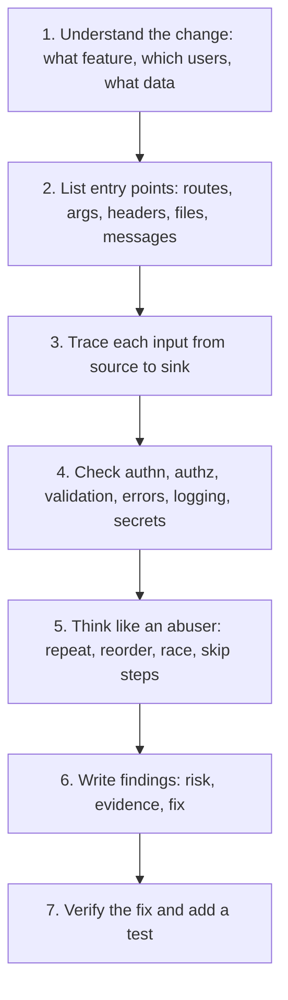

# Security Code Review

## Introduction

Code review is the last point where a human reads a change before it reaches users. A **security code review** asks one extra question on top of "does this work and is it maintainable?": **how could someone misuse this?**

Automated scanners are good at spotting dangerous *functions*, such as `shell=True` or string-built SQL. They are poor at spotting missing *logic*: an endpoint that forgets to check whether the caller owns the record, a discount that can be applied twice, or a token written to a log. Those bugs need a person who understands what the code is supposed to do.

An analogy: a spell checker catches typos, but only an editor notices that the second paragraph contradicts the first. Static analysis tools are the spell checker. Security code review is the editor.

This page covers:

- When a change needs a security-focused review, and who should do it
- A repeatable method: understand, trace sources to sinks, check with a list
- A worked review of a realistic pull request, with tool output and the fixed code
- How to write findings that get fixed, and how to scale review across a team

The method follows the OWASP [Secure Code Review Cheat Sheet](https://cheatsheetseries.owasp.org/cheatsheets/Secure_Code_Review_Cheat_Sheet.html), which distinguishes **baseline reviews** (a whole application or component) from **diff-based reviews** (a single change). This page focuses on diff-based review, since that is what most developers do every day.

## When Does a Change Need a Security Review?

Not every pull request needs deep security attention. Fixing a typo in a button label does not. Use triggers so attention goes where risk is:

| Trigger | Why it matters |
| --- | --- |
| Authentication, sessions, password reset, MFA | Account takeover |
| Authorization: roles, ownership checks, tenant filters | Data exposure across users or customers |
| New endpoint or new input source (webhook, upload, queue consumer) | New attack surface |
| SQL, shell, file paths, templates, deserialization | Injection sinks |
| Payments, credits, limits, coupons | Business logic abuse, race conditions |
| Crypto, tokens, secrets, key handling | Subtle and high impact |
| New dependency or infrastructure change | Supply chain and misconfiguration |
| Logging or error handling changes | Information disclosure |

Many teams encode these triggers with a `CODEOWNERS` file so sensitive paths automatically request a reviewer from a security-minded group:

```text
# .github/CODEOWNERS
/app/auth/            @acme/security-champions
/app/payments/        @acme/security-champions @acme/payments
/app/**/permissions*  @acme/security-champions
/infra/               @acme/platform
requirements*.txt     @acme/security-champions
```

Combine this with branch protection that requires code-owner approval, and a risky change cannot merge without the right eyes on it.

## The Method



### 1. Understand the change

Read the PR description, linked ticket and any [threat model](../6-sec-appsec-and-devsecops/1-sec-threat-modeling.mdx). Who calls this code? Is it public, authenticated, or admin-only? What data does it touch? You cannot judge "is this authorization correct?" without knowing who should be allowed.

### 2 and 3. Trace sources to sinks

List every place untrusted data enters the change (route parameters, query strings, headers, request bodies, files, database fields that users wrote earlier). Then follow each one forward until it reaches a **sink**: SQL, a shell, a file path, an HTML template, a redirect, an outbound HTTP request, a log line. At every sink, ask: is it validated, parameterized or encoded *for this specific sink*? (See [Secure Coding Introduction](./0-sec-secure-coding-introduction.mdx) for the source and sink model.)

### 4. Run through a checklist

A short list you actually use beats a long list you skim. This one follows the OWASP cheat sheet's checklist areas:

| Area | Questions |
| --- | --- |
| Input validation | Is every input validated on the server with an allowlist? Are sizes limited? |
| Authentication and sessions | Is this route protected? Are tokens checked properly (signature, expiry, audience)? |
| Authorization | Does the code check that *this user* may access *this object*? Is the tenant filter applied? |
| Cryptography | Are standard libraries used? Any hard-coded keys, weak algorithms, `random` for tokens? |
| Business logic | Can steps be skipped, repeated or run in parallel? Are limits enforced atomically? |
| Configuration | Debug flags, permissive CORS, new defaults that are unsafe? |
| Monitoring | Are security events logged? Is anything sensitive logged? Are errors generic to clients? |

### 5. Think like an abuser

For each feature, imagine using it in ways the author did not intend: change the ID in the URL, send the request twice at once, send a negative quantity, skip step 2 of a 3-step flow, upload a 2 GB file, use another tenant's webhook. [Business Logic Vulnerabilities](../3-sec-web-security/11-sec-business-logic-flaws.mdx) covers many such patterns.

## A Worked Review

A teammate opens a pull request: "Add account export (CSV and PDF)". Here is the new file.

```python
# export.py  (the code under review)
import csv
import io
import logging
import subprocess

from flask import Blueprint, request, send_file

from .db import db
from .auth import login_required, current_user

bp = Blueprint("export", __name__)
log = logging.getLogger(__name__)

@bp.get("/export/<int:account_id>")
@login_required
def export_account(account_id):
    fmt = request.args.get("format", "csv")
    sort = request.args.get("sort", "created_at")
    log.info("export requested by %s with token %s", current_user().email,
             request.headers.get("Authorization"))
    rows = db.execute(
        f"SELECT id, amount, memo FROM transactions WHERE account_id = ? ORDER BY {sort}",
        (account_id,),
    ).fetchall()
    buf = io.StringIO()
    csv.writer(buf).writerows(rows)
    path = f"/tmp/export_{account_id}.{fmt}"
    with open(path, "w") as f:
        f.write(buf.getvalue())
    if fmt == "pdf":
        subprocess.run(f"csv2pdf {path}", shell=True, check=True)
    return send_file(path)
```

Try to find the problems yourself before reading on. There are at least six.

### Step 1: let the tools go first

Automated tools are cheap, so run them before spending human attention. [Bandit](https://bandit.readthedocs.io/) is a Python security linter:

```bash
pip install bandit
bandit -q export.py
```

Example output (shortened):

```text
>> Issue: [B404:blacklist] Consider possible security implications associated with the subprocess module.
   Severity: Low   Confidence: High
   Location: ./export.py:5:0
>> Issue: [B608:hardcoded_sql_expressions] Possible SQL injection vector through string-based query construction.
   Severity: Medium   Confidence: Medium
   Location: ./export.py:23:10
>> Issue: [B108:hardcoded_tmp_directory] Probable insecure usage of temp file/directory.
   Severity: Medium   Confidence: Medium
   Location: ./export.py:28:13
>> Issue: [B602:subprocess_popen_with_shell_equals_true] subprocess call with shell=True identified, security issue.
   Severity: High   Confidence: High
   Location: ./export.py:32:8
```

Bandit found four pattern-level issues. Notice what it could not find: it does not know that `account_id` needs an ownership check, or that logging the `Authorization` header is a leak. Those are the reviewer's job, though you can teach a tool about *your* conventions with custom rules.

### Step 2: encode team rules in Semgrep

[Semgrep](https://semgrep.dev/) (the open-source engine is called Semgrep Community Edition) lets you write rules that look like the code they match. Two rules for conventions in this codebase:

```yaml
# rules.yml
rules:
  - id: log-auth-header
    languages: [python]
    severity: ERROR
    message: >-
      Authorization header passed to a logger. Tokens in logs can be replayed by anyone
      with log access. Log the user ID instead.
    patterns:
      - pattern-either:
          - pattern: $LOG.$METHOD(..., request.headers.get("Authorization"), ...)
          - pattern: $LOG.$METHOD(..., request.headers["Authorization"], ...)
      - metavariable-regex:
          metavariable: $METHOD
          regex: ^(debug|info|warning|error|exception|critical)$
  - id: account-route-without-owner-check
    languages: [python]
    severity: WARNING
    message: >-
      Route takes an account_id but never calls require_account_access(). Check that the
      current user may access this account (IDOR).
    patterns:
      - pattern: |
          @$BP.$VERB("...")
          def $FUNC(..., account_id, ...):
              ...
      - pattern-not: |
          @$BP.$VERB("...")
          def $FUNC(..., account_id, ...):
              ...
              require_account_access(...)
              ...
```

```bash
pipx install semgrep
semgrep scan --config rules.yml --metrics=off --quiet .
```

Example output (shortened):

```text
┌─────────────────┐
│ 2 Code Findings │
└─────────────────┘
    export.py
    ❯❱ account-route-without-owner-check
          Route takes an account_id but never calls require_account_access(). Check that the current user may
          access this account (IDOR).
           15┆ @bp.get("/export/<int:account_id>")
           16┆ @login_required
           17┆ def export_account(account_id):
   ❯❯❱ log-auth-header
          Authorization header passed to a logger. Tokens in logs can be replayed by anyone with log access.
           20┆ log.info("export requested by %s with token %s", current_user().email,
           21┆          request.headers.get("Authorization"))
```

Once a reviewer has found a bug class by hand, a custom rule makes sure it never comes back. Running these tools in CI is covered in [Static Analysis (SAST)](../6-sec-appsec-and-devsecops/2-sec-sast.mdx).

### Step 3: the human review

Tracing each input from source to sink:

| # | Source to sink | Finding | Severity |
| --- | --- | --- | --- |
| 1 | `account_id` to SQL `WHERE` | Parameterized, but **no ownership check**: any logged-in user can export any account (IDOR, A01) | High |
| 2 | `sort` to SQL `ORDER BY` | **SQL injection.** Identifiers cannot be bound as parameters, so the value is pasted in raw | High |
| 3 | `Authorization` header to log | **Bearer token written to logs**; anyone with log access can replay it | High |
| 4 | `account_id` to `/tmp/export_...` | **Predictable shared temp file**: other local users or concurrent requests can read or clobber it | Medium |
| 5 | `fmt` to file path and `send_file` | **No allowlist**: arbitrary extensions, odd content types | Low |
| 6 | `path` to `shell=True` | Not exploitable today (`path` has only an int and `pdf`), but **one refactor away** from command injection | Medium |

Finding 6 is a good example of reviewer judgment. Bandit rated it High, and the reviewer checked whether attacker data can actually reach it. Today it cannot, but the fix is trivial and removes the risk permanently, so it is still worth requesting.

### Step 4: write findings that get fixed

A good review comment has four parts: **what**, **why it matters** (impact), **how to reproduce** (or reason), and **a concrete fix**. Compare:

```text
Weak:   "This looks insecure."

Strong: [High] IDOR on /export/<account_id>
        Any logged-in user can export any account's transactions by changing the ID
        (e.g. log in as alice, request /export/2 which belongs to bob).
        Fix: call require_account_access(user, account_id) before the query; it
        returns 404 for accounts the user cannot see. Please add a test where bob
        requests alice's export and gets 404.
```

Label severity consistently (Critical, High, Medium, Low, or "blocking" versus "nit") so the author knows what must change before merging. Be specific and kind: the goal is a fixed bug and a developer who will not repeat it, not a won argument.

### The code after review

```python
# export.py  (after review)
import csv
import io
import logging
import os
import subprocess  # nosec B404 - used with fixed argument lists only
import tempfile

from flask import Blueprint, abort, request, send_file

from .db import db
from .auth import login_required, current_user, require_account_access

bp = Blueprint("export", __name__)
log = logging.getLogger(__name__)

FORMATS = {"csv": "text/csv", "pdf": "application/pdf"}
SORT_COLUMNS = {"created_at": "created_at", "amount": "amount"}   # allowlist: value -> SQL identifier

@bp.get("/export/<int:account_id>")
@login_required
def export_account(account_id):
    user = current_user()
    require_account_access(user, account_id)                       # [1] authorization (aborts 404)
    fmt = request.args.get("format", "csv")
    sort_col = SORT_COLUMNS.get(request.args.get("sort", "created_at"))
    if fmt not in FORMATS or sort_col is None:                     # [2] allowlists
        abort(400)
    log.info("export user_id=%s account_id=%s format=%s", user.id, account_id, fmt)   # [3] no token

    sql = ("SELECT id, amount, memo FROM transactions WHERE account_id = ? "
           f"ORDER BY {sort_col}")  # nosec B608 - sort_col comes from SORT_COLUMNS only
    rows = db.execute(sql, (account_id,)).fetchall()

    buf = io.StringIO()
    csv.writer(buf).writerows(rows)
    data = buf.getvalue().encode()
    if fmt == "pdf":
        with tempfile.TemporaryDirectory() as tmp:                 # [4] private, unique directory
            src = os.path.join(tmp, "export.csv")
            with open(src, "wb") as f:
                f.write(data)
            subprocess.run(["/usr/local/bin/csv2pdf", src], check=True, timeout=30)  # nosec B603
            with open(src.replace(".csv", ".pdf"), "rb") as f:
                data = f.read()
    return send_file(io.BytesIO(data), mimetype=FORMATS[fmt],
                     download_name=f"account-{account_id}.{fmt}", as_attachment=True)
```

(`csv2pdf` stands in for whatever converter your team uses.) Bandit on the fixed file:

```text
Test results:
	No issues identified.
	...
	Total potential issues skipped due to specifically being disabled (e.g., #nosec BXXX): 3
```

Every `# nosec` names the specific check and gives a reason. A bare `# nosec` hides future findings on that line too, so reviewers should push back on it.

## Scaling Security Review Across a Team

- **Security champions:** one developer per team with extra training, who reviews risky PRs and spreads knowledge. Cheaper and faster than routing everything to a central security team.
- **PR template prompts:** a few questions the author answers before review.

```markdown
## Security checklist (delete lines that do not apply)
- [ ] New or changed endpoints check authorization for the specific object
- [ ] All new inputs are validated server-side (types, sizes, allowlists)
- [ ] No secrets, tokens or personal data in logs, errors or code
- [ ] SQL, shell and file paths use parameters, argument lists and safe joins
- [ ] Touches auth, payments or crypto -> security champion requested
```

- **Small PRs:** review quality drops sharply on very large diffs. Ask for risky changes to be split out.
- **AI-assisted review:** LLM-based reviewers can flag issues quickly, but they also miss logic bugs and sometimes report problems that are not there. Treat their output like a scanner's: useful input, never the final decision. See [Security for AI and LLM Applications](../13-sec-governance/5-sec-ai-security.mdx).

## Real-World Scenario

**Your 12-person engineering team ships about 40 pull requests a week** for a healthcare scheduling SaaS. There is one security engineer. Every PR currently waits for her approval, which takes two days and frustrates everyone; she also admits she skims most of them. A customer audit asks how you ensure code is reviewed for security.

### The solution

1. **Automate the pattern-level checks** with Bandit and Semgrep (community rules plus a few custom rules) in CI, so humans never spend time on `shell=True`.
2. **Route by risk with `CODEOWNERS`**: auth, permissions, payments, PHI-handling modules and dependency files require a security champion's approval. Everything else gets normal peer review with the PR checklist.
3. **Train two security champions** from the product teams, using this tutorial and a few hours of pairing with the security engineer.
4. **The security engineer does deep reviews** only for new features flagged in design review and for a monthly sample of merged PRs, and turns each recurring finding into a Semgrep rule.
5. **Track findings** (category, severity, time to fix) so you can show auditors the process works.

### Why this approach

Reviewing everything equally means reviewing nothing well. Automation handles volume, `CODEOWNERS` focuses scarce expertise on the code where bugs hurt most, and champions spread the skill so it does not depend on one person. Turning findings into rules makes each review pay off repeatedly.

### When to use it, and when not to

Risk-based review fits most product teams. In highly regulated or safety-critical code (medical devices, avionics, cryptographic libraries), standards may require independent review of every change, and the cost is justified. For a two-person startup, peer review with the checklist plus automated tools is a sensible start.

### Alternatives and trade-offs

| Approach | Pros | Cons | Best for |
| --- | --- | --- | --- |
| Security team reviews every PR | Consistent expertise | Bottleneck, reviewer fatigue, skimming | Very small volume or regulated code |
| Risk-based review (CODEOWNERS + champions) | Focuses expertise, scales | Triggers need maintenance | Most product teams |
| Automated SAST only | Fast, every commit | Misses logic and authorization bugs, false positives | Baseline for everyone |
| Periodic full audits or pen tests | Deep, independent | Point in time, late feedback | Major releases, compliance |
| Pair programming on risky features | Catches design issues early | Expensive per hour | New auth, payment or crypto features |

## Common Mistakes

- **Reviewing only the diff.** The bug is often what the diff *does not* change, such as a missing check in a new route that an old helper used to provide. Open the surrounding code.
- **Trusting the tests.** Tests show the happy path works; they rarely try another user's ID.
- **Accepting `# nosec` or "false positive" without a reason.** Require a short justification.
- **Vague comments** ("security issue here") that the author cannot act on.
- **Giant PRs** reviewed in one pass. Ask for a split.
- **Fixing the instance, not the class.** If one route lacked an ownership check, search for others and add a rule.
- **Treating review as gatekeeping.** Reviews that feel like blame make people hide risky changes. Explain, teach and thank.

## Summary

- Security review asks "how could this be misused?" and finds what scanners cannot: authorization gaps, logic flaws, sensitive data in logs.
- Use **triggers** and **CODEOWNERS** to focus review on risky code.
- Method: understand the change, list inputs, **trace sources to sinks**, apply a short checklist, then think like an abuser.
- Run **Bandit and Semgrep** first; write **custom rules** for your own conventions and recurring findings.
- Write findings with **severity, impact, evidence and a concrete fix**, and verify with a test.
- Scale with **security champions**, PR checklists, small PRs and automation.

## Exercises

1. Review a recent pull request in a project you work on using the seven-area checklist. Write at least one finding in the "strong" format, even if it is Low severity.
2. Write a Semgrep rule that flags `requests.get(...)` calls whose URL comes from `request.args`, and test it on a small sample (this pattern is the start of [SSRF](../3-sec-web-security/6-sec-ssrf.mdx)).
3. Run `bandit -r` on an open-source Flask project. For three findings, decide whether each is exploitable and explain why.
4. Draft a `CODEOWNERS` file and PR security checklist for a codebase you know.

Related pages: [Static Analysis (SAST)](../6-sec-appsec-and-devsecops/2-sec-sast.mdx), [Threat Modeling with STRIDE](../6-sec-appsec-and-devsecops/1-sec-threat-modeling.mdx), [Project: Auditing and Fixing a Vulnerable Web App](../14-sec-projects/1-sec-project-vulnerable-app-audit.mdx). Next: [Language-Specific Security Pitfalls](./8-sec-language-specific-pitfalls.mdx).
