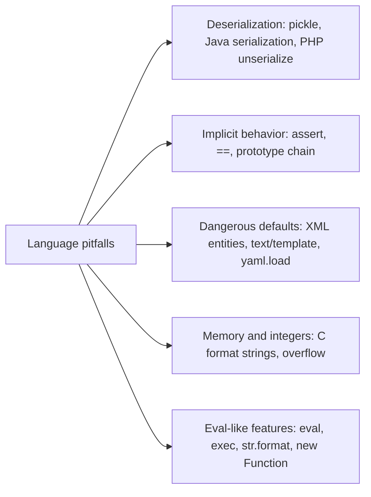

# Language-Specific Security Pitfalls

## Introduction

The earlier pages in this section covered principles that apply in any language: validate input, encode output, fail closed, keep secrets out of code. But every language also has its own **sharp edges**: features that are convenient, look harmless, and quietly turn into vulnerabilities.

A Python developer might not know that `assert` statements vanish in optimized mode. A JavaScript developer might not know that merging a JSON object can change the behavior of *every* object in the program. A Java developer might not know that the default XML parser will fetch files from disk if the document asks it to.

An analogy: every kitchen has knives, so every cook learns knife safety. But a pastry kitchen also has a blowtorch and a sushi kitchen has a fugu license. General kitchen safety is not enough; you need to know the specific dangers of *your* station.

This page is a field guide. For each language you will see the most common pitfalls, a minimal **Vulnerable** and **Fixed** example, and the tools that catch them. Run all examples locally; they do not touch any network service.



## Python

### `assert` is not a security check

```python
# python_pitfalls.py (part 1)
def delete_project(user_role):
    assert user_role == "admin", "admins only"     # Vulnerable: stripped with -O
    return "project deleted"

def delete_project_fixed(user_role):
    if user_role != "admin":                        # Fixed: a real check
        raise PermissionError("admins only")
    return "project deleted"

print("assert check:", delete_project("viewer") if not __debug__ else "skipped (run with -O to see)")
```

```bash
python3 python_pitfalls.py
python3 -O python_pitfalls.py
```

Output (first line of each run):

```text
assert check: skipped (run with -O to see)
assert check: project deleted
```

Python removes every `assert` when run with `-O` or `PYTHONOPTIMIZE`, which some deployment images set. Use `assert` for internal sanity checks in tests, never for access control or input validation.

### `str.format` on user-controlled templates

If users can supply a format string (custom email templates, report titles), `str.format` lets them walk object attributes:

```python
# python_pitfalls.py (part 2)
class Config:
    SECRET_KEY = "s3cr3t-signing-key"
class Event:
    def __init__(self):
        self.name = "Launch"
        self.config = Config()

template = "Event: {event.name} / {event.config.SECRET_KEY}"     # supplied by a user
print("format:", template.format(event=Event()))

from string import Template                                       # Fixed: only $name substitution
print("Template:", Template("Event: $name").safe_substitute(name=Event().name))
```

Output:

```text
format: Event: Launch / s3cr3t-signing-key
Template: Event: Launch
```

`string.Template` only substitutes named values, with no attribute access. For richer user templates, use a sandboxed engine such as Jinja2's `SandboxedEnvironment`, and pass only plain data (not live objects) into it.

### Unsafe deserialization: pickle and YAML

```python
# python_pitfalls.py (part 3)
import pickle
import yaml

doc = "!!python/object/apply:os.getcwd []"
try:
    yaml.safe_load(doc)                          # Fixed: only plain data types
except yaml.YAMLError as e:
    print("safe_load refused:", type(e).__name__)

class Harmless:
    def __reduce__(self):
        return (print, ("code ran during pickle.loads!",))
blob = pickle.dumps(Harmless())
pickle.loads(blob)                               # Vulnerable with untrusted bytes
```

Output:

```text
safe_load refused: ConstructorError
code ran during pickle.loads!
```

This harmless demo calls `print`, but the same mechanism can call *any* function. The [Python docs](https://docs.python.org/3/library/pickle.html) warn that the pickle module is not secure and that you should never unpickle data that could have come from an untrusted source. Use JSON for untrusted data, `yaml.safe_load` for YAML, and see [Insecure Deserialization](../3-sec-web-security/8-sec-insecure-deserialization.mdx) for more. The same warning applies to formats built on pickle, such as some machine-learning model files.

### Other Python traps

| Pitfall | Vulnerable | Fixed |
| --- | --- | --- |
| Shell injection | `subprocess.run(f"convert {name}", shell=True)` | `subprocess.run(["convert", "--", name])` |
| Code execution | `eval(user_expr)` | `ast.literal_eval` for literals, or a real parser |
| Predictable tokens | `random.choice(...)` for reset codes | `secrets.token_urlsafe()` (see [Randomness](../1-sec-cryptography/9-sec-randomness.mdx)) |
| Temp file races | `tempfile.mktemp()` | `tempfile.mkstemp()` / `NamedTemporaryFile()` |
| XML entity attacks | `xml.etree` on untrusted XML in older setups | `defusedxml` |
| Archive extraction | `tarfile.extractall()` before Python 3.14 (no filter) | `extractall(filter="data")`; 3.14 made `"data"` the default |
| Path joins | `os.path.join(base, user_path)` where `user_path` is absolute | Resolve and check it stays inside `base` |
| Timing leaks | `token == expected` | `hmac.compare_digest(token, expected)` |

Tools: [Bandit](https://bandit.readthedocs.io/), Ruff's `S` rules (a port of Bandit's checks), Semgrep, and `pip-audit` for vulnerable dependencies. See the [Python tutorial](/docs/language/python) for language basics.

## JavaScript and Node.js

### Prototype pollution

In JavaScript, plain objects inherit from `Object.prototype`. If code copies attacker-controlled keys into an object, a key named `__proto__` modifies the shared prototype, so **every object** in the process gains the attacker's property.

```javascript
// prototype_pollution.js
// Vulnerable: a naive deep merge, common in hand-written "settings" helpers
function mergeVulnerable(target, source) {
  for (const key in source) {
    if (typeof source[key] === "object" && source[key] !== null) {
      if (!target[key]) target[key] = {};
      mergeVulnerable(target[key], source[key]);
    } else {
      target[key] = source[key];
    }
  }
  return target;
}

// Fixed: skip dangerous keys and only copy own properties
const BLOCKED = new Set(["__proto__", "constructor", "prototype"]);
function mergeFixed(target, source) {
  for (const key of Object.keys(source)) {
    if (BLOCKED.has(key)) continue;
    const value = source[key];
    if (typeof value === "object" && value !== null) {
      if (!Object.hasOwn(target, key)) target[key] = {};
      mergeFixed(target[key], value);
    } else {
      target[key] = value;
    }
  }
  return target;
}

const body = JSON.parse('{"theme": "dark", "__proto__": {"isAdmin": true}}');  // attacker-controlled JSON

mergeFixed({}, body);
console.log("after fixed merge, new user isAdmin:", ({}).isAdmin);

mergeVulnerable({}, body);
const newUser = {};                       // an unrelated object created later
console.log("after vulnerable merge, new user isAdmin:", newUser.isAdmin);
delete Object.prototype.isAdmin;          // clean up the demo
```

```bash
node prototype_pollution.js
```

Output:

```text
after fixed merge, new user isAdmin: undefined
after vulnerable merge, new user isAdmin: true
```

`JSON.parse` creates a real own property named `__proto__`, and the vulnerable merge then assigns into `target["__proto__"]`, which *is* `Object.prototype`. Any later check like `if (user.isAdmin)` on an object without its own `isAdmin` now passes.

Defenses, from most to least robust:

- **Validate the shape** of incoming JSON with a schema (for example Zod or Ajv) that rejects unknown keys.
- Use `Map` for user-keyed data, or objects created with `Object.create(null)`, which have no prototype.
- Block `__proto__`, `constructor` and `prototype` keys in merge and path-setting helpers, and keep libraries like lodash up to date.
- Node's `--disable-proto=delete` flag removes the `__proto__` accessor process-wide (test your dependencies first).

### Loose equality

```javascript
// loose_equality.js
console.log("0 == ''        ->", 0 == "");
console.log("'0' == false   ->", "0" == false);
console.log("null == undefined ->", null == undefined);
console.log("[] == false    ->", [] == false);
console.log("0 === ''       ->", 0 === "");
```

Output:

```text
0 == ''        -> true
'0' == false   -> true
null == undefined -> true
[] == false    -> true
0 === ''       -> false
```

`==` converts types before comparing, so an empty string, a zero and an empty array can all "equal" each other. In checks like `if (req.body.pin == storedPin)` this creates surprising bypasses. Always use `===`, and validate types first.

### Shell commands in Node

```javascript
// child_process_demo.js
const { exec, execFile } = require("node:child_process");

const filename = "report.txt; echo INJECTED";       // attacker-controlled

// Vulnerable: the string goes through /bin/sh, so ";" starts a new command
exec(`wc -c ${filename}`, (err, stdout, stderr) => {
  console.log("exec stdout:", JSON.stringify(stdout.trim()));
});

// Fixed: no shell; the whole value is one argument
execFile("wc", ["-c", "--", filename], (err, stdout, stderr) => {
  console.log("execFile error:", err ? stderr.trim() : "none");
});
```

Example output (the two lines can appear in either order):

```text
exec stdout: "INJECTED"
execFile error: wc: 'report.txt; echo INJECTED': No such file or directory
```

### Other JavaScript traps

| Pitfall | Vulnerable | Fixed |
| --- | --- | --- |
| DOM XSS | `el.innerHTML = userText` | `el.textContent = userText`, or DOMPurify for HTML |
| Eval-like APIs | `eval(s)`, `new Function(s)`, `setTimeout("code")` | Parse data with `JSON.parse`; never run strings |
| ReDoS | `/(a+)+$/` on request input | Simple patterns, length limits, linear-time engines |
| Open redirect | `res.redirect(req.query.next)` | Allowlist of paths, or only relative paths |
| Secrets in frontend | `VITE_API_SECRET` in the bundle | Keep secrets server-side (see [Secrets in Code](./3-sec-secrets-in-code.mdx)) |
| Install scripts | Running untrusted `postinstall` scripts | `npm ci --ignore-scripts` where possible, lockfiles, review new dependencies |

Node also ships a **permission model** (`node --permission --allow-fs-read=...`), stable since Node 22.13 and 23.5. The [Node docs](https://nodejs.org/api/permissions.html) describe it as a seat belt for trusted code, not a sandbox against malicious code.

Tools: ESLint with `eslint-plugin-security`, TypeScript's strict mode, Semgrep, `npm audit`. See [Cross-Site Scripting](../3-sec-web-security/4-sec-xss.mdx) for frontend details.

## Java

### Native deserialization

```java
// Vulnerable: reads any serializable class from the network
try (ObjectInputStream in = new ObjectInputStream(socket.getInputStream())) {
    Order order = (Order) in.readObject();   // the cast happens AFTER the object graph is built
}
```

The cast does not protect you: by then, `readObject` has already instantiated whatever classes the stream named, and "gadget chains" in common libraries can turn that into code execution. Prefer JSON (Jackson or Gson without polymorphic "default typing" on untrusted input). If you must accept Java serialization, use an allowlist filter (`ObjectInputFilter`, Java 9+):

```java
// Fixed (if native serialization is unavoidable): allowlist the expected classes
ObjectInputFilter filter =
    ObjectInputFilter.Config.createFilter("com.example.dto.*;java.base/*;!*");
try (ObjectInputStream in = new ObjectInputStream(socket.getInputStream())) {
    in.setObjectInputFilter(filter);
    Order order = (Order) in.readObject();
}
```

### XML external entities (XXE)

Many Java XML parsers, by default, process `DOCTYPE` declarations and can be told by the document to read local files or make network requests.

```java
// Vulnerable: default factory settings
DocumentBuilder db = DocumentBuilderFactory.newInstance().newDocumentBuilder();
Document doc = db.parse(untrustedInput);
```

```java
// Fixed: disallow DOCTYPE entirely (recommended by the OWASP XXE Prevention Cheat Sheet)
DocumentBuilderFactory dbf = DocumentBuilderFactory.newInstance();
dbf.setFeature("http://apache.org/xml/features/disallow-doctype-decl", true);
dbf.setXIncludeAware(false);
dbf.setExpandEntityReferences(false);
Document doc = dbf.newDocumentBuilder().parse(untrustedInput);
```

Each XML API (SAX, StAX, JAXB, `TransformerFactory`) has its own settings; the [OWASP XXE Prevention Cheat Sheet](https://cheatsheetseries.owasp.org/cheatsheets/XML_External_Entity_Prevention_Cheat_Sheet.html) lists them.

### Other Java traps

| Pitfall | Vulnerable | Fixed |
| --- | --- | --- |
| String comparison | `if (role == "admin")` compares references | `"admin".equals(role)` |
| SQL injection | `stmt.executeQuery("... WHERE id=" + id)` | `PreparedStatement` with `?` parameters |
| Expression injection | User input evaluated by SpEL, OGNL or EL | Never evaluate user-supplied expressions |
| Logging user input | Older Log4j 2 versions with message lookups (Log4Shell) | Keep logging libraries patched; treat logs as a sink |
| Weak randomness | `java.util.Random` for tokens | `java.security.SecureRandom` |

Tools: SpotBugs with the Find Security Bugs plugin, Semgrep, CodeQL, and OWASP Dependency-Check or other [SCA tools](../6-sec-appsec-and-devsecops/4-sec-dependency-scanning.mdx).

## Go

Go is memory safe in normal use, and its standard library makes several safe choices. The traps are mostly about picking the right package and handling errors.

```go
// Vulnerable: text/template does NOT escape HTML
import "text/template"

// Fixed: html/template escapes values based on context (HTML, attribute, JS, URL)
import "html/template"
```

The two packages have nearly identical APIs, so the wrong import compiles fine and silently produces XSS.

| Pitfall | Vulnerable | Fixed |
| --- | --- | --- |
| Ignored errors | `data, _ := os.ReadFile(path)` then continuing | Check every `err`; fail closed |
| Data races | Shared maps written from goroutines | Mutexes or channels; run `go test -race ./...` |
| Path traversal | `filepath.Join(base, userPath)` alone | `os.Root` (Go 1.24+) to confine file access to a directory |
| Weak randomness | `math/rand` for tokens | `crypto/rand` |
| SQL injection | `fmt.Sprintf` into a query | `db.Query("... WHERE id = $1", id)` |
| Unbounded reads | `io.ReadAll(r.Body)` | `http.MaxBytesReader` to cap request size |

Tools: `go vet`, [gosec](https://github.com/securego/gosec), the race detector, and the official `govulncheck`, which reports only vulnerabilities in code paths you actually call.

## PHP

| Pitfall | Vulnerable | Fixed |
| --- | --- | --- |
| Type juggling | `if ($hash == $expected)`: two hashes that look like `0e123...` compare equal as numbers | `hash_equals($expected, $hash)`, and `===` everywhere |
| Password checks | `md5($pw) == $row['hash']` | `password_hash()` and `password_verify()` |
| Deserialization | `unserialize($_COOKIE['cart'])` | `json_decode()` |
| File inclusion | `include $_GET['page'] . '.php'` | Map allowed page names to fixed files |
| SQL injection | Building queries with `.` concatenation | PDO prepared statements |

PHP 8 removed some of the worst comparison surprises (for example, `0 == "abc"` is now `false`), but numeric-looking strings are still compared as numbers with `==`. Use strict comparisons and static analysis such as Psalm's taint analysis or PHPStan.

## C and C++

Memory safety issues are covered in depth in [Memory Safety](./4-sec-memory-safety.mdx). One more classic deserves its own example: the **format string bug**.

```c
/* log_message.c */
#include <stdio.h>

void log_vulnerable(const char *user_msg) {
    printf(user_msg);              /* Vulnerable: input is treated as a format string */
    printf("\n");
}

void log_fixed(const char *user_msg) {
    printf("%s\n", user_msg);      /* Fixed: input is only ever data */
}

int main(void) {
    const char *msg = "hello %x %x %x";
    log_fixed(msg);
    log_vulnerable(msg);
    return 0;
}
```

```bash
gcc -Wall -Wformat -Wformat-security -o log_message log_message.c
./log_message
```

Example output (the leaked values differ on every machine and run):

```text
log_message.c:5:5: warning: format not a string literal and no format arguments [-Wformat-security]
hello %x %x %x
hello 5 3214750 3214750
```

The vulnerable call printed values from the program's memory, because `%x` tells `printf` to read arguments that were never passed. The compiler warned about it: build with `-Werror=format-security` so such warnings fail the build.

## Rust

Rust prevents most memory bugs at compile time, but some pitfalls remain:

| Pitfall | Risk | Fixed |
| --- | --- | --- |
| `unsafe` blocks | Memory safety now depends on the programmer | Keep `unsafe` small, documented and reviewed |
| Integer overflow | Panics in debug builds but **wraps** in release builds by default | `checked_add`, `saturating_add`, or enable `overflow-checks` in release |
| `unwrap()` on input | Panics become denial of service | Return `Result` and handle errors |
| Dependencies | Large dependency trees | `cargo audit`, `cargo deny`, review new crates |

Tools: `cargo clippy`, `cargo audit`, Miri for testing `unsafe` code. See the [Rust tutorial](/docs/language/rust).

## Real-World Scenario

**Your company has a React frontend, a Node.js API gateway, Python data services and a Go worker fleet.** A pen test found prototype pollution in the gateway, a `pickle.loads` on a Redis cache in a Python service, and a `text/template` import in a Go admin tool. Each team says "we did not know that was dangerous". You lead the platform team and want this class of problem to stop recurring.

### The solution

1. **Per-language "top pitfalls" page** in your engineering handbook, five to ten items per language, each with a vulnerable and fixed snippet from your own code, like the tables on this page.
2. **Per-language linters in CI**, enforced on new code: ESLint with security rules and `===` enforcement for JavaScript; Ruff `S` rules or Bandit for Python; `go vet`, gosec and `govulncheck` for Go.
3. **Cross-language Semgrep rules** for your specific findings: ban `pickle.loads` outside one reviewed module, ban `text/template` in packages that render HTML, flag hand-written deep-merge functions.
4. **Fix the instances found** and search for siblings: every `pickle` use, every merge helper, every `text/template` import.
5. **Language-aware review**: add the pitfalls list to the [security code review](./7-sec-code-review-for-security.mdx) checklist for each repository.

### Why this approach

The pen test findings were not random; each was a well-known trap of its language. Teams fell into them because nobody had told them. A short list plus automated enforcement turns tribal knowledge into a guardrail, and custom rules stop the exact patterns you have already been burned by.

### When to use it, and when not to

This is worth doing for any language your company uses in production. For a language used in a single small script, a link to the language's official security guidance may be enough. Do not enable every rule of every linter at once: start with high-confidence rules, fix the backlog, then tighten.

### Alternatives and trade-offs

| Approach | Pros | Cons | Best for |
| --- | --- | --- | --- |
| Per-language linters (Bandit, ESLint, gosec) | Fast, language-aware, easy CI setup | Different tools and configs per language | Every codebase, as a baseline |
| Cross-language engine (Semgrep, CodeQL) | One rule format, custom rules, data-flow analysis | Setup and tuning time, some features commercial | Polyglot organizations |
| Training and handbook | Prevents bugs before code exists | Knowledge fades without reinforcement | New hires, onboarding |
| Restricting language features (ban lists) | Removes a whole trap | Can block legitimate uses; needs exceptions | Known-dangerous APIs like `pickle`, `eval` |
| Moving risky components to safer languages | Removes bug classes | Rewrite cost | Parsers and high-exposure services |

## Common Mistakes

- **Assuming a "safe" language has no traps.** Memory safety does not prevent deserialization, injection or logic bugs.
- **Using convenience features on untrusted data:** `pickle`, `eval`, `yaml.load`, `unserialize`, Java serialization.
- **Trusting loose comparison** (`==` in JavaScript and PHP) in security checks.
- **Picking the wrong package by accident** (`text/template` versus `html/template`, `random` versus `secrets`).
- **Ignoring compiler and linter warnings.** Many of the bugs on this page produce a warning that someone dismissed.
- **Copying old snippets** from forums that predate safer APIs (for example `tarfile.extractall()` without a filter on older Python versions).

## Summary

- Every language has built-in features that become vulnerabilities on untrusted data. Learn the top traps of the languages you use.
- **Python:** no `assert` for security, no `pickle` or `yaml.load` on untrusted data, no user-controlled `str.format`, use `secrets` and `subprocess` argument lists.
- **JavaScript:** watch for prototype pollution, use `===`, avoid `innerHTML` and `eval`, use `execFile` over `exec`.
- **Java:** avoid native deserialization or filter it, disable DOCTYPE in XML parsers, compare strings with `equals`.
- **Go:** use `html/template`, handle every error, run the race detector, use `crypto/rand`.
- **PHP:** strict comparisons, `hash_equals`, `password_verify`, no `unserialize` on input.
- **C and Rust:** fixed format strings, bounded functions, minimal `unsafe`, checked integer arithmetic.
- Enforce all of this with per-language linters and custom rules, not memory alone.

## Exercises

1. Run the Python, JavaScript and C examples on this page. Then change the JavaScript merge to use a `Map` and confirm pollution is impossible.
2. Run Ruff with the `S` rules (or Bandit) and ESLint with `eslint-plugin-security` on a project you own. Fix or justify each finding.
3. Write a Semgrep rule that flags `pickle.loads` and `yaml.load` without `Loader=yaml.SafeLoader` in Python code.
4. Choose the language you use most and write your own "top 5 pitfalls" list with a vulnerable and fixed example for each.

Related pages: [Insecure Deserialization](../3-sec-web-security/8-sec-insecure-deserialization.mdx), [Command Injection and Path Traversal](../3-sec-web-security/7-sec-command-injection.mdx), [Static Analysis (SAST)](../6-sec-appsec-and-devsecops/2-sec-sast.mdx). This is the last page of the Secure Coding section. Continue with [AppSec and DevSecOps: Secure Software Development Lifecycle](../6-sec-appsec-and-devsecops/0-sec-sdlc.mdx).
