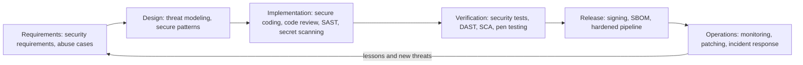
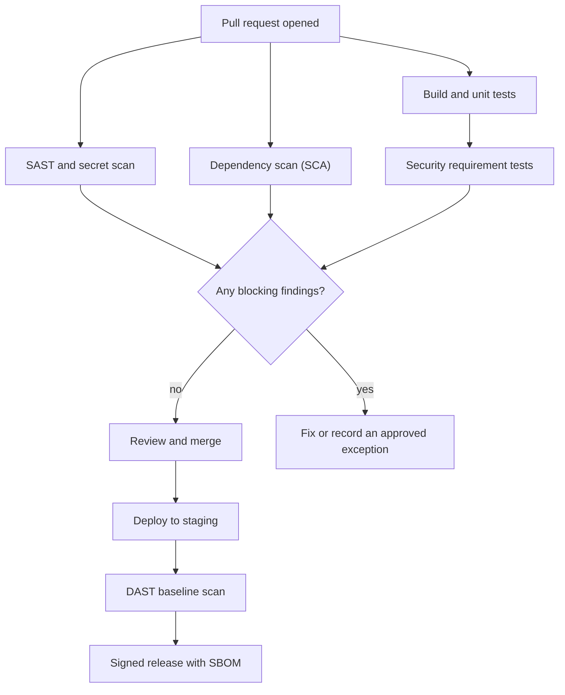

# Secure Software Development Lifecycle

## Introduction

A **Secure Software Development Lifecycle (Secure SDLC or SSDLC)** is the set of security activities a team performs at every stage of building software: when it writes requirements, designs the system, writes code, tests, releases and runs it in production. Instead of one big security review at the end, small checks happen all the way through.

Think of building a house. You could build the whole thing and then hire an inspector, who finds that the wiring inside the finished walls is unsafe. Now you tear open the walls. Or the inspector can check the plans, then the foundation, then the wiring before the drywall goes up. Each check is small, and problems are cheap to fix when they are found. A Secure SDLC is the second approach applied to software.

This page is the starting point for the **AppSec and DevSecOps** section. It explains the overall lifecycle, the frameworks teams use to organize it, and how to make security requirements testable. The rest of the section goes deep on each activity: [threat modeling](./1-sec-threat-modeling.mdx), [SAST](./2-sec-sast.mdx), [DAST](./3-sec-dast.mdx), [dependency scanning](./4-sec-dependency-scanning.mdx), [supply chain security](./5-sec-supply-chain.mdx), [SBOMs and signing](./6-sec-sbom-and-signing.mdx), [secret scanning](./7-sec-secret-scanning.mdx), [pipeline security](./8-sec-pipeline-security.mdx) and putting it all together in a [testing strategy](./9-sec-security-testing-strategy.mdx).

## Why "Security at the End" Fails

Many teams still work like this: build features for three months, then ask a security team or an outside penetration tester to "check it" a week before launch. The problems with that model are predictable:

- **Design flaws are expensive late.** If the tester finds that any user can read any other user's invoices because the API never checks ownership, the fix may touch every endpoint. A design review would have caught it before the first line of code.
- **The release date wins.** Findings that arrive a week before launch get pushed to "after launch", and many never get fixed.
- **One review cannot see everything.** A two-week test samples the app. It cannot replace secure defaults, code review and automated checks on every change.
- **Developers do not learn.** If findings come back months after the code was written, nobody remembers the context, and the same mistake shows up in the next feature.

The phrase you will hear for the alternative is **"shift left"**: move security activities earlier (to the left on a timeline) so problems are found when they are cheapest to fix. Shifting left does not mean abandoning late testing. You still need production monitoring and periodic penetration tests. It means adding earlier, cheaper layers.

:::note About cost multipliers
You may see claims that a bug costs "100x more" to fix in production than in design. The exact multipliers that circulate are poorly sourced, so do not quote them as facts. The direction is still well accepted by practitioners: the later a flaw is found, the more code, people and customers it touches.
:::

## Security Activities in Each Phase

Every SDLC model, whether waterfall, agile or continuous delivery, has the same basic phases. The diagram shows the main security activity attached to each one.



The arrow back to Requirements matters. Incidents, bug bounty reports and new threats feed the next round of requirements. A Secure SDLC is a loop, not a checklist you finish once.

| Phase | Security question | Typical activities | Covered in |
| --- | --- | --- | --- |
| Requirements | What must the system protect, and from whom? | Security requirements, abuse cases, compliance needs, data classification | This page |
| Design | What can go wrong with this design? | Threat modeling, architecture review, choosing secure frameworks | [Threat Modeling with STRIDE](./1-sec-threat-modeling.mdx) |
| Implementation | Is the code written safely? | Secure coding standards, peer review, SAST, secret scanning, pre-commit hooks | [SAST](./2-sec-sast.mdx), [Secret Scanning](./7-sec-secret-scanning.mdx) |
| Verification | Does it hold up when attacked? | Security unit tests, DAST, dependency scanning, fuzzing, pen tests | [DAST](./3-sec-dast.mdx), [SCA](./4-sec-dependency-scanning.mdx) |
| Release | Can users trust what we ship? | Signed artifacts, SBOMs, provenance, protected pipelines | [SBOMs, Signing and SLSA](./6-sec-sbom-and-signing.mdx), [Securing CI/CD Pipelines](./8-sec-pipeline-security.mdx) |
| Operations | Will we notice and respond to attacks? | Logging, alerting, patching, vulnerability disclosure, incident response | [Incident Response Lifecycle](../12-sec-incident-response/0-sec-incident-response-lifecycle.mdx) |

### In an agile or DevOps team

In a team that ships many times a day there is no separate "design phase" lasting weeks. The same activities still happen, but at a smaller grain:

- **Per epic or new service:** a lightweight threat model (often an hour at a whiteboard).
- **Per user story:** security acceptance criteria, written next to the functional ones.
- **Per pull request:** peer review with a security checklist, plus automated SAST, secret scanning and dependency checks in CI.
- **Per release:** signed artifacts, SBOM, a DAST scan against staging.
- **Continuously:** dependency alerts, runtime monitoring, a vulnerability disclosure inbox.
- **Periodically:** penetration tests, threat model refreshes, training.

This is what people mean by **DevSecOps**: security work automated into the same pipeline as builds and tests, owned by the same teams, with security specialists acting as coaches and tool builders instead of gatekeepers.

## Frameworks for Organizing the Work

You do not need to invent your Secure SDLC from scratch. Several public frameworks describe what good looks like. They differ in style.

### NIST Secure Software Development Framework (SSDF)

The [NIST SSDF, SP 800-218](https://csrc.nist.gov/projects/ssdf) is a short, outcome-based list of practices. It does not tell you which tool to buy. It tells you what result to achieve. Its practices fall into four groups:

| Group | Meaning | Example practices |
| --- | --- | --- |
| **PO** Prepare the Organization | People, process and tooling are ready | Define security requirements, assign roles, set up toolchains |
| **PS** Protect the Software | Code and releases cannot be tampered with | Protect code from unauthorized change, provide integrity checks for releases, archive releases |
| **PW** Produce Well-Secured Software | Software is built with few vulnerabilities | Threat modeling, reusing secure components, code review, testing, secure default settings |
| **RV** Respond to Vulnerabilities | Problems are found and fixed after release | Vulnerability intake, root cause analysis, fixing whole classes of issues |

Version 1.1 (February 2022) is the current final version as of this writing. NIST released a draft **Revision 1 (SSDF version 1.2)** in December 2025. The SSDF matters beyond good practice: US federal software procurement rules have used it as the basis for supplier self-attestation. Check the [NIST SSDF project page](https://csrc.nist.gov/projects/ssdf) for the current status, because drafts become final and requirements change.

### OWASP SAMM

[OWASP SAMM](https://owaspsamm.org/model/) (Software Assurance Maturity Model) version 2 organizes security into five **business functions**: Governance, Design, Implementation, Verification and Operations. Each has three practices, and each practice has three maturity levels. Teams score themselves, pick a target score, and improve step by step. SAMM is useful when you need a roadmap: "we are at level 1 in Security Testing, we want level 2 by next year".

### Microsoft SDL

The [Microsoft Security Development Lifecycle](https://www.microsoft.com/en-us/securityengineering/sdl) is one of the oldest formal Secure SDLCs. It is a concrete set of practices Microsoft applies internally, such as threat modeling, approved tools and cryptography standards, and security testing. It is a good reference for what a mature program does, but its exact form fits a large vendor.

### BSIMM

[BSIMM](https://www.blackduck.com/resources/analyst-reports/bsimm.html) is **descriptive**, not prescriptive. It surveys what real organizations' security programs actually do, and lets you compare yourself with them. SAMM tells you what you should do; BSIMM tells you what others are doing.

### Secure by Design

CISA's [Secure by Design](https://www.cisa.gov/securebydesign) initiative pushes software makers to take ownership of customer security outcomes: memory-safe languages, MFA by default, no default passwords, eliminating whole vulnerability classes. It is more a set of principles and commitments than a process model, but it shapes what "secure defaults" means in requirements. See [Secure Defaults and Configuration](../5-sec-secure-coding/6-sec-secure-defaults.mdx).

## Step 1: Write Security Requirements

Security starts with requirements, because you cannot test for something nobody wrote down. There are three useful sources.

**1. A requirements standard.** The [OWASP Application Security Verification Standard (ASVS)](https://owasp.org/www-project-application-security-verification-standard/) is a catalog of testable security requirements, grouped into chapters such as authentication, session management, access control and cryptography. Version 5.0 was released in May 2025. It has three levels: Level 1 for a baseline, Level 2 for most applications that handle sensitive data, and Level 3 for the most critical systems. Pick a level, then pick the chapters that apply to your feature.

**2. Abuse cases.** A user story says what a legitimate user wants. An abuse case says what an attacker wants:

```text
User story:  As a customer, I can reset my password by email
             so that I can recover my account.

Abuse case:  As an attacker, I want to learn which email addresses have
             accounts, so I can target them with phishing.
Abuse case:  As an attacker, I want to request thousands of resets,
             so I can spam victims or exhaust the email budget.
Abuse case:  As an attacker, I want to reuse or guess a reset link,
             so I can take over someone else's account.
```

**3. Data classification and compliance.** If the feature stores card data, health records or personal data of EU residents, the rules of PCI DSS, HIPAA or GDPR become requirements. See [Compliance: SOC 2, PCI DSS, HIPAA and GDPR](../13-sec-governance/2-sec-compliance.mdx).

Turn each abuse case into an **acceptance criterion** that can be checked:

| ID | Security requirement | How we verify it |
| --- | --- | --- |
| SR-1 | Every response sets `X-Content-Type-Options` and a Content Security Policy | Automated test |
| SR-2 | Session cookies are `Secure`, `HttpOnly` and `SameSite` | Automated test |
| SR-3 | Password reset gives the same response whether or not the account exists | Automated test |
| SR-4 | Debug mode is never enabled in deployed code | Automated test plus SAST rule |
| SR-5 | Reset requests are rate-limited per IP and per account | Integration test |
| SR-6 | Reset tokens are single-use, random, and expire within 30 minutes | Unit test and code review |

## Step 2: Make Requirements Executable

A requirement in a wiki page drifts out of date. A requirement in the test suite fails the build when someone breaks it. Here is a small Flask service with the first four requirements built in.

```python
# app.py - a tiny account service with security requirements built in
from flask import Flask, jsonify, request

app = Flask(__name__)
app.config.update(
    SESSION_COOKIE_SECURE=True,
    SESSION_COOKIE_HTTPONLY=True,
    SESSION_COOKIE_SAMESITE="Lax",
)

USERS = {"alice@example.com": {"id": 1}}


@app.after_request
def security_headers(resp):
    resp.headers["X-Content-Type-Options"] = "nosniff"
    resp.headers["Content-Security-Policy"] = "default-src 'self'"
    resp.headers["Referrer-Policy"] = "no-referrer"
    return resp


@app.post("/password-reset")
def password_reset():
    email = (request.get_json(silent=True) or {}).get("email", "")
    if email in USERS:
        pass  # queue the reset email here
    # SR-3: same response whether or not the account exists
    return jsonify(message="If that account exists, we sent a reset link."), 202


@app.get("/healthz")
def healthz():
    return jsonify(status="ok")
```

And the security acceptance criteria as `pytest` tests:

```python
# test_security_requirements.py - security acceptance criteria as tests
import pytest

from app import app


@pytest.fixture
def client():
    app.config["TESTING"] = True
    return app.test_client()


def test_sr1_security_headers_on_every_response(client):
    resp = client.get("/healthz")
    assert resp.headers["X-Content-Type-Options"] == "nosniff"
    assert "default-src 'self'" in resp.headers["Content-Security-Policy"]


def test_sr2_session_cookie_flags():
    assert app.config["SESSION_COOKIE_SECURE"] is True
    assert app.config["SESSION_COOKIE_HTTPONLY"] is True
    assert app.config["SESSION_COOKIE_SAMESITE"] in ("Lax", "Strict")


@pytest.mark.parametrize("email", ["alice@example.com", "nobody@example.com"])
def test_sr3_password_reset_does_not_reveal_accounts(client, email):
    resp = client.post("/password-reset", json={"email": email})
    assert resp.status_code == 202
    assert resp.get_json()["message"].startswith("If that account exists")


def test_sr4_debug_mode_is_off():
    assert app.debug is False
```

Run it:

```bash
pip install flask pytest
python -m pytest -v test_security_requirements.py
```

Example output:

```text
test_security_requirements.py::test_sr1_security_headers_on_every_response PASSED [ 20%]
test_security_requirements.py::test_sr2_session_cookie_flags PASSED      [ 40%]
test_security_requirements.py::test_sr3_password_reset_does_not_reveal_accounts[alice@example.com] PASSED [ 60%]
test_security_requirements.py::test_sr3_password_reset_does_not_reveal_accounts[nobody@example.com] PASSED [ 80%]
test_security_requirements.py::test_sr4_debug_mode_is_off PASSED         [100%]

============================== 5 passed in 0.06s ===============================
```

Now try breaking SR-3. Change the handler so it returns `404` with "No such user" for unknown emails. The parametrized test fails for `nobody@example.com`, and the pull request cannot merge. That is the core idea of a Secure SDLC in a modern team: **security knowledge becomes automated checks that run on every change**.

:::tip Name tests after requirement IDs
Prefixes like `test_sr3_` make it easy to trace a failing test back to the requirement and its abuse case. Auditors for SOC 2 or ISO 27001 also like this traceability, because it shows the control exists and is tested.
:::

## Step 3: Add Gates to the Pipeline

Automated checks need a place to run. A typical pull-request pipeline adds security stages next to the normal build and test stages:



Two rules make gates work in practice:

1. **Block only on high-confidence, high-impact findings.** If every pull request fails because of noisy warnings, developers learn to ignore or bypass the gate. Start in "report only" mode, tune, and then turn on blocking for a small set of rules.
2. **Have an exception process.** Sometimes a finding is a false positive or an accepted risk. Record who accepted it, why, and when it expires, instead of silently disabling the rule.

The [Building a Security Testing Strategy](./9-sec-security-testing-strategy.mdx) page covers how to choose which checks run where.

## Step 4: People and Ownership

Tools do not make a Secure SDLC on their own. Three people-related practices matter most:

- **Security champions.** One developer per team who gets extra training, joins threat modeling sessions and is the first contact for security questions. Champions scale a small security team across many product teams.
- **Secure coding training tied to real findings.** Generic annual training is less effective than a short session on "the three kinds of bugs our SAST found last quarter".
- **Clear ownership of findings.** Every finding needs an owner and a due date based on severity. See [Vulnerability Management and CVSS](../11-sec-defensive-operations/6-sec-vulnerability-management.mdx).

And one external practice: publish a way for outsiders to report vulnerabilities, such as a `security.txt` file and a disclosure policy. See [Ethics, Law and Responsible Disclosure](../0-sec-fundamentals/8-sec-ethics-and-law.mdx).

## Step 5: Measure Whether It Works

A Secure SDLC that nobody measures slowly decays: scanners get disabled, threat models stop happening, exceptions never expire. Track a handful of numbers that show both **coverage** (are we doing the activities?) and **outcomes** (is the software getting safer?).

| Metric | Type | What it tells you |
| --- | --- | --- |
| Share of repositories with SAST, SCA and secret scanning enabled | Coverage | Whether the automated baseline actually reaches all code |
| Share of new services with a threat model on file | Coverage | Whether design review happens, or only for some teams |
| Mean time to remediate, by severity | Outcome | How fast findings are fixed once known |
| Open findings past their due date | Outcome | Whether the backlog is under control |
| Vulnerabilities found in production vs before release | Outcome | Whether earlier phases catch problems, or customers and testers do |
| Recurring vulnerability classes | Outcome | Which training or guardrail (for example a safe library) would remove a whole class |
| Active risk exceptions and their expiry dates | Governance | Whether "temporary" exceptions are quietly becoming permanent |

Two cautions apply. First, do not turn these into targets for individual developers, or people will optimize the number instead of the risk (for example by marking real findings as false positives). Second, a rising finding count right after you add a new scanner is good news: it means you are seeing problems that were already there.

Review the numbers quarterly with engineering leadership. The best outcome is a decision such as "SQL injection findings keep recurring in the reporting service, so we will migrate it to the query builder", which removes a class of bugs instead of fixing them one at a time.

## Real-World Scenario

Your company is a 15-engineer B2B SaaS startup selling an HR tool. There is no dedicated security team. A large prospective customer sends a security questionnaire asking, among other things, "Do you follow a documented secure development lifecycle?" Today, the honest answer is "we do code review and we use HTTPS". You have one quarter to build something real, and leadership will not hire a security team yet.

**The walkthrough:**

1. **Pick a framework to map against.** Use the NIST SSDF as your checklist because it is short, outcome-based and recognized by enterprise buyers. Write a two-page "Secure Development Policy" that names who does what in each phase.
2. **Requirements:** adopt OWASP ASVS Level 2 as your baseline. Add a "Security" section to the story template with abuse cases and acceptance criteria.
3. **Design:** run a one-hour threat model for every new service or major feature. Store the diagram and threat list in the repo next to the code.
4. **Implementation:** turn on SAST, secret scanning and dependency scanning in CI, in report-only mode for the first month, then block on critical findings.
5. **Verification:** write security requirement tests like the ones above for authentication, session and access control. Add a weekly DAST baseline scan against staging. Book an external penetration test for the end of the quarter.
6. **Release and operations:** produce an SBOM for each release, pin CI dependencies, and publish a `security.txt` and a disclosure inbox.
7. **People:** pick one security champion per team and give them a few hours a week for security work.

**Why this approach:** It produces evidence (policy, pipeline logs, test results, pen test report) that answers the questionnaire honestly, and it actually reduces risk. The automated parts keep working after the quarter ends.

**When to use it:** small and mid-sized teams that need a credible program without a security department. **When not to:** if you are a regulated vendor (for example selling to US federal agencies, or handling card data at scale), you will need the full set of required attestations and possibly a formal maturity assessment, not a light version.

| Approach | Pros | Cons | Best for |
| --- | --- | --- | --- |
| Pen test before each launch only | Simple; produces a report | Late, expensive, samples only part of the app; findings slip | A supplement, never the whole program |
| NIST SSDF mapping | Short, outcome-based, recognized by buyers and regulators | Says what, not how; you still choose tools | Startups and vendors answering customer due diligence |
| OWASP SAMM assessment | Clear maturity levels and roadmap | Takes effort to score honestly | Organizations planning multi-year improvement |
| Microsoft SDL style program | Concrete, proven practices | Heavy for small teams | Large product companies |
| BSIMM comparison | Shows what peers really do | Descriptive, not a how-to; benchmark is large organizations | Mature programs benchmarking themselves |
| Ad hoc "we are careful" | No overhead | No evidence, no consistency | Nobody |

## Common Mistakes

- **Buying tools before defining requirements.** A scanner tells you about the bugs it knows how to find. It cannot tell you that your app needs tenant isolation.
- **Making security a phase owned by another team.** If security is "the security team's job at the end", developers never build the skill and the end-of-cycle review becomes a bottleneck.
- **Turning on every rule in blocking mode on day one.** You will get hundreds of findings, the build will be red, and someone will disable the scanner. Start with report-only and tune.
- **Skipping design review.** Most expensive flaws, such as missing authorization or trusting the client, are design flaws that no linter can find.
- **Writing requirements nobody can test.** "The system shall be secure" is not a requirement. "Reset tokens expire after 30 minutes" is.
- **Forgetting operations.** Code that was secure at release becomes vulnerable when a dependency gets a new CVE. Monitoring and patching are part of the lifecycle.
- **No exception process.** Without a documented way to accept a risk, people either block releases for low-risk findings or quietly bypass the checks.

## Summary

- A Secure SDLC adds security activities to every phase: requirements, design, implementation, verification, release and operations.
- "Shift left" means finding problems earlier and cheaper, not dropping late testing.
- NIST SSDF (outcomes), OWASP SAMM (maturity roadmap), Microsoft SDL (concrete practices) and BSIMM (benchmark) are complementary references.
- OWASP ASVS 5.0 is a ready-made catalog of testable security requirements; abuse cases turn them into stories.
- Write security acceptance criteria as automated tests so they run on every change.
- Gates should block only on high-confidence findings, with a documented exception process.
- Security champions and clear ownership make the process scale.

## Further Learning

**Exercises**

1. Run the `app.py` and `test_security_requirements.py` example. Then break SR-3 by returning `404` for unknown emails and confirm the test fails.
2. Implement SR-5 (rate limiting the reset endpoint) and write a test that sends six requests and expects the sixth to be rejected with `429`.
3. Pick a feature you built recently. Write three abuse cases for it and turn each into a testable requirement.
4. Read the four SSDF practice groups and rate your current team from 0 to 2 on each. Which group is weakest, and what is one action that would improve it?

**Related pages**

- [Threat Modeling with STRIDE](./1-sec-threat-modeling.mdx): the main design-phase activity.
- [Building a Security Testing Strategy](./9-sec-security-testing-strategy.mdx): choosing which tests run where.
- [Secure Coding Introduction](../5-sec-secure-coding/0-sec-secure-coding-introduction.mdx)
- [Security Frameworks: NIST CSF, ISO 27001 and CIS Controls](../13-sec-governance/1-sec-security-frameworks.mdx)
- [CI/CD tutorial](/docs/devops/cicd) for pipeline basics.
