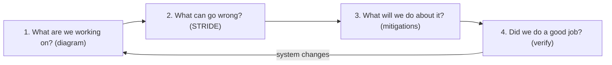
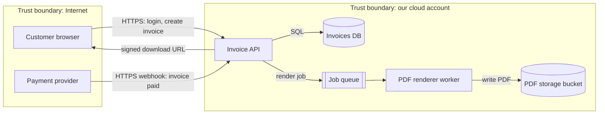

# Threat Modeling with STRIDE

## Introduction

**Threat modeling** is a structured way of asking "what could go wrong?" about a system **before** attackers do. You draw how the system works, look at each part through an attacker's eyes, decide which threats matter, and choose what to do about them.

An analogy: before a museum opens a new exhibit, the security manager walks the floor plan. Where are the doors? Which windows face the street? Who has keys? Where could someone hide after closing? Nobody has stolen anything yet, but the walk-through shapes where cameras, locks and guards go. Threat modeling is that walk-through for software.

It is the main security activity of the **design** phase in a [Secure SDLC](./0-sec-sdlc.mdx). It finds flaws no scanner can see, such as a missing authorization check between tenants, or an internal service that trusts any caller on the network. Those design flaws map to OWASP Top 10:2025 categories like **A06 Insecure Design** and **A01 Broken Access Control**.

On this page you will learn the four-question framework, the **STRIDE** threat categories, how to draw a data flow diagram with trust boundaries, how to apply STRIDE to each element, and how to keep a threat model alive as code in your repository.

## The Four Questions

The [Threat Modeling Manifesto](https://www.threatmodelingmanifesto.org/) and Adam Shostack's work boil threat modeling down to four questions. Every method, including STRIDE, is a way of answering them:

1. **What are we working on?** Draw the system: components, data flows, data stores, and trust boundaries.
2. **What can go wrong?** Find threats. STRIDE is a checklist that helps here.
3. **What are we going to do about it?** For each threat: mitigate, eliminate, transfer or accept.
4. **Did we do a good job?** Check that the mitigations exist and are tested, and that the model matches what was built.



You do not need special tools or a security degree to answer these. A whiteboard, the people who know the system, and an hour are enough to get real value.

## STRIDE: Six Kinds of Threat

STRIDE was developed at Microsoft in the late 1990s. Each letter names a type of threat, and each type violates one security property:

| Letter | Threat | Property violated | Example | Typical mitigations |
| --- | --- | --- | --- | --- |
| **S** | Spoofing | Authentication | Attacker logs in with a stolen session cookie | Strong authentication, MFA, signed tokens, mutual TLS |
| **T** | Tampering | Integrity | Attacker changes the `price` field in a checkout request | Server-side validation, MACs and signatures, access control on data |
| **R** | Repudiation | Non-repudiation | Admin deletes records and claims they never did | Audit logs that the actor cannot modify, signed transactions |
| **I** | Information disclosure | Confidentiality | API returns other customers' data, or stack traces leak secrets | Authorization checks, encryption, minimal responses, error handling |
| **D** | Denial of service | Availability | One client sends huge uploads that exhaust disk | Rate limits, quotas, size limits, autoscaling, timeouts |
| **E** | Elevation of privilege | Authorization | Normal user calls an admin endpoint that lacks a role check | Least privilege, deny by default, consistent authorization layer |

STRIDE is useful because it turns a vague question ("is this secure?") into six concrete ones. It maps neatly to the [CIA triad](../0-sec-fundamentals/1-sec-cia-triad.mdx) plus authentication, authorization and accountability.

## Step 1: Draw a Data Flow Diagram

Threat models usually start from a **data flow diagram (DFD)**. A DFD has only four kinds of element, plus trust boundaries:

| Element | What it is | Examples |
| --- | --- | --- |
| External entity | Something outside your control that interacts with the system | User's browser, partner API, payment provider |
| Process | Code that runs and transforms data | Web API, background worker, PDF renderer |
| Data store | Where data rests | Database, S3 bucket, Redis cache, log files |
| Data flow | Data moving between elements | HTTPS request, queue message, SQL query |
| Trust boundary | A line where the level of trust changes | Internet to your VPC, your app to a third party, user to admin |

Our example system is **an invoice service** for small businesses. Customers log in, create invoices, and download PDFs. A payment provider sends webhooks when invoices are paid.



Draw the diagram at the level of detail where the team can talk about it. Five to fifteen elements is a good size. If the diagram needs fifty boxes, split the system into smaller models.

:::tip Trust boundaries are where bugs live
Most serious threats appear where data crosses a trust boundary: from the internet into your API, from your API to a third party, or from a less privileged component to a more privileged one. Look there first.
:::

## Step 2: Apply STRIDE per Element

Not every STRIDE category applies to every element. A data store cannot "spoof" anything, for example. The common **STRIDE-per-element** convention narrows the questions:

| Element type | S | T | R | I | D | E |
| --- | --- | --- | --- | --- | --- | --- |
| External entity | Yes |  | Yes |  |  |  |
| Process | Yes | Yes | Yes | Yes | Yes | Yes |
| Data store |  | Yes | Sometimes (logs) | Yes | Yes |  |
| Data flow |  | Yes |  | Yes | Yes |  |

You can automate the boring part, generating the list of questions, with a few lines of Python. The thinking still has to come from people.

```python
# stride.py - generate STRIDE-per-element questions from a small system model
from dataclasses import dataclass, field

STRIDE_PER_ELEMENT = {
    "external_entity": ["S", "R"],
    "process": ["S", "T", "R", "I", "D", "E"],
    "data_store": ["T", "R", "I", "D"],
    "data_flow": ["T", "I", "D"],
}

QUESTIONS = {
    "S": "Spoofing: can someone pretend to be {name}?",
    "T": "Tampering: can someone modify {name} or the data in it?",
    "R": "Repudiation: could {name} deny an action because nothing proves it?",
    "I": "Information disclosure: can {name} leak data to the wrong party?",
    "D": "Denial of service: can someone make {name} unavailable?",
    "E": "Elevation of privilege: can someone gain rights through {name}?",
}


@dataclass
class Element:
    name: str
    kind: str
    crosses_boundary: bool = False
    notes: list = field(default_factory=list)


def enumerate_threats(elements):
    threats = []
    for el in elements:
        for letter in STRIDE_PER_ELEMENT[el.kind]:
            threats.append({
                "id": f"T{len(threats) + 1:02d}",
                "element": el.name,
                "category": letter,
                "question": QUESTIONS[letter].format(name=el.name),
                # Flows and processes on a trust boundary get looked at first
                "priority": "review first" if el.crosses_boundary else "normal",
            })
    return threats


if __name__ == "__main__":
    model = [
        Element("Customer browser", "external_entity", crosses_boundary=True),
        Element("Browser -> API (HTTPS)", "data_flow", crosses_boundary=True),
        Element("Invoice API", "process", crosses_boundary=True),
        Element("Invoices DB", "data_store"),
    ]
    threats = enumerate_threats(model)
    for t in threats:
        print(f'{t["id"]} [{t["category"]}] {t["priority"]:<12} {t["question"]}')
    print(f"\n{len(threats)} questions for {len(model)} elements")
```

Output:

```text
T01 [S] review first Spoofing: can someone pretend to be Customer browser?
T02 [R] review first Repudiation: could Customer browser deny an action because nothing proves it?
T03 [T] review first Tampering: can someone modify Browser -> API (HTTPS) or the data in it?
T04 [I] review first Information disclosure: can Browser -> API (HTTPS) leak data to the wrong party?
T05 [D] review first Denial of service: can someone make Browser -> API (HTTPS) unavailable?
T06 [S] review first Spoofing: can someone pretend to be Invoice API?
T07 [T] review first Tampering: can someone modify Invoice API or the data in it?
T08 [R] review first Repudiation: could Invoice API deny an action because nothing proves it?
T09 [I] review first Information disclosure: can Invoice API leak data to the wrong party?
T10 [D] review first Denial of service: can someone make Invoice API unavailable?
T11 [E] review first Elevation of privilege: can someone gain rights through Invoice API?
T12 [T] normal       Tampering: can someone modify Invoices DB or the data in it?
T13 [R] normal       Repudiation: could Invoices DB deny an action because nothing proves it?
T14 [I] normal       Information disclosure: can Invoices DB leak data to the wrong party?
T15 [D] normal       Denial of service: can someone make Invoices DB unavailable?

15 questions for 4 elements
```

Each question is a prompt for discussion, not a finding. For many, the answer is "already handled" (for example, T03: TLS protects the flow). The goal is to make sure nobody skips a category by accident.

### Turning questions into concrete threats

Walking through the invoice service with the team produces threats like these:

- **Spoofing the payment provider (S).** The webhook endpoint is on the internet. If it does not verify the provider's signature, anyone can POST "invoice 123 is paid". Mitigation: verify the HMAC signature and timestamp on every webhook. See [Webhook Security](../7-sec-api-security/6-sec-webhook-security.mdx).
- **Tampering with invoice totals (T).** The browser sends line items and a total. If the API trusts the total, a customer can pay less. Mitigation: recompute totals on the server.
- **Repudiation of deletes (R).** An admin can delete invoices, and nothing records who did it. Mitigation: append-only audit log.
- **Information disclosure across tenants (I and E).** `GET /invoices/1042` returns the invoice without checking that it belongs to the caller's company. This is a classic [Broken Object Level Authorization](../7-sec-api-security/2-sec-bola.mdx) flaw. Mitigation: scope every query by tenant.
- **Denial of service on the renderer (D).** A huge invoice with 100,000 lines makes the PDF worker run out of memory. Mitigation: limit line items and job runtime.
- **Elevation of privilege through templates (E).** Customers can upload custom invoice templates. If the renderer evaluates them as code, a template could run commands. Mitigation: a logic-less template engine plus a sandboxed worker with no secrets.
- **Information disclosure from storage (I).** If the PDF bucket is public, invoice PDFs leak. Mitigation: private bucket and short-lived signed URLs. See [Securing Cloud Storage](../8-sec-cloud-and-container/3-sec-cloud-storage-security.mdx).

## Step 3: Rate and Decide

You will find more threats than you can fix at once. Rate each one so you can prioritize. Keep the rating simple: a **likelihood x impact** grid with three levels each is enough for most teams.

| Likelihood \\ Impact | Low | Medium | High |
| --- | --- | --- | --- |
| **High** | Medium | High | Critical |
| **Medium** | Low | Medium | High |
| **Low** | Low | Low | Medium |

:::note About DREAD
You may see **DREAD** (Damage, Reproducibility, Exploitability, Affected users, Discoverability) in older material. Microsoft itself stopped using it because scores were too subjective and inconsistent between raters. A simple likelihood and impact grid, or CVSS for concrete vulnerabilities, is usually more useful. See [Risk Management](../13-sec-governance/0-sec-risk-management.mdx).
:::

For each threat, choose one response:

- **Mitigate:** add a control that reduces likelihood or impact (most common).
- **Eliminate:** remove the feature or component (for example, drop custom templates entirely).
- **Transfer:** let someone else carry the risk (for example, use a payment provider so you never store card numbers, or buy insurance).
- **Accept:** consciously decide the risk is tolerable, with a named owner and an expiry date.

## Step 4: Keep the Model as Code

A threat model in a slide deck is forgotten after the meeting. A threat register in the repository can be reviewed in pull requests and checked in CI, just like code. Here is a small YAML register for the invoice service:

```yaml
# threats.yaml
system: invoice-service
version: 2026-10
reviewed_by: [maria (dev lead), sam (security champion)]
threats:
  - id: T-01
    element: Invoice API
    stride: E
    title: Customer reads another tenant's invoice by changing the ID
    likelihood: high
    impact: high
    mitigation: Check invoice.tenant_id == session.tenant_id in the data layer
    status: mitigated
    verified_by: tests/test_tenant_isolation.py
  - id: T-02
    element: Browser -> API (HTTPS)
    stride: I
    title: Session token stolen in transit
    likelihood: low
    impact: high
    mitigation: HTTPS only, HSTS, Secure and HttpOnly cookies
    status: mitigated
    verified_by: tests/test_security_headers.py
  - id: T-03
    element: Invoice API
    stride: R
    title: Admin deletes an invoice and denies it
    likelihood: medium
    impact: medium
    mitigation: Append-only audit log of who changed what and when
    status: planned
    owner: maria
    due: 2026-11-30
  - id: T-04
    element: PDF renderer
    stride: E
    title: Malicious invoice template runs code in the renderer
    likelihood: medium
    impact: high
    mitigation: Render in a sandboxed container with no network and no secrets
    status: accepted
    accepted_by: cto
    expires: 2027-01-31
```

And a checker that fails CI when the register has gaps: mitigated threats without evidence, planned work without an owner, expired risk acceptances, or unmitigated high-impact threats.

```python
# check_threats.py - fail CI if the threat register has gaps
import sys
from datetime import date

import yaml  # pip install pyyaml

REQUIRED = {"id", "element", "stride", "title", "likelihood", "impact", "mitigation", "status"}


def check(path):
    with open(path) as f:
        model = yaml.safe_load(f)
    problems = []
    for t in model["threats"]:
        missing = REQUIRED - t.keys()
        if missing:
            problems.append(f'{t.get("id", "?")}: missing fields {sorted(missing)}')
        status = t.get("status")
        if status == "mitigated" and "verified_by" not in t:
            problems.append(f'{t["id"]}: mitigated but no test or evidence in verified_by')
        if status == "planned" and ("owner" not in t or "due" not in t):
            problems.append(f'{t["id"]}: planned work needs an owner and a due date')
        if status == "accepted":
            expires = t.get("expires")
            if not expires or expires < date.today():
                problems.append(f'{t["id"]}: risk acceptance missing or expired')
        if t.get("likelihood") == "high" and t.get("impact") == "high" and status != "mitigated":
            problems.append(f'{t["id"]}: high/high threat is not mitigated')
    return problems


if __name__ == "__main__":
    problems = check(sys.argv[1] if len(sys.argv) > 1 else "threats.yaml")
    for p in problems:
        print("FAIL", p)
    print(f"{len(problems)} problem(s)")
    sys.exit(1 if problems else 0)
```

Running it against a copy of the register where someone removed the owner of T-03 and the risk acceptance for T-04 has expired:

```bash
python check_threats.py threats-broken.yaml
```

Output:

```text
FAIL T-03: planned work needs an owner and a due date
FAIL T-04: risk acceptance missing or expired
2 problem(s)
```

The `verified_by` field closes the loop on the fourth question, "did we do a good job?": every mitigated threat points at a test that proves the mitigation exists.

## Tools and Other Methods

| Tool or method | What it is | When it fits |
| --- | --- | --- |
| Whiteboard and STRIDE | Draw, discuss, write a list | Most teams, most features |
| [OWASP Threat Dragon](https://owasp.org/www-project-threat-dragon/) | Free diagramming tool with STRIDE support | Teams that want saved, shareable diagrams |
| Microsoft Threat Modeling Tool | Free Windows tool that generates threats from DFD templates | Windows and Azure heavy shops |
| [OWASP pytm](https://github.com/OWASP/pytm) | Describe the system in Python, generate diagrams and threats | Teams that want models as code |
| Commercial platforms | Questionnaires, templates, integrations with ticketing | Large organizations with many models |
| Attack trees | Tree of ways an attacker reaches one goal | Deep dives on one critical asset |
| PASTA | Seven-stage, risk-centric process | Formal, business-impact focused programs |
| LINDDUN | Privacy threat categories (linking, identifying, and others) | Systems processing personal data. See [Privacy Engineering](../13-sec-governance/4-sec-privacy-engineering.mdx) |

STRIDE and LINDDUN combine well: STRIDE for security, LINDDUN for privacy, on the same diagram. For AI features, add the threats from the [OWASP Top 10 for LLM Applications](../13-sec-governance/5-sec-ai-security.mdx), such as prompt injection, because STRIDE alone does not name them.

## Real-World Scenario

Your team is adding a **"share invoice by link"** feature to the invoice service: a customer can generate a link that lets their accountant view an invoice without logging in. The product manager wants it shipped in two weeks. You have one hour with the developer, the product manager and the team's security champion.

**The walkthrough:**

1. **What are we working on?** Add two elements to the diagram: a new "Share link" data flow from the API to an unauthenticated viewer (a new external entity), and a "share tokens" data store.
2. **What can go wrong?** Apply STRIDE to the new elements only:
   - S: someone guesses or brute-forces share links. I: links get forwarded, indexed by search engines or leaked in referrer headers. R: nobody knows who opened the link. D: link-viewing endpoint is hammered. E: the share token accidentally grants access to other invoices of the same tenant.
3. **What will we do?** Tokens with 128 bits of randomness from a cryptographically secure generator (see [Randomness and Secure Tokens](../1-sec-cryptography/9-sec-randomness.mdx)); store only a hash of the token; scope each token to exactly one invoice; expire after 14 days with an option to revoke; `Referrer-Policy: no-referrer` and `noindex`; log each view with time and IP; rate-limit the endpoint.
4. **Did we do a good job?** Add threats T-10 to T-14 to `threats.yaml`, each with `verified_by` pointing to new tests, and let CI enforce it.

**Why this approach:** a focused, one-hour model on the **change** gives most of the value at low cost. It caught a design decision (one token per invoice, not per tenant) that would have been expensive to change after release.

**When to use it:** every new feature that adds an entry point, a new data store, a trust boundary or a new kind of sensitive data. **When not to bother:** a pure UI copy change or an internal refactor that does not change data flows. Re-model when the architecture changes, not every sprint.

| Approach | Pros | Cons | Best for |
| --- | --- | --- | --- |
| Lightweight STRIDE per feature | Fast, fits sprints, developers learn | Can miss systemic issues across features | Most product teams |
| Full system model per release | Sees cross-cutting issues | Slow; becomes outdated | New systems, major redesigns |
| Threat model as code (YAML, pytm) | Reviewed in PRs, enforceable in CI | Needs discipline and some tooling | Teams with strong CI culture |
| External design review | Expert eyes, fresh perspective | Costly; less context | High-risk systems, compliance |
| No threat model, rely on pen tests | No upfront effort | Finds design flaws late, when they are most expensive | Not recommended |

## Common Mistakes

- **Boiling the ocean.** Trying to model the entire company in one diagram. Model one system or one feature at a time.
- **Doing it once.** A threat model from two years ago describes a system that no longer exists. Re-model when data flows or trust boundaries change.
- **Only the security team attends.** The developers know how the system really works. Without them the diagram is wrong.
- **Listing threats without decisions.** Every threat needs a response (mitigate, eliminate, transfer, accept) and an owner.
- **Forgetting third parties and internal callers.** Webhooks, partner APIs, admin tools and internal services are entry points too. "It's internal" is not a mitigation. See [Least Privilege and Zero Trust](../0-sec-fundamentals/5-sec-least-privilege.mdx).
- **Ignoring abuse of legitimate features.** Not every threat is a bug. Coupon stacking or mass account creation are business logic threats. See [Business Logic Vulnerabilities](../3-sec-web-security/11-sec-business-logic-flaws.mdx).
- **Treating STRIDE as complete.** It is a prompt list. Supply chain, privacy and AI-specific threats need extra lenses.

## Summary

- Threat modeling answers four questions: what are we building, what can go wrong, what will we do, did we do a good job.
- STRIDE names six threat types: Spoofing, Tampering, Repudiation, Information disclosure, Denial of service and Elevation of privilege.
- Start with a data flow diagram and mark trust boundaries; most serious threats sit on those boundaries.
- STRIDE-per-element limits the questions to the ones that make sense for each element type.
- Rate threats simply, then mitigate, eliminate, transfer or accept each one with an owner.
- Keep the register as code with `verified_by` links to tests, and check it in CI.

## Further Learning

**Exercises**

1. Draw a DFD for a to-do list app with a mobile client, an API, a database and a push notification service. Mark the trust boundaries.
2. Extend `stride.py` with the rest of the invoice service (payment provider, webhook flow, queue, renderer, bucket) and review the generated questions. Which ones are already mitigated?
3. Add a check to `check_threats.py` that fails if any threat on an element in a trust boundary list has no `verified_by` test.
4. Pick one threat from the "share invoice by link" scenario and write the test named in its `verified_by` field.

**Related pages**

- [Secure Software Development Lifecycle](./0-sec-sdlc.mdx)
- [Attack Surface](../0-sec-fundamentals/3-sec-attack-surface.mdx)
- [Secure Design Principles](../0-sec-fundamentals/6-sec-security-principles.mdx)
- [Project: Threat Modeling a SaaS Application](../14-sec-projects/2-sec-project-threat-model.mdx)
