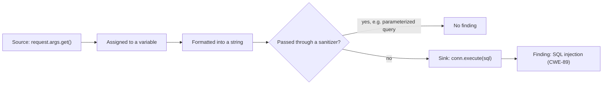
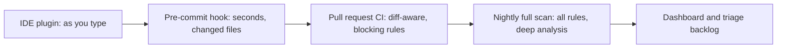

# Static Analysis (SAST)

## Introduction

**Static Application Security Testing (SAST)** tools read your source code, without running it, and look for patterns that often lead to vulnerabilities: SQL built from strings, `shell=True` with user input, hardcoded passwords, disabled TLS verification, unsafe deserialization and so on.

Think of SAST as a spell checker for security. A spell checker does not understand your essay, but it reliably catches common mistakes the moment you type them, long before an editor reads the draft. It also flags some words that are actually fine. SAST works the same way: fast, cheap and early, but it needs human judgment for the results.

SAST is the main automated check in the **implementation** phase of a [Secure SDLC](./0-sec-sdlc.mdx). On this page you will run two open source tools, **Bandit** and **Semgrep**, against a deliberately vulnerable Flask app, fix the code, write a custom rule, handle false positives, and wire SAST into CI.

:::warning Scan only code you are allowed to scan
Run SAST on your own projects, your employer's code with permission, or deliberately vulnerable training apps such as OWASP Juice Shop, DVWA or WebGoat. Uploading someone else's private code to a cloud scanner can also breach confidentiality agreements.
:::

## How SAST Tools Work

SAST tools use a few techniques, from simple to sophisticated:

| Technique | What it does | Finds | Misses |
| --- | --- | --- | --- |
| Text or regex matching | Searches for strings like `shell=True` | Obvious patterns | Anything that needs context; many false positives |
| AST pattern matching | Parses code into a syntax tree and matches structures | Calls with specific argument shapes, regardless of formatting | Whether the input is actually attacker-controlled |
| Taint (data flow) analysis | Tracks data from **sources** (user input) to **sinks** (SQL, shell, HTML) | Injection where input really reaches a dangerous call | Flows through frameworks or code it does not model |
| Inter-file / inter-procedural analysis | Follows data across functions and files | Deeper injection paths | Slower; needs a build or full project |



The more a tool understands data flow, the fewer false positives it produces, and the more it costs in scan time and setup.

### Popular tools

| Tool | Languages | License | Notes |
| --- | --- | --- | --- |
| [Bandit](https://bandit.readthedocs.io/) | Python | Open source | Simple AST checks; very easy to start |
| [Semgrep](https://semgrep.dev/docs/) | 30+ languages | Community Edition is open source; paid platform adds cross-file analysis and more rules | Rules look like the code they match; easy custom rules |
| [CodeQL](https://codeql.github.com/) | Many compiled and interpreted languages | Free for public repos on GitHub; paid (GitHub Code Security) for private | Deep data flow analysis; queries in its own language |
| ESLint security plugins | JavaScript / TypeScript | Open source | Good for frontend and Node basics |
| SonarQube / SonarCloud | Many | Community and paid editions | Combines code quality and security rules |
| gosec, SpotBugs with Find Security Bugs, Brakeman | Go, Java, Ruby on Rails | Open source | Language-specific checks |

Product names, editions and free tiers change, so check each vendor's site for current terms.

## A Vulnerable App to Scan

Here is a small Flask app with four classic problems. Save it as `demo/app.py`. Do not deploy it.

```python
# demo/app.py  (Vulnerable: local lab only)
import sqlite3
import subprocess

from flask import Flask, request

app = Flask(__name__)
DB_PASSWORD = "SuperSecret123!"


@app.route("/orders")
def orders():
    customer = request.args.get("customer", "")
    conn = sqlite3.connect("shop.db")
    sql = f"SELECT id, total FROM orders WHERE customer = '{customer}'"
    return {"orders": conn.execute(sql).fetchall()}


@app.route("/ping")
def ping():
    host = request.args.get("host", "localhost")
    out = subprocess.run(f"ping -c 1 {host}", shell=True, capture_output=True, text=True)
    return {"output": out.stdout}


if __name__ == "__main__":
    app.run(debug=True)
```

## Scanning with Bandit

```bash
python -m venv .venv && . .venv/bin/activate
pip install bandit
bandit -r demo
```

Example output (Bandit 1.9.4, trimmed):

```text
>> Issue: [B404:blacklist] Consider possible security implications associated with the subprocess module.
   Severity: Low   Confidence: High
   CWE: CWE-78 (https://cwe.mitre.org/data/definitions/78.html)
   Location: demo/app.py:2:0

>> Issue: [B105:hardcoded_password_string] Possible hardcoded password: 'SuperSecret123!'
   Severity: Low   Confidence: Medium
   CWE: CWE-259 (https://cwe.mitre.org/data/definitions/259.html)
   Location: demo/app.py:7:14

>> Issue: [B608:hardcoded_sql_expressions] Possible SQL injection vector through string-based query construction.
   Severity: Medium   Confidence: Low
   CWE: CWE-89 (https://cwe.mitre.org/data/definitions/89.html)
   Location: demo/app.py:14:12

>> Issue: [B602:subprocess_popen_with_shell_equals_true] subprocess call with shell=True identified, security issue.
   Severity: High   Confidence: High
   CWE: CWE-78 (https://cwe.mitre.org/data/definitions/78.html)
   Location: demo/app.py:21:10

>> Issue: [B201:flask_debug_true] A Flask app appears to be run with debug=True, which exposes the Werkzeug debugger and allows the execution of arbitrary code.
   Severity: High   Confidence: Medium
   CWE: CWE-94 (https://cwe.mitre.org/data/definitions/94.html)
   Location: demo/app.py:26:4

Run metrics:
	Total issues (by severity):
		Low: 2
		Medium: 1
		High: 2
```

Read each finding with two numbers in mind:

- **Severity:** how bad it would be if the finding is real.
- **Confidence:** how sure the tool is that it is real. B608 has **low** confidence because Bandit only sees an f-string that looks like SQL. It does not know whether `customer` comes from a user.

Bandit found all four planted bugs and one informational note (importing `subprocess` is not a bug by itself). To focus on what matters, filter by severity: `bandit -ll -r demo` shows only medium and higher.

## Scanning with Semgrep and a Custom Rule

Semgrep's strength is rules that look like the code they match. Public rulesets exist in the Semgrep Registry (for example `p/python` or `p/flask`), and `semgrep scan --config auto` picks rules based on your project. Registry rules are downloaded from Semgrep's servers, and the CLI reports anonymous usage metrics by default; `--metrics=off` turns that off.

You can also write your own rule. This one uses **taint mode**: it reports only when data from a Flask request reaches `execute()`.

```yaml
# rules.yml
rules:
  - id: flask-sqli-fstring
    languages: [python]
    severity: ERROR
    message: >-
      User input from the request flows into a SQL string built with an f-string.
      Use a parameterized query instead: conn.execute("... WHERE x = ?", (value,))
    metadata:
      cwe: "CWE-89: SQL Injection"
    mode: taint
    pattern-sources:
      - pattern: flask.request.$ANYTHING.get(...)
    pattern-sinks:
      - patterns:
          - pattern-inside: $CONN.execute($SQL, ...)
          - focus-metavariable: $SQL
```

```bash
pip install semgrep
semgrep scan --config rules.yml --metrics=off demo
```

Example output (Semgrep 1.180.0, trimmed):

```text
┌────────────────┐
│ 1 Code Finding │
└────────────────┘

    demo/app.py
   ❯❯❱ flask-sqli-fstring
          ❰❰ Blocking ❱❱
          User input from the request flows into a SQL string built with an f-string. Use a parameterized
          query instead: conn.execute("... WHERE x = ?", (value,))

           15┆ return {"orders": conn.execute(sql).fetchall()}
```

Custom rules shine for **your** codebase's rules: "never call `requests.get` with `verify=False`", "every Flask route under `/admin` must have `@require_role`", "use our `safe_query()` helper, not raw `execute()`". Generic rulesets cannot know your conventions.

## The Fixed Code

```python
# fixed/app.py  (Fixed)
import os
import re
import sqlite3
import subprocess

from flask import Flask, abort, request

app = Flask(__name__)
DB_PASSWORD = os.environ["DB_PASSWORD"]          # secret from the environment
HOSTNAME_RE = re.compile(r"^[a-zA-Z0-9.-]{1,253}$")


@app.route("/orders")
def orders():
    customer = request.args.get("customer", "")
    conn = sqlite3.connect("shop.db")
    rows = conn.execute(                           # parameterized query
        "SELECT id, total FROM orders WHERE customer = ?", (customer,)
    ).fetchall()
    return {"orders": rows}


@app.route("/ping")
def ping():
    host = request.args.get("host", "localhost")
    if not HOSTNAME_RE.fullmatch(host):            # allowlist validation
        abort(400)
    # Reviewed: fixed argv list, validated host, no shell
    out = subprocess.run(  # nosec B603
        ["ping", "-c", "1", "--", host], capture_output=True, text=True, timeout=5
    )
    return {"output": out.stdout}


if __name__ == "__main__":
    app.run(debug=os.environ.get("FLASK_DEBUG") == "1")
```

Rescan:

```bash
bandit -ll -r fixed
semgrep scan --config rules.yml --metrics=off --error fixed
```

Example output:

```text
Test results:
	No issues identified.
...
Total potential issues skipped due to specifically being disabled (e.g., #nosec BXXX): 1
```

Semgrep reports no findings and exits with code 0. Each fix addresses the root cause: parameterized SQL (see [SQL Injection](../3-sec-web-security/3-sec-sql-injection.mdx)), an argument list instead of a shell (see [Command Injection and Path Traversal](../3-sec-web-security/7-sec-command-injection.mdx)), the secret moved out of code (see [Secrets Management in Code](../5-sec-secure-coding/3-sec-secrets-in-code.mdx)), and debug mode off by default.

Notice the suppression comment `# nosec B603`. It names the **specific** rule being suppressed, and the line above explains why. Bandit reports that one issue was skipped, so suppressions stay visible.

## False Positives and Tuning

Every SAST tool produces false positives. Here is a typical one:

```python
# fp/report.py
import sqlite3

TABLE = "orders_2026"  # constant chosen by developers, never by users


def get_order(conn: sqlite3.Connection, order_id: int):
    sql = f"SELECT id, total FROM {TABLE} WHERE id = ?"
    return conn.execute(sql, (order_id,)).fetchone()
```

```text
>> Issue: [B608:hardcoded_sql_expressions] Possible SQL injection vector through string-based query construction.
   Severity: Medium   Confidence: Low
   Location: fp/report.py:7:12
```

The table name is a constant and the value is parameterized, so this is safe. Bandit cannot tell, because it does not track where `TABLE` comes from. The taint rule above would not fire, because no request data flows into it. This is the practical difference between pattern matching and data flow analysis.

How to handle findings like this:

1. **Triage, then decide.** True positive: fix it. False positive: suppress it with a reason. Not sure: ask the security champion.
2. **Suppress narrowly.** Use the rule ID (`# nosec B608`, `# nosemgrep: rule-id`), not a blanket ignore of the file.
3. **Tune at the rule level.** If a rule is wrong 90% of the time in your codebase, disable it in config, or replace it with a better rule, rather than adding hundreds of inline comments.
4. **Audit suppressions.** Periodically list all `nosec` / `nosemgrep` comments. A suppression added "temporarily" two years ago deserves a second look.

:::caution SAST is not proof of security
"No findings" means "no findings for the rules we ran". SAST cannot see broken access control logic, business logic flaws, misconfigured cloud resources or vulnerabilities in dependencies. Those need threat modeling, code review, [DAST](./3-sec-dast.mdx) and [SCA](./4-sec-dependency-scanning.mdx).
:::

## Running SAST in CI

A useful CI setup has three properties: it runs on every pull request, it reports only **new** findings in the change, and it blocks on a small set of high-confidence rules.

```yaml
# .github/workflows/sast.yml
name: SAST
on:
  pull_request:
  push:
    branches: [main]

permissions:
  contents: read

jobs:
  semgrep:
    runs-on: ubuntu-latest
    permissions:
      contents: read
      security-events: write   # needed to upload SARIF to code scanning
    steps:
      - uses: actions/checkout@3d3c42e5aac5ba805825da76410c181273ba90b1 # v7.0.1
        with:
          fetch-depth: 0            # full history so the baseline commit exists
          persist-credentials: false
      - uses: actions/setup-python@5fda3b95a4ea91299a34e894583c3862153e4b97 # v7.0.0
        with:
          python-version: "3.13"
      - name: Install scanners
        run: pip install "semgrep==1.180.0" "bandit==1.9.4"
      - name: Semgrep (block on new findings only)
        env:
          BASE_SHA: ${{ github.event.pull_request.base.sha }}
        run: |
          semgrep scan --config rules.yml --config p/python --metrics=off \
            --baseline-commit "${BASE_SHA:-HEAD~1}" \
            --sarif-output semgrep.sarif --error
      - name: Bandit (medium severity and above)
        run: bandit -ll -r src
      - name: Upload results to code scanning
        if: always()
        uses: github/codeql-action/upload-sarif@24c54180a607b1449ed407dd24f251e4e9147c8d # v4.38.3
        with:
          sarif_file: semgrep.sarif
```

Points to notice:

- **`--baseline-commit`** makes Semgrep report only findings introduced after the base commit. Without it, the first run on a legacy codebase reports everything and the team cannot merge anything.
- **SARIF** is a standard JSON format for static analysis results. Platforms like GitHub code scanning and GitLab show SARIF findings inline on the pull request.
- **Pinned versions and SHAs** for actions and tools. A scanner is code that runs with access to your repository. See [Securing CI/CD Pipelines](./8-sec-pipeline-security.mdx).
- **Minimal `permissions`.** The job gets only what it needs.

On GitHub you can also enable **CodeQL default setup** in the repository's security settings, with no workflow file. It is free for public repositories; private repositories need the paid GitHub Code Security product. Check GitHub's current pricing.

### Where else to run SAST



Fast checks (IDE, pre-commit) catch mistakes before they reach review. Slower, deeper scans (nightly CodeQL, full rulesets) run where waiting is acceptable.

## Real-World Scenario

You lead a team of eight Python developers maintaining a five-year-old Django monolith with about 200,000 lines of code. After a penetration test found two injection bugs, management asks you to "add SAST". Your first trial run of a broad ruleset produces 1,400 findings. The developers are already saying the tool is useless.

**The walkthrough:**

1. **Do not block on the backlog.** Configure CI to report only **new** findings in each pull request (`--baseline-commit` or the platform's diff-aware mode). The legacy backlog goes into a separate triage list.
2. **Start with a small blocking set.** Choose about ten high-confidence rules for the bug classes that actually hurt you: SQL injection via raw queries, `shell=True`, `verify=False`, `pickle.loads` on request data, `DEBUG = True`, hardcoded secrets.
3. **Triage the backlog by risk, not by count.** Filter to high severity and high confidence in internet-facing code first. In practice the 1,400 shrink to a few dozen worth fixing now.
4. **Write two or three custom rules** for your conventions, for example "views under `api/admin/` must use the `@staff_required` decorator".
5. **Measure the false positive rate per rule** for a month. Disable or rewrite rules that are wrong most of the time.
6. **Add CodeQL or another deep data flow tool as a nightly job** once the team trusts the first tool.

**Why this approach:** developers keep trust in the tool because the pull request checks are accurate and about their own change. The real risk in the backlog is handled by priority instead of by volume.

**When to use SAST:** always, for code you write. It is cheap and catches whole classes of bugs early. **When it is not enough:** authorization logic, business logic and runtime configuration are mostly invisible to SAST.

| Approach | Pros | Cons | Best for |
| --- | --- | --- | --- |
| Pattern-based SAST (Bandit, ESLint plugins) | Fast, simple, runs anywhere | More false positives; shallow | Pre-commit and PR checks |
| Rule-as-code SAST (Semgrep) | Easy custom rules; taint mode | Deep cross-file analysis may need paid tier | Team conventions, PR checks |
| Deep data flow (CodeQL, commercial) | Fewer false positives on injection; deep paths | Slower; needs builds; steeper learning curve | Nightly scans, high-risk code |
| Manual secure code review | Finds logic and authorization flaws | Expensive; does not scale to every line | Sensitive changes. See [Security Code Review](../5-sec-secure-coding/7-sec-code-review-for-security.mdx) |
| Secure libraries and frameworks | Removes whole bug classes | Requires migration effort | Long-term fix for recurring findings |

## Common Mistakes

- **Turning on everything and blocking on everything.** The team drowns, then disables the tool. Start small.
- **Blanket suppressions.** `# nosec` without a rule ID, or excluding whole directories, hides real bugs. Suppress one rule on one line with a reason.
- **Treating "no findings" as "secure".** SAST is one layer.
- **Not scanning tests, scripts and infrastructure code.** Deployment scripts and IaC also contain secrets and dangerous commands. Use IaC scanners for Terraform and Kubernetes manifests. See [Infrastructure as Code Security](../8-sec-cloud-and-container/6-sec-infrastructure-as-code-security.mdx).
- **Fixing the symptom to silence the tool.** Renaming a variable or splitting a string so the rule stops matching does not remove the vulnerability.
- **Nobody owns the backlog.** Findings without owners and due dates never get fixed.

## Summary

- SAST analyzes source code without running it, from simple pattern matching to taint tracking across files.
- Bandit is an easy start for Python; Semgrep makes custom rules simple; CodeQL offers deep data flow analysis.
- Read severity and confidence together, and fix the root cause, not the pattern.
- Suppress false positives narrowly, with a rule ID and a reason, and audit suppressions.
- In CI, report only new findings, block on a small set of high-confidence rules, and upload SARIF.
- SAST cannot find logic, authorization or configuration flaws on its own.

## Further Learning

**Exercises**

1. Run Bandit and Semgrep on the vulnerable app, then on the fixed app, and compare the results.
2. Write a Semgrep rule that flags `requests.get(..., verify=False)` and test it on a small file.
3. Add a second sink to the taint rule for `subprocess.run(..., shell=True)` and confirm it fires on `/ping` in the vulnerable app.
4. Practice on a deliberately vulnerable codebase: clone OWASP Juice Shop or WebGoat locally, run Semgrep with a registry ruleset, and classify the first ten findings as true or false positives.

**Related pages**

- [Dynamic Analysis (DAST)](./3-sec-dast.mdx): testing the running app.
- [Security Code Review](../5-sec-secure-coding/7-sec-code-review-for-security.mdx)
- [Input Validation and Output Encoding](../5-sec-secure-coding/1-sec-input-validation.mdx)
- [Building a Security Testing Strategy](./9-sec-security-testing-strategy.mdx)
