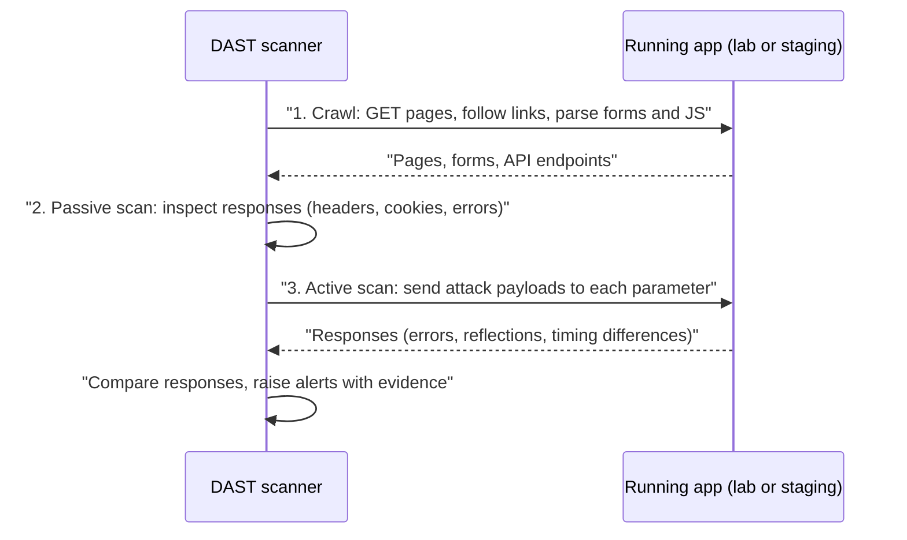

# Dynamic Analysis (DAST)

## Introduction

**Dynamic Application Security Testing (DAST)** tests a **running** application from the outside, the way an attacker would. A DAST scanner crawls the site or API, sends requests, and studies the responses for signs of vulnerabilities: missing security headers, reflected input that could become XSS, SQL error messages, exposed admin pages, insecure cookies and more.

If [SAST](./2-sec-sast.mdx) is reading the blueprints of a car, DAST is the crash test. The crash test does not care how the car was designed or which language the engineers used. It only cares what happens when the car hits the wall. It also finds problems that do not exist in the blueprints at all, such as a wrong setting on the assembly line, which in software means a misconfigured web server, proxy or framework.

On this page you will set up a safe local lab with OWASP Juice Shop, run ZAP's passive baseline scan and an active scan, read and tune the results, and add a DAST stage to CI.

:::warning Only scan systems you own or have written permission to test
An active DAST scan sends thousands of attack-like requests: SQL injection strings, script payloads, path traversal attempts. Against a system you do not own, this can be illegal, and it can damage data or take the service down. Scan your own local lab, your own staging environment, or targets that explicitly invite testing (for example PortSwigger Web Security Academy labs or a bug bounty program's in-scope assets, following its rules). Always get written permission that names the targets and the time window. See [Ethics, Law and Responsible Disclosure](../0-sec-fundamentals/8-sec-ethics-and-law.mdx).
:::

## How DAST Works

A DAST scan has three main stages:



1. **Crawl (spider).** Discover URLs, forms and parameters. Modern single-page apps need a browser-based crawler (often called an "AJAX spider" or "client spider") because links are created by JavaScript.
2. **Passive scan.** Look at the traffic without sending anything new: missing headers, cookies without `Secure` or `HttpOnly`, version banners, error pages. Passive scanning is safe enough to run often.
3. **Active scan.** Modify each parameter with attack payloads and watch the responses. This finds injection, XSS and path traversal, but it changes data and can be disruptive.

### SAST, DAST and IAST compared

| | SAST | DAST | IAST |
| --- | --- | --- | --- |
| Needs | Source code | Running app (URL) | Running app plus an agent inside it |
| Language-specific? | Yes | No | Yes (agent per runtime) |
| Finds | Code patterns, injection paths | Runtime and config issues, real exploitability | Code paths actually executed by tests |
| Points to the line of code? | Yes | No, only the URL and parameter | Yes |
| False positives | Medium to high | Lower for confirmed issues | Low |
| Misses | Config, runtime, deployed-environment issues | Code that the crawler never reaches | Code no test exercises |
| When | Every commit | Staging, nightly, before release | During functional and integration tests |

They complement each other. A common pattern is SAST on every pull request and DAST against staging after deployment. See [Building a Security Testing Strategy](./9-sec-security-testing-strategy.mdx).

### Common DAST tools

| Tool | Type | Notes |
| --- | --- | --- |
| [ZAP](https://www.zaproxy.org/) | Free, open source | Formerly OWASP ZAP. Baseline, full and API scan scripts; an automation framework; Docker images |
| [Burp Suite](https://portswigger.net/burp) | Community (free, manual) and paid editions | The standard tool for manual web testing; paid editions add an automated scanner. See [Web Testing with Burp Suite](../10-sec-offensive-security/4-sec-burp-suite.mdx) |
| Nuclei | Free, open source | Template-based checks for known issues and misconfigurations |
| Commercial DAST platforms | Paid | Dashboards, authenticated scanning helpers, scheduling, ticketing integrations |

## Build a Safe Lab

You need a target you are allowed to attack. [OWASP Juice Shop](https://owasp.org/www-project-juice-shop/) is a deliberately insecure web shop designed for exactly this. Run it and ZAP on a private Docker network so nothing leaves your machine:

```bash
# A private network for the lab
docker network create zaplab

# The deliberately vulnerable target
docker run -d --rm --name juice --network zaplab bkimminich/juice-shop

# The scanner image (ZAP 2.17 at the time of writing)
docker pull ghcr.io/zaproxy/zaproxy:stable
```

Juice Shop is now reachable as `http://juice:3000` from other containers on the `zaplab` network. It is not published to your host's network interfaces, which keeps a vulnerable app off your LAN. For more lab options see [Building a Safe Practice Lab](../10-sec-offensive-security/1-sec-lab-setup.mdx).

## Baseline Scan: Passive and Safe

The ZAP **baseline scan** spiders the target for one minute by default and then reports passive findings. It sends no attacks, which makes it suitable for frequent runs, even in CI.

```bash
mkdir -p zapwrk && chmod 777 zapwrk   # the ZAP container writes reports here
docker run --rm --network zaplab -v "$PWD/zapwrk:/zap/wrk/:rw" -t \
  ghcr.io/zaproxy/zaproxy:stable zap-baseline.py \
  -t http://juice:3000 -r report.html -J report.json
```

Example output (trimmed):

```text
Using the Automation Framework
Total of 88 URLs
PASS: Vulnerable JS Library (Powered by Retire.js) [10003]
PASS: Cookie No HttpOnly Flag [10010]
PASS: Cookie Without Secure Flag [10011]
...
WARN-NEW: Content Security Policy (CSP) Header Not Set [10038] x 5
	http://juice:3000 (200 OK)
	http://juice:3000/ftp (200 OK)
	http://juice:3000/sitemap.xml (200 OK)
WARN-NEW: Deprecated Feature Policy Header Set [10063] x 5
	http://juice:3000 (200 OK)
WARN-NEW: Timestamp Disclosure - Unix [10096] x 5
	http://juice:3000/styles.css (200 OK)
WARN-NEW: Cross-Domain Misconfiguration [10098] x 5
	http://juice:3000/robots.txt (200 OK)
WARN-NEW: Dangerous JS Functions [10110] x 1
	http://juice:3000/main.js (200 OK)
WARN-NEW: Cross-Origin-Embedder-Policy Header Missing or Invalid [90004] x 10
	http://juice:3000 (200 OK)
FAIL-NEW: 0	FAIL-INPROG: 0	WARN-NEW: 8	WARN-INPROG: 0	INFO: 0	IGNORE: 0	PASS: 59
```

How to read it:

- Each line is a **rule** with an ID in brackets. `PASS` means the rule found nothing. `WARN` and `FAIL` are findings, followed by example URLs.
- `x 5` is the number of URLs where the issue appeared.
- Exit codes make it CI-friendly: `0` success, `1` at least one FAIL, `2` at least one WARN and no FAIL, `3` any other error. The `-I` flag stops warnings from failing the run.
- The HTML and JSON reports in `zapwrk/` include descriptions, evidence and suggested solutions for each alert.

Some findings are real problems (no Content Security Policy). Others are informational or a matter of policy (`Timestamp Disclosure` often matches harmless numbers in CSS, and `Modern Web Application` simply tells you the app is a single-page app). That is why you tune the rules.

### Tune the rules

Generate a config file that lists every rule, then set each to `IGNORE`, `INFO`, `WARN` or `FAIL`:

```bash
docker run --rm --network zaplab -v "$PWD/zapwrk:/zap/wrk/:rw" -t \
  ghcr.io/zaproxy/zaproxy:stable zap-baseline.py -t http://juice:3000 -g gen.conf -I
```

The generated file is tab-separated. Edit it to match your policy:

```text
10020	FAIL	(Anti-clickjacking Header)
10021	FAIL	(X-Content-Type-Options Header Missing)
10038	FAIL	(Content Security Policy (CSP) Header Not Set)
10096	IGNORE	(Timestamp Disclosure)
10109	IGNORE	(Modern Web Application)
10110	WARN	(Dangerous JS Functions)
*	OUTOFSCOPE	.*\.(png|jpg|svg|woff2)$
```

Then run with `-c gen.conf`. Commit the file to the repository so policy changes are reviewed like code. Choose `FAIL` only for rules where your team agrees the build must stop.

## Fixing What DAST Found

DAST tells you **what** is wrong at **which URL**, but not which line of code to change. For header findings, the fix often belongs in the web server or framework, not in each page. Here is the pattern for an app behind nginx.

Vulnerable: no security headers.

```nginx
# Vulnerable: nginx passes responses through with no security headers
server {
    listen 443 ssl;
    server_name shop.example.com;

    location / {
        proxy_pass http://app:3000;
    }
}
```

Fixed: headers added once, for every response.

```nginx
# Fixed: security headers on every response (including error pages, via "always")
server {
    listen 443 ssl;
    server_name shop.example.com;

    add_header Content-Security-Policy "default-src 'self'; frame-ancestors 'none'; object-src 'none'" always;
    add_header X-Content-Type-Options "nosniff" always;
    add_header Referrer-Policy "strict-origin-when-cross-origin" always;
    add_header Permissions-Policy "camera=(), microphone=(), geolocation=()" always;
    add_header Strict-Transport-Security "max-age=31536000; includeSubDomains" always;

    location / {
        proxy_pass http://app:3000;
    }
}
```

A strict CSP can break pages that use inline scripts, so roll it out with `Content-Security-Policy-Report-Only` first and watch the reports. See [Security Headers, CORS and CSP](../3-sec-web-security/9-sec-security-headers.mdx). Then rerun the baseline scan and confirm the rule moves from `WARN` to `PASS`. That rescan is your regression test.

## Active Scans: Only in the Lab or Staging

The active scanner sends attack payloads to every parameter it found. ZAP's **Automation Framework** describes the whole scan as a YAML plan, which is easier to review and version than a long command line.

```yaml
# zapwrk/plan.yaml - active scan of the LOCAL Juice Shop lab only
env:
  contexts:
    - name: juice-shop-lab
      urls:
        - http://juice:3000
      includePaths:
        - "http://juice:3000.*"
      excludePaths:
        - "http://juice:3000/socket.io.*"
  parameters:
    failOnError: true
    progressToStdout: true

jobs:
  - type: passiveScan-config
    parameters:
      maxAlertsPerRule: 10
  - type: spider
    parameters:
      context: juice-shop-lab
      maxDuration: 1
  - type: passiveScan-wait
    parameters:
      maxDuration: 2
  - type: activeScan
    parameters:
      context: juice-shop-lab
      maxScanDurationInMins: 5
      maxRuleDurationInMins: 1
  - type: report
    parameters:
      template: traditional-json
      reportDir: /zap/wrk
      reportFile: active-report
```

```bash
docker run --rm --network zaplab -v "$PWD/zapwrk:/zap/wrk/:rw" \
  ghcr.io/zaproxy/zaproxy:stable zap.sh -cmd -autorun /zap/wrk/plan.yaml
```

Example output (trimmed):

```text
Job spider started
Job spider requesting URL http://juice:3000
Job spider found 101 URLs
Job spider finished, time taken: 00:00:18
Job passiveScan-wait started
Job passiveScan-wait finished, time taken: 00:00:00
Job activeScan started
Job activeScan terminated
Job activeScan finished, time taken: 00:05:05
Job report started
Job report generated report /zap/wrk/active-report.json
Automation plan succeeded!
```

Summarizing `active-report.json` from that run gives a surprising result:

```text
Medium (High)          10038  Content Security Policy (CSP) Header Not Set
Medium (Medium)        10098  Cross-Domain Misconfiguration
Low (Low)              10096  Timestamp Disclosure - Unix
Informational (Medium) 10109  Modern Web Application
```

Juice Shop is full of SQL injection and XSS, yet this five-minute active scan reported **no injection findings at all**. The reasons are instructive:

- The traditional spider follows HTML links. Juice Shop is an Angular single-page app whose login and search call JSON APIs from JavaScript, so the spider never discovered those endpoints and the active scanner never attacked them.
- The scan was unauthenticated, so everything behind the login was invisible.
- The `activeScan` job hit its five-minute limit (`terminated`) before finishing.

This is the most important lesson about DAST: **a scanner can only test what it reaches**. A clean report from a scan with poor coverage means very little. For single-page apps, add the browser-based AJAX spider (an `spiderAjax` job), import an OpenAPI definition, or record traffic through ZAP while running your end-to-end tests, and configure authentication.

Key points of the plan:

- **`includePaths` is your scope.** The scanner never leaves it. Get this right before every active scan.
- **`excludePaths`** keeps the scanner away from endpoints that would hang it (websockets here) or cause damage (for example `/logout`, `/delete-account`, payment endpoints).
- **Time limits** keep the scan from running for hours. Full active scans of real apps often take much longer than this lab example.
- **Never active-scan production** unless the system owner explicitly agrees, with backups and a maintenance window. Active scans create junk records, send emails, and can trigger lockouts or outages.

ZAP also ships `zap-full-scan.py` (spider plus active scan) and `zap-api-scan.py`, which imports an OpenAPI, SOAP or GraphQL definition so the scanner knows every endpoint and parameter without crawling:

```bash
docker run --rm --network zaplab -v "$PWD/zapwrk:/zap/wrk/:rw" -t \
  ghcr.io/zaproxy/zaproxy:stable zap-api-scan.py \
  -t http://api:8000/openapi.json -f openapi -r api-report.html
```

### Authenticated scanning

Most of an application sits behind a login. An unauthenticated scan only sees the login page and public pages. To scan deeper, give the scanner a test account in a dedicated test tenant, configure how it logs in (form login, a header with a token, or a browser-based login script), and tell it how to detect that it has been logged out. Use accounts with realistic roles, including a low-privilege user, so you can find access control problems. Never give a scanner real customer credentials.

## DAST in CI

A practical pattern: after the app deploys to an ephemeral or staging environment, run a **baseline** scan on every merge to main, and a scheduled **active** scan nightly or weekly.

```yaml
# .github/workflows/dast.yml
name: DAST baseline
on:
  push:
    branches: [main]

permissions:
  contents: read

jobs:
  zap-baseline:
    runs-on: ubuntu-latest
    steps:
      - uses: actions/checkout@3d3c42e5aac5ba805825da76410c181273ba90b1 # v7.0.1
        with:
          persist-credentials: false
      - name: Start the app under test
        run: |
          docker compose up -d --build
          timeout 60 sh -c 'until curl -fs http://localhost:8080/healthz; do sleep 2; done'
      - name: ZAP baseline scan
        uses: zaproxy/action-baseline@de8ad967d3548d44ef623df22cf95c3b0baf8b25 # v0.15.0
        with:
          target: "http://localhost:8080"
          rules_file_name: ".zap/rules.tsv"
          fail_action: true
          allow_issue_writing: false
```

The action runs the same `zap-baseline.py` script in the `ghcr.io/zaproxy/zaproxy:stable` image and uploads the reports as a workflow artifact. `allow_issue_writing: false` stops it from opening GitHub issues automatically, which many teams prefer to control themselves.

## Real-World Scenario

Your team runs an online booking site. A customer's security review flagged missing security headers and asked whether you do "regular dynamic testing". You have SAST in CI already. The platform team suggests putting a **WAF** in front of the site and calling it done. You need to decide what DAST to add and how it relates to the WAF.

**The walkthrough:**

1. **Fix the headers in code or proxy config**, then add a ZAP **baseline scan** to the deploy pipeline with `FAIL` set for the header and cookie rules. This prevents regressions forever, at a cost of a couple of minutes per deploy.
2. **Schedule an authenticated active scan** of staging every night with test accounts for "customer" and "staff" roles, excluding payment and email-sending endpoints. Send new high-risk alerts to the team's triage channel.
3. **Use the WAF as an extra layer**, not the fix. It can block obvious attack payloads while a code fix ships, but it does not add missing headers to your design, does not fix access control, and can be bypassed.
4. **Keep an annual manual penetration test**, because automated scanners are weak at business logic, multi-step workflows and access control between users.

**Why this approach:** baseline scans are cheap and catch configuration regressions on every deploy; nightly active scans find injection-type issues without slowing developers; the WAF and manual tests cover different gaps.

**When to use DAST:** any web app or API with a deployable test environment. **When it is weak:** apps with complex multi-step flows, heavy client-side logic the crawler cannot reach, or logic flaws such as "user A can see user B's booking" when the scanner only has one account.

| Approach | Pros | Cons | Best for |
| --- | --- | --- | --- |
| Passive baseline scan in CI | Fast, safe, catches config regressions | Finds only passive issues | Every deploy |
| Scheduled active scan on staging | Finds injection and XSS with evidence | Slow; needs scope, test data and auth setup | Nightly or weekly |
| API scan from OpenAPI spec | Complete endpoint coverage without crawling | Spec must be accurate and current | APIs and microservices |
| WAF in front of production | Immediate protection; virtual patching | Bypassable; false positives; not a fix | Extra layer, emergency cover. See [API Gateways and WAFs](../7-sec-api-security/7-sec-api-gateway-security.mdx) |
| Manual penetration test | Finds logic and access control flaws | Expensive; point in time | Annually and before major launches |

## Common Mistakes

- **Scanning without permission or outside scope.** Even "just a quick scan" of a third-party site can be illegal. Write down scope and permission first.
- **Active scanning production.** Active scans create data, send emails and can cause outages.
- **Unauthenticated scans only.** Most of the attack surface is behind the login.
- **Trusting the crawler's coverage.** Check how many URLs and parameters were found. Single-page apps and APIs often need a browser-based spider or an API definition.
- **Failing builds on every WARN.** Tune rules first, then fail on a small agreed set.
- **Treating a clean report as proof of security.** DAST rarely finds broken access control between users or business logic flaws. Pair it with threat modeling and manual testing.
- **Leaving scanner test accounts with real privileges in production.** Use dedicated test tenants and remove access after testing.

## Summary

- DAST tests a running app from the outside: crawl, passive scan, active scan.
- It finds runtime and configuration issues that SAST cannot see, but it does not point to the line of code.
- Build a local lab (for example OWASP Juice Shop on a private Docker network) before scanning anything.
- ZAP's baseline scan is passive and CI-friendly; tune its rules with a committed config file.
- Active scans belong in the lab or staging, with a clear scope, exclusions and time limits.
- Combine DAST with SAST, WAFs and manual testing; none of them alone is enough.

## Further Learning

**Exercises**

1. Run the baseline scan against your local Juice Shop and open `report.html`. Pick three alerts and explain whether each is a real risk.
2. Write a small Flask app with no security headers, scan it with the baseline scan, add the headers, and rescan until the header rules pass.
3. Create a `gen.conf` that fails on missing CSP and `X-Content-Type-Options`, and ignores timestamp disclosure. Confirm the exit code changes.
4. Run the active scan plan against Juice Shop and compare its alerts with the Juice Shop scoreboard challenges. Which vulnerability classes did the scanner miss?

**Related pages**

- [Static Analysis (SAST)](./2-sec-sast.mdx)
- [Web Testing with Burp Suite](../10-sec-offensive-security/4-sec-burp-suite.mdx)
- [Vulnerability Scanning](../10-sec-offensive-security/3-sec-vulnerability-scanning.mdx)
- [OWASP Top 10](../3-sec-web-security/1-sec-owasp-top-10.mdx)
