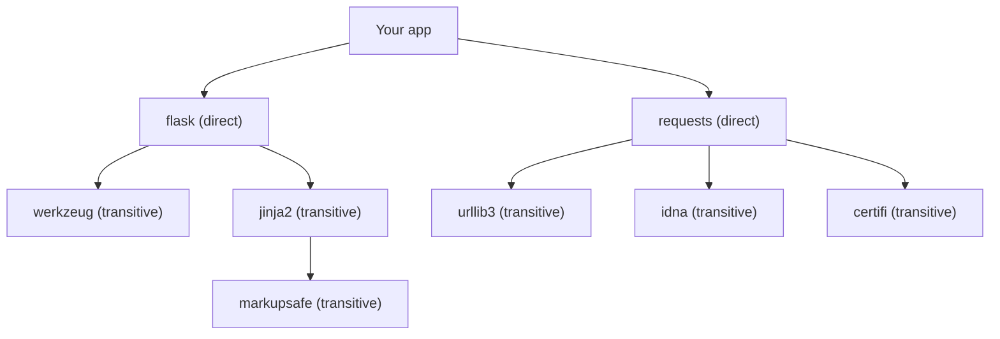
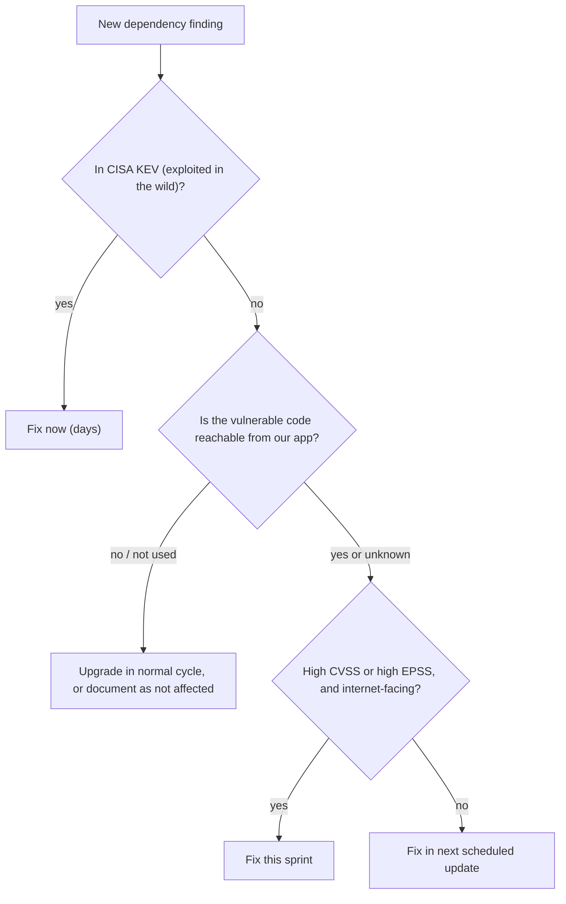

# Dependency Scanning and SCA

## Introduction

Most of the code in a modern application was written by someone else. A small Flask or Express service with a dozen direct dependencies easily pulls in dozens or hundreds of packages once you count the dependencies of your dependencies. When a vulnerability is published in one of them, your application is affected even though you never touched that code.

**Software Composition Analysis (SCA)**, also called **dependency scanning**, finds out which third-party components you use, compares them against databases of known vulnerabilities, and tells you which ones need upgrading.

An analogy: a restaurant buys ingredients from many suppliers. When the food safety agency announces a recall of a specific batch of flour, the restaurant needs to know quickly, "Did we buy that batch, and which dishes use it?" SCA is that inventory-plus-recall check for your software.

Vulnerable and outdated components are a long-standing entry in the OWASP Top 10. In the 2025 edition they are part of **A03:2025 Software Supply Chain Failures**, which also covers malicious packages and compromised build systems. This page focuses on **known vulnerabilities in legitimate packages**. The next page, [Software Supply Chain Security](./5-sec-supply-chain.mdx), covers deliberately malicious packages and attacks on the supply chain itself.

## Direct and Transitive Dependencies



- **Direct dependencies** are the ones you list in `requirements.txt`, `pyproject.toml` or `package.json`.
- **Transitive dependencies** come along because your direct dependencies need them. You often do not know they exist.

Many real-world vulnerabilities sit in transitive dependencies. That is why SCA tools should scan a **lockfile** (`package-lock.json`, `poetry.lock`, `uv.lock`, or a fully pinned `requirements.txt`), which lists the exact version of every package that will be installed, not just your top-level list.

:::tip Lock your dependencies
Without a lockfile, two builds a day apart can install different versions. You cannot know what you shipped, and a scan today says nothing about the build that runs tomorrow. Commit lockfiles for applications. Libraries are different: they usually declare ranges and let the application lock.
:::

## Where Vulnerability Data Comes From

SCA tools are only as good as their data. The main sources:

| Source | What it is | Notes |
| --- | --- | --- |
| **CVE** | Global identifiers like `CVE-2024-35195` | Assigned by CVE Numbering Authorities (CNAs) |
| **NVD** | NIST's database that enriches CVEs with CVSS scores and affected products | Had a large enrichment backlog in 2024 and 2025, so scores can arrive late |
| **GitHub Advisory Database (GHSA)** | Reviewed advisories for open source ecosystems | Feeds Dependabot and `npm audit` |
| **OSV** ([osv.dev](https://osv.dev/)) | Open, machine-readable format and aggregated database across ecosystems | Aggregates GHSA, PyPA (`PYSEC-` IDs), Go, Rust and more; also lists malicious packages (`MAL-` IDs) |
| **CISA KEV** | [Known Exploited Vulnerabilities catalog](https://www.cisa.gov/known-exploited-vulnerabilities-catalog) | Vulnerabilities with evidence of real-world exploitation |
| **EPSS** | [Exploit Prediction Scoring System](https://www.first.org/epss/) | A daily probability that a CVE will be exploited in the next 30 days |

One vulnerability often has several IDs (a CVE, a GHSA and a PYSEC entry). Good tools show them as aliases of one issue.

## Scanning Python Dependencies with pip-audit

[pip-audit](https://pypi.org/project/pip-audit/) is maintained under the Python Packaging Authority and checks Python packages against the PyPI advisory data and OSV.

```bash
python -m venv .venv && . .venv/bin/activate
pip install pip-audit
printf 'requests==2.31.0\n' > requirements.txt
pip-audit -r requirements.txt
```

Example output (pip-audit 2.10.1; the exact IDs, counts and fix versions change as new advisories are published):

```text
Found 6 known vulnerabilities in 1 package
Name     Version ID              Fix Versions
-------- ------- --------------- ------------
requests 2.31.0  PYSEC-2026-1873 2.32.0
requests 2.31.0  PYSEC-2026-1872 2.32.4
requests 2.31.0  PYSEC-2026-2275 2.33.0
requests 2.31.0  PYSEC-2026-1873 2.32.0
requests 2.31.0  PYSEC-2026-1872 2.32.4
requests 2.31.0  PYSEC-2026-2275 2.33.0
```

In this run the same three advisory IDs were listed twice, so there are really three distinct issues. Count unique IDs, not rows, when you report numbers. Upgrading to the highest fix version listed (2.33.0 here) resolves all of them.

For CI or further processing, use JSON, which includes aliases and descriptions:

```bash
pip-audit -r requirements.txt --format json --output pip-audit.json
```

An excerpt for one finding:

```json
{
  "id": "PYSEC-2026-1873",
  "fix_versions": ["2.32.0"],
  "aliases": ["GHSA-9wx4-h78v-vm56", "CVE-2024-35195"],
  "description": "When using a `requests.Session`, if the first request to a given origin is made with `verify=False`, TLS certificate verification may remain disabled for all subsequent requests to that origin..."
}
```

Useful options:

- `pip-audit` with no arguments audits the current environment.
- `--fix --dry-run` shows which upgrades would resolve the findings, and `--fix` applies them.
- `--ignore-vuln ID` skips a specific advisory. Use it only with a recorded reason, as described below.
- The exit code is `1` when vulnerabilities are found, which fails a CI step.

## Scanning JavaScript Dependencies with npm audit

`npm audit` is built into npm and checks `package-lock.json` against the GitHub Advisory Database.

```json
{
  "name": "shop-frontend",
  "version": "1.0.0",
  "private": true,
  "dependencies": {
    "lodash": "4.17.20"
  }
}
```

```bash
npm install --package-lock-only --ignore-scripts
npm audit --audit-level=high
```

Example output (npm 9; advisory list trimmed):

```text
# npm audit report

lodash  <=4.17.23
Severity: high
Command Injection in lodash - https://github.com/advisories/GHSA-35jh-r3h4-6jhm
Regular Expression Denial of Service (ReDoS) in lodash - https://github.com/advisories/GHSA-29mw-wpgm-hmr9
...
fix available via `npm audit fix --force`
Will install lodash@4.18.1, which is outside the stated dependency range
node_modules/lodash

1 high severity vulnerability
```

`--audit-level=high` makes the command exit non-zero only for high or critical findings. `npm audit fix` applies compatible upgrades. `npm audit fix --force` also applies **breaking** upgrades outside your declared range, so review those changes and run your tests rather than forcing them blindly in CI.

:::note Why --ignore-scripts here
`npm install` runs package install scripts by default, which is one of the ways malicious packages execute code. When you only want a lockfile or an audit, `--ignore-scripts` avoids running third-party code. See [Software Supply Chain Security](./5-sec-supply-chain.mdx).
:::

## One Scanner for Many Ecosystems: OSV-Scanner

Real projects mix ecosystems: a Python API, a JavaScript frontend, a Go tool and a Dockerfile. [OSV-Scanner](https://google.github.io/osv-scanner/) from Google scans many lockfile formats against osv.dev in one run.

```bash
# Run it from the official container image against the current directory
docker run --rm -v "$PWD:/src" ghcr.io/google/osv-scanner:latest scan source -r /src
```

Example output (OSV-Scanner 2.6.0, trimmed):

```text
Scanned /src/requirements.txt file and found 1 package
Scanned /src/package-lock.json file and found 1 package

Total 3 packages affected by 7 known vulnerabilities (0 Critical, 1 High, 6 Medium, 0 Low, 0 Unknown) from 2 ecosystems.
7 vulnerabilities can be fixed.

+-------------------------------------+------+-----------+----------+---------+---------------+-----------------------+
| OSV URL                             | CVSS | ECOSYSTEM | PACKAGE  | VERSION | FIXED VERSION | SOURCE                |
+-------------------------------------+------+-----------+----------+---------+---------------+-----------------------+
| https://osv.dev/PYSEC-2026-1872     | 5.3  | PyPI      | requests | 2.31.0  | 2.32.4        | src/requirements.txt  |
| https://osv.dev/PYSEC-2026-215      | 6.9  | PyPI      | idna     | 3.9.0   | 3.15          | src/requirements.txt  |
| https://osv.dev/GHSA-35jh-r3h4-6jhm | 8.1  | npm       | lodash   | 4.17.20 | 4.17.21       | src/package-lock.json |
| ...                                 |      |           |          |         |               |                       |
+-------------------------------------+------+-----------+----------+---------+---------------+-----------------------+
```

Notice `idna`: it is not in `requirements.txt`, but OSV-Scanner resolved the transitive dependencies of `requests` and found a vulnerable version. Pin the image to a version tag or digest in CI instead of `latest`.

Other common SCA tools include **Dependabot** (built into GitHub), **Renovate**, **Trivy** and **Grype** (which also scan container images), **Snyk**, **Mend**, **Sonatype** and **Black Duck**. Commercial tools usually add reachability analysis, license policy and dashboards.

## Prioritizing: Not Every Finding Is Urgent

A big project can have hundreds of findings. Treating them all as emergencies burns out the team. Combine several signals:



| Signal | Question it answers | Caveat |
| --- | --- | --- |
| CVSS severity | How bad is it in the worst case? | Does not consider your context. See [Vulnerability Management and CVSS](../11-sec-defensive-operations/6-sec-vulnerability-management.mdx) |
| CISA KEV | Is it being exploited right now? | Covers only confirmed exploitation |
| EPSS | How likely is exploitation soon? | A probability, not a certainty |
| Reachability | Does our code call the vulnerable function? | Tool support varies by language; "unknown" should be treated as reachable |
| Exposure | Is the component internet-facing or handling untrusted input? | Requires knowing your architecture |

When you decide a finding does **not** affect you (for example, the vulnerable function is never called), record that decision. The standard format for this is **VEX** (Vulnerability Exploitability eXchange), which states "product X is not affected by CVE Y because Z". VEX documents are often published alongside [SBOMs](./6-sec-sbom-and-signing.mdx).

## Fixing Findings

Most fixes are upgrades, but there are a few patterns:

**1. Upgrade a direct dependency.**

```bash
pip install --upgrade "requests>=2.33.0"
pip freeze > requirements.txt   # or: uv lock --upgrade-package requests
```

**2. Force a safe version of a transitive dependency.** npm supports `overrides`:

```json
{
  "dependencies": {
    "some-sdk": "3.2.0"
  },
  "overrides": {
    "lodash": "4.18.1"
  }
}
```

In Python, a constraints file pins transitive versions without making them direct dependencies:

```bash
echo "idna>=3.15" > constraints.txt
pip install -r requirements.txt -c constraints.txt
```

Overrides are a stopgap. Remove them when the direct dependency ships a fixed release.

**3. When no fix exists.** Mitigate in your own code (avoid the vulnerable function, validate input before it reaches the library), add a WAF rule if it is a web-facing issue, or replace the package. Record the decision with an expiry date.

**4. Ignore with a reason.** Every ignore needs the advisory ID, the justification and an expiry:

```bash
# Not affected: we never use requests.Session with verify=False. Review by 2026-12-31.
pip-audit -r requirements.txt --ignore-vuln PYSEC-2026-1873
```

## Automating Updates with Dependabot

Scanning tells you about problems. Automated update tools open the pull requests that fix them. Here is a Dependabot configuration for a Python app that also keeps GitHub Actions up to date:

```yaml
# .github/dependabot.yml
version: 2
updates:
  - package-ecosystem: "pip"
    directory: "/"
    schedule:
      interval: "weekly"
    groups:
      python-minor-and-patch:
        update-types: ["minor", "patch"]
    cooldown:
      default-days: 5
      semver-major-days: 30

  - package-ecosystem: "github-actions"
    directory: "/"
    schedule:
      interval: "weekly"
    cooldown:
      default-days: 7
```

- **Security updates** (Dependabot alerts with automatic fix PRs) are triggered by new advisories and are separate from these scheduled version updates.
- **`groups`** bundles minor and patch updates into one pull request instead of twenty.
- **`cooldown`** waits a few days after a release before proposing it. This gives the community time to spot a malicious or broken release before it reaches your build. Cooldown applies to version updates, not security updates. Check the [Dependabot options reference](https://docs.github.com/en/code-security/dependabot/working-with-dependabot/dependabot-options-reference) for current options.

Renovate offers similar features (grouping, scheduling, a minimum release age, automerge rules) and works on GitHub, GitLab, Bitbucket and others.

## Running SCA in CI

```yaml
# .github/workflows/sca.yml
name: Dependency scan
on:
  pull_request:
  schedule:
    - cron: "0 6 * * 1"   # weekly, catches new advisories for unchanged code

permissions:
  contents: read

jobs:
  pip-audit:
    runs-on: ubuntu-latest
    steps:
      - uses: actions/checkout@3d3c42e5aac5ba805825da76410c181273ba90b1 # v7.0.1
        with:
          persist-credentials: false
      - uses: actions/setup-python@5fda3b95a4ea91299a34e894583c3862153e4b97 # v7.0.0
        with:
          python-version: "3.13"
      - run: pip install "pip-audit==2.10.1"
      - run: pip-audit -r requirements.txt --strict
```

The **scheduled** trigger matters: a dependency that was clean when merged may get an advisory next week. Without a scheduled scan (or Dependabot alerts), nobody notices until the next code change.

## Real-World Scenario

Your team maintains a customer-facing Node.js and Python application. You turn on Dependabot alerts and get **312 open alerts**. Developers are overwhelmed, and a manager suggests "just run `npm audit fix --force` on everything and ship it."

**The walkthrough:**

1. **Do not force-upgrade everything at once.** Major upgrades can break the app, and a broken release is also an outage.
2. **Deduplicate and group.** Many alerts are the same package across several lockfiles or several advisories for one package. 312 alerts often collapse into a few dozen packages.
3. **Fix KEV and high-EPSS, internet-facing findings first.** Apply those this week, with tests.
4. **Enable grouped weekly updates with cooldown**, and allow automerge for patch updates of development dependencies when tests pass.
5. **Mark not-affected findings with a reason** (dismiss in Dependabot with "vulnerable code is not used", or a VEX statement).
6. **Remove unused dependencies.** The cheapest vulnerability to fix is in a package you do not need.
7. **Track mean time to remediate** for critical and high findings going forward.

**Why this approach:** it reduces real risk quickly, keeps the app stable, and creates a steady update habit so the backlog does not grow back.

**When to use automated updates:** applications with good test coverage. **When to be careful:** apps without tests, where automerge can ship breaking changes, and critical systems that need staged rollouts.

| Approach | Pros | Cons | Best for |
| --- | --- | --- | --- |
| Manual periodic upgrades | Full control | Slow; backlog grows; easy to forget | Very small projects |
| Scanner in CI only (pip-audit, npm audit, OSV-Scanner) | Simple; fails builds on new issues | Does not open fix PRs; misses new advisories without a schedule | Every project as a baseline |
| Dependabot or Renovate update PRs | Continuous, small upgrades; grouping and cooldown | PR noise; needs good tests | Most teams |
| Commercial SCA with reachability | Better prioritization; license policy; dashboards | Cost; vendor lock-in | Large portfolios |
| Vendoring and freezing dependencies | Fully reproducible | You own all patching; drift becomes huge | Air-gapped or embedded systems |

## Common Mistakes

- **Scanning the manifest, not the lockfile.** You miss transitive dependencies and the exact installed versions.
- **Only scanning when code changes.** New advisories appear for code you have not touched. Schedule scans.
- **Blanket ignores without expiry.** "Ignore all medium findings" or an ignore list nobody reviews hides real risk.
- **Force-upgrading majors in CI.** `npm audit fix --force` can break your app. Review breaking upgrades like any other change.
- **Treating CVSS as priority.** A critical CVE in an unused dev tool matters less than a medium one in your login path.
- **Forgetting container base images and OS packages.** Your Python dependencies may be clean while the base image has a vulnerable OpenSSL. Scan images too. See [Container Image Security](../8-sec-cloud-and-container/4-sec-container-security.mdx).
- **Assuming "no known vulnerabilities" means safe.** SCA only knows about **published** advisories. Malicious packages and zero-days need other controls.

## Summary

- Most of your application is third-party code; SCA inventories it and checks it against vulnerability databases.
- Scan lockfiles so transitive dependencies are included.
- OSV, GHSA and NVD provide the data; one issue often has several aliases.
- pip-audit, npm audit and OSV-Scanner cover the basics for free; Dependabot and Renovate automate fixes.
- Prioritize with KEV, EPSS, reachability and exposure, not CVSS alone; record not-affected decisions (VEX).
- Run scans on pull requests **and** on a schedule, and use grouping and cooldown to keep updates manageable.

## Further Learning

**Exercises**

1. Create a `requirements.txt` with three older packages, run `pip-audit`, and upgrade until it reports no known vulnerabilities. Did any upgrade break an API you use?
2. Run OSV-Scanner on one of your own projects. How many findings are in transitive dependencies?
3. Write a `dependabot.yml` for a repository that contains both `package.json` and `Dockerfile`, with grouped minor and patch updates.
4. Look up one finding's CVE on the CISA KEV catalog and on FIRST's EPSS site. Would you fix it this week? Explain why.

**Related pages**

- [Software Supply Chain Security](./5-sec-supply-chain.mdx): malicious packages and compromised publishers.
- [SBOMs, Signing and SLSA](./6-sec-sbom-and-signing.mdx)
- [Patch Management](../9-sec-system-hardening/3-sec-patch-management.mdx)
- [Vulnerability Management and CVSS](../11-sec-defensive-operations/6-sec-vulnerability-management.mdx)
