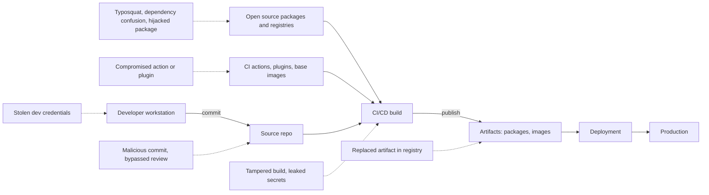
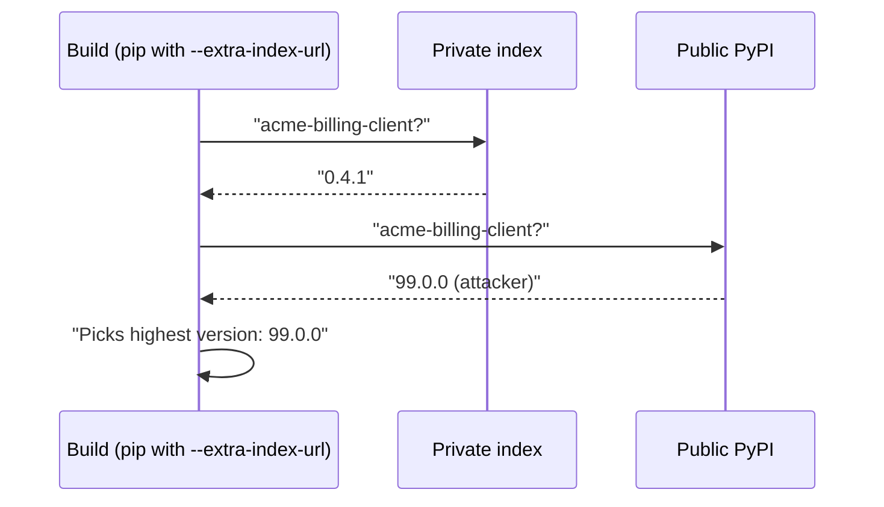

# Software Supply Chain Security

## Introduction

Your **software supply chain** is everything that touches your code on its way to production: the source repository, every open source package you install, the build tools, the CI/CD system and its plugins, container base images, package registries and the deployment tooling. If an attacker compromises any link in that chain, they can get their code into your product without ever attacking your application directly.

An analogy: a bakery can have spotless kitchens and careful bakers, but if the flour supplier's warehouse is broken into and the flour is contaminated, every loaf is affected. Worse, the bakery's own quality checks were designed to find mistakes by bakers, not poison in sealed sacks.

Supply chain attacks are attractive because of **leverage**: compromise one popular package or one widely used CI action, and you reach thousands of organizations at once. The OWASP Top 10:2025 reflects this with **A03:2025 Software Supply Chain Failures**, a broader successor to the older "vulnerable and outdated components" category.

The previous page, [Dependency Scanning and SCA](./4-sec-dependency-scanning.mdx), dealt with **accidental** vulnerabilities in legitimate packages. This page deals with **deliberate** attacks on the chain itself. The next page, [SBOMs, Signing and SLSA](./6-sec-sbom-and-signing.mdx), covers how to prove what you ship.

## Map of the Supply Chain



Each dashed arrow is a real class of attack. Your defenses need to cover the whole chain, not only the code you write.

## Real Incidents and What They Teach

These public incidents shaped today's best practices. Details come from vendor and government advisories; follow the links in the Further Learning section for primary sources.

| Incident | What happened | Lesson |
| --- | --- | --- |
| **event-stream** (2018) | A new volunteer maintainer was given publish rights to a popular npm package and added a dependency containing code that targeted a specific cryptocurrency wallet app | Maintainer handover is a trust decision; popular does not mean safe |
| **SolarWinds Orion** (2020) | Attackers compromised the vendor's build environment and inserted a backdoor into signed product updates | A signature proves who built it, not that the build was clean; protect build systems |
| **Dependency confusion** research (2021) | A researcher showed that build tools at many large companies would install a public package with the same name as an internal one if its version was higher | Internal names must resolve only from your private registry |
| **Codecov Bash Uploader** (2021) | A modified upload script, downloaded by CI jobs, sent environment variables (including secrets) to an attacker | Do not pipe unpinned remote scripts into a shell in CI; limit secrets in jobs |
| **xz utils backdoor** (CVE-2024-3094, 2024) | After years of building trust, a contributor shipped a backdoor in release tarballs of the xz compression library, aimed at SSH servers on some Linux distributions; it was caught shortly before reaching most stable releases | Release artifacts can differ from the visible source; maintainer burnout is a security risk |
| **tj-actions/changed-files** (CVE-2025-30066, March 2025) | Attackers with a stolen bot token re-pointed the action's version tags to a malicious commit that dumped CI secrets into workflow logs | Tags are mutable; pin actions to full commit SHAs |
| **Shai-Hulud npm worm** (September and November 2025) | Malware in compromised npm packages stole developer and CI tokens, then used them to publish infected versions of the victims' own packages, spreading on its own | Long-lived publish tokens are dangerous; prefer trusted publishing and phishing-resistant MFA |
| **Trivy and trivy-action** (March 2026) | Following an incomplete credential rotation after an earlier breach, attackers force-pushed most version tags of the `trivy-action` GitHub Action and published a malicious Trivy release that stole CI secrets before running the normal scan | Even security tools are supply chain risks; pin by SHA and rotate all credentials fully after an incident |

Two patterns stand out. First, attackers increasingly target **publishing credentials and CI systems** rather than code. Second, the malware often **behaves normally** (the scan still runs, the library still works), so nothing looks broken.

## Attack Techniques

### Typosquatting and lookalike names

An attacker publishes `reqeusts` or `python-dateutils` hoping someone mistypes a name. A newer variant, sometimes called **slopsquatting**, registers package names that AI coding assistants tend to hallucinate, so a developer who copies a suggested `pip install` line gets malware.

### Dependency confusion

Your company has an internal package `acme-billing-client` on a private index. Your build is configured with both the private index and the public PyPI (for example with pip's `--extra-index-url`). An attacker publishes `acme-billing-client` version `99.0.0` on PyPI. pip treats both indexes as equal sources and picks the highest version, so the public malicious package wins.



### Account takeover and malicious updates

The attacker phishes or steals the credentials of a real maintainer, then publishes a new version of a trusted package. Everyone with a loose version range (`^1.2.0`, `>=1.2`) picks it up on the next install.

### Install-time code execution

npm `preinstall` and `postinstall` scripts, Python source distributions that run `setup.py`, and similar hooks execute arbitrary code **during installation**, on developer laptops and CI runners, before your tests run.

### Compromised build tools and CI components

GitHub Actions, Jenkins plugins, CI orbs, base images and scanners all run with access to your source code and often your secrets. A compromised action version is effectively code execution inside your pipeline. See [Securing CI/CD Pipelines](./8-sec-pipeline-security.mdx).

## Defenses for Consumers

### 1. Pin exact versions and verify hashes

A lockfile with hashes means "install exactly these bytes". If the registry serves something different, installation fails. pip supports this with **hash-checking mode**:

```text
# requirements.txt (generated, do not edit by hand)
idna==3.15 \
    --hash=sha256:048adeaf8c2d788c40fee287673ccaa74c24ffd8dcf09ffa555a2fbb59f10ac8
```

Tools like `pip-compile --generate-hashes` (pip-tools), `uv pip compile --generate-hashes`, Poetry and uv lockfiles produce these for every transitive dependency. To see what happens when the bytes do not match, here is the same file with a wrong hash:

```bash
pip install --require-hashes -r requirements.txt
```

Output:

```text
Collecting idna==3.15 (from -r bad.txt (line 1))
  Downloading idna-3.15-py3-none-any.whl (72 kB)
ERROR: THESE PACKAGES DO NOT MATCH THE HASHES FROM THE REQUIREMENTS FILE. If you have updated the package versions, please update the hashes. Otherwise, examine the package contents carefully; someone may have tampered with them.
    idna==3.15 from https://files.pythonhosted.org/packages/.../idna-3.15-py3-none-any.whl (from -r bad.txt (line 1)):
        Expected sha256 0000000000000000000000000000000000000000000000000000000000000000
             Got        048adeaf8c2d788c40fee287673ccaa74c24ffd8dcf09ffa555a2fbb59f10ac8
```

In JavaScript, `package-lock.json` stores an `integrity` hash for each package, and `npm ci` installs exactly what the lockfile says (failing if `package.json` and the lockfile disagree). Use `npm ci` in CI, never `npm install`.

Hash pinning does not protect you if the malicious version is the one you locked. It protects against **changes after** you reviewed and locked.

### 2. Close the dependency confusion gap

Vulnerable: two equal indexes, highest version wins.

```bash
# Vulnerable: public PyPI and the private index are both searched
pip install --extra-index-url https://pypi.internal.example.com/simple acme-billing-client
```

Fixed: one index that you control, which proxies public packages and serves internal ones, with internal names blocked from the public upstream.

```bash
# Fixed: a single private proxy index (for example Artifactory, Nexus or a
# cloud artifact registry) configured to never fetch acme-* from upstream
pip install --index-url https://pypi.internal.example.com/simple acme-billing-client
```

Other ecosystem-specific defenses:

- **npm:** publish internal packages under an **organization scope** you own (`@acme/billing-client`) and map the scope to your registry in `.npmrc` (`@acme:registry=https://npm.internal.example.com/`).
- **Reserve your names** on public registries (an empty placeholder package), so nobody else can register them.
- **uv** has an explicit index strategy setting, and by default it stops at the first index that contains a package. Check your tool's documentation for how it chooses between indexes.

### 3. Control install-time scripts

```bash
# Install without running package lifecycle scripts
npm ci --ignore-scripts

# Or set it for the project in .npmrc
echo "ignore-scripts=true" >> .npmrc
```

Some packages legitimately need install scripts (native modules, for example). Allow those explicitly. Newer package managers such as pnpm and Bun do not run dependency lifecycle scripts unless you allow them. For Python, prefer wheels over source distributions when you can (`pip install --only-binary :all:`), because building an sdist runs code.

### 4. Wait before adopting new releases

Many malicious versions are detected and removed within hours or days. A short **cooldown** or **minimum release age** before your automation adopts a new version avoids most of them. Dependabot supports `cooldown` (see [Dependency Scanning and SCA](./4-sec-dependency-scanning.mdx)), Renovate has `minimumReleaseAge`, and several package managers now offer similar settings. Security fixes should still be applied promptly; tune the cooldown so it applies to routine version updates.

### 5. Review new dependencies before they enter

Adding a dependency is a trust decision. A lightweight review process catches the most obvious problems. Here is a small check that runs on pull requests that change `requirements.txt`:

```python
# new_dep_check.py - flag risky new dependencies in a pull request
import difflib
import re
import sys

# Names your organization already trusts (in practice: your lockfile on main
# plus a curated allowlist).
KNOWN_GOOD = {"requests", "flask", "django", "numpy", "pandas", "urllib3",
              "cryptography", "pyyaml", "boto3", "sqlalchemy"}

# Internal package names that must only come from the private index.
INTERNAL_PREFIXES = ("acme-",)


def parse_requirements(text):
    names = set()
    for line in text.splitlines():
        line = line.split("#", 1)[0].strip()
        if not line or line.startswith("-"):
            continue
        name = re.split(r"[=<>!~\[; ]", line, maxsplit=1)[0]
        names.add(name.lower().replace("_", "-"))
    return names


def review(old_text, new_text):
    added = parse_requirements(new_text) - parse_requirements(old_text)
    findings = []
    for name in sorted(added):
        close = difflib.get_close_matches(name, KNOWN_GOOD, n=1, cutoff=0.8)
        if close and close[0] != name:
            findings.append(f"{name}: looks like '{close[0]}' (possible typosquat)")
        elif name.startswith(INTERNAL_PREFIXES):
            findings.append(f"{name}: internal name; make sure it resolves from the private index only")
        else:
            findings.append(f"{name}: new dependency; needs a human review")
    return findings


if __name__ == "__main__":
    old = "flask==3.1.2\nrequests==2.33.0\n"
    new = old + "reqeusts==1.0.0\nacme-billing-client==0.4.1\nrich==14.1.0\n"
    for f in review(old, new):
        print("REVIEW", f)
    sys.exit(0)
```

Output:

```text
REVIEW acme-billing-client: internal name; make sure it resolves from the private index only
REVIEW reqeusts: looks like 'requests' (possible typosquat)
REVIEW rich: new dependency; needs a human review
```

For the human review, look at: who maintains it and for how long, release history, download counts, whether the source repository matches the published package, and its [OpenSSF Scorecard](https://github.com/ossf/scorecard) results (automated checks such as branch protection, code review, pinned dependencies, signed releases and dangerous workflow patterns). Also ask whether you need the package at all: a ten-line helper is often safer to write yourself.

### 6. Verify provenance when it is available

Registries increasingly publish cryptographic evidence of **where and how** a package was built:

- **npm:** packages published with provenance show a link to the source commit and build, and `npm audit signatures` verifies registry signatures and provenance attestations for installed packages.
- **PyPI:** supports digital attestations (PEP 740), generated automatically for projects that publish with Trusted Publishing from GitHub Actions using the official publish action.
- **Containers and binaries:** Sigstore signatures and SLSA provenance. See [SBOMs, Signing and SLSA](./6-sec-sbom-and-signing.mdx).

```bash
npm ci --ignore-scripts
npm audit signatures
```

Example output:

```text
audited 1 package in 0s

1 package has a verified registry signature
```

Most installers do not yet **require** provenance by default, so treat it as evidence you can check and alert on rather than an automatic gate.

### 7. Enforce the rules automatically

Policies that live only in a wiki get forgotten. A small lint script in CI can enforce the most important consumer rules on every pull request:

```bash
#!/usr/bin/env bash
# supply_chain_lint.sh - fail CI on common supply chain anti-patterns
set -euo pipefail
status=0

fail() { echo "FAIL: $*"; status=1; }

# 1. Third-party actions must be pinned to a 40-character commit SHA
while IFS= read -r line; do
  ref="${line#*uses:}"; ref="${ref//[[:space:]]/}"; ref="${ref%%#*}"
  case "$ref" in ./*|docker://*) continue ;; esac
  [[ "$ref" =~ @[0-9a-f]{40}$ ]] || fail "unpinned action: $ref"
done < <(grep -rhoE 'uses:[[:space:]]*[^[:space:]]+' .github/workflows || true)

# 2. No extra package indexes (dependency confusion risk)
if grep -rnE --include='*.txt' --include='*.cfg' --include='*.toml' \
     --include='*.yml' --include='*.yaml' -e 'extra-index-url' . ; then
  fail "extra index URL found; use a single controlled index"
fi

# 3. CI must use 'npm ci', not 'npm install'
if grep -rnE 'npm (install|i)( |$)' .github/workflows; then
  fail "use 'npm ci' in CI workflows"
fi

# 4. Lockfiles must exist next to manifests
for manifest in $(find . -name package.json -not -path '*/node_modules/*'); do
  [[ -f "$(dirname "$manifest")/package-lock.json" ]] || fail "no package-lock.json for $manifest"
done

[[ $status -eq 0 ]] && echo "supply chain lint: OK"
exit $status
```

Running it in a repository whose workflow uses `actions/checkout@v7`, `npm install` and `--extra-index-url`, and which has no lockfile:

```text
FAIL: unpinned action: actions/checkout@v7
./.github/workflows/ci.yml:10:      - run: pip install --extra-index-url https://pypi.internal.example.com/simple -r requirements.txt
FAIL: extra index URL found; use a single controlled index
.github/workflows/ci.yml:9:      - run: npm install
FAIL: use 'npm ci' in CI workflows
FAIL: no package-lock.json for ./package.json
```

After pinning the action to its commit SHA, switching to `npm ci --ignore-scripts`, using a single index and committing the lockfile, the script prints `supply chain lint: OK` and exits with `0`. Grep-based checks are deliberately simple and can be fooled. For deeper workflow analysis, dedicated tools such as zizmor exist; see [Securing CI/CD Pipelines](./8-sec-pipeline-security.mdx). GitHub organizations can also enforce SHA pinning for actions through the allowed-actions policy.

## Defenses for Producers

If you publish packages, images or actions, you are someone else's supply chain:

- **Phishing-resistant MFA** (passkeys or security keys) on registry and source control accounts. After the 2025 npm worm, npm announced changes such as removing long-lived classic tokens and moving maintainers toward stronger 2FA and short-lived tokens; check the npm documentation for the current rules.
- **Trusted publishing.** PyPI and npm support publishing from CI with short-lived OIDC credentials instead of stored API tokens. There is no long-lived secret to steal. Trusted publishing is not a complete fix: if an attacker can run code in the authorized workflow, they can publish. Protect that workflow (see [Securing CI/CD Pipelines](./8-sec-pipeline-security.mdx)).
- **Branch protection and required review** on the default branch and release tags.
- **Immutable releases.** Never re-point a published version or tag. Several of the incidents above relied on moving tags.
- **Signed artifacts and provenance**, plus an SBOM for each release.
- **A security policy** (`SECURITY.md`) and a way to report vulnerabilities privately.

## Real-World Scenario

You are the platform engineer for a fintech company with 40 Python and Node.js services. After reading about the 2025 npm worm and the 2026 Trivy compromise, the CTO asks: "Could that happen to us, and what should we do first?" Your audit finds: builds use `--extra-index-url` for the private index, CI runs `npm install`, all GitHub Actions are referenced by version tags, and npm publishing uses a long-lived token stored as a repository secret.

**The walkthrough:**

1. **This week:** rotate the npm token, then switch to trusted publishing. Pin all third-party actions to full commit SHAs and enable the organization policy that requires SHA pinning. Change CI to `npm ci --ignore-scripts` (with an allowlist for the two packages that need scripts).
2. **This month:** replace `--extra-index-url` with a single proxy index that blocks internal names from upstream; move internal npm packages under the `@acme` scope. Reserve internal names on public registries.
3. **This quarter:** add hash-pinned lockfiles for every Python service; add a dependency review step for new packages; set a cooldown for routine updates; start verifying provenance and signatures in the deploy pipeline.

**Why this approach:** the first steps remove the attack paths used in the most recent large incidents (stolen long-lived tokens, mutable tags, install scripts) at low cost. Later steps raise the bar for less common attacks.

**When not to over-engineer:** a small internal tool with five dependencies does not need a private proxy registry. Lockfiles, `npm ci`, pinned actions and MFA cover most of the risk.

| Control | Stops | Cost | Limits |
| --- | --- | --- | --- |
| Lockfiles with hashes, `npm ci` | Silent changes after review; registry tampering | Low | Does not catch a malicious version you locked |
| Single proxy index, scoped names | Dependency confusion | Medium (run a registry) | Needs ongoing curation |
| `--ignore-scripts`, wheels only | Install-time malware execution | Low to medium | Some packages need scripts |
| Cooldown / minimum release age | Short-lived malicious releases | Low | Delays non-security updates by days |
| Dependency review and Scorecard | Typosquats, abandoned or risky packages | Medium (human time) | Judgment calls; does not scale to every transitive dependency |
| Trusted publishing and strong MFA | Stolen tokens and passwords used to publish | Low | Workflow compromise still possible |
| SHA-pinned CI actions | Re-pointed tags | Low, with automated update PRs | Must still review updates |
| Provenance and signature verification | Artifacts not built by the expected pipeline | Medium | Ecosystem support still growing |

## Common Mistakes

- **Using `--extra-index-url` for private packages.** It is the classic dependency confusion setup.
- **`npm install` in CI.** It may update the lockfile and runs every install script. Use `npm ci`.
- **Referencing actions and images by mutable tags.** `@v4` and `:latest` can change under you.
- **Long-lived publish tokens in CI secrets.** They are the first thing supply chain malware steals.
- **Partial credential rotation after an incident.** Rotate every secret the compromised system could reach, and verify the old ones no longer work.
- **Assuming security tools are trustworthy by default.** Scanners and their CI integrations run with high privileges; they need the same pinning and review.
- **Adding dependencies casually.** Each one is code from a stranger running in your product.

## Summary

- The software supply chain spans source, dependencies, build tools, CI, artifacts and deployment; attackers target it for leverage.
- Common attacks: typosquatting, dependency confusion, account takeover, install scripts, compromised CI actions and build systems.
- Consumers defend with hash-pinned lockfiles, a single controlled index, scoped names, no install scripts, cooldowns, dependency review and provenance checks.
- Producers defend with strong MFA, trusted publishing, protected branches and tags, immutable releases, signing and SBOMs.
- Recent incidents (2025 npm worm, 2026 Trivy compromise) show that CI credentials and mutable tags are prime targets.

## Further Learning

**Exercises**

1. Generate a hash-pinned `requirements.txt` for a small project with `pip-compile --generate-hashes` or `uv pip compile --generate-hashes`, then change one hash and confirm installation fails.
2. Check how your projects resolve internal packages. Is there any `--extra-index-url`, or any unscoped internal npm package?
3. Run OpenSSF Scorecard against an open source dependency you use and read the "Pinned-Dependencies" and "Dangerous-Workflow" results.
4. Read the [Aqua Security write-up of the 2026 Trivy incident](https://www.aquasec.com/blog/trivy-supply-chain-attack-what-you-need-to-know) and list which controls from this page would have reduced the impact for a consumer of `trivy-action`.

**Related pages**

- [SBOMs, Signing and SLSA](./6-sec-sbom-and-signing.mdx)
- [Securing CI/CD Pipelines](./8-sec-pipeline-security.mdx)
- [Secret Scanning](./7-sec-secret-scanning.mdx)
- [Container Image Security](../8-sec-cloud-and-container/4-sec-container-security.mdx)
