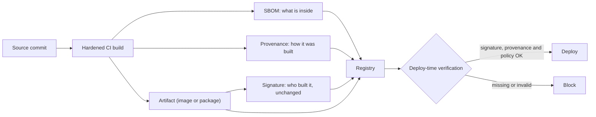
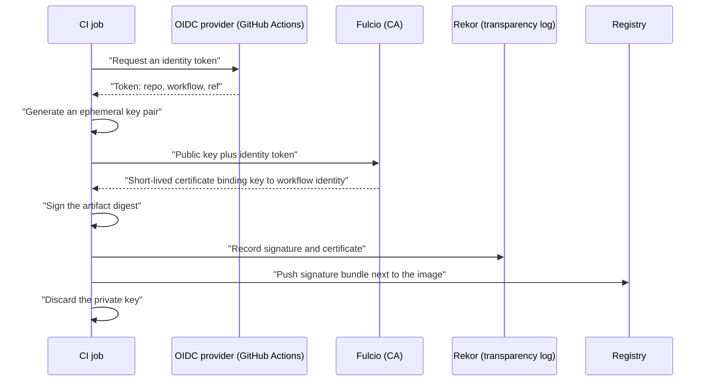

# SBOMs, Signing and SLSA

## Introduction

When someone runs your software, three questions decide whether they can trust it:

1. **What is inside it?** Which libraries and versions, so they can react when the next big vulnerability is announced. This is answered by a **Software Bill of Materials (SBOM)**.
2. **Who made it, and has it changed since?** This is answered by a **digital signature**.
3. **How was it built?** From which source commit, by which build system, with which steps. This is answered by **build provenance**, and the **SLSA** framework tells you how trustworthy that provenance is.

An analogy: a packaged food product has an ingredient list (the SBOM), a tamper-evident seal with the manufacturer's name (the signature), and a batch code that traces it to a specific factory and production run (the provenance). Each answers a different question, and you want all three.

This page builds on [Software Supply Chain Security](./5-sec-supply-chain.mdx). Signing uses public-key cryptography; see [Digital Signatures and MACs](../1-sec-cryptography/5-sec-digital-signatures.mdx) if you need a refresher.



## Part 1: Software Bills of Materials

### What an SBOM contains

An SBOM is a machine-readable inventory of the components in a piece of software. For each component it records at least a name, a version and an identifier such as a **purl** (package URL, for example `pkg:pypi/flask@3.1.2`), plus relationships ("A depends on B").

The US NTIA published "minimum elements" for SBOMs in 2021. CISA proposed an updated list in 2025 that adds items such as component hashes, license information, the name of the generating tool and the generation context (for example, whether the SBOM was produced from source or from a built artifact). Check [CISA's SBOM page](https://www.cisa.gov/sbom) for the current guidance.

### Two standard formats

| Format | Steward | Current version (at the time of writing) | Strengths |
| --- | --- | --- | --- |
| **SPDX** | Linux Foundation | 3.0 (2.3 is still very widely produced); ISO/IEC 5962:2021 covers SPDX 2.2.1 | Strong license compliance heritage; ISO standard |
| **CycloneDX** | OWASP; standardized by Ecma as ECMA-424 | 1.7 (October 2025) | Security focus: vulnerabilities, VEX, services, cryptography (CBOM), ML models |

Most tools can produce both. Pick what your customers or regulators ask for; if nobody asks, CycloneDX is a common choice for security use, and SPDX for license compliance.

### Generate an SBOM with Syft

[Syft](https://github.com/anchore/syft) from Anchore generates SBOMs from source directories, container images and archives. Run it from its container image:

```bash
docker pull python:3.13-slim

docker run --rm \
  -v /var/run/docker.sock:/var/run/docker.sock \
  -v "$PWD:/out" \
  anchore/syft:latest scan python:3.13-slim \
  -o table \
  -o cyclonedx-json=/out/py-slim.cdx.json \
  -o spdx-json=/out/py-slim.spdx.json
```

Example output (Syft 1.54.1, first lines of the table):

```text
NAME                     VERSION                            TYPE
Simple Launcher          1.1.0.14                           binary  (+5 duplicates)
adduser                  3.152                              deb
apt                      3.0.3                              deb
base-files               13.8+deb13u7                       deb
base-passwd              3.6.7                              deb
bash                     5.2.37-2+b10                       deb
ca-certificates          20250419                           deb
coreutils                9.7-3                              deb
...
```

Note that the "slim" base image already contains dozens of OS packages before you add a single line of your own code. The SBOM makes that visible. Mounting the Docker socket gives the container control over your Docker daemon, so do this only on a machine you trust, or install Syft directly instead.

A single component in the CycloneDX output looks like this (trimmed):

```json
{
  "bom-ref": "pkg:pypi/flask@3.1.2?package-id=356a18e12f737aac",
  "type": "library",
  "name": "flask",
  "version": "3.1.2",
  "cpe": "cpe:2.3:a:python-flask:python-flask:3.1.2:*:*:*:*:*:*:*",
  "purl": "pkg:pypi/flask@3.1.2"
}
```

### Use the SBOM: scan it later

The real payoff comes **after** release. When a new vulnerability is announced, you can scan stored SBOMs instead of rebuilding every image. [Grype](https://github.com/anchore/grype) accepts an SBOM directly:

```bash
docker run --rm -v "$PWD:/out" anchore/grype:latest sbom:/out/py-slim.cdx.json --only-fixed
```

Example output (Grype 0.120.1, trimmed; results change daily as the database updates):

```text
NAME    INSTALLED  FIXED IN   TYPE    VULNERABILITY   SEVERITY  EPSS         RISK
python  3.13.16    3.15.0a6   binary  CVE-2025-15367  Medium    0.4% (28th)  0.2
```

`--only-fixed` hides findings with no released fix, which keeps the list actionable.

### When to generate the SBOM

| When | Pros | Cons |
| --- | --- | --- |
| From source (lockfiles) | Early; fast | Misses OS packages and anything added during the build |
| During the build | Most accurate for what was assembled | Needs build tool integration |
| From the final artifact (image) | Reflects what actually ships | Can miss components that leave no metadata (static binaries, vendored code) |

Generating in the build pipeline from the final artifact, and storing the SBOM next to the artifact, is a good default.

### VEX: saying "not affected"

An SBOM lists components, so a scanner reading it will report every CVE in every component, including ones you are not affected by. A **VEX** (Vulnerability Exploitability eXchange) document states, per vulnerability, whether a product is `affected`, `not_affected` (with a justification such as "vulnerable code not present"), `fixed` or `under_investigation`. CycloneDX can carry VEX data, and OpenVEX and CSAF are other formats. Publishing VEX with your SBOM saves your customers from chasing false alarms.

## Part 2: Signing Artifacts with Sigstore

### Why classic signing is hard

Traditional code signing needs a long-lived private key. Someone has to generate it, store it safely (often in an HSM), rotate it, and revoke it if it leaks. Many open source projects never signed anything because key management was too much work.

[Sigstore](https://www.sigstore.dev/) removes most of that burden with **keyless signing**:

- **Cosign** is the client tool for signing and verifying container images and other files.
- **Fulcio** is a certificate authority that issues a **short-lived certificate** (valid for minutes) to an identity proven by OIDC, such as "this GitHub Actions workflow in this repository" or a developer's email.
- **Rekor** is a public, append-only **transparency log** that records each signing event, so signing is auditable and a stolen identity's misuse becomes visible.



The private key exists only for the duration of the job. Verifiers check that the certificate was issued to the **expected identity** (for example, your release workflow on the `main` branch), not just that "some valid signature exists".

### Try it offline in a lab

Keyless signing needs an OIDC login, so for a quick offline experiment you can use a traditional key pair. This shows the mechanics of signing and tamper detection. Commands use Cosign 3.1.3 from its container image:

```bash
mkdir -p cosign-lab && chmod 777 cosign-lab && cd cosign-lab
echo "hello release" > app-1.0.0.tar.gz
COSIGN="docker run --rm -e COSIGN_PASSWORD= -v $PWD:/w -w /w ghcr.io/sigstore/cosign/cosign:v3.1.3"

$COSIGN generate-key-pair
# Lab only: no transparency log, so nothing is published anywhere
$COSIGN sign-blob --key cosign.key --use-signing-config=false --tlog-upload=false \
  --bundle app.sigstore.json app-1.0.0.tar.gz
$COSIGN verify-blob --key cosign.pub --bundle app.sigstore.json \
  --insecure-ignore-tlog=true app-1.0.0.tar.gz
```

Example output:

```text
Private key written to cosign.key
Public key written to cosign.pub
...
Signing artifact...
Wrote bundle to file app.sigstore.json
...
Verified OK
```

Now tamper with the file and verify again:

```bash
echo "tampered" >> app-1.0.0.tar.gz
$COSIGN verify-blob --key cosign.pub --bundle app.sigstore.json \
  --insecure-ignore-tlog=true app-1.0.0.tar.gz
```

Output:

```text
Error: failed to verify signature: could not verify message: invalid signature when validating ASN.1 encoded signature
```

Cosign prints warnings in this lab because skipping the transparency log is insecure (and `--tlog-upload` is deprecated in favor of signing config files). Do not use these flags for real releases. Cosign v3 writes signatures in the standard **Sigstore bundle** format (`.sigstore.json`), which contains the signature, certificate and log entry in one file.

### Keyless signing and verification in CI

In GitHub Actions, the job needs `id-token: write` so it can request an OIDC token. Always sign the image **by digest** (`@sha256:...`), never by tag, because tags can move.

```bash
# In the CI job (keyless; identity comes from the workflow's OIDC token)
cosign sign --yes ghcr.io/acme/shop-api@sha256:3f1c...e9a2
```

Consumers then verify both the signature and **who** signed:

```bash
cosign verify \
  --certificate-identity "https://github.com/acme/shop-api/.github/workflows/release.yml@refs/heads/main" \
  --certificate-oidc-issuer "https://token.actions.githubusercontent.com" \
  ghcr.io/acme/shop-api@sha256:3f1c...e9a2
```

The identity is exact and case-sensitive, and includes the workflow path and Git ref. `--certificate-identity-regexp` exists for matching several workflows, but an overly broad pattern like `.*` turns verification into "anyone with a GitHub account signed this", which is meaningless.

## Part 3: Provenance and SLSA

### Build provenance

A signature says "this workflow identity signed these bytes". **Provenance** adds the details: which source repository and commit, which build platform, which workflow and inputs produced the artifact. The common format is an **in-toto attestation** with a SLSA provenance predicate, signed with Sigstore.

GitHub can generate and sign provenance for you with **artifact attestations**:

```yaml
# .github/workflows/release.yml (excerpt)
permissions:
  contents: read
  id-token: write      # OIDC token for Sigstore signing
  attestations: write  # store the attestation
  packages: write      # push the image and attestation to GHCR

steps:
  - uses: actions/checkout@3d3c42e5aac5ba805825da76410c181273ba90b1 # v7.0.1
    with:
      persist-credentials: false
  - name: Build and push image
    id: build
    run: |
      echo "${{ secrets.GITHUB_TOKEN }}" | docker login ghcr.io -u "${{ github.actor }}" --password-stdin
      docker build -t ghcr.io/acme/shop-api:${{ github.sha }} .
      docker push ghcr.io/acme/shop-api:${{ github.sha }}
      DIGEST=$(docker inspect --format='{{index .RepoDigests 0}}' ghcr.io/acme/shop-api:${{ github.sha }} | cut -d@ -f2)
      echo "digest=$DIGEST" >> "$GITHUB_OUTPUT"
  - name: Generate SBOM
    uses: anchore/sbom-action@66cbf4bc1f1c0d2edc94016e65bc221b6bb0ad6c # v0.24.3
    with:
      image: ghcr.io/acme/shop-api@${{ steps.build.outputs.digest }}
      format: cyclonedx-json
      output-file: sbom.cdx.json
  - name: Attest build provenance
    uses: actions/attest@1e69f48acb82d1966a394da916b4c1698aa569d6 # v4.2.2
    with:
      subject-name: ghcr.io/acme/shop-api
      subject-digest: ${{ steps.build.outputs.digest }}
      push-to-registry: true
  - name: Attest SBOM
    uses: actions/attest@1e69f48acb82d1966a394da916b4c1698aa569d6 # v4.2.2
    with:
      subject-name: ghcr.io/acme/shop-api
      subject-digest: ${{ steps.build.outputs.digest }}
      sbom-path: sbom.cdx.json
      push-to-registry: true
```

Verify with the GitHub CLI:

```bash
gh attestation verify oci://ghcr.io/acme/shop-api@sha256:3f1c...e9a2 -R acme/shop-api
```

The verification checks that the attestation was signed by a GitHub Actions workflow in the `acme/shop-api` repository and that the digest matches. Older guides use the `actions/attest-build-provenance` action; current GitHub documentation uses `actions/attest`. Check the [GitHub artifact attestations docs](https://docs.github.com/en/actions/how-tos/secure-your-work/use-artifact-attestations/use-artifact-attestations) for the current version and options.

### SLSA levels

[SLSA](https://slsa.dev/) (Supply-chain Levels for Software Artifacts, pronounced "salsa") is an OpenSSF framework that defines how much you can trust an artifact's provenance. Version 1.2 (November 2025) has two tracks.

**Build track:**

| Level | Requirement in short | What it protects against |
| --- | --- | --- |
| Build L0 | Nothing | - |
| Build L1 | Provenance exists, describing how the artifact was built | Mistakes; gives visibility for debugging and inventory |
| Build L2 | Provenance is generated and signed by a **hosted build platform** | Tampering after the build; forged provenance |
| Build L3 | The build platform is **hardened**: builds are isolated from each other and signing secrets are not accessible to user-defined build steps | Tampering during the build, for example a compromised step forging provenance |

**Source track** (new in v1.2):

| Level | Name | Requirement in short |
| --- | --- | --- |
| Source L1 | Version controlled | Source is in a modern version control system |
| Source L2 | History and provenance | Branch history is continuous and retained, and the source control system issues provenance for new revisions |
| Source L3 | Continuous technical controls | The source control system enforces the organization's controls on named branches and tags |
| Source L4 | Two-party review | Two trusted people review every change to protected branches |

Hosted CI with signed, automatically generated provenance (such as GitHub artifact attestations) typically gets you to Build L2. Reaching Build L3 depends on isolating the build from the signing step; GitHub's documentation describes using reusable workflows for this. Read the [SLSA specification](https://slsa.dev/spec/v1.2/) for the exact requirements rather than relying on a vendor's claim alone.

### Enforce at deploy time

Signatures and attestations help only if something **checks** them. In Kubernetes, admission controllers such as the Sigstore policy-controller or Kyverno can reject pods whose images are not signed by the expected identity or lack valid provenance. In other environments, add a `cosign verify` or `gh attestation verify` step to the deployment pipeline and fail the deploy if it does not pass. See [Kubernetes Security](../8-sec-cloud-and-container/5-sec-kubernetes-security.mdx).

## Real-World Scenario

You sell an on-premises analytics product to banks and a government agency. A new contract requires you to "provide an SBOM with every release and demonstrate the integrity of delivered software". Customers will download your container images and Helm charts into their own environments.

**The walkthrough:**

1. **SBOM:** generate CycloneDX (and SPDX if a customer asks) from each final image in CI with Syft. Publish it with the release and attach it as an attestation.
2. **VEX:** for high-profile CVEs that do not affect you, publish VEX statements so customer scanners stop flagging them.
3. **Signing:** sign images keylessly with Cosign from the release workflow. Document the exact `--certificate-identity` and issuer customers must use to verify. For an air-gapped customer who cannot reach the public transparency log, offer a key-based signature using a key in a KMS or HSM, with a published public key.
4. **Provenance:** generate attestations for every image and chart. Aim for SLSA Build L2 now and Build L3 by moving the build into a reusable, isolated workflow.
5. **Internally:** verify signatures in your own deployment pipeline before promoting images to production, so you notice problems before customers do.

**Why this approach:** each artifact answers a customer question with evidence they can verify themselves, without trusting your word or your website.

**When to use it:** whenever others consume your artifacts, or regulation and contracts require it. **When it is overkill:** a small internal script nobody else runs. Even then, a lockfile and pinned dependencies give you most of the SBOM value.

| Approach | Pros | Cons | Best for |
| --- | --- | --- | --- |
| SBOM only | Easy; answers "are we affected?" | Does not prove integrity or origin | Inventory and vulnerability response |
| Keyless Sigstore signing | No key management; transparent and auditable | Needs OIDC and network access to Sigstore services to verify (or a mirrored trust root) | Cloud-native and open source releases |
| Key-based signing (KMS or HSM) | Works offline and air-gapped | Key management burden; key compromise risk | Air-gapped customers, regulated environments |
| Provenance attestations (SLSA L2) | Proves where and how it was built | Requires hosted CI and verification tooling | Most teams publishing artifacts |
| SLSA Build L3 | Resists tampering during the build | More pipeline engineering | High-value targets, widely used packages |
| Deploy-time policy enforcement | Makes all the above actually matter | Needs careful rollout to avoid blocking deploys | Production clusters and pipelines |

## Common Mistakes

- **Generating SBOMs nobody stores or uses.** Keep them with the artifact and scan them when new CVEs appear.
- **Signing tags instead of digests.** A tag can be re-pointed after signing.
- **Verifying "is it signed?" instead of "is it signed by our release workflow?"** Always pin the identity and issuer.
- **Signing everything from developer laptops.** Sign in CI, where the identity is the workflow, not a person's account.
- **Treating signatures as proof of safety.** SolarWinds updates were properly signed. Signing proves origin and integrity, not that the build was clean. That is what provenance and hardened builds address.
- **Never enforcing.** Signatures and attestations that no deployment checks provide audit evidence at best.
- **Ignoring SBOM completeness.** Statically linked binaries, vendored code and files copied into images may not appear. Check the SBOM against what you know is inside.

## Summary

- An SBOM lists what is inside; SPDX and CycloneDX (1.7, ECMA-424) are the standard formats; Syft generates them and Grype scans them.
- VEX documents tell consumers which listed vulnerabilities do not affect the product.
- Sigstore's keyless signing uses OIDC identities, short-lived certificates from Fulcio and the Rekor transparency log; Cosign v3 uses the Sigstore bundle format.
- Verification must check the signer identity and issuer, and must happen at deploy time.
- Provenance (in-toto/SLSA attestations, for example via GitHub `actions/attest`) records how an artifact was built.
- SLSA 1.2 defines Build levels L0 to L3 and a new Source track L1 to L4.

## Further Learning

**Exercises**

1. Generate CycloneDX and SPDX SBOMs for a container image you use, and compare the number of packages in each.
2. Repeat the offline Cosign lab, then tamper with the bundle file instead of the artifact. What error do you get?
3. In a test repository, add `actions/attest` to a workflow that builds a small binary, then verify it with `gh attestation verify`.
4. Read the SLSA Build track requirements and decide which level your current pipeline meets. What would it take to reach the next level?

**Related pages**

- [Software Supply Chain Security](./5-sec-supply-chain.mdx)
- [Securing CI/CD Pipelines](./8-sec-pipeline-security.mdx)
- [PKI and Certificates](../1-sec-cryptography/6-sec-pki-and-certificates.mdx)
- [Container Image Security](../8-sec-cloud-and-container/4-sec-container-security.mdx)
