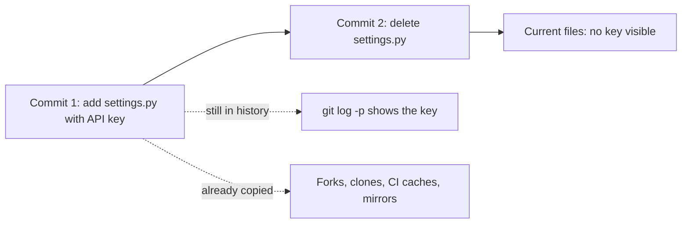
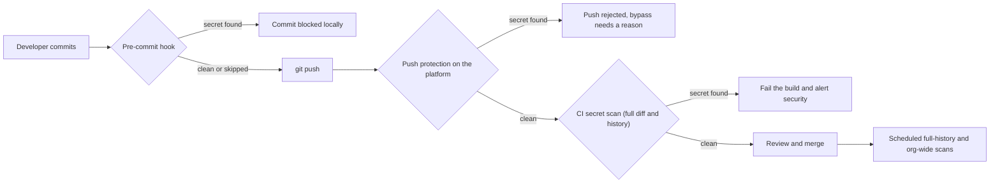
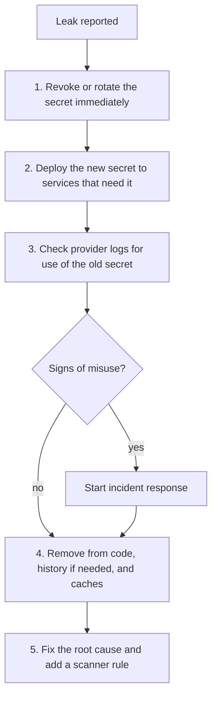

# Secret Scanning

## Introduction

A **secret** is any value that grants access: API keys, database passwords, cloud access keys, OAuth client secrets, private keys, webhook signing keys, session signing keys. When one of these ends up in a Git repository, a CI log, a Docker image layer or a chat message, anyone who can read that place can use it.

**Secret scanning** is the practice of automatically searching code, Git history, build logs and artifacts for secrets, ideally **before** they are pushed, and reacting quickly when one gets through.

An analogy: leaving a house key under the doormat is risky. Committing a secret to Git is like making a copy of that key and taping it inside every photocopy of your house plans, including the old ones in the archive. Deleting the file later does not take the copies back.

Leaked credentials are a common starting point for breaches, and public repositories are watched continuously by automated tools looking for them. This page shows how scanners find secrets, how to block them before they leave a laptop, how to scan Git history, and what to do when a secret leaks anyway. For how to keep secrets out of code in the first place, see [Secrets Management in Code](../5-sec-secure-coding/3-sec-secrets-in-code.mdx).

## Why "I Deleted It" Is Not Enough

Git keeps every version of every file. If you commit a key and then remove it in the next commit, the key is still in the history, still in every clone and fork, and possibly in CI caches and pull request views.



The only reliable fix for a leaked secret is to **revoke or rotate it**, so the leaked value no longer works. Cleaning history is a secondary step.

## How Secret Scanners Find Secrets

| Technique | How it works | Strength | Weakness |
| --- | --- | --- | --- |
| Known-format patterns | Regexes for formats with fixed prefixes, such as GitHub tokens (`ghp_`), AWS access key IDs (`AKIA`), Stripe keys (`sk_live_`) | Very accurate for modern token formats | Misses secrets without a recognizable format |
| Keyword plus entropy | Looks for high-randomness strings near words like `password`, `secret`, `token` | Finds generic passwords and keys | More false positives (hashes, IDs, test data) |
| Verification | Tries the found credential against the provider's API to see if it is live | Separates real, active leaks from noise | Sends the credential to the provider; needs network access |
| Provider partnerships | Platforms such as GitHub notify the issuing provider, which may revoke the token automatically | Fast revocation for public leaks | Only for participating providers and platforms |

This is why modern token formats include a recognizable prefix and a checksum: they make leaks easy to detect with almost no false positives. If you issue API keys from your own product, give them a prefix too (for example `acme_live_...`).

### Common tools

| Tool | Type | Notes |
| --- | --- | --- |
| [Gitleaks](https://github.com/gitleaks/gitleaks) | Open source CLI | Fast regex and entropy scanning of Git history, directories and stdin. Its README now says it is feature complete and will receive security fixes only; the maintainer has started a successor project, Betterleaks. Check the repository before adopting it for new work |
| [TruffleHog](https://github.com/trufflesecurity/trufflehog) | Open source CLI plus commercial product | Hundreds of detectors and **verification** of found credentials |
| detect-secrets (Yelp) | Open source | Baseline file workflow for large legacy codebases |
| GitHub secret scanning and push protection | Platform feature | Free for public repositories; private repositories need the paid GitHub Secret Protection product (sold separately since April 2025). Check current GitHub pricing |
| GitLab secret detection, other platform scanners | Platform feature | Availability depends on tier |

## Hands-On: Find a Secret That Was "Deleted"

This lab builds a throwaway repository with **fake, randomly generated** credentials, then "removes" them. The token-like strings are assembled at runtime so the script itself contains nothing that looks like a real key.

```bash
#!/usr/bin/env bash
# make_leaky_repo.sh - build a throwaway repo containing FAKE, random credentials
set -euo pipefail
mkdir lab && cd lab
git init -q
git config user.name "Dev" && git config user.email "dev@example.com"

rand() { LC_ALL=C tr -dc 'A-Za-z0-9' < /dev/urandom | head -c "$1"; }

# Build token-shaped strings at runtime so no real-looking token is stored in this script
GH_PREFIX="ghp"; STRIPE_PREFIX="sk_""live"
cat > settings.py <<PY
DEBUG = False
GITHUB_TOKEN = "${GH_PREFIX}_$(rand 36)"
STRIPE_API_KEY = "${STRIPE_PREFIX}_$(rand 48)"
PY
git add settings.py && git commit -qm "Add settings"

# The "fix": delete the file in a later commit
git rm -q settings.py && git commit -qm "Remove secrets"
git log --oneline
```

```bash
bash make_leaky_repo.sh
```

Example output:

```text
a40d8ed Remove secrets
4119557 Add settings
```

Scan only the current files with Gitleaks' `dir` mode:

```bash
docker run --rm -v "$PWD/lab:/repo" ghcr.io/gitleaks/gitleaks:v8.30.1 dir --no-banner /repo
```

Output:

```text
INF scanned ~0 bytes (0) in 855µs
INF no leaks found
```

Now scan the **history** with `git` mode. `--redact` keeps the secret values out of the scan output and CI logs:

```bash
docker run --rm -v "$PWD/lab:/repo" ghcr.io/gitleaks/gitleaks:v8.30.1 git --redact --no-banner -v /repo
```

Example output:

```text
Finding:     GITHUB_TOKEN = "REDACTED
Secret:      REDACTED
RuleID:      github-pat
Entropy:     4.584184
File:        settings.py
Line:        2
Commit:      41195579af289993c6727f20e1b96a2689155076
Author:      Dev
Email:       dev@example.com
Date:        2026-10-11T11:19:26Z
Fingerprint: 41195579af289993c6727f20e1b96a2689155076:settings.py:github-pat:2

Finding:     STRIPE_API_KEY = "REDACTED"
Secret:      REDACTED
RuleID:      stripe-access-token
Entropy:     5.003434
File:        settings.py
Line:        3
Commit:      41195579af289993c6727f20e1b96a2689155076
...
WRN leaks found: 2
```

The working tree is clean, but both secrets are found in commit `4119557`. The exit code is `1` when leaks are found, so the command fails a CI job. Older tutorials use `gitleaks detect` and `gitleaks protect`; those commands were deprecated in Gitleaks 8.19 in favor of `git`, `dir` and `stdin`.

:::caution Be careful with verification
TruffleHog can **verify** credentials by calling the provider's API (for example `trufflehog git file://./lab --results=verified`). That is very useful for triaging real leaks in your own repositories, but it means the scanner sends each found credential to a third party. Only run verification on code you own, and never "verify" credentials you found in someone else's repository. Report them to the owner instead.
:::

## Custom Rules and Allowlists

Default rules know about public token formats. Add rules for **your** formats, and allowlist known test fixtures, in a `.gitleaks.toml` at the repository root:

```toml
# .gitleaks.toml
[extend]
useDefault = true            # keep all built-in rules

[[rules]]
id = "acme-internal-api-key"
description = "Acme internal API key"
regex = '''acme_(?:live|test)_[A-Za-z0-9]{32}'''
keywords = ["acme_live", "acme_test"]

[[allowlists]]
description = "Fake credentials used by unit tests"
paths = ['''(^|/)tests/fixtures/''']
```

Two details matter:

- Use a **non-capturing group** `(?:...)` in the regex. In Gitleaks, a capturing group can be treated as the secret part of the match, which changes what gets reported and redacted.
- `keywords` make scanning fast: the regex runs only on text that contains one of them.

With a fake `acme_live_...` key in both `app/client.py` and `tests/fixtures/fake.py`:

```bash
docker run --rm -v "$PWD/lab:/repo" ghcr.io/gitleaks/gitleaks:v8.30.1 \
  dir --no-banner --redact -v -c /repo/.gitleaks.toml /repo
```

Example output (trimmed):

```text
Finding:     KEY = "REDACTED
RuleID:      acme-internal-api-key
File:        /repo/app/client.py
WRN leaks found: 1
```

The fixture is allowlisted; the application file is flagged. For a single line, Gitleaks also honors an inline `gitleaks:allow` comment. Use it sparingly and only for values that are provably fake, because every inline exception is a place a real secret could hide later.

## Block Secrets Before They Leave the Laptop

The cheapest leak is the one that never gets pushed. Add a **pre-commit hook** with the [pre-commit](https://pre-commit.com/) framework:

```yaml
# .pre-commit-config.yaml
repos:
  - repo: https://github.com/gitleaks/gitleaks
    rev: v8.30.1
    hooks:
      - id: gitleaks
```

```bash
pip install pre-commit
pre-commit install            # installs the Git hook in this clone
git add settings.py && git commit -m "add settings"
```

If the staged changes contain a secret, the commit is rejected with a Gitleaks finding. Hooks are **local and optional**: a developer can skip them (`git commit --no-verify`) or never install them. That is why you also need server-side controls.

## Server-Side Controls: Push Protection and CI



- **Push protection** (GitHub, GitLab and others) checks pushes on the server and rejects ones containing supported secret types. Developers can bypass with a reason, which is logged for review.
- **CI scanning** catches custom formats and anything that slipped through, and can scan the whole history.

A CI job that scans the commits in a pull request:

```yaml
# .github/workflows/secrets.yml
name: Secret scan
on: [pull_request]

permissions:
  contents: read

jobs:
  gitleaks:
    runs-on: ubuntu-latest
    steps:
      - uses: actions/checkout@3d3c42e5aac5ba805825da76410c181273ba90b1 # v7.0.1
        with:
          fetch-depth: 0                # need history to scan the PR's commits
          persist-credentials: false
      - name: Scan commits in this pull request
        env:
          BASE: ${{ github.event.pull_request.base.sha }}
          HEAD: ${{ github.event.pull_request.head.sha }}
        run: |
          docker run --rm -v "$PWD:/repo" ghcr.io/gitleaks/gitleaks:v8.30.1 \
            git --redact --no-banner --log-opts="$BASE..$HEAD" /repo
```

The PR's SHAs are passed through environment variables instead of being written directly into the script, which avoids [template injection in workflows](./8-sec-pipeline-security.mdx). Pin the image by digest for stronger guarantees. Remember that CI logs are often visible to many people, which is why `--redact` matters.

## Responding to a Leaked Secret

When a scanner, a colleague, a provider or a stranger reports a leaked secret, act in this order:



1. **Revoke or rotate first.** Treat the secret as compromised the moment it was pushed, even to a private repo. Do not wait to "see if anyone used it".
2. **Roll out the replacement** from a secret manager, so services keep working.
3. **Investigate.** Check the provider's audit logs (for example cloud API logs) for activity with the old credential since the leak time. See [Investigating with Logs](../12-sec-incident-response/3-sec-log-analysis.mdx).
4. **Clean up.** Remove the secret from the code. Rewriting history (for example with `git filter-repo`) is worth it for private repos where the secret is also embarrassing or sensitive in itself, but it requires coordinating with everyone who has a clone, and it does not remove copies in forks or caches. Never treat history rewriting as a replacement for rotation.
5. **Fix the cause.** Why was the secret in code? Move it to a secret manager or, better, remove it entirely with workload identity or OIDC federation.

Vulnerable: a long-lived key in code.

```python
# Vulnerable: credential committed to the repository
import boto3

s3 = boto3.client(
    "s3",
    aws_access_key_id="AKIA...EXAMPLE",
    aws_secret_access_key="wJal...EXAMPLEKEY",
)
```

Fixed: no secret in code at all. The SDK finds short-lived credentials from the environment (an IAM role on the instance or container, or OIDC federation in CI).

```python
# Fixed: the default credential chain supplies short-lived credentials at runtime
import boto3

s3 = boto3.client("s3")  # uses the workload's IAM role; nothing to leak in the repo
```

The best secret is one that does not exist. See [Cloud IAM Security](../8-sec-cloud-and-container/1-sec-cloud-iam.mdx) and [Key Management](../1-sec-cryptography/8-sec-key-management.mdx).

## Real-World Scenario

A developer at your company pushed a commit to a **public** open source repository that contained a cloud access key for the staging account. Thirty minutes later, they noticed and pushed a commit deleting it. They ask whether that is enough. Separately, the security team wants to roll out secret scanning across 200 repositories, and the engineering director worries about slowing developers down.

**The walkthrough for the incident:**

1. Deactivate the key immediately and create a replacement in the secret manager.
2. Search the cloud audit logs for any API calls made with the old key since the push. Unexpected regions, new compute instances or IAM changes mean an incident.
3. Leave history rewriting for later. The repository is public, so assume the key was copied within minutes.
4. Root cause: the developer used a static key for a local script. Replace it with short-lived credentials from single sign-on.

**The walkthrough for the rollout:**

1. Turn on platform **push protection** for all repositories first. It is low-friction and stops the most common, well-formatted tokens.
2. Run a **one-time history scan** across all repositories with verification enabled, and rotate every live credential found, starting with production.
3. Add a **CI secret scan** with custom rules for internal key formats.
4. Offer a **pre-commit hook** in the project template, recommended but not mandatory.
5. Measure: number of push protection bypasses (and their reasons), and time from detection to rotation.

**Why this approach:** blocking at push time prevents new leaks without much developer friction, and the history scan deals with leaks that already happened. Rotation, not deletion, is what actually removes the risk.

| Control | Pros | Cons | Best for |
| --- | --- | --- | --- |
| Pre-commit hook | Catches leaks before they exist anywhere else | Optional; easily skipped; needs installation per clone | Developer convenience |
| Platform push protection | Server-side; hard to forget; low noise | Limited to supported formats; paid for private repos on some platforms | Default for every repo |
| CI scan with custom rules | Flexible; covers internal formats | Runs after the push; secret already on the server | Organizations with their own token formats |
| Scheduled full-history scan with verification | Finds old, live leaks | Noisy at first; verification sends secrets to providers | One-time cleanup and periodic audits |
| Removing static secrets (OIDC, workload identity) | Nothing to leak | Requires platform support and migration work | Long-term fix |

## Common Mistakes

- **Deleting the file instead of rotating the secret.** The history and every clone still have it.
- **Rotating some, not all.** After an incident, rotate every secret the leaked one could reach, and confirm the old values stop working.
- **Printing secrets in CI logs.** Debug output and verbose tools leak secrets into logs that many people can read. Mask them and use `--redact`.
- **Over-broad allowlists.** Allowlisting `config/` because of one test file hides real secrets added later.
- **Forgetting other places secrets live.** Docker image layers, Terraform state, notebooks, chat tools and ticket systems leak secrets too.
- **Treating private repositories as safe.** Many people, integrations and backups can read them, and private repositories can become public by mistake.
- **Verifying credentials you do not own.** Report them to the owner instead.

## Summary

- Secrets in Git persist in history and every clone; deletion is not remediation.
- Scanners use known token formats, entropy plus keywords, and optionally live verification.
- Gitleaks scans history (`git`), directories (`dir`) and streams (`stdin`); use `--redact` in CI.
- Layer controls: pre-commit hooks, platform push protection, CI scans, and periodic full-history scans.
- When a secret leaks: rotate first, investigate use, then clean up and fix the root cause.
- The best long-term fix is removing static secrets with short-lived, identity-based credentials.

## Further Learning

**Exercises**

1. Run the lab and confirm that `dir` mode finds nothing while `git` mode finds both secrets. Then add a custom rule for a token format of your own.
2. Install the pre-commit hook in a test repository and try to commit a fake token. Then try `--no-verify` and think about which server-side control would catch it.
3. Write a short runbook for "cloud access key leaked in a public repository" for your team, with owners for each step.
4. Find one secret in your own projects that could be replaced by OIDC federation or a workload identity, and plan the migration.

**Related pages**

- [Secrets Management in Code](../5-sec-secure-coding/3-sec-secrets-in-code.mdx)
- [Securing CI/CD Pipelines](./8-sec-pipeline-security.mdx)
- [Incident Response Playbooks](../12-sec-incident-response/1-sec-incident-playbooks.mdx)
- [Key Management](../1-sec-cryptography/8-sec-key-management.mdx)
