# Building a Security Testing Strategy

## Introduction

The previous pages introduced many kinds of security testing: [threat modeling](./1-sec-threat-modeling.mdx), [SAST](./2-sec-sast.mdx), [DAST](./3-sec-dast.mdx), [dependency scanning](./4-sec-dependency-scanning.mdx), [secret scanning](./7-sec-secret-scanning.mdx) and [pipeline audits](./8-sec-pipeline-security.mdx). Each one finds some problems and misses others. A **security testing strategy** decides which tests you run, where in the delivery process they run, how results are handled, and how you know the mix is working.

An analogy is health care. You brush your teeth every day (cheap, frequent, prevents common problems), you see a doctor once a year (broader, more expensive), and you see a specialist when something specific needs a deep look. Nobody gets an MRI every morning, and nobody relies on brushing alone. Security testing works the same way: fast automated checks on every change, deeper scans on a schedule, and expert human testing for the things automation cannot judge.

This page shows how to map risks to test types, how to place tests in the pipeline, how to write two kinds of high-value tests that tools cannot provide for you (authorization matrices and property-based fuzzing), and how to turn scanner output into one consistent gate policy.

## The Security Testing Toolbox

| Test type | Finds well | Misses | Cost and speed |
| --- | --- | --- | --- |
| Threat modeling | Design flaws, missing controls | Implementation bugs | Hours per feature; human |
| Security unit and integration tests | Regressions in auth, access control, validation, headers | Anything nobody wrote a test for | Seconds; written by developers |
| SAST | Injection patterns, dangerous APIs, hardcoded secrets | Logic, authorization, config | Seconds to minutes |
| Secret scanning | Credentials in code and history | Secrets in other systems | Seconds |
| SCA | Known CVEs in dependencies | Zero-days, malicious packages without advisories | Seconds |
| IaC and container scanning | Cloud and image misconfiguration | Runtime drift | Seconds to minutes. See [Infrastructure as Code Security](../8-sec-cloud-and-container/6-sec-infrastructure-as-code-security.mdx) |
| DAST | Runtime and config issues, exploitable injection | Code the crawler never reaches, logic flaws | Minutes to hours |
| Fuzzing and property-based tests | Edge cases, parser bugs, crashes | Bugs outside the fuzzed function | Minutes to continuous |
| Penetration testing | Chained issues, logic and access control flaws | Whatever is out of scope or time | Days; expensive; periodic |
| Bug bounty / vulnerability disclosure | Issues found by many outside researchers | Only what researchers choose to look at | Pay per valid finding plus program effort. See [Bug Bounty Programs](../10-sec-offensive-security/10-sec-bug-bounty.mdx) |
| Red team exercises | Detection and response gaps across people and systems | Breadth of individual vulnerabilities | Expensive; for mature organizations |

No single row covers everything. The strategy question is how to combine them for **your** risks and budget.

## Step 1: Start From Risks, Not Tools

List your most important risks first (from threat models, past incidents and pen test reports), then choose the cheapest test that reliably catches each one. The OWASP Top 10:2025 is a useful starting checklist for web applications:

| OWASP Top 10:2025 category | Primary test | Supporting tests |
| --- | --- | --- |
| A01 Broken Access Control | Authorization matrix tests (below) | Pen testing, DAST with multiple accounts |
| A02 Security Misconfiguration | IaC scanning, DAST baseline | Configuration unit tests, CIS benchmarks |
| A03 Software Supply Chain Failures | SCA, pipeline audit, dependency review | SBOM scanning, signature verification |
| A04 Cryptographic Failures | Code review, SAST rules for weak algorithms | TLS scanners, unit tests for crypto settings |
| A05 Injection | SAST (taint rules), parameterized-query conventions | DAST active scans, fuzzing |
| A06 Insecure Design | Threat modeling | Abuse-case tests, pen testing |
| A07 Authentication Failures | Security unit tests (lockout, MFA, session) | DAST, pen testing |
| A08 Software or Data Integrity Failures | Signature and provenance verification, deserialization SAST rules | Pipeline audits |
| A09 Security Logging and Alerting Failures | Tests that assert security events are logged | Detection exercises. See [Detection Engineering](../11-sec-defensive-operations/2-sec-detection-engineering.mdx) |
| A10 Mishandling of Exceptional Conditions | Fuzzing, error-path unit tests | SAST rules for broad exception handling |

Notice how often the **primary** test is something your own team writes. Tools are excellent at known bug patterns; they know nothing about your permissions model or business rules.

For a more detailed list of testable requirements, use [OWASP ASVS 5.0](https://owasp.org/www-project-application-security-verification-standard/) as the source of test cases, and the [OWASP Web Security Testing Guide](https://owasp.org/www-project-web-security-testing-guide/) for manual testing techniques.

## Step 2: Place Each Test Where It Belongs

Each test runs at the point where it gives fast, useful feedback without blocking people unnecessarily.

```mermaid
flowchart LR
    subgraph Dev["Developer (seconds)"]
        IDE["IDE linting"]
        HOOK["Pre-commit: secrets, fast SAST"]
    end
    subgraph PR["Pull request (under ~10 min)"]
        UT["Security unit and authz tests"]
        SAST["Diff-aware SAST"]
        SCA["SCA on lockfiles"]
        SEC["Secret scan"]
        WF["Workflow audit"]
    end
    subgraph Main["After merge and deploy to staging"]
        DASTB["DAST baseline"]
        IMG["Image and IaC scan"]
        SIGN["SBOM, sign, attest"]
    end
    subgraph Sched["Scheduled"]
        DASTA["Nightly authenticated DAST"]
        FUZZ["Fuzzing"]
        DEEP["Deep SAST, full-history secrets"]
        SCAN["SCA of deployed SBOMs"]
    end
    subgraph Periodic["Periodic (human)"]
        PEN["Pen test"]
        TM["Threat model refresh"]
        BB["Bug bounty or disclosure program"]
    end
    Dev --> PR --> Main --> Sched --> Periodic
```



Rules of thumb:

- **Pull request checks must be fast and accurate**, or developers will route around them. Keep them under roughly ten minutes and block only on high-confidence findings.
- **Slow or noisy tests run on a schedule**, with results triaged by the owning team, not dumped on whoever opened the latest PR.
- **Scheduled scans of unchanged code matter**, because new CVEs and new scanner rules appear every day.
- **Human testing focuses on what automation cannot do**: business logic, chained attacks, access control between roles and tenants.

## Step 3: Write the Tests Only You Can Write

### Authorization matrix tests

Broken access control is the top category in the OWASP Top 10, and scanners rarely find it, because they do not know that Alice from tenant `acme` must not see invoice 2 from tenant `globex`. A table-driven test that checks **every role against every endpoint, for own and other tenants** catches these bugs and prevents regressions. See [Broken Object Level Authorization](../7-sec-api-security/2-sec-bola.mdx) for the vulnerability itself.

A small multi-tenant API:

```python
# app.py - multi-tenant invoice API (simplified, in-memory)
from flask import Flask, abort, g, jsonify, request

app = Flask(__name__)

USERS = {  # token -> user (a real app would verify a session or JWT)
    "tok-alice": {"name": "alice", "tenant": "acme", "role": "member"},
    "tok-bob": {"name": "bob", "tenant": "globex", "role": "member"},
    "tok-carol": {"name": "carol", "tenant": "acme", "role": "admin"},
}
INVOICES = {
    1: {"id": 1, "tenant": "acme", "total": 120},
    2: {"id": 2, "tenant": "globex", "total": 75},
}


@app.before_request
def authenticate():
    token = request.headers.get("Authorization", "").removeprefix("Bearer ")
    g.user = USERS.get(token)
    if g.user is None:
        abort(401)


def load_invoice(invoice_id):
    inv = INVOICES.get(invoice_id)
    # Same 404 for "missing" and "belongs to another tenant": no existence leak
    if inv is None or inv["tenant"] != g.user["tenant"]:
        abort(404)
    return inv


@app.get("/invoices/<int:invoice_id>")
def get_invoice(invoice_id):
    return jsonify(load_invoice(invoice_id))


@app.delete("/invoices/<int:invoice_id>")
def delete_invoice(invoice_id):
    inv = load_invoice(invoice_id)
    if g.user["role"] != "admin":
        abort(403)
    del INVOICES[inv["id"]]
    return "", 204
```

The test matrix:

```python
# test_authz_matrix.py - every role x every endpoint x own/other tenant
import copy

import pytest

import app as invoice_app

ORIGINAL = copy.deepcopy(invoice_app.INVOICES)

# (method, path, token, expected status)
MATRIX = [
    ("GET", "/invoices/1", None, 401),            # no token
    ("GET", "/invoices/1", "tok-alice", 200),     # own tenant
    ("GET", "/invoices/2", "tok-alice", 404),     # other tenant: must not see it
    ("GET", "/invoices/1", "tok-bob", 404),       # other tenant
    ("DELETE", "/invoices/1", "tok-alice", 403),  # member cannot delete
    ("DELETE", "/invoices/2", "tok-carol", 404),  # admin, but other tenant
    ("DELETE", "/invoices/1", "tok-carol", 204),  # admin, own tenant
]


@pytest.fixture
def client():
    invoice_app.INVOICES.clear()
    invoice_app.INVOICES.update(copy.deepcopy(ORIGINAL))
    return invoice_app.app.test_client()


@pytest.mark.parametrize("method,path,token,expected", MATRIX)
def test_authorization_matrix(client, method, path, token, expected):
    headers = {"Authorization": f"Bearer {token}"} if token else {}
    resp = client.open(path, method=method, headers=headers)
    assert resp.status_code == expected
```

```bash
pip install flask pytest
python -m pytest -q test_authz_matrix.py
```

Output:

```text
.......                                                                  [100%]
7 passed in 0.46s
```

Now delete the tenant check from `load_invoice` (keep only `if inv is None`). Three rows fail immediately:

```text
FAILED test_authz_matrix.py::test_authorization_matrix[GET-/invoices/2-tok-alice-404]
FAILED test_authz_matrix.py::test_authorization_matrix[GET-/invoices/1-tok-bob-404]
FAILED test_authz_matrix.py::test_authorization_matrix[DELETE-/invoices/2-tok-carol-404]
3 failed, 4 passed in 0.12s
```

Alice and Bob can read each other's invoices, and Carol, an admin in `acme`, can delete Globex's invoice. In a real codebase, generate the matrix from your route list and role definitions so that **new endpoints are automatically included**, and a new route without an explicit expected result fails the test suite.

### Property-based testing and fuzzing

Example-based tests check the inputs you thought of. **Property-based tests** state a rule that must hold for all inputs and let a library such as [Hypothesis](https://hypothesis.readthedocs.io/) generate thousands of inputs, including nasty ones. This is a lightweight form of fuzzing that fits in a normal test suite.

The property: "no filename a user supplies may resolve to a path outside the upload directory." Here is a vulnerable implementation that strips `../` once:

```python
# unsafe_paths.py  (Vulnerable)
import os

UPLOAD_ROOT = "/srv/uploads"


def resolve_upload(filename):
    # Vulnerable: strips "../" once, then joins
    return os.path.normpath(os.path.join(UPLOAD_ROOT, filename.replace("../", "")))
```

```python
# test_unsafe.py
from hypothesis import given, settings
from hypothesis import strategies as st

from unsafe_paths import UPLOAD_ROOT, resolve_upload

pieces = st.sampled_from(["..", "/", "\\", ".", "etc", "passwd", "%2e%2e", "a"])


@settings(max_examples=2000)
@given(st.lists(pieces, max_size=12).map("".join))
def test_never_escapes_upload_root(name):
    path = resolve_upload(name)
    assert path == UPLOAD_ROOT or path.startswith(UPLOAD_ROOT + "/")
```

```bash
pip install hypothesis
python -m pytest -q test_unsafe.py
```

Example output (trimmed):

```text
E       AssertionError: assert ('/srv' == '/srv/uploads'
E       Failing test case: test_never_escapes_upload_root(
E           name='..',
E       )
FAILED test_unsafe.py::test_never_escapes_upload_root - AssertionError: asser...
1 failed in 0.08s
```

Hypothesis found, and then **shrank** to the simplest form, an input the replace call does not catch: a bare `..` with no slash, which resolves to the parent directory. A single-pass filter is also defeated by inputs like `....//`, which become `../` after the replacement. The fixed version resolves the final path and checks containment instead of filtering strings:

```python
# safe_paths.py  (Fixed)
from pathlib import Path

UPLOAD_ROOT = Path("/srv/uploads").resolve()


def resolve_upload(filename: str) -> Path:
    if not filename or "\x00" in filename:
        raise ValueError("invalid filename")
    candidate = (UPLOAD_ROOT / filename).resolve()
    if not candidate.is_relative_to(UPLOAD_ROOT):
        raise ValueError("path escapes upload directory")
    return candidate
```

```python
# test_safe_paths_fuzz.py - property-based test: no input may escape UPLOAD_ROOT
from hypothesis import given, settings
from hypothesis import strategies as st

from safe_paths import UPLOAD_ROOT, resolve_upload

# Mix ordinary text with the pieces attackers use in path traversal
pieces = st.sampled_from(["..", "/", "\\", ".", "etc", "passwd", "%2e%2e", "a", "\x00"])
filenames = st.one_of(st.text(max_size=40), st.lists(pieces, max_size=12).map("".join))


@settings(max_examples=2000)
@given(filenames)
def test_never_escapes_upload_root(name):
    try:
        path = resolve_upload(name)
    except ValueError:
        return  # rejecting is always acceptable
    assert path.is_relative_to(UPLOAD_ROOT)
```

Output:

```text
.                                                                        [100%]
1 passed in 1.71s
```

`Path.is_relative_to` needs Python 3.9 or newer. For parsers written in C, C++, Rust or Go, coverage-guided fuzzers (libFuzzer, AFL++, Go's built-in fuzzing, Atheris for Python) go much deeper, and Google's OSS-Fuzz runs them continuously for many open source projects. See [Command Injection and Path Traversal](../3-sec-web-security/7-sec-command-injection.mdx) and [Memory Safety](../5-sec-secure-coding/4-sec-memory-safety.mdx).

## Step 4: One Gate Policy for Many Tools

Every scanner has its own severity names and flags. If each tool is configured separately, the rules for "what blocks a merge" drift apart. Most tools can emit **SARIF**, so you can apply one policy to all of them: which levels block, and which time-boxed exceptions are approved.

```python
# security_gate.py - apply one gate policy to SARIF output from any scanner
import json
import sys
from datetime import date

# Policy: which SARIF levels block the build, plus time-boxed exceptions
BLOCKING_LEVELS = {"error"}
EXCEPTIONS = {
    # rule id -> (reason, expiry)
    "B105": ("Test fixture password, tracked in SEC-142", date(2026, 12, 31)),
}


def findings(sarif_path):
    with open(sarif_path) as f:
        sarif = json.load(f)
    for run in sarif.get("runs", []):
        tool = run["tool"]["driver"]["name"]
        # Default level per rule, used when a result does not set its own
        defaults = {
            r["id"]: r.get("defaultConfiguration", {}).get("level", "warning")
            for r in run["tool"]["driver"].get("rules", [])
        }
        for res in run.get("results", []):
            rule = res.get("ruleId", "?")
            level = res.get("level", defaults.get(rule, "warning"))
            loc = res["locations"][0]["physicalLocation"]
            where = f'{loc["artifactLocation"]["uri"]}:{loc["region"]["startLine"]}'
            yield tool, rule, level, where


def main(paths):
    blocking = 0
    for path in paths:
        for tool, rule, level, where in findings(path):
            exc = EXCEPTIONS.get(rule)
            note = ""
            if exc and exc[1] >= date.today():
                verdict, note = "excepted", f"  ({exc[0]}, expires {exc[1]})"
            elif level in BLOCKING_LEVELS:
                verdict = "BLOCK"
                blocking += 1
            else:
                verdict = "report"
            print(f"{verdict:<9} {tool:<12} {rule:<19} {level:<8} {where}{note}")
    print(f"\n{blocking} blocking finding(s)")
    return 1 if blocking else 0


if __name__ == "__main__":
    sys.exit(main(sys.argv[1:]))
```

Run it on SARIF from Semgrep and Bandit, produced from the vulnerable Flask app on the [SAST](./2-sec-sast.mdx) page:

```bash
pip install semgrep "bandit[sarif]"
semgrep scan --config rules.yml --metrics=off --sarif-output semgrep.sarif demo
bandit -r demo -f sarif -o bandit.sarif
python security_gate.py semgrep.sarif bandit.sarif
```

Example output:

```text
BLOCK     Semgrep OSS  flask-sqli-fstring  error    demo/app.py:15
report    Bandit       B404                note     demo/app.py:2
excepted  Bandit       B105                note     demo/app.py:7  (Test fixture password, tracked in SEC-142, expires 2026-12-31)
report    Bandit       B608                warning  demo/app.py:14
BLOCK     Bandit       B602                error    demo/app.py:21
BLOCK     Bandit       B201                error    demo/app.py:26

3 blocking finding(s)
```

The exit code is `1`, so CI fails. Notice:

- Both tools found the SQL injection (Semgrep at `error`, Bandit's lower-confidence B608 at `warning`). Overlap between tools is normal; deduplicate by location when you report numbers.
- The exception carries a **reason, a ticket and an expiry date**. When it expires, the finding blocks again and someone has to look at it.
- The policy lives in one reviewed file instead of being spread over scanner flags.

Commercial ASPM (application security posture management) platforms do this aggregation, deduplication and policy at scale. The principle is the same.

## Step 5: Measure and Adjust

A strategy is a hypothesis about where bugs come from. Check it with data:

| Question | Signal |
| --- | --- |
| Are our early tests catching what matters? | Share of vulnerabilities found before release vs by pen testers, bug bounty or incidents |
| Are we fixing fast enough? | Mean time to remediate by severity; findings past due date |
| Are our tools trusted? | False positive rate per rule; number of suppressions and bypasses |
| Is coverage complete? | Share of repos with each check enabled; endpoints covered by authz tests |
| What keeps recurring? | Vulnerability classes in pen test and bounty reports over time |

When the pen test report keeps finding the same class of issue (for example IDOR), that is a signal to add a test type earlier in the pipeline (an authorization matrix), not just to fix the individual bugs.

## Real-World Scenario

You are the first security engineer at a 30-person SaaS company with one web app, a public API and a mobile client. The annual security budget for tools and services is modest. Leadership asks what to spend it on: "Should we buy a commercial scanner suite, start a bug bounty, or do a pen test?" Currently there is no security testing beyond code review.

**The walkthrough:**

1. **Months 1 to 2, free and high-leverage:** enable platform secret scanning and push protection, Dependabot, Semgrep or CodeQL in PRs (diff-aware, small blocking set), zizmor for workflows, and a ZAP baseline scan after deploy to staging. Write authorization matrix tests for the API with developers.
2. **Month 3:** a focused external **penetration test** of the API and web app, with test accounts for each role. Use the results to find which test types are missing.
3. **Months 4 to 6:** publish a vulnerability disclosure policy and `security.txt`. Consider a small private bug bounty only **after** the pen test findings are fixed; otherwise you pay bounties for issues you could have found cheaply.
4. **Ongoing:** nightly authenticated DAST, property-based tests for parsers and file handling, quarterly threat model refresh, yearly pen test.
5. **Revisit tools after six months**, when you know your real false positive rates and gaps; then decide whether a commercial suite adds enough (reachability, aggregation, support) to justify the cost.

**Why this approach:** the cheapest controls go first, human testing is aimed at what tools cannot do, and paid programs start once the easy findings are gone.

**When not to follow it:** if you are under a contractual or regulatory deadline (for example PCI DSS requirements for application testing), the order may be dictated by the auditor's requirements. See [Compliance: SOC 2, PCI DSS, HIPAA and GDPR](../13-sec-governance/2-sec-compliance.mdx).

| Option | Pros | Cons | Best for |
| --- | --- | --- | --- |
| Open source scanners in CI | Free; fast feedback; fully automatable | Setup and tuning time; limited cross-file analysis | Every team, first |
| Commercial AppSec suite | Aggregation, reachability, support, dashboards | Cost; still needs tuning and triage | Many repos and teams |
| Developer-written security tests | Catch logic and access control bugs; prevent regressions | Need training and discipline | Every team with real authorization rules |
| Annual penetration test | Expert human view, chained attacks, report for customers | Point in time; expensive | Before launches and yearly |
| Bug bounty program | Many testers; pay for results | Noise and triage load; costly if basics are missing | Mature apps after a clean pen test |
| Vulnerability disclosure policy only | Free; legal safe harbor for finders | No incentive for researchers | Every organization |
| Red team | Tests detection and response | Expensive; needs mature defenses | Large organizations |

## Common Mistakes

- **Buying tools before deciding what risks they should cover.** Start from the threat model and past incidents.
- **Running everything on every pull request.** Slow, noisy checks get disabled. Move them to scheduled jobs.
- **No owner for results.** Scheduled scan output nobody triages is wasted work.
- **Relying on scanners for access control.** Write authorization tests.
- **Testing only the happy path.** Abuse cases and properties ("no input escapes the directory") find what examples miss.
- **Pen testing a moving target without scope.** Give testers accounts, a defined scope and a stable environment, and fix basics first so they spend time on hard problems.
- **Permanent exceptions.** Every exception needs a reason, an owner and an expiry date.
- **Never measuring.** Without data you cannot tell whether the strategy works or just produces reports.

## Summary

- A security testing strategy maps your risks to the cheapest reliable tests and places each test where it gives fast, accurate feedback.
- Fast checks run on every PR; slow and noisy ones run on a schedule; humans focus on logic and access control.
- Some of the highest-value tests are ones only your team can write: authorization matrices and property-based tests.
- Use SARIF to apply one gate policy, with time-boxed exceptions, across tools.
- Pen tests, disclosure programs and bug bounties complement automation; start bounties after the basics are clean.
- Measure where vulnerabilities are found and adjust the mix over time.

## Further Learning

**Exercises**

1. Remove the tenant check from `load_invoice` and confirm which rows of the matrix fail. Then extend the matrix to generate rows automatically from a list of routes and roles.
2. Write a Hypothesis property test for a function in your own code that parses user input (dates, URLs, filenames). What property must always hold?
3. Add a rule to `security_gate.py` that blocks any finding in files under `src/auth/` regardless of level.
4. Draw your team's current pipeline and mark which test types run at each stage. Which OWASP Top 10:2025 categories have no test at all?

**Related pages**

- [Secure Software Development Lifecycle](./0-sec-sdlc.mdx)
- [Penetration Testing Introduction](../10-sec-offensive-security/0-sec-pentest-introduction.mdx)
- [Vulnerability Management and CVSS](../11-sec-defensive-operations/6-sec-vulnerability-management.mdx)
- [Project: DevSecOps Pipeline](../14-sec-projects/3-sec-project-devsecops-pipeline.mdx)
