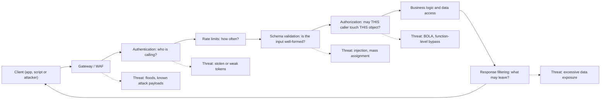
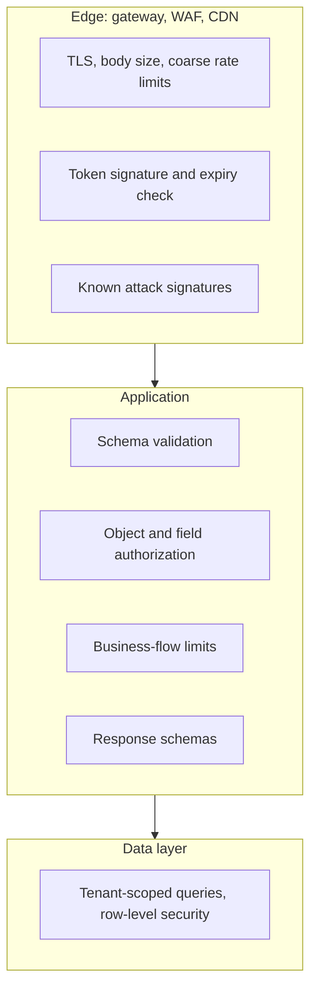

# API Security Introduction

## Introduction

Most software today talks through APIs. A mobile app asks your backend for the user's orders, a single-page app saves a form, a partner's server pulls a nightly report, and your own microservices call each other hundreds of times per second. Every one of those calls is a door into your data.

**API security** is the practice of making sure that each request reaching those doors is made by someone you can identify, asks only for what that caller is allowed to have, carries data in the shape you expect, and arrives at a rate your system and budget can handle.

Think of a restaurant. The dining room (your website) has hosts, waiters and a menu that limits what guests can order. The kitchen's back door (your API) is where suppliers deliver directly. If that back door has no one checking delivery notes, anyone with a van can walk in and take the steaks. Attackers know the back door is often less guarded than the dining room, so they skip the website and call the API directly.

This section teaches you to secure that back door. This page gives you the big picture: what makes APIs different, the main threats, and the layered set of controls you will build in the rest of the section.

:::warning Only test what you own
The examples in this section run on your own machine against small local apps. Only probe APIs that you own or have written permission to test. For practice, use deliberately vulnerable targets such as OWASP crAPI, OWASP Juice Shop, or the API testing labs in PortSwigger Web Security Academy.
:::

## Why APIs Need Their Own Security Thinking

Everything in [Web Application Security](../3-sec-web-security/0-sec-web-security-introduction.mdx) still applies to APIs. Injection, broken access control and misconfiguration do not go away. But APIs change the picture in a few important ways.

### 1. The client is not your code

With a classic server-rendered website, the server decides what HTML the browser sees. With an API, the server sends raw data to a client, and the client decides what to show. A mobile app might hide the `email` field of other users, but the JSON still contains it. Anyone can open the app's traffic in a proxy and read the full response.

**Rule:** treat every API client as hostile. Whatever the API returns, assume the attacker sees it. Whatever the API accepts, assume the attacker can send it.

### 2. Object IDs are right there in the request

APIs are built around resources: `/orders/1001`, `/users/42/invoices`. The IDs are visible and easy to change. That makes **object-level authorization** the most common and most damaging API flaw. You will study it in depth in [Broken Object Level Authorization](./2-sec-bola.mdx).

### 3. APIs are built for automation

An API is designed to be called by programs, so it is equally easy for an attacker's script to call it 100,000 times. Credential stuffing, scraping, coupon abuse and SMS cost attacks are all automation problems. See [Rate Limiting and Abuse Prevention](./3-sec-rate-limiting.mdx).

### 4. There are many of them, and they drift

Teams ship `/v1`, then `/v2`, then a "temporary" `/internal/debug` endpoint. Old versions keep running with old bugs. Shadow APIs that nobody documented are still reachable. OWASP calls this **Improper Inventory Management**, and it is on the [OWASP API Security Top 10](./1-sec-owasp-api-top-10.mdx).

### 5. APIs consume other APIs

Your API probably calls payment providers, identity providers and partner services, and receives webhooks from them. Data coming back from those services is input too, and it needs the same validation as user input. See [Webhook Security](./6-sec-webhook-security.mdx).

## Common API Styles and Their Risks

| Style | Typical use | Security notes |
| --- | --- | --- |
| REST over HTTP/JSON | Public and internal APIs, mobile backends | Object IDs in URLs make BOLA easy to find; validate JSON bodies strictly |
| GraphQL | Flexible front-end data fetching | One endpoint, client-shaped queries; needs depth, cost and resolver-level authorization. See [GraphQL Security](./5-sec-graphql-security.mdx) |
| gRPC | Service-to-service calls | Binary Protobuf contracts help validation; still needs authn (often mTLS) and authz per method |
| Webhooks | Event callbacks between companies | You receive requests from the internet that claim to be a provider; verify signatures |
| SOAP/XML | Legacy enterprise integrations | XML parsers bring XXE risks; disable external entities |

## A Map of the Threats

The diagram below follows one request through a typical API and shows where things go wrong.



Each box is a **control** you will implement, and each dotted line is a **threat** it addresses. No single box is enough. A gateway cannot know that invoice `inv_a1` belongs to tenant 1, and your handler code should not have to block a flood of 50,000 requests per second. That is [defense in depth](../0-sec-fundamentals/4-sec-defense-in-depth.mdx) applied to APIs.

## Seeing the Problems in Code

Here is a small FastAPI service that makes three classic API mistakes at once. It runs locally with no database.

```bash
python3 -m venv venv && source venv/bin/activate
pip install fastapi httpx
```

**Vulnerable:**

```python
# users_api.py  (Vulnerable: local lab only)
from fastapi import FastAPI

app = FastAPI()

USERS = {
    1: {"id": 1, "username": "alice", "email": "alice@example.com",
        "password_hash": "$argon2id$v=19$...", "is_admin": False, "mfa_secret": "JBSWY3DP"},
    2: {"id": 2, "username": "bob", "email": "bob@example.com",
        "password_hash": "$argon2id$v=19$...", "is_admin": True, "mfa_secret": "KRSXG5CT"},
}

@app.get("/v1/users")
def list_users_v1():
    # No authentication, the whole record, and no limit on how many come back
    return list(USERS.values())
```

Call it with FastAPI's test client:

```python
# try_v1.py
from fastapi.testclient import TestClient
from users_api import app

client = TestClient(app)
print(client.get("/v1/users").json()[0])
```

Output:

```text
{'id': 1, 'username': 'alice', 'email': 'alice@example.com', 'password_hash': '$argon2id$v=19$...', 'is_admin': False, 'mfa_secret': 'JBSWY3DP'}
```

Three problems in four lines:

1. **No authentication.** Anyone on the internet can list users.
2. **Excessive data exposure.** The handler returns the database record as is, including the password hash and the MFA secret. The front end may only display `username`, but the attacker reads the raw JSON.
3. **Unbounded results.** With a million users, one request dumps all of them, and it is also an easy way to exhaust memory.

**Fixed:**

```python
# users_api.py  (Fixed)
from typing import Annotated
from fastapi import FastAPI, Depends, Header, HTTPException, Query
from pydantic import BaseModel

app = FastAPI()

USERS = {
    1: {"id": 1, "username": "alice", "email": "alice@example.com",
        "password_hash": "$argon2id$v=19$...", "is_admin": False, "mfa_secret": "JBSWY3DP"},
    2: {"id": 2, "username": "bob", "email": "bob@example.com",
        "password_hash": "$argon2id$v=19$...", "is_admin": True, "mfa_secret": "KRSXG5CT"},
}
TOKENS = {"alice-token": 1, "bob-token": 2}   # stand-in for real token validation

def current_user(authorization: Annotated[str, Header()] = "") -> dict:
    user_id = TOKENS.get(authorization.removeprefix("Bearer "))
    if user_id is None:
        raise HTTPException(status_code=401, detail="not authenticated")
    return USERS[user_id]

class PublicUser(BaseModel):
    """The only fields allowed to leave the server."""
    id: int
    username: str

@app.get("/v2/users", response_model=list[PublicUser])
def list_users_v2(
    user: Annotated[dict, Depends(current_user)],
    limit: Annotated[int, Query(ge=1, le=50)] = 20,
    offset: Annotated[int, Query(ge=0)] = 0,
):
    return list(USERS.values())[offset: offset + limit]
```

```python
# try_v2.py
from fastapi.testclient import TestClient
from users_api import app

client = TestClient(app)
auth = {"Authorization": "Bearer alice-token"}
print(client.get("/v2/users").status_code)
print(client.get("/v2/users", headers=auth).json())
print(client.get("/v2/users?limit=100000", headers=auth).status_code)
```

Output:

```text
401
[{'id': 1, 'username': 'alice'}, {'id': 2, 'username': 'bob'}]
422
```

What changed:

- `Depends(current_user)` makes authentication a required dependency, so a handler cannot forget it.
- `response_model=list[PublicUser]` is an **allowlist** for output. Even though the handler returns full records, FastAPI serializes only `id` and `username`. New sensitive columns added to the database later do not leak by accident.
- `Query(ge=1, le=50)` bounds the page size. A request for 100,000 rows is rejected with `422` before any work happens.

:::tip Allowlist output, not just input
Most developers validate input. Fewer validate output. A response schema per endpoint is one of the cheapest API security controls you can add, and it also documents your API.
:::

## Know What You Expose: A Route Inventory

You cannot protect endpoints you do not know about. Before any other review, list every route and check which ones are public. If both versions of `list_users` live in one `users_api.py` module (the vulnerable `/v1` and the fixed `/v2`), a few lines of Python can walk FastAPI's route table:

```python
# list_routes.py
from fastapi.routing import APIRoute
from users_api import app, current_user

def uses_auth(route: APIRoute) -> bool:
    return any(dep.call is current_user for dep in route.dependant.dependencies)

for route in app.routes:
    if isinstance(route, APIRoute):
        methods = ",".join(sorted(route.methods))
        flag = "auth" if uses_auth(route) else "PUBLIC"
        print(f"{methods:7} {route.path:15} {flag}")
```

Output:

```text
GET     /v1/users       PUBLIC
GET     /v2/users       auth
```

Run a script like this in CI and fail the build when a new `PUBLIC` route appears that is not on an approved list. It turns "someone forgot the auth dependency" from a production incident into a failing check. Flask has the same information in `app.url_map`, and most frameworks can export an OpenAPI document that you can diff between releases.

## The Layers of API Defense

Here is how the rest of this section maps onto the controls.

| Layer | Question it answers | Where it usually lives | Covered in |
| --- | --- | --- | --- |
| Inventory | Which APIs and versions exist? | OpenAPI specs, gateway config, discovery tools | [OWASP API Top 10](./1-sec-owasp-api-top-10.mdx) |
| Transport | Is the connection private and authentic? | TLS at the edge, mTLS between services | [TLS and HTTPS](../1-sec-cryptography/7-sec-tls.mdx) |
| Authentication | Who is calling? | Gateway or app: OAuth tokens, API keys, mTLS | [API Keys and Service Authentication](../4-sec-authentication/10-sec-api-authentication.mdx) |
| Rate limiting | How often and how much? | Gateway plus app for business limits | [Rate Limiting](./3-sec-rate-limiting.mdx) |
| Input validation | Is the request well-formed? | App, optionally gateway | [Schema Validation](./4-sec-api-input-validation.mdx) |
| Authorization | May this caller act on this object or field? | App and data layer | [BOLA](./2-sec-bola.mdx) |
| Output filtering | What may leave the server? | App response schemas | This page |
| Edge filtering | Is this a known-bad request? | WAF, gateway | [API Gateways and WAFs](./7-sec-api-gateway-security.mdx) |
| Logging and monitoring | What happened, and is it abuse? | App logs, gateway logs, SIEM | [Secure Error Handling and Logging](../5-sec-secure-coding/2-sec-error-handling-and-logging.mdx) |

### Where controls belong

A useful rule of thumb:

- **Generic, identity-agnostic checks** go at the edge: TLS termination, request size limits, coarse rate limits, blocking obviously malicious payloads.
- **Checks that need business knowledge** go in the application: "does this invoice belong to this tenant?", "can this plan create more than five projects?", "is this transfer above the user's daily limit?".



## A Quick API Security Checklist

Use this as a first pass on any API you build or review:

1. Every endpoint requires authentication, except a short, explicit list of public ones.
2. Every handler that takes an object ID checks that the caller may access that object.
3. Every request body is validated against a schema that rejects unknown fields.
4. Every response is serialized through an explicit output schema.
5. List endpoints have a maximum page size.
6. Request bodies have a maximum size.
7. Sensitive flows (login, OTP, password reset, checkout) have their own rate limits.
8. Errors return a generic message and a request ID, never stack traces.
9. There is an up-to-date OpenAPI spec, and old versions have a retirement date.
10. Authentication failures, authorization failures and rate-limit hits are logged and alerted on.

## Real-World Scenario

**Your team** is launching a mobile app for a fitness studio chain. The backend is a REST API with endpoints for class bookings, membership payments, and trainer notes. The app goes live in six weeks, and you have budget for roughly two weeks of security work. Where do you spend it?

### The plan

1. **Week 1, inside the app code:**
   - Add a shared authentication dependency to every router, with an explicit allowlist of public endpoints (class schedule, studio locations).
   - Write one data-access function per resource that always takes the current member or studio from the session, for example `get_booking_for_member(booking_id, member_id)`. Ban raw `get_by_id` calls in handlers through code review.
   - Add Pydantic request models with `extra="forbid"` and response models for every endpoint.
   - Write authorization tests: member A cannot read, change or cancel member B's booking.
2. **Week 2, at the edge and in operations:**
   - Put the API behind a gateway with TLS, a request-size limit, and per-IP plus per-token rate limits.
   - Add strict limits for login, password reset and the SMS verification endpoint.
   - Publish an OpenAPI spec and block any route not in it at the gateway.
   - Ship structured logs for 401, 403, 404-on-object and 429 responses to your log platform with alerts.

### Why this approach

The highest-impact API bugs in practice are authorization bugs, and only application code can fix them. So the first week goes to code. Edge controls are mostly configuration, so they fit in the second week, and they catch volume-based abuse that code-level fixes do not address.

### When to use it, and when not to

This "code first, edge second" split fits most product teams. If you already run a mature gateway with authentication and rate limits, spend more of the budget on authorization tests. If the API is purely internal and reachable only over a private network, still do the authorization work. Internal networks get breached, and a compromised service becomes your attacker.

### Alternatives and trade-offs

| Approach | Pros | Cons | Best for |
| --- | --- | --- | --- |
| Fix in code only | Fixes root causes like BOLA; fully testable | No protection against floods; every service must repeat generic checks | Small APIs, early-stage products |
| Gateway or WAF only | Fast to deploy; central policy; no code changes | Cannot understand object ownership or business rules; false sense of safety | Emergency virtual patching, legacy apps you cannot change |
| Code plus gateway (layered) | Root-cause fixes and central volume controls | Two places to configure and monitor | Most production APIs |
| Commercial API security platform | Discovers shadow APIs, detects behavioral abuse | Cost, tuning effort, another vendor holding traffic data | Large API estates with many teams |

## Common Mistakes

1. **"The app doesn't show that field, so it's safe."** The API response is what matters. Filter on the server with response schemas.
2. **Trusting IDs from the client.** User IDs, tenant IDs and roles in request bodies or headers are attacker-controlled. Take identity from the verified token or session.
3. **Authenticating but not authorizing.** A valid token proves who someone is, not what they may touch.
4. **Forgetting old versions.** `/v1` still runs with the bug you fixed in `/v2`. Retire versions on a schedule.
5. **Verbose errors.** Stack traces and SQL errors tell attackers your framework, table names and code paths.
6. **Relying on obscurity.** "Nobody knows about `/internal/export`" lasts until someone decompiles the mobile app.
7. **No logging of denials.** A burst of 403 and 404 responses on object endpoints is often the first sign of a BOLA scan.

## Summary

- APIs expose raw data and object IDs to clients you do not control, and they are built for automation, which attackers use too.
- The biggest API risks are authorization failures, excessive data exposure, missing rate limits, weak input validation and forgotten endpoints.
- Defend in layers: transport, authentication, rate limiting, validation, authorization, output filtering, edge filtering and logging.
- Put generic checks at the edge and business-aware checks in the application.
- Allowlist both input and output with explicit schemas.

## Further Learning

### Exercises

1. Run the vulnerable and fixed `users_api.py` locally. Add a new column `phone` to the `USERS` records and confirm that only the vulnerable endpoint leaks it.
2. Add an `/v2/users/{user_id}` endpoint to the fixed version. Write a test that proves Alice can read her own full profile (including email) but only the public fields of Bob.
3. Take an API you have built and fill in the checklist above. Which three items are missing, and which one would you fix first?
4. Install OWASP crAPI locally with Docker and list every endpoint the mobile web client calls. Compare your list with the published OpenAPI spec.

### Related pages

- [OWASP API Security Top 10](./1-sec-owasp-api-top-10.mdx)
- [Broken Object Level Authorization](./2-sec-bola.mdx)
- [Authentication vs Authorization](../4-sec-authentication/0-sec-authn-vs-authz.mdx)
- [Attack Surface](../0-sec-fundamentals/3-sec-attack-surface.mdx)
- The site's [FastAPI tutorial](/docs/framework/fastapi) and [Flask tutorial](/docs/framework/flask)
