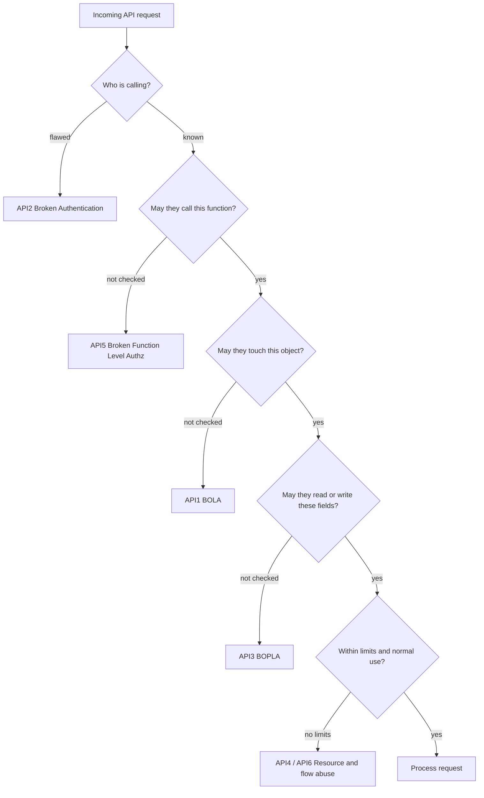
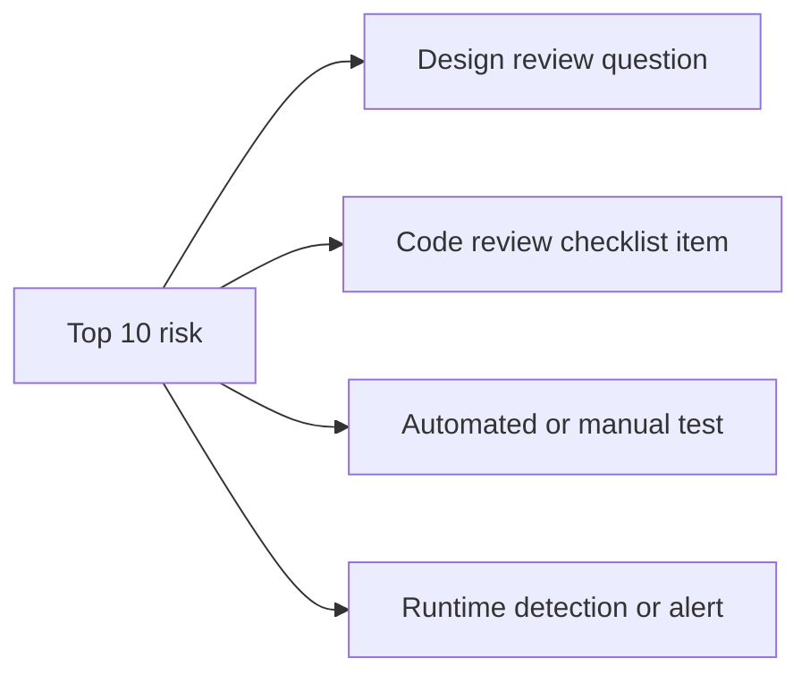

# OWASP API Security Top 10

## Introduction

The [OWASP Top 10](../3-sec-web-security/1-sec-owasp-top-10.mdx) describes the most important risks for web applications in general. In 2019 OWASP started a separate list for APIs, because API breaches kept following a different pattern: fewer classic injection bugs, and many more cases of "the API happily returned another customer's data because nobody checked who was asking."

The current edition is the **OWASP API Security Top 10 2023**. As of late 2026 it is still the latest API edition, even though the general web list moved to a 2025 edition. Check the [official project site](https://owasp.org/API-Security/) for newer releases.

Think of the list as the most common ways API "back doors" get left open, written down by people who reviewed many real incidents. It is not a complete security standard. For a full checklist use [OWASP ASVS](https://owasp.org/www-project-application-security-verification-standard/), which has a dedicated chapter on API and web services. The Top 10 is an awareness document and a great starting point for code reviews, threat models and test plans.

:::warning Only test what you own
The snippets on this page are small local labs. To practice finding these issues in a full application, run OWASP crAPI (completely ridiculous API) or OWASP Juice Shop locally, or use the API labs in PortSwigger Web Security Academy. Never probe a real company's API without written permission.
:::

## The List at a Glance

| ID | Risk | One-line summary |
| --- | --- | --- |
| API1:2023 | Broken Object Level Authorization | Changing an object ID gives access to someone else's object |
| API2:2023 | Broken Authentication | Weak or flawed login, token or key handling lets attackers impersonate users |
| API3:2023 | Broken Object Property Level Authorization | Reading or writing fields of an object you should not see or change |
| API4:2023 | Unrestricted Resource Consumption | No limits on requests, payload sizes, page sizes or paid third-party calls |
| API5:2023 | Broken Function Level Authorization | Normal users can call admin or privileged functions |
| API6:2023 | Unrestricted Access to Sensitive Business Flows | Automated abuse of legitimate flows such as buying, booking or signing up |
| API7:2023 | Server Side Request Forgery | The API fetches a URL supplied by the client and reaches internal systems |
| API8:2023 | Security Misconfiguration | Unsafe defaults, verbose errors, missing hardening, permissive CORS |
| API9:2023 | Improper Inventory Management | Forgotten versions, undocumented hosts, debug endpoints |
| API10:2023 | Unsafe Consumption of APIs | Trusting data from third-party APIs too much |

Notice that **three of the top five are authorization problems** (API1, API3, API5). That is the main lesson of the list: authentication is mostly solved by frameworks and identity providers, but authorization is specific to your data model, so it is your job.



Read the diagram top to bottom: each question is an authorization or limit decision, and each "not checked" branch is one of the Top 10 risks.

## How It Relates to the Web Top 10

| API Top 10 2023 | Closest OWASP Top 10 2025 category |
| --- | --- |
| API1 BOLA, API3 BOPLA, API5 BFLA | A01 Broken Access Control |
| API2 Broken Authentication | A07 Authentication Failures |
| API4 Unrestricted Resource Consumption | No direct match; partly A06 Insecure Design |
| API6 Sensitive Business Flows | A06 Insecure Design |
| API7 SSRF | A01 Broken Access Control (SSRF was folded into A01 in 2025) |
| API8 Security Misconfiguration | A02 Security Misconfiguration |
| API9 Improper Inventory Management | No direct match; related to A02 and asset management |
| API10 Unsafe Consumption of APIs | A08 Software or Data Integrity Failures, A05 Injection |

Injection does not have its own entry in the API list. That does not mean APIs are immune. SQL injection through a JSON body works exactly like SQL injection through a form. See [SQL Injection](../3-sec-web-security/3-sec-sql-injection.mdx).

## The Ten Risks with Code

The snippets below use Flask and a fake in-memory "database". They are deliberately tiny so you can focus on the flaw. Each one shows the **Vulnerable** pattern and the **Fixed** pattern.

### API1:2023 Broken Object Level Authorization (BOLA)

The API takes an object ID from the client and never checks that the caller owns it.

**Vulnerable:**

```python
@app.get("/api/orders/<int:order_id>")
def get_order(order_id):
    return jsonify(ORDERS[order_id])          # any logged-in user, any order
```

**Fixed:**

```python
@app.get("/api/orders/<int:order_id>")
def get_order(order_id):
    order = ORDERS.get(order_id)
    if order is None or order["owner_id"] != g.user_id:
        abort(404)
    return jsonify(order)
```

This is the most important item on the list, so it has its own page: [Broken Object Level Authorization](./2-sec-bola.mdx).

### API2:2023 Broken Authentication

Common causes: no rate limit on login or OTP checks, accepting unsigned or `alg: none` JWTs, long-lived tokens that are never revoked, API keys in URLs where they end up in logs, and password reset flows that leak tokens.

**Vulnerable:**

```python
import jwt

def user_from_token(token: str) -> dict:
    # Signature is never checked: anyone can forge a token
    return jwt.decode(token, options={"verify_signature": False})
```

**Fixed:**

```python
import jwt

def user_from_token(token: str) -> dict:
    return jwt.decode(
        token,
        PUBLIC_KEY,
        algorithms=["RS256"],               # pin the algorithm
        audience="https://api.example.com",
        issuer="https://auth.example.com/",
        options={"require": ["exp", "iat", "sub"]},
    )
```

The authentication section covers this in depth: [JSON Web Tokens](../4-sec-authentication/5-sec-jwt.mdx) and [API Keys and Service Authentication](../4-sec-authentication/10-sec-api-authentication.mdx).

### API3:2023 Broken Object Property Level Authorization (BOPLA)

The caller may access the object, but not every **property** of it. This merges two older categories: *excessive data exposure* (reading fields you should not see) and *mass assignment* (writing fields you should not change).

**Vulnerable:**

```python
@app.patch("/api/me")
def update_me():
    user = USERS[g.user_id]
    user.update(request.get_json())          # client can send {"role": "admin", "credit": 9999}
    return jsonify(user)                     # and the response includes password_hash
```

**Fixed:**

```python
EDITABLE = {"display_name", "bio"}
PUBLIC_FIELDS = ("id", "display_name", "bio")

@app.patch("/api/me")
def update_me():
    data = request.get_json() or {}
    unknown = set(data) - EDITABLE
    if unknown:
        return jsonify(error=f"fields not allowed: {sorted(unknown)}"), 400
    user = USERS[g.user_id]
    user.update(data)
    return jsonify({k: user[k] for k in PUBLIC_FIELDS})
```

In real projects, use schema models for both directions instead of hand-written sets. See [Schema Validation for APIs](./4-sec-api-input-validation.mdx).

### API4:2023 Unrestricted Resource Consumption

Every request costs CPU, memory, bandwidth and sometimes money, for example an SMS, an email or a call to a paid AI model. Without limits, one client can create a denial of service or a very large bill.

**Vulnerable:**

```python
@app.get("/api/products")
def list_products():
    size = int(request.args.get("page_size", 20))    # attacker sends page_size=10000000
    return jsonify(PRODUCTS[:size])
```

**Fixed:**

```python
MAX_PAGE_SIZE = 100
app.config["MAX_CONTENT_LENGTH"] = 1 * 1024 * 1024   # 1 MiB max request body

@app.get("/api/products")
@limiter.limit("60/minute")                           # Flask-Limiter
def list_products():
    size = min(max(int(request.args.get("page_size", 20)), 1), MAX_PAGE_SIZE)
    return jsonify(PRODUCTS[:size])
```

Also set timeouts, memory limits on containers, and spending caps or billing alerts with third-party providers. See [Rate Limiting and Abuse Prevention](./3-sec-rate-limiting.mdx).

### API5:2023 Broken Function Level Authorization (BFLA)

A regular user calls a function meant for admins or another role. APIs make this easy to guess: if `GET /api/users/me` exists, an attacker will try `GET /api/admin/users` or `DELETE /api/users/42`.

**Vulnerable:**

```python
@app.delete("/api/admin/users/<int:user_id>")
def delete_user(user_id):                    # only checks that someone is logged in
    USERS.pop(user_id, None)
    return "", 204
```

**Fixed:**

```python
from functools import wraps

def require_role(role):
    def decorator(view):
        @wraps(view)
        def wrapper(*args, **kwargs):
            if role not in g.roles:
                abort(403)
            return view(*args, **kwargs)
        return wrapper
    return decorator

@app.delete("/api/admin/users/<int:user_id>")
@require_role("admin")
def delete_user(user_id):
    USERS.pop(user_id, None)
    return "", 204
```

Prefer deny-by-default: every route needs an explicit permission, and a test fails if a new route has none. For role and attribute models, see [RBAC, ABAC and ReBAC](../4-sec-authentication/9-sec-rbac-abac.mdx).

### API6:2023 Unrestricted Access to Sensitive Business Flows

There is no code bug here. The API works exactly as designed, but an attacker automates it in a way that hurts the business: bots buying all concert tickets in seconds, mass-creating trial accounts, or booking every restaurant table and cancelling at the last minute.

Fixes are business decisions as much as code:

- Identify the flows that would hurt if automated (checkout, sign-up, referral credits, reservations).
- Add flow-specific limits, for example "two tickets per verified account per event".
- Add friction for suspicious clients: device fingerprinting, CAPTCHAs or proof-of-work, phone or payment verification.
- Watch for non-human patterns: perfect timing, no browsing before checkout, many accounts from one payment card.

See also [Business Logic Vulnerabilities](../3-sec-web-security/11-sec-business-logic-flaws.mdx).

### API7:2023 Server Side Request Forgery (SSRF)

The API fetches a URL that the client controls, such as an avatar URL, a webhook target or a "preview this link" feature. An attacker points it at `http://169.254.169.254/` (cloud metadata) or an internal admin service.

**Vulnerable:**

```python
@app.post("/api/avatar-from-url")
def avatar_from_url():
    image = requests.get(request.json["url"], timeout=5).content   # any URL, any host
    return save_avatar(g.user_id, image)
```

**Fixed (outline):**

```python
@app.post("/api/avatar-from-url")
def avatar_from_url():
    url = request.json["url"]
    check_public_https_url(url)       # scheme allowlist, resolve DNS, reject non-public IPs
    image = fetch_via_egress_proxy(url, max_bytes=2_000_000, timeout=5, allow_redirects=False)
    return save_avatar(g.user_id, image)
```

The [SSRF page](../3-sec-web-security/6-sec-ssrf.mdx) covers this in depth, and [Webhook Security](./6-sec-webhook-security.mdx) shows a tested `check_webhook_url` function.

### API8:2023 Security Misconfiguration

Examples: debug mode in production, stack traces in error responses, `Access-Control-Allow-Origin: *` combined with credentials, missing TLS on internal hops, default credentials on the admin console, unnecessary HTTP methods enabled.

**Vulnerable:**

```python
app.run(debug=True, host="0.0.0.0")      # interactive debugger reachable from the network
```

**Fixed:**

```python
@app.errorhandler(Exception)
def handle_error(exc):
    request_id = log_exception(exc)           # full details go to the logs only
    return jsonify(error="internal error", request_id=request_id), 500
```

Run production under a proper WSGI server such as Gunicorn, never the development server. See [Secure Defaults and Configuration](../5-sec-secure-coding/6-sec-secure-defaults.mdx) and [Security Headers, CORS and CSP](../3-sec-web-security/9-sec-security-headers.mdx).

### API9:2023 Improper Inventory Management

You cannot secure what you do not know exists. Typical findings:

- `api-v1.example.com` still running a version with a BOLA bug fixed two years ago in v2.
- A `staging-api` host that uses production data but has no rate limits.
- Endpoints that the mobile app calls but that are missing from the documentation.

Fixes:

- Keep an OpenAPI spec per API and version, generated from code or enforced in CI.
- Record owner, environment, data sensitivity and retirement date for every API.
- Route all public traffic through a gateway so the gateway config is your inventory.
- Retire old versions on a published schedule, and block undocumented routes at the gateway.

### API10:2023 Unsafe Consumption of APIs

Developers often trust data from a well-known third-party API more than user input. Attackers know this and go after the weaker partner, or abuse data that flows through it.

**Vulnerable:**

```python
resp = requests.get(f"https://geo.partner.example/lookup?ip={ip}")  # plain trust
city = resp.json()["city"]
db.execute(f"UPDATE users SET city = '{city}' WHERE id = {user_id}")   # injection via partner data
```

**Fixed:**

```python
resp = requests.get("https://geo.partner.example/lookup", params={"ip": ip},
                    timeout=3, allow_redirects=False)
resp.raise_for_status()
data = GeoResponse.model_validate(resp.json())     # Pydantic model with max lengths
db.execute("UPDATE users SET city = ? WHERE id = ?", (data.city, user_id))
```

Treat third-party responses as untrusted input: use TLS, set timeouts, do not follow redirects blindly, validate against a schema, and parameterize queries.

## Using the List in Practice

The Top 10 is most useful when you turn it into concrete activities.



| Risk | Design question | Test idea | Runtime signal |
| --- | --- | --- | --- |
| API1 BOLA | Is every object lookup scoped to the caller? | Two-user tests swapping IDs | Many 404s on object routes from one token |
| API2 Authn | Are tokens short-lived, signed and pinned to an algorithm? | Forged and expired token tests | Spikes in 401s, logins from new countries |
| API3 BOPLA | Do request and response schemas exist for every endpoint? | Send unknown fields; diff responses against schema | Responses larger than usual |
| API4 Resources | What are the limits on size, rate and cost? | Oversized bodies, huge page sizes | 429s, latency, provider bills |
| API5 BFLA | Is every route mapped to a permission? | Call admin routes as a normal user | 403s on admin routes |
| API6 Flows | Which flows hurt if automated? | Scripted checkout or sign-up | Non-human timing, account clusters |
| API7 SSRF | Does any endpoint fetch a client-supplied URL? | Internal and metadata IPs | Outbound requests to private ranges |
| API8 Misconfig | Is the production config hardened and reviewed? | Scanner plus config review | Debug headers or stack traces in responses |
| API9 Inventory | Is every host and version owned and documented? | Compare traffic with spec | Traffic to undocumented routes |
| API10 Consumption | Are third-party responses validated? | Malformed partner responses in tests | Validation errors on partner data |

## Real-World Scenario

**Your fintech startup** just received an external penetration test report for its public REST API. It lists 14 findings, and you have one sprint before a large partner goes live. The findings include:

- A BOLA issue on `GET /accounts/{id}/statements` (API1).
- The `PATCH /profile` endpoint accepts `kyc_status` from the client (API3).
- No rate limit on `POST /otp/verify` (API2 and API4).
- An old `/v1` host still reachable (API9).
- Verbose errors on malformed JSON (API8).
- Several low-severity header findings.

### How to prioritize

1. **BOLA on statements first.** Any customer can read any other customer's bank statements. That is a reportable data breach waiting to happen. Fix in code with a scoped query, add two-user tests, and search the codebase for the same pattern on other routes.
2. **`kyc_status` mass assignment second.** A user can mark themselves as identity-verified, which may break regulatory obligations. Add request schemas with `extra="forbid"` across the profile endpoints.
3. **OTP rate limit third.** A 6-digit OTP has one million combinations. Without limits, brute force is practical. Add per-account and per-IP limits plus lockout after a few failures.
4. **Retire `/v1`** by blocking it at the gateway after checking logs for legitimate traffic.
5. **Errors and headers** go into the normal backlog.

### Why this approach

The ordering follows impact and exploitability, not the order of the Top 10. API1 and API3 here allow direct data theft and fraud with nothing more than a valid account. Using the Top 10 as a vocabulary helps communicate risk to management, but you still need to score each finding in context. [Vulnerability Management and CVSS](../11-sec-defensive-operations/6-sec-vulnerability-management.mdx) covers scoring.

### When to use the Top 10, and when not to

Use it for awareness training, as a code review lens, and to structure tests. Do not use it as your only requirement set or as a compliance checkbox. It deliberately leaves out many things, such as logging requirements and cryptography details, that a standard like ASVS covers.

### Alternatives and trade-offs

| Approach | Pros | Cons | Best for |
| --- | --- | --- | --- |
| OWASP API Top 10 as checklist | Short, well known, API-specific | Not exhaustive; not testable requirements | Training, first reviews |
| OWASP ASVS 5 (API-related requirements) | Detailed, verifiable requirements with levels | Long; needs tailoring | Security requirements and audits |
| Threat modeling (STRIDE) per API | Finds design flaws specific to your system | Takes time and skill | New or high-risk APIs |
| Automated API scanning (DAST) | Repeatable, catches regressions | Weak on authorization and business logic | CI pipelines, large API estates |
| Manual penetration test | Finds logic and authorization flaws | Point in time, costly | Before major launches |

## Common Mistakes

1. **Treating the list as complete.** Passing a "Top 10 scan" does not mean the API is secure.
2. **Relying on scanners for API1, API3 and API5.** Scanners do not know who should own which object. You need tests written with that knowledge.
3. **Fixing one endpoint, not the pattern.** If one route had BOLA, search for every route that loads an object by ID.
4. **Ignoring API6 because "it's not a bug".** Business-flow abuse causes real losses. Involve product owners.
5. **Mixing up the editions.** The web list has a 2025 edition; the API list's latest is 2023. Cite the right one.

## Summary

- The OWASP API Security Top 10 2023 lists the most common API risks: BOLA, broken authentication, BOPLA, resource consumption, BFLA, business-flow abuse, SSRF, misconfiguration, inventory and unsafe consumption.
- Authorization problems dominate the list. Frameworks cannot solve them for you.
- Turn each risk into a design question, a test and a runtime signal.
- Prioritize real findings by impact and exploitability in your context.
- Use ASVS and threat modeling for completeness; use the Top 10 for focus and communication.

## Further Learning

### Exercises

1. Run OWASP crAPI locally. For each of the ten risks, find at least one endpoint or feature that demonstrates it, and write down the fix.
2. Pick an API you maintain and fill in the "Using the List in Practice" table for it.
3. Take the vulnerable `update_me` example and write a pytest test that fails when a client can change `role`. Then apply the fix and watch it pass.
4. Read the official page for API6:2023 and list three business flows in a product you know that would be harmful if automated.

### Related pages

- [API Security Introduction](./0-sec-api-security-introduction.mdx)
- [Broken Object Level Authorization](./2-sec-bola.mdx)
- [OWASP Top 10 (web)](../3-sec-web-security/1-sec-owasp-top-10.mdx)
- [Threat Modeling with STRIDE](../6-sec-appsec-and-devsecops/1-sec-threat-modeling.mdx)
- [Dynamic Analysis (DAST)](../6-sec-appsec-and-devsecops/3-sec-dast.mdx)
