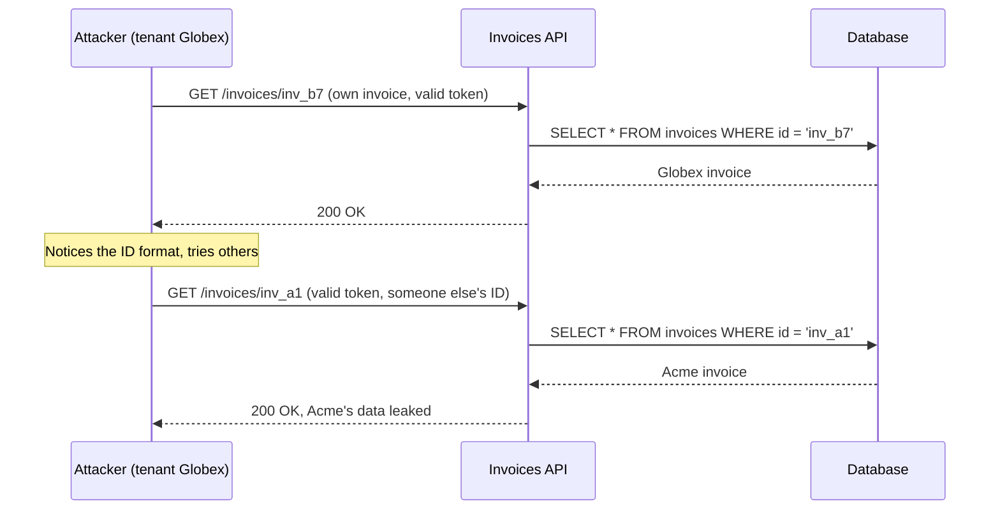
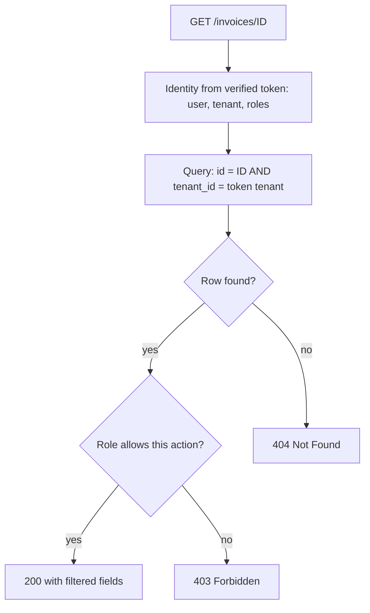

# Broken Object Level Authorization

## Introduction

**Broken Object Level Authorization (BOLA)** is number one on the [OWASP API Security Top 10](./1-sec-owasp-api-top-10.mdx). It happens when an API receives an object ID from the client, loads that object, and never checks whether the caller is allowed to access it.

You may know the same bug by its older web name, **IDOR** (Insecure Direct Object Reference), covered in [Broken Access Control](../3-sec-web-security/2-sec-broken-access-control.mdx). BOLA is the API-focused name, and APIs make it worse for three reasons:

- IDs appear everywhere: paths (`/invoices/inv_a1`), query strings (`?account=42`), JSON bodies (`{"document_id": 7}`) and headers.
- Responses are raw data, so a single successful request leaks the full object.
- APIs are built for scripts, so an attacker can try a million IDs as easily as one.

Picture a coat check. You hand over ticket 57 and get coat 57. A broken coat check hands out whatever coat matches the number on any ticket you show, even one you wrote yourself. Authentication is "you are a customer with a ticket". Object-level authorization is "this ticket is yours, and so is this coat".

The OWASP example scenarios are telling: an e-commerce API that let any shop owner pull revenue data for thousands of other shops by changing a shop name in the URL, and a connected-car API that let users unlock vehicles by sending someone else's VIN.

:::warning Only test what you own
Changing IDs in requests to a system you do not own is unauthorized access in many countries, even if the API "lets you". Practice on your own code, OWASP crAPI, OWASP Juice Shop, or the access control labs in PortSwigger Web Security Academy.
:::

## How a BOLA Attack Works



The token is valid. The request is well-formed. The query is parameterized, so there is no injection. Every security control the team thought about is working. The one missing question is: **does `inv_a1` belong to the caller?**

Attackers find object IDs by:

- Reading their own responses (IDs of their own objects reveal the format).
- Looking at related endpoints, for example a public list of shops or users.
- Watching mobile app traffic in a proxy such as Burp Suite (see [Web Testing with Burp Suite](../10-sec-offensive-security/4-sec-burp-suite.mdx)).
- Guessing sequential integers, or reusing IDs leaked in emails, URLs and logs.

## A Vulnerable API

This Flask app holds two tenants' invoices in an in-memory SQLite database. Hard-coded tokens stand in for real authentication.

```bash
python3 -m venv venv && source venv/bin/activate
pip install flask pytest
```

**Vulnerable:**

```python
# invoices_api.py  (Vulnerable: local lab only)
import sqlite3
from flask import Flask, jsonify, request, abort, g

app = Flask(__name__)
db = sqlite3.connect(":memory:", check_same_thread=False)
db.row_factory = sqlite3.Row
db.executescript("""
CREATE TABLE invoices (id TEXT PRIMARY KEY, tenant_id INTEGER, customer TEXT, amount REAL);
INSERT INTO invoices VALUES ('inv_a1', 1, 'Acme Ltd',   1200.0);
INSERT INTO invoices VALUES ('inv_b7', 2, 'Globex Inc',  980.0);
""")

# token -> (user id, tenant id, role)
TOKENS = {"acme-alice": (10, 1, "member"), "globex-gina": (20, 2, "member")}

@app.before_request
def authenticate():
    token = request.headers.get("Authorization", "").removeprefix("Bearer ")
    if token not in TOKENS:
        abort(401)
    g.user_id, g.tenant_id, g.role = TOKENS[token]

@app.get("/invoices/<invoice_id>")
def read_invoice(invoice_id):
    row = db.execute("SELECT id, customer, amount FROM invoices WHERE id = ?",
                     (invoice_id,)).fetchone()
    if row is None:
        abort(404)
    return jsonify(dict(row))

@app.delete("/invoices/<invoice_id>")
def delete_invoice(invoice_id):
    db.execute("DELETE FROM invoices WHERE id = ?", (invoice_id,))
    return "", 204
```

Gina from Globex reads Acme's invoice with her own valid token:

```python
# try_bola.py
from invoices_api import app

client = app.test_client()
r = client.get("/invoices/inv_a1", headers={"Authorization": "Bearer globex-gina"})
print(r.status_code, r.get_json())
```

Output:

```text
200 {'amount': 1200.0, 'customer': 'Acme Ltd', 'id': 'inv_a1'}
```

The `DELETE` route is even worse: she can destroy another tenant's data, and it returns `204` whether or not the invoice was hers.

## The Fix: Scope Every Lookup to the Caller

The most reliable fix is to make ownership part of the query itself, using identity that comes from the verified token, never from the request.

**Fixed:**

```python
# invoices_api.py  (Fixed)
def get_invoice_for_tenant(invoice_id: str, tenant_id: int):
    """Every lookup takes the tenant from the session, never from the request."""
    row = db.execute(
        "SELECT id, customer, amount FROM invoices WHERE id = ? AND tenant_id = ?",
        (invoice_id, tenant_id),
    ).fetchone()
    return dict(row) if row else None

@app.get("/invoices/<invoice_id>")
def read_invoice(invoice_id):
    invoice = get_invoice_for_tenant(invoice_id, g.tenant_id)
    if invoice is None:
        abort(404)   # same answer for "missing" and "not yours"
    return jsonify(invoice)

@app.delete("/invoices/<invoice_id>")
def delete_invoice(invoice_id):
    cur = db.execute("DELETE FROM invoices WHERE id = ? AND tenant_id = ?",
                     (invoice_id, g.tenant_id))
    if cur.rowcount == 0:
        abort(404)
    return "", 204
```

Three details matter:

1. **`tenant_id` comes from `g`**, which the authentication step filled from the token. If the tenant came from a header like `X-Tenant-Id` or a body field, the attacker would just change it too.
2. **The check is in the query**, not in a separate `if` after loading. A query that can only return the caller's rows cannot "forget" the check.
3. **`404` for both "not found" and "not yours".** Returning `403` for objects that exist but belong to someone else lets attackers enumerate which IDs exist. Use `403` when the caller can know the object exists but lacks the permission, for example a read-only member trying to delete a shared document.



## Beyond Ownership: Policy Functions

Real systems have more rules than "owner only". A document might be readable by its owner, by members of a shared folder, and by support staff during an open ticket. Scattering those rules across handlers leads to inconsistencies. Centralize them in one **policy function** per resource and action.

```python
# policies.py
from dataclasses import dataclass

@dataclass(frozen=True)
class Principal:
    user_id: int
    tenant_id: int
    roles: frozenset[str]

def can_access_invoice(p: Principal, invoice: dict, action: str) -> bool:
    if invoice["tenant_id"] != p.tenant_id:
        return False                                   # tenant isolation first, always
    if action == "read":
        return True                                    # any member of the tenant may read
    if action in {"update", "delete"}:
        return "billing_admin" in p.roles
    return False                                       # unknown action: deny by default

alice = Principal(10, 1, frozenset({"member"}))
boss = Principal(11, 1, frozenset({"member", "billing_admin"}))
gina = Principal(20, 2, frozenset({"billing_admin"}))
inv = {"id": "inv_a1", "tenant_id": 1}

for who, p in [("alice", alice), ("boss", boss), ("gina", gina)]:
    print(who, {a: can_access_invoice(p, inv, a) for a in ("read", "delete", "export")})
```

Output:

```text
alice {'read': True, 'delete': False, 'export': False}
boss {'read': True, 'delete': True, 'export': False}
gina {'read': False, 'delete': False, 'export': False}
```

The handler then loads the object (still tenant-scoped where possible) and calls the policy. As rules grow, teams move this logic into a policy engine such as Open Policy Agent, AWS Cedar, or a relationship-based system like OpenFGA. See [RBAC, ABAC and ReBAC](../4-sec-authentication/9-sec-rbac-abac.mdx).

## Defense in Depth: Row-Level Security

For multi-tenant systems on PostgreSQL, you can add a database-level safety net. With **row-level security (RLS)**, the database itself filters rows by tenant, so even a handler that forgets the `WHERE tenant_id = ?` clause cannot read other tenants' data.

```sql
ALTER TABLE invoices ENABLE ROW LEVEL SECURITY;

CREATE POLICY tenant_isolation ON invoices
    USING (tenant_id = current_setting('app.tenant_id')::int);

-- The application sets the tenant per request, in the same transaction:
-- SET LOCAL app.tenant_id = '1';
```

RLS does not apply to table owners or superusers by default, so connect as a separate, less privileged role. It is a backstop, not a replacement for application checks: the application still needs per-user and per-role rules that RLS policies would make complicated.

## Do Random IDs Fix BOLA?

Switching from `/invoices/1042` to `/invoices/7d3c1f5e-2a1b-4c8e-9f00-1b2c3d4e5f60` makes guessing much harder, and OWASP recommends random, unpredictable IDs. But it is **not a fix**:

- IDs leak through shared links, emails, browser history, logs, analytics and support tickets.
- Former employees and ex-collaborators still know old IDs.
- Other endpoints may list IDs, for example "recent activity" feeds.

Use UUIDs or random identifiers to reduce enumeration, **and** always check authorization. See [Randomness and Secure Tokens](../1-sec-cryptography/9-sec-randomness.mdx).

## BOLA Hides in Less Obvious Places

| Location | Example | What to check |
| --- | --- | --- |
| Nested routes | `/users/42/orders/7` | That order 7 belongs to user 42 **and** that user 42 is the caller |
| Request bodies | `POST /transfers {"from_account": 991}` | That the caller owns account 991 |
| Bulk endpoints | `POST /invoices/batch-get {"ids": [...]}` | Every ID in the list, not just the first |
| File downloads | `/files/download?key=reports/acme/q3.pdf` | That the storage key is under the caller's prefix |
| GraphQL | `node(id: "...")` or a mutation taking `documentId` | Authorization in every resolver. See [GraphQL Security](./5-sec-graphql-security.mdx) |
| Background jobs | Export job created with someone else's report ID | Check at enqueue time **and** at run time |
| Webhooks and callbacks | Partner sends `{"order_id": ...}` | That the order belongs to that partner |

## Test Authorization Like a Feature

BOLA slips through code review because the vulnerable code looks normal. Automated tests with **two users** catch it reliably.

```python
# test_invoices_authz.py
import pytest
from invoices_api import app

@pytest.fixture
def client():
    return app.test_client()

def auth(token):
    return {"Authorization": f"Bearer {token}"}

def test_owner_can_read(client):
    r = client.get("/invoices/inv_a1", headers=auth("acme-alice"))
    assert r.status_code == 200

@pytest.mark.parametrize("method", ["get", "delete"])
def test_other_tenant_gets_404(client, method):
    r = getattr(client, method)("/invoices/inv_a1", headers=auth("globex-gina"))
    assert r.status_code == 404

def test_no_token_gets_401(client):
    assert client.get("/invoices/inv_a1").status_code == 401
```

```bash
python -m pytest -v test_invoices_authz.py
```

Output (against the fixed version):

```text
test_invoices_authz.py::test_owner_can_read PASSED                       [ 25%]
test_invoices_authz.py::test_other_tenant_gets_404[get] PASSED           [ 50%]
test_invoices_authz.py::test_other_tenant_gets_404[delete] PASSED        [ 75%]
test_invoices_authz.py::test_no_token_gets_401 PASSED                    [100%]
```

Against the vulnerable version, both `test_other_tenant_gets_404` cases fail. OWASP's prevention advice includes exactly this: write authorization tests and do not deploy changes that make them fail.

:::tip Scale tests with a route matrix
For larger APIs, generate tests from a table of `(route, method, owner, other_user, expected_status)`. Some teams generate the table from the OpenAPI spec so that every new route with a path parameter must appear in the matrix, or CI fails.
:::

## Real-World Scenario

**Your team** runs a multi-tenant SaaS helpdesk. Customers (tenants) have agents who read tickets, and tickets have attachments. A security researcher reports through your disclosure program that `GET /api/attachments/{id}` returns any tenant's file to any logged-in agent. Attachment IDs are sequential integers.

### The response

1. **Contain:** deploy a hotfix that scopes the attachment lookup by tenant, joining through the ticket: `attachments.id = ? AND tickets.tenant_id = ?`.
2. **Investigate:** search access logs for agents fetching attachments whose tenant differs from theirs. Your logs need the tenant of both the caller and the object to answer this, which is a good reason to log both. See [Investigating with Logs](../12-sec-incident-response/3-sec-log-analysis.mdx).
3. **Fix the pattern:** grep for every handler that loads by ID. Introduce repository functions such as `get_attachment_for_tenant()` and a lint rule or code-review check that bans unscoped lookups in handlers.
4. **Add safety nets:** enable PostgreSQL RLS on tenant tables, move to random IDs for new objects, and add two-tenant authorization tests to CI.
5. **Thank the researcher** and follow your disclosure process. See [Ethics, Law and Responsible Disclosure](../0-sec-fundamentals/8-sec-ethics-and-law.mdx).

### Why this approach

The hotfix in code closes the hole with certainty. A WAF rule cannot do that, because it cannot know which tenant owns attachment 88123. RLS and random IDs reduce the impact of the next mistake, and tests stop regressions.

### When to use each control, and when not to

- **Scoped queries** always. They are cheap and the most reliable.
- **Policy functions or engines** when rules go beyond ownership (sharing, roles, delegation).
- **RLS** for multi-tenant relational databases where tenant isolation is critical. It is less useful when one service account must legitimately read across tenants, such as analytics jobs, which then need a separate role.
- **Random IDs** for new tables. Migrating existing integer IDs can be expensive, so weigh the benefit.

### Alternatives and trade-offs

| Approach | Pros | Cons | Best for |
| --- | --- | --- | --- |
| Ownership in query (`WHERE tenant_id = ?`) | Simple, fast, hard to bypass | Only covers ownership rules | Every API with user or tenant data |
| Policy function per resource | Central, testable, handles roles and sharing | Developers must remember to call it | Apps with moderate rule complexity |
| External policy engine (OPA, Cedar, OpenFGA) | Consistent across services, auditable policies | Extra infrastructure and latency; learning curve | Many services, complex sharing models |
| Database row-level security | Safety net even when code forgets | Database-specific; tricky with pooled connections | Multi-tenant SaaS on PostgreSQL |
| Random, unguessable IDs | Stops easy enumeration | Not access control; IDs leak | Defense in depth only |
| WAF or gateway rules | Fast to deploy | Cannot know ownership | Not a BOLA fix |

## Common Mistakes

1. **Taking the user or tenant from the request.** `X-User-Id`, `?tenant=`, or `{"owner_id": ...}` are attacker-controlled. Use the verified token.
2. **Checking the parent but not the child.** `/users/42/orders/7` checks that you are user 42 but loads order 7 without checking it belongs to user 42.
3. **Checking on read but not on write or delete.** Test every method.
4. **Load first, check later, and forget sometimes.** Put the check in the data access function so it cannot be skipped.
5. **Returning 403 for other people's objects.** It confirms the ID exists. Prefer 404 unless the caller is entitled to know.
6. **Trusting the front end.** Hiding a button does not stop a direct API call.
7. **No logs of denials.** A stream of 404s on object routes from one token is a classic BOLA scan pattern. Alert on it.

## Summary

- BOLA means an API acts on an object ID from the client without checking the caller's right to that object. It is the top API risk.
- Fix it by deriving identity from the verified token and scoping every lookup to that identity, preferably inside the query.
- Centralize complex rules in policy functions or a policy engine; add row-level security as a safety net.
- Random IDs help against enumeration but are not authorization.
- Two-user automated tests are the best way to stop BOLA from coming back.

## Further Learning

### Exercises

1. Run the vulnerable `invoices_api.py`, confirm the leak with `try_bola.py`, apply the fix, and run the pytest suite against both versions.
2. Add a `PATCH /invoices/<id>` route that only `billing_admin` users may call, using `can_access_invoice`. Extend the tests with a member and an admin from the same tenant.
3. Add a `POST /invoices/batch-get` route that accepts a list of IDs. Make sure one foreign ID in the list does not leak data. Decide whether to return partial results or fail the whole request, and justify your choice.
4. Solve the BOLA-related challenges in OWASP crAPI or the PortSwigger access control labs, and write the fix for each in your own words.

### Related pages

- [Broken Access Control](../3-sec-web-security/2-sec-broken-access-control.mdx)
- [Authentication vs Authorization](../4-sec-authentication/0-sec-authn-vs-authz.mdx)
- [Schema Validation for APIs](./4-sec-api-input-validation.mdx), for property-level authorization
- [GraphQL Security](./5-sec-graphql-security.mdx)
- [Security Code Review](../5-sec-secure-coding/7-sec-code-review-for-security.mdx)
