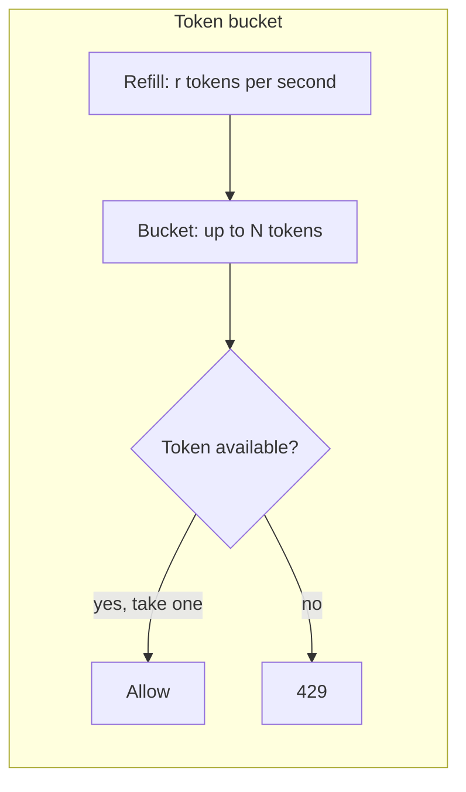
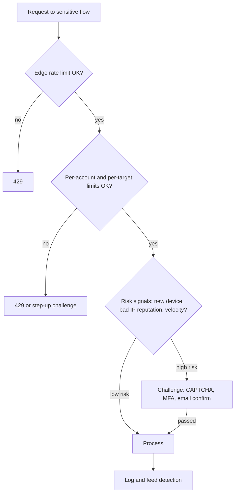

# Rate Limiting and Abuse Prevention

## Introduction

An API that answers any number of requests from anyone is an open invitation. Attackers use that to guess passwords (credential stuffing), brute-force six-digit OTP codes, scrape your catalog, overload expensive endpoints, or run up your bill by triggering thousands of paid SMS messages. OWASP lists this as **API4:2023 Unrestricted Resource Consumption**, and the business-flow version as **API6:2023 Unrestricted Access to Sensitive Business Flows** (see [OWASP API Security Top 10](./1-sec-owasp-api-top-10.mdx)).

**Rate limiting** caps how many requests a client can make in a period of time. **Abuse prevention** is the wider set of controls (quotas, lockouts, CAPTCHAs, cost caps, anomaly detection) that stop legitimate features from being used against you.

A good analogy is a theme park ride. The turnstile lets people through at a steady pace (rate limit), each ticket allows a fixed number of rides per day (quota), and a staff member stops the person who has ridden 40 times in a row and keeps cutting the line (abuse detection). The goal is not to stop people from riding. It is to keep the ride fair and running for everyone.

:::warning Only test what you own
Load-testing or brute-forcing someone else's API is illegal in many places and can take services offline. Test limits against your own local apps or a lab you control.
:::

## What You Are Protecting Against

| Threat | Example | Typical control |
| --- | --- | --- |
| Credential stuffing | Bots try leaked email and password pairs on `/login` | Per-IP and per-account limits, MFA, breached-password checks |
| OTP or code brute force | 1,000,000 guesses at a 6-digit code | Per-code attempt cap, short expiry |
| Scraping | Downloading the whole product or user directory | Per-key quotas, page-size caps, bot detection |
| Expensive endpoints | Report generation, search, AI calls | Cost-weighted limits, queues, timeouts |
| Cost attacks (SMS pumping) | Triggering verification SMS to premium numbers | Per-number and per-country limits, provider spend caps |
| Application-layer DoS | Many slow or heavy requests | Gateway limits, timeouts, autoscaling |
| Business-flow abuse | Bots buying all limited-edition stock | Per-account purchase limits, queueing, verification |

Network-level floods are a different problem, usually handled by your CDN or cloud provider. See [DDoS Attacks and Mitigation](../2-sec-network-security/7-sec-ddos.mdx).

## Choosing the Key: Limit *Whom*?

A rate limit counts requests **per key**. Choosing the key is the most important design decision.

| Key | Pros | Cons |
| --- | --- | --- |
| Client IP | Works before login | Many users can share one IP (offices, mobile carriers); attackers rotate IPs |
| API key or OAuth client | Matches your billing and plans | Only after authentication; stolen keys hit the victim's quota |
| User or account ID | Fair per person | Only after login; attackers create many accounts |
| Target account (for login) | Stops brute force on one victim regardless of IP | Attackers can lock out real users if you block hard |
| Phone number or email (for OTP, reset) | Stops message flooding to one target | Needs normalization (case, `+1` prefixes) |
| Global per endpoint | Protects a fragile backend | One noisy client can block everyone |

In practice you **combine** keys. A login endpoint might allow 5 attempts per minute per IP, 10 per hour per target account, and a global ceiling that alerts the on-call engineer.

## Rate Limiting Algorithms



| Algorithm | How it works | Pros | Cons |
| --- | --- | --- | --- |
| Fixed window | Count requests per clock window (e.g. per minute) | Simplest, cheap to store | Bursts at window edges: up to twice the limit across a boundary |
| Sliding window log | Store a timestamp per request, count those in the last N seconds | Exact | Memory grows with traffic |
| Sliding window counter | Weighted mix of current and previous window counts | Smooth, cheap | Approximate |
| Token bucket | Bucket refills at a steady rate; each request takes a token | Allows controlled bursts; very common | Two parameters to tune |
| Leaky bucket | Requests queue and drain at a fixed rate | Smooths traffic to backends | Adds latency; queue can fill |

Nginx's `limit_req` is a leaky-bucket design. Many gateways and libraries offer token bucket or sliding window variants.

### A token bucket in Python

This is the core idea behind many production limiters, in about 25 lines.

```python
# token_bucket.py
import time
from dataclasses import dataclass, field

@dataclass
class TokenBucket:
    capacity: float          # maximum burst size
    refill_rate: float       # tokens added per second
    tokens: float = field(init=False)
    updated: float = field(init=False)

    def __post_init__(self):
        self.tokens = self.capacity
        self.updated = time.monotonic()

    def allow(self, cost: float = 1.0) -> bool:
        now = time.monotonic()
        elapsed = now - self.updated
        self.tokens = min(self.capacity, self.tokens + elapsed * self.refill_rate)
        self.updated = now
        if self.tokens >= cost:
            self.tokens -= cost
            return True
        return False

buckets: dict[str, TokenBucket] = {}

def check(client_key: str) -> bool:
    bucket = buckets.setdefault(client_key, TokenBucket(capacity=5, refill_rate=1.0))
    return bucket.allow()

if __name__ == "__main__":
    results = [check("api-key-123") for _ in range(8)]
    print("burst:", ["ok" if r else "429" for r in results])
    time.sleep(2.1)
    print("after 2s:", ["ok" if check("api-key-123") else "429" for _ in range(3)])
    print("other client:", check("api-key-999"))
```

Output:

```text
burst: ['ok', 'ok', 'ok', 'ok', 'ok', '429', '429', '429']
after 2s: ['ok', 'ok', '429']
other client: True
```

The client gets a burst of 5, then is limited to about 1 request per second. The `cost` parameter lets an expensive endpoint (a PDF export, an AI call) consume more tokens than a cheap one.

:::caution In-memory limiters do not scale out
This dictionary lives in one process. With four Gunicorn workers on three servers, each client gets twelve separate buckets. Production limiters keep counters in a shared store such as Redis, with atomic operations (a Lua script or `INCR` with expiry) so concurrent requests cannot both take the last token. See the site's [Redis tutorial](/docs/middleware/redis).
:::

## Rate Limiting a Flask API with Flask-Limiter

[Flask-Limiter](https://flask-limiter.readthedocs.io/) (4.x at the time of writing, built on the `limits` library) handles storage, algorithms and headers for you.

```bash
pip install flask flask-limiter
# for production storage: pip install "flask-limiter[redis]"
```

```python
# app.py
from flask import Flask, jsonify, request
from flask_limiter import Limiter
from flask_limiter.util import get_remote_address

app = Flask(__name__)

API_KEYS = {"key-free-1": "free", "key-pro-1": "pro"}

def client_key() -> str:
    """Limit by API key when present, otherwise by client IP."""
    api_key = request.headers.get("X-API-Key")
    if api_key in API_KEYS:
        return f"key:{api_key}"
    return f"ip:{get_remote_address()}"

def plan_limit() -> str:
    plan = API_KEYS.get(request.headers.get("X-API-Key", ""), "anonymous")
    return {"anonymous": "10/minute", "free": "60/minute", "pro": "600/minute"}[plan]

limiter = Limiter(
    client_key,
    app=app,
    default_limits=["1000/hour"],
    storage_uri="memory://",        # use "redis://redis:6379" in production
    strategy="sliding-window-counter",
    headers_enabled=True,
)

@app.get("/v1/products")
@limiter.limit(plan_limit)
def products():
    return jsonify([{"id": 1, "name": "Keyboard"}])

@app.post("/v1/login")
@limiter.limit("5/minute;20/hour", key_func=get_remote_address)
def login():
    return jsonify({"ok": False, "error": "invalid credentials"}), 401

@app.errorhandler(429)
def too_many(e):
    return jsonify(error="rate_limited", detail=str(e.description)), 429

if __name__ == "__main__":
    c = app.test_client()
    for i in range(7):
        r = c.post("/v1/login", json={"user": "a", "password": "x"})
        print(i + 1, r.status_code, r.get_json())
    print({k: v for k, v in r.headers.items() if k.lower().startswith(("x-ratelimit", "retry"))})
```

Example output:

```text
1 401 {'error': 'invalid credentials', 'ok': False}
2 401 {'error': 'invalid credentials', 'ok': False}
3 401 {'error': 'invalid credentials', 'ok': False}
4 401 {'error': 'invalid credentials', 'ok': False}
5 401 {'error': 'invalid credentials', 'ok': False}
6 429 {'detail': '5 per 1 minute', 'error': 'rate_limited'}
7 429 {'detail': '5 per 1 minute', 'error': 'rate_limited'}
{'X-RateLimit-Limit': '5', 'X-RateLimit-Remaining': '0', 'X-RateLimit-Reset': '1791716401', 'Retry-After': '26'}
```

Key points:

- **The first argument is the key function.** Here it uses the API key if one is valid, otherwise the IP. The login route overrides it with a pure IP key.
- **`plan_limit` is a callable**, so each plan gets its own limit. An anonymous client gets 10 per minute; a free key gets 60.
- **Multiple limits** on one route (`"5/minute;20/hour"`) stop both fast bursts and slow, patient attacks.
- **`storage_uri="memory://"`** is for development only. The Flask-Limiter docs say to switch to a shared backend such as Redis in production.

### Getting the client IP right

Behind a load balancer or reverse proxy, `request.remote_addr` is the proxy's IP, so every client shares one bucket. The opposite mistake is worse: trusting `X-Forwarded-For` blindly lets attackers send a fake header and get a fresh bucket on every request.

```python
from werkzeug.middleware.proxy_fix import ProxyFix

# Trust exactly one proxy hop (your load balancer) for X-Forwarded-For
app.wsgi_app = ProxyFix(app.wsgi_app, x_for=1)
```

Set `x_for` to the number of proxies **you control** in front of the app. See the [Flask tutorial](/docs/framework/flask) for deployment basics.

## Telling Clients About Limits

When a client is limited, respond in a way that well-behaved clients can handle:

- Status **`429 Too Many Requests`**.
- A **`Retry-After`** header with seconds to wait.
- A short JSON error body without internal details.
- Optionally, headers that show the remaining quota.

Many APIs use the informal `X-RateLimit-Limit`, `X-RateLimit-Remaining` and `X-RateLimit-Reset` headers. The IETF HTTPAPI working group is standardizing **`RateLimit-Policy`** and **`RateLimit`** header fields in `draft-ietf-httpapi-ratelimit-headers`. As of 2026 it is still an Internet-Draft, and its header format has changed between versions, so check the [current draft](https://datatracker.ietf.org/doc/draft-ietf-httpapi-ratelimit-headers/) before adopting it.

:::tip Should you show remaining quota?
For paying API customers, yes: it helps them build good clients. For login or OTP endpoints, consider hiding it. Telling an attacker "3 attempts left before lockout" helps them pace the attack.
:::

## Rate Limiting at the Edge with nginx

It is cheaper to reject floods before they reach Python. Nginx's `limit_req` module does this with a shared-memory zone.

```nginx
http {
    # 10 MB zone keyed by client IP, average 10 requests per second
    limit_req_zone $binary_remote_addr zone=api_per_ip:10m rate=10r/s;
    # Stricter zone for authentication endpoints
    limit_req_zone $binary_remote_addr zone=auth_per_ip:10m rate=5r/m;
    limit_req_status 429;

    server {
        listen 443 ssl;
        server_name api.example.com;

        location /v1/ {
            limit_req zone=api_per_ip burst=20 nodelay;
            proxy_pass http://app:8000;
        }

        location = /v1/login {
            limit_req zone=auth_per_ip burst=3 nodelay;
            proxy_pass http://app:8000;
        }
    }
}
```

- `$binary_remote_addr` uses a compact binary form of the IP, so a 10 MB zone holds tens of thousands of clients.
- `burst=20` allows short spikes; `nodelay` serves the burst immediately instead of queueing it.
- The default rejection status is `503`. `limit_req_status 429` returns the correct code.

The site's [nginx tutorial](/docs/middleware/nginx) covers the rest of the configuration. Gateways like Kong offer the same feature with per-consumer keys; see [API Gateways and WAFs](./7-sec-api-gateway-security.mdx).

## Beyond Request Counts: Abuse Prevention

Rate limits count requests. Abuse prevention looks at **what** the requests do.



Useful techniques:

- **Attempt caps on secrets.** An OTP code should allow only a handful of attempts and then expire, no matter how many IPs the guesses come from.
- **Progressive delays instead of hard lockouts.** Hard lockouts after five failures let attackers lock real users out on purpose. Increasing delays, CAPTCHAs, or step-up verification are usually better. See [Secure Password Authentication](../4-sec-authentication/1-sec-password-authentication.mdx).
- **Cost-weighted limits.** Charge expensive operations more tokens, or put them on a queue with a per-tenant concurrency limit.
- **Quotas and spend caps.** Daily or monthly quotas per plan, plus spending limits or billing alerts at providers (SMS, email, AI APIs). OWASP's API4 guidance explicitly recommends spending limits with providers.
- **Business rules.** "Two tickets per verified account per event" is more effective than any request-rate rule against ticket bots.
- **Detection.** Log every 429 and every failed login with the key that was limited, and alert on unusual patterns. See [Detection Engineering](../11-sec-defensive-operations/2-sec-detection-engineering.mdx).

## Real-World Scenario

**Your team** runs a consumer app that verifies phone numbers by SMS during sign-up. One Monday, finance reports that SMS spend over the weekend was many times the normal level. Logs show hundreds of thousands of `POST /v1/verify/send` requests to phone numbers in a few countries where you have no customers, spread across thousands of IP addresses. This is **SMS pumping** (also called SMS toll fraud): attackers profit from messages sent to number ranges they control.

### The fix

1. **Immediately:** set a hard daily spend cap and per-country restrictions in the SMS provider console. Block countries you do not serve.
2. **Per-target limits:** at most 3 codes per phone number per hour and 5 per day, keyed on the normalized E.164 number.
3. **Per-session and per-device limits:** codes can only be requested from a sign-up session that passed earlier steps (email confirmed, CAPTCHA solved).
4. **Edge limit:** a modest per-IP limit at the gateway for the endpoint, mainly to slow simple scripts.
5. **Monitoring:** alert when hourly SMS volume to any country exceeds a baseline.

### Why this approach

Per-IP limits alone failed because the attack was distributed across thousands of IPs. Limits keyed on the **target** (phone number, country) and on the **flow** (a verified session) match how the abuse actually works. Provider-side spend caps protect the business even if application limits have a bug.

### When to use it, and when not to

Target-keyed limits fit any flow that sends something to an address: SMS, email, push notifications, password resets. They are less useful for read-only APIs where scraping is the risk; there, per-key quotas and page-size caps matter more. Avoid hard global limits on critical flows without alerting, because a single attacker can then block sign-ups for everyone.

### Alternatives and trade-offs

| Approach | Pros | Cons | Best for |
| --- | --- | --- | --- |
| Per-IP rate limit at gateway | Cheap, stops simple floods early | Bypassed by IP rotation; hurts shared IPs | First line for all endpoints |
| Per-user or per-key limits in app | Fair, matches plans | Needs authentication first | Authenticated APIs, paid tiers |
| Per-target limits (phone, email, account) | Stops distributed attacks on one target | Needs normalization; can be used to block victims | OTP, reset, login |
| CAPTCHA or proof-of-work | Raises cost for bots | Friction and accessibility issues; solver services exist | High-risk anonymous flows |
| Commercial bot management | Device and behavior signals | Cost; privacy review; vendor lock-in | Large consumer apps |
| Provider spend caps | Hard financial ceiling | Can block legitimate traffic when hit | Any paid third-party call |

## Common Mistakes

1. **Only per-IP limits.** Distributed attacks bypass them, and corporate NAT users get blocked unfairly.
2. **Trusting `X-Forwarded-For` from anyone.** Configure the exact number of trusted proxy hops.
3. **In-memory counters with many workers.** Use a shared store such as Redis.
4. **Same limit for every endpoint.** Login, OTP, search and export each need their own limits.
5. **Returning 200 with an error body or 503 instead of 429.** Clients and monitoring cannot tell what happened.
6. **Hard account lockout.** It turns brute-force protection into a denial-of-service tool against your users.
7. **No spending caps at providers.** Rate-limit bugs become very expensive without them.
8. **Never reviewing limits.** Set them from real traffic data, then revisit as usage grows.

## Summary

- Rate limiting caps requests per key over time. Abuse prevention looks at what requests do and what they cost.
- Pick keys deliberately: IP, API key, user, target account or phone number, and usually combine several.
- Token bucket and sliding windows are the common algorithms. Use a shared store in production.
- Return `429` with `Retry-After`. Watch the IETF `RateLimit` header draft for a standard format.
- Apply coarse limits at the edge (nginx, gateway) and business-aware limits in the application, plus provider spend caps.

## Further Learning

### Exercises

1. Extend `TokenBucket` with a `retry_after()` method that returns how many seconds until the next token, and use it to set a `Retry-After` header in a small Flask app.
2. Run the Flask-Limiter example with Redis in Docker (`docker run -p 6379:6379 redis`), switch `storage_uri`, and start two app processes. Confirm that the limit is shared.
3. Design limits for a password reset flow: which keys, which numbers, and what the user sees when limited. Write them as a table.
4. Configure the nginx example locally in front of a small app and use a loop with `curl` to observe `429` responses and the effect of `burst`.

### Related pages

- [OWASP API Security Top 10](./1-sec-owasp-api-top-10.mdx)
- [DDoS Attacks and Mitigation](../2-sec-network-security/7-sec-ddos.mdx)
- [Password Attacks and Defenses](../10-sec-offensive-security/7-sec-password-attacks.mdx)
- [API Gateways and WAFs](./7-sec-api-gateway-security.mdx)
- [GraphQL Security](./5-sec-graphql-security.mdx), where one HTTP request can hide many operations
