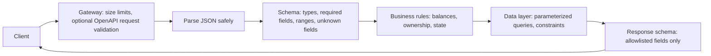

# Schema Validation for APIs

## Introduction

Every API request is a promise from the client: "here is a transfer with an amount, a currency and two accounts". Attackers break that promise on purpose. They send negative amounts, strings where you expect numbers, 50 MB bodies, extra fields like `"is_admin": true`, and nested objects 10,000 levels deep.

**Schema validation** means you describe exactly what a valid request looks like, in a machine-readable schema, and reject everything else before your business logic runs. It is the API version of a bouncer with a guest list: names on the list get in, everyone else is turned away, no matter how convincing their story.

Schemas help with several items on the [OWASP API Security Top 10](./1-sec-owasp-api-top-10.mdx):

- **API3 Broken Object Property Level Authorization**: rejecting unknown fields stops mass assignment, and response schemas stop excessive data exposure.
- **API4 Unrestricted Resource Consumption**: length, size and item-count limits bound the work per request.
- **API8 Security Misconfiguration** and **API10 Unsafe Consumption of APIs**: the same schemas validate data from partners.

General input validation and output encoding (for SQL, HTML and shell contexts) are covered in [Input Validation and Output Encoding](../5-sec-secure-coding/1-sec-input-validation.mdx). This page focuses on the **shape** of API payloads.

:::note Validation is not the whole defense
A perfectly valid request can still be malicious: `{"invoice_id": "inv_a1"}` is well-formed even when `inv_a1` belongs to someone else. Schema validation must be paired with [authorization](./2-sec-bola.mdx) and with safe handling downstream, such as parameterized SQL.
:::

## Where Validation Happens



Each stage catches different problems. Size limits stop huge bodies before parsing. The schema rejects malformed input. Business rules check things a schema cannot know, such as "does the account have enough money?". Database constraints are the last safety net. The response schema decides what leaves.

## The Contract: OpenAPI

Most HTTP APIs describe their endpoints with an **OpenAPI** document (formerly Swagger). OpenAPI 3.1 uses JSON Schema for request and response bodies, so one file can drive documentation, client generation, gateway validation and tests.

```yaml
# openapi.yaml (excerpt)
openapi: 3.1.0
info:
  title: Payments API
  version: 1.0.0
paths:
  /v1/transfers:
    post:
      requestBody:
        required: true
        content:
          application/json:
            schema:
              $ref: "#/components/schemas/CreateTransfer"
      responses:
        "201":
          description: Created
components:
  schemas:
    CreateTransfer:
      type: object
      additionalProperties: false
      required: [from_account, to_account, amount, currency]
      properties:
        from_account: { type: string, format: uuid }
        to_account: { type: string, format: uuid }
        amount: { type: string, pattern: "^[0-9]{1,8}(\\.[0-9]{1,2})?$" }
        currency: { type: string, enum: [USD, EUR, GBP] }
        memo: { type: string, maxLength: 140 }
```

The important security properties:

- `additionalProperties: false` rejects fields you did not declare.
- `required`, `enum`, `maxLength` and `pattern` constrain each value.
- Money is a decimal string, not a float, to avoid rounding issues.

You can write this file by hand (**design-first**) or generate it from code (**code-first**, as FastAPI does). Either way, keep it in version control and review changes to it like code.

## Validating in Python with Pydantic and FastAPI

[Pydantic](https://docs.pydantic.dev/) models are the most common way to validate JSON in Python. FastAPI uses them automatically and generates the OpenAPI document from them.

```bash
pip install fastapi httpx
```

**Vulnerable:**

```python
# transfers_vuln.py  (Vulnerable)
from fastapi import FastAPI, Request

app = FastAPI()

@app.post("/v1/transfers")
async def create_transfer(request: Request):
    body = await request.json()                       # any shape, any size, any types
    amount = float(body["amount"])                   # "-5", "1e308", "nan" all accepted
    record = {**body, "status": "pending", "internal_risk_score": 0.82}
    return record                                     # echoes extra fields and internal data
```

This handler accepts negative and non-numeric amounts (`float("nan")` works), copies every unknown client field (such as `"owner_id"` or `"approved_by"`) into the stored record, and returns an internal risk score to the caller. If someone later moves the `**body` spread to the end of the dict, the client can even overwrite `status`.

**Fixed:**

```python
# transfers_api.py  (Fixed)
from decimal import Decimal
from typing import Annotated, Literal
from uuid import UUID

from fastapi import FastAPI
from pydantic import BaseModel, ConfigDict, Field, StrictBool

class CreateTransfer(BaseModel):
    model_config = ConfigDict(extra="forbid")      # unknown fields are an error

    from_account: UUID
    to_account: UUID
    amount: Annotated[Decimal, Field(gt=0, le=10_000, max_digits=12, decimal_places=2)]
    currency: Literal["USD", "EUR", "GBP"]
    express: StrictBool = False                     # "yes" or 1 is rejected, only true/false
    memo: Annotated[str, Field(max_length=140, pattern=r"^[\w .,'-]*$")] = ""

class TransferOut(BaseModel):
    id: UUID
    status: Literal["pending", "completed"]
    amount: Decimal
    currency: str

app = FastAPI()

@app.post("/v1/transfers", response_model=TransferOut, status_code=201)
def create_transfer(body: CreateTransfer):
    record = {
        "id": "7d3c1f5e-2a1b-4c8e-9f00-1b2c3d4e5f60",
        "status": "pending",
        "amount": body.amount,
        "currency": body.currency,
        "internal_risk_score": 0.82,    # never leaves the server: not in TransferOut
    }
    return record
```

Try it with the test client:

```python
# try_transfers.py
from fastapi.testclient import TestClient
from transfers_api import app

client = TestClient(app)
good = {
    "from_account": "0b6f2c1e-1111-4a2b-8c3d-000000000001",
    "to_account": "0b6f2c1e-1111-4a2b-8c3d-000000000002",
    "amount": "25.50",
    "currency": "USD",
}
r = client.post("/v1/transfers", json=good)
print(r.status_code, r.json())

for bad in [dict(good, amount="-5", currency="BTC", is_admin=True),
            dict(good, express="yes", memo="<script>")]:
    r = client.post("/v1/transfers", json=bad)
    print(r.status_code, [(e["type"], e["loc"][-1]) for e in r.json()["detail"]])
```

Output:

```text
201 {'id': '7d3c1f5e-2a1b-4c8e-9f00-1b2c3d4e5f60', 'status': 'pending', 'amount': '25.50', 'currency': 'USD'}
422 [('greater_than', 'amount'), ('literal_error', 'currency'), ('extra_forbidden', 'is_admin')]
422 [('bool_type', 'express'), ('string_pattern_mismatch', 'memo')]
```

What each piece does:

| Feature | Blocks |
| --- | --- |
| `extra="forbid"` | Mass assignment (`is_admin`, `status`, `owner_id`) |
| `UUID` type | Path traversal or SQL fragments in ID fields |
| `Decimal` with `gt`, `le`, `decimal_places` | Negative, huge, `NaN` or over-precise amounts |
| `Literal[...]` | Unexpected enum values |
| `StrictBool` | Type confusion such as `"yes"`, `"false"` or `1` being treated as true |
| `max_length` and `pattern` | Oversized strings and unexpected characters |
| `response_model=TransferOut` | Leaking internal fields in responses |

:::caution Strict mode and JSON
Pydantic has a `strict=True` model setting that disables all type coercion. Be careful applying it to a whole FastAPI model: JSON has no UUID or Decimal type, so strict mode rejects the string `"0b6f2c1e-..."` for a `UUID` field. Use strict types per field (`StrictBool`, `StrictInt`, `StrictStr`) where coercion is risky, as above. Check the [Pydantic strict mode docs](https://docs.pydantic.dev/latest/concepts/strict_mode/) for the current rules.
:::

## Validating with JSON Schema Directly

Not every service uses Pydantic. If you have an OpenAPI or JSON Schema document, the `jsonschema` library can validate payloads against it in any Python framework.

```python
# validate_jsonschema.py
from jsonschema import Draft202012Validator

SIGNUP_SCHEMA = {
    "$schema": "https://json-schema.org/draft/2020-12/schema",
    "type": "object",
    "additionalProperties": False,
    "required": ["email", "display_name"],
    "properties": {
        "email": {"type": "string", "maxLength": 254, "format": "email"},
        "display_name": {"type": "string", "minLength": 1, "maxLength": 50},
        "tags": {"type": "array", "maxItems": 10,
                 "items": {"type": "string", "maxLength": 20}},
    },
}
validator = Draft202012Validator(SIGNUP_SCHEMA)

payload = {"email": "a@example.com", "display_name": "", "tags": ["x"] * 11, "role": "admin"}
for err in sorted(validator.iter_errors(payload), key=lambda e: e.path):
    print(list(err.path), "->", err.message[:70])
```

Output:

```text
[] -> Additional properties are not allowed ('role' was unexpected)
['display_name'] -> '' should be non-empty
['tags'] -> ['x', 'x', 'x', 'x', 'x', 'x', 'x', 'x', 'x', 'x', 'x'] is too long
```

Two things to know about `jsonschema`:

- `iter_errors` reports **all** problems, which is handy for client error messages. Keep error messages short and do not echo large inputs back.
- **`format` is not enforced by default** in JSON Schema 2020-12. `"format": "email"` above is only an annotation unless you pass a `format_checker` (for example `Draft202012Validator(schema, format_checker=Draft202012Validator.FORMAT_CHECKER)`). Read the [jsonschema format docs](https://python-jsonschema.readthedocs.io/en/stable/validate/#validating-formats) before relying on it.

## Limit Sizes Before Parsing

A schema with `maxLength: 140` does not help if the server first reads a 2 GB body into memory to parse it. Limit the body size before parsing, at the gateway and in the app.

```python
# size_limit.py
from flask import Flask, request, jsonify

app = Flask(__name__)
app.config["MAX_CONTENT_LENGTH"] = 64 * 1024   # 64 KiB for the whole request body

@app.post("/v1/notes")
def notes():
    data = request.get_json()
    return jsonify(ok=True, keys=len(data))

client = app.test_client()
print(client.post("/v1/notes", json={"text": "x" * 100}).status_code)
print(client.post("/v1/notes", json={"text": "x" * 70_000}).status_code)
```

Output:

```text
200
413
```

Status `413` (Content Too Large) is returned before your handler runs. In nginx the equivalent is `client_max_body_size 64k;`. Also cap arrays (`maxItems`), nesting depth and the number of properties. Deeply nested JSON can exhaust the stack or CPU of some parsers.

## Tricky Inputs Schemas Should Handle

| Input trick | Example | Defense |
| --- | --- | --- |
| Type confusion | `"quantity": "1"` vs `1`, `"admin": "false"` (a truthy string) | Strict types for booleans and integers |
| Huge numbers | `"amount": 1e308`, `"page": 99999999999999999999` | `le` / `maximum` bounds on every number |
| Special floats | `NaN`, `Infinity` | Use `Decimal` with bounds, or reject non-finite floats |
| Duplicate keys | `{"role": "user", "role": "admin"}` | Many parsers keep the last value; gateway and app may disagree. Reject duplicates if parsers differ |
| Unknown fields | `"is_admin": true` | `extra="forbid"` / `additionalProperties: false` |
| Unicode tricks | Look-alike characters, invisible characters, different normalization forms | Normalize (NFKC) identifiers like usernames before comparing; restrict character sets |
| Null where unexpected | `"email": null` | Mark fields required and non-nullable explicitly |
| Oversized arrays | `"ids": [1, 2, ... 1000000]` | `maxItems` |
| Content-type confusion | Form data or XML sent to a JSON endpoint | Accept only `application/json`; return `415` otherwise |

## Validate Responses and Partner Data Too

Validation is not only for what clients send you.

- **Responses:** a response model (FastAPI `response_model`, or a serializer class) is an allowlist of fields that may leave. It prevents the next database column from leaking automatically.
- **Third-party APIs and webhooks:** parse partner responses into models with limits, exactly as you would user input. A compromised or buggy partner should not be able to inject 10 MB strings or SQL into your system. See [Webhook Security](./6-sec-webhook-security.mdx).

```python
from pydantic import BaseModel, ConfigDict, Field

class GeoResponse(BaseModel):
    model_config = ConfigDict(extra="ignore")      # partners add fields; ignore, do not fail
    country: str = Field(min_length=2, max_length=2)
    city: str = Field(max_length=100)

data = GeoResponse.model_validate({"country": "DE", "city": "Berlin", "isp": "ExampleNet"})
print(data)
```

Output:

```text
country='DE' city='Berlin'
```

Note the different choice: `extra="forbid"` for **your** API's inputs (clients must follow your contract), `extra="ignore"` for **partner** data (partners may add fields without warning, and you only keep what you know).

## Real-World Scenario

**Your company** exposes a partner API that lets resellers create customer orders. A reseller's integration bug sent `"unit_price": -20` and the order went through with a refund-like negative total. A week later, a security review found that the `POST /orders` handler also accepted `"discount_pct"`, which was meant only for internal staff tools. Management asks: should we add validation at the API gateway, in the code, or both?

### The solution

1. **In code (required):** define Pydantic request models for every endpoint with `extra="forbid"`, bounds on all numbers, and enums for statuses. Remove `discount_pct` from the partner model entirely. Staff tools get a separate model and endpoint with function-level authorization.
2. **Business rules in code:** compute prices on the server from the catalog. The client sends product IDs and quantities, never prices.
3. **Generate the OpenAPI spec** from the models and publish it to partners, so they see the exact contract.
4. **At the gateway (optional, recommended):** enforce body size limits and content type, and enable OpenAPI request validation if your gateway supports it, to reject junk early and protect older services that lack models.
5. **Contract tests in CI:** send invalid payloads from a list (negative numbers, extra fields, wrong types) and expect `422`.

### Why this approach

The root cause was trusting client data, and only the application knows that `unit_price` should never come from a client. Gateway validation is a useful early filter and a good way to give legacy services a baseline, but it can drift from the code if the spec is not generated from the same source.

### When to use gateway validation, and when not to

Use it when you have many services in different languages, or legacy services you cannot change quickly. Skip it, or keep it to size and content-type checks, when the spec changes often and you cannot keep the gateway in sync, because a stale gateway schema will reject legitimate new fields.

### Alternatives and trade-offs

| Approach | Pros | Cons | Best for |
| --- | --- | --- | --- |
| Schema models in code (Pydantic, Zod, Bean Validation) | Precise, close to logic, testable | Each service must do it | Every API |
| OpenAPI validation at gateway | Central, language-agnostic, rejects early | Can drift from code; limited business logic | Many services, legacy backends |
| Hand-written `if` checks | No dependencies | Easy to miss fields; inconsistent | Tiny scripts only |
| WAF signatures | Catches known attack strings | Does not understand your schema; false positives | Extra layer, not a substitute |
| Database constraints (`CHECK amount > 0`) | Last line of defense, always enforced | Errors arrive late and are less friendly | Critical invariants |

## Common Mistakes

1. **Allowing unknown fields.** The default in many frameworks is to ignore or keep extras. For your own inputs, forbid them.
2. **Validating only on the client.** Front-end validation is a usability feature, not a security control.
3. **Floats for money.** Use decimal strings or integer minor units (cents).
4. **No upper bounds.** Every string, number, and array needs a maximum.
5. **Echoing raw input in error messages.** Large inputs in errors can leak data into logs or cause reflected XSS in tools that render them.
6. **Trusting partner data.** Validate third-party responses like user input.
7. **A schema that drifts from code.** Generate the OpenAPI document from code, or generate code from the document, and check it in CI.

## Summary

- Describe valid requests in a schema and reject everything else before business logic runs.
- Forbid unknown fields to stop mass assignment, bound every value, and use strict types where coercion is risky.
- Limit body size before parsing, at the gateway and in the app.
- Use response schemas to control what leaves, and validate partner data too.
- Schema validation complements, but does not replace, authorization and safe downstream handling.

## Further Learning

### Exercises

1. Add a `quantity: int` field to `CreateTransfer` that must be between 1 and 100 and must reject the string `"5"`. Which Pydantic type do you need?
2. Write a pytest test that posts ten malicious payloads (negative amount, `NaN`, extra field, 10,000-character memo, nested object for `currency`) and asserts that each returns `422`.
3. Take the `SIGNUP_SCHEMA` example, enable the format checker, and verify that `"email": "not-an-email"` is now rejected.
4. Export the OpenAPI document from the FastAPI app (`/openapi.json`) and check whether `additionalProperties: false` appears for the request model.

### Related pages

- [Input Validation and Output Encoding](../5-sec-secure-coding/1-sec-input-validation.mdx)
- [Broken Access Control](../3-sec-web-security/2-sec-broken-access-control.mdx), for mass assignment
- [Insecure Deserialization](../3-sec-web-security/8-sec-insecure-deserialization.mdx)
- [GraphQL Security](./5-sec-graphql-security.mdx)
- The site's [FastAPI tutorial](/docs/framework/fastapi)
