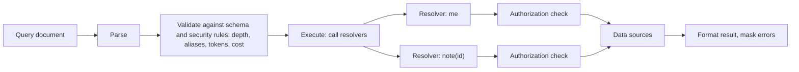
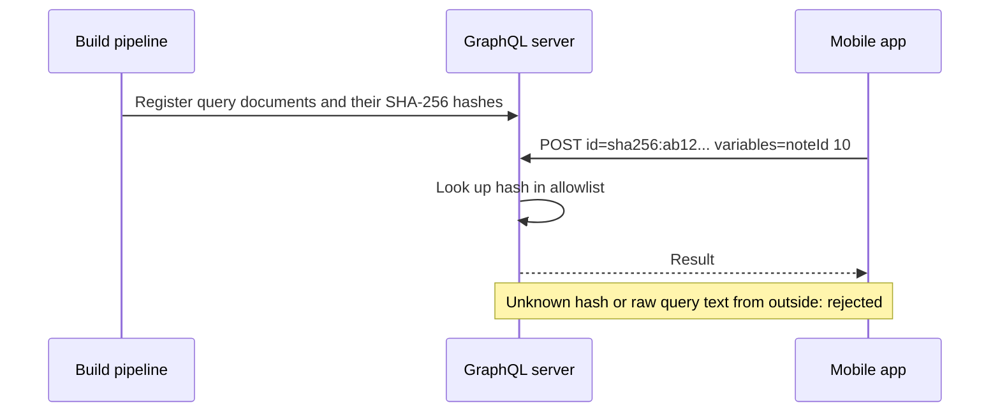

# GraphQL Security

## Introduction

**GraphQL** lets clients ask for exactly the data they need in one request. Instead of calling `/users/1`, then `/users/1/friends`, then `/posts?author=2`, a client sends one query to a single `/graphql` endpoint and gets back a JSON document shaped like the query.

That flexibility is the reason front-end teams love GraphQL, and it is also the reason it needs extra security thinking. In REST, the **server** decides the shape and cost of each endpoint. In GraphQL, the **client** writes the query. An attacker can write a query that is ten levels deep, repeats an expensive field 500 times with aliases, or walks from a public object to private ones through relationships you forgot to protect.

Think of a REST API as a restaurant with a fixed menu, and GraphQL as a kitchen that will cook whatever combination of ingredients you write on the order slip. That is great for customers, but the kitchen now needs rules about how big an order can be and which ingredients each customer may order.

All the other API risks still apply. GraphQL mainly changes **where** you put the controls. This page covers the GraphQL-specific ones, following the [OWASP GraphQL Cheat Sheet](https://cheatsheetseries.owasp.org/cheatsheets/GraphQL_Cheat_Sheet.html).

:::warning Only test what you own
Run the examples here locally. To practice GraphQL attacks, use deliberately vulnerable apps such as the Damn Vulnerable GraphQL Application (DVGA) or the GraphQL labs in PortSwigger Web Security Academy. Do not send heavy or probing queries to public GraphQL APIs you do not own.
:::

## How GraphQL Changes the Attack Surface

| Concern | REST | GraphQL |
| --- | --- | --- |
| Endpoints | Many, each with fixed behavior | Usually one (`/graphql`); behavior depends on the query |
| Response shape | Fixed by server | Chosen by client |
| Cost per request | Roughly predictable per endpoint | Varies hugely with depth, aliases and list sizes |
| Rate limiting | Per endpoint per request | One HTTP request can contain hundreds of operations |
| Schema discovery | Docs or guessing | Introspection can return the full schema |
| Authorization | Per route | Per type and per field, in resolvers |
| WAF inspection | URL and parameters | Everything is in a JSON body; harder for generic rules |



Two places matter most: the **validation** phase, where you reject abusive query shapes before any resolver runs, and the **resolvers**, where authorization must happen for every object.

## Threat 1: Deep and Expensive Queries

If `User` has `friends: [User]`, a client can nest the relationship as deep as it likes:

```graphql
query Deep {
  me {
    friends {
      friends {
        friends {
          friends {
            friends { name }
          }
        }
      }
    }
  }
}
```

With 100 friends per user, five levels means up to 100 to the power of 5, ten billion, user lookups. One request can take down the server. This is OWASP **API4 Unrestricted Resource Consumption**.

Defenses, from simplest to strongest:

1. **Depth limit:** reject queries nested deeper than N levels.
2. **Pagination caps:** every list field takes `first` or `limit` arguments with a server-enforced maximum.
3. **Cost analysis:** assign a cost to fields (more for lists and expensive resolvers) and reject queries above a budget. Depth alone misses wide queries that are shallow but request many fields.
4. **Timeouts:** cap execution time per request.
5. **Persisted queries:** only allow pre-approved queries (covered below).

## Threat 2: Alias and Batch Attacks

GraphQL **aliases** let one query call the same field many times with different arguments:

```graphql
mutation Guess {
  a0: verifyOtp(code: "000000") { ok }
  a1: verifyOtp(code: "000001") { ok }
  a2: verifyOtp(code: "000002") { ok }
}
```

Imagine a thousand of those in one HTTP request. A rate limiter that counts HTTP requests sees **one** request. Some servers also accept **batched** requests (a JSON array of operations), which has the same effect.

Defenses:

- Limit the number of aliases per document.
- Disable array batching unless you need it, or count each operation against rate limits.
- Rate limit **inside** sensitive resolvers (per account or per code), not just per HTTP request. See [Rate Limiting and Abuse Prevention](./3-sec-rate-limiting.mdx).

## Threat 3: Introspection and Field Suggestions

Introspection queries (`__schema`, `__type`) return the full schema: every type, field and argument, including the admin mutations you hoped nobody would find. Even with introspection off, many servers answer typos with "Did you mean `deleteAllUsers`?", which leaks field names one guess at a time.

Defenses:

- Disable introspection in production, or allow it only for authenticated internal users.
- Disable field suggestions in error messages.
- Remember that hiding the schema is **obscurity, not security**. Mobile apps and web bundles contain your queries. Every field must still be authorized.

## Threat 4: Authorization Gaps in Resolvers

GraphQL APIs often authenticate the request once, then let resolvers fetch whatever the query asks for. This creates classic [BOLA](./2-sec-bola.mdx) and BFLA bugs in new places:

- A top-level `note(id:)` resolver that loads any note by ID.
- A generic `node(id:)` resolver (common in Relay-style schemas) that returns any object type by global ID.
- A relationship such as `invoice { customer { paymentMethods } }` where the nested resolver assumes "if you got here, you must be allowed".
- Mutations such as `deleteDocument(id:)` that check login but not ownership. OWASP's API1 page uses exactly this example.

**Rule:** authorization belongs in the resolver (or the data-access layer it calls) for **every** object and sensitive field, never only at the HTTP layer.

## Building a Hardened Server with Strawberry (Python)

[Strawberry](https://strawberry.rocks/) is a popular Python GraphQL library. It ships schema extensions for most of the controls above.

```bash
pip install strawberry-graphql
```

```python
# schema.py
import strawberry
from strawberry.extensions import (
    DisableIntrospection, MaskErrors, MaxAliasesLimiter, MaxTokensLimiter, QueryDepthLimiter,
)
from strawberry.types import Info
from graphql import GraphQLError

USERS = {1: {"id": 1, "name": "alice", "friend_ids": [2]},
         2: {"id": 2, "name": "bob", "friend_ids": [1]}}
NOTES = {10: {"id": 10, "owner_id": 1, "text": "alice's private note"},
         11: {"id": 11, "owner_id": 2, "text": "bob's private note"}}

@strawberry.type
class Note:
    id: int
    text: str

@strawberry.type
class User:
    id: int
    name: str
    friend_ids: strawberry.Private[list[int]]     # not exposed in the schema

    @strawberry.field
    def friends(self) -> list["User"]:
        return [User(**USERS[i]) for i in self.friend_ids]

def current_user_id(info: Info) -> int:
    return info.context["user_id"]               # set from a verified token by the web layer

@strawberry.type
class Query:
    @strawberry.field
    def me(self, info: Info) -> User:
        return User(**USERS[current_user_id(info)])

    @strawberry.field
    def note(self, info: Info, id: int) -> Note | None:
        if id == 99:
            raise RuntimeError("db password=hunter2 connection failed")   # simulate a crash
        note = NOTES.get(id)
        # Authorization lives in the resolver, next to the data access
        if note is None or note["owner_id"] != current_user_id(info):
            return None
        return Note(id=note["id"], text=note["text"])

def should_mask(error: GraphQLError) -> bool:
    # Mask unexpected exceptions from resolvers; keep validation messages readable
    return error.original_error is not None

schema = strawberry.Schema(
    query=Query,
    extensions=[
        QueryDepthLimiter(max_depth=5),
        MaxAliasesLimiter(max_alias_count=10),
        MaxTokensLimiter(max_token_count=1000),
        DisableIntrospection(),
        MaskErrors(should_mask_error=should_mask),
    ],
)
```

Now send it some hostile queries:

```python
# try_schema.py
from schema import schema

ctx = {"user_id": 1}   # pretend Alice is logged in

def run(label, query):
    result = schema.execute_sync(query, context_value=ctx)
    print(label, "->", result.data, [e.message for e in (result.errors or [])])

run("own note", "{ note(id: 10) { text } }")
run("other note", "{ note(id: 11) { text } }")
run("deep", "{ me { friends { friends { friends { friends { friends { name } } } } } } }")
aliases = " ".join(f"a{i}: note(id: 11) {{ id }}" for i in range(50))
run("aliases", "{ " + aliases + " }")
run("introspection", "{ __schema { types { name } } }")
run("crash", "{ note(id: 99) { text } }")
```

Output (Strawberry also logs the errors to stderr; that is omitted here):

```text
own note -> {'note': {'text': "alice's private note"}} []
other note -> {'note': None} []
deep -> None ["'anonymous' exceeds maximum operation depth of 5"]
aliases -> None ['50 aliases found. Allowed: 10']
introspection -> None ["GraphQL introspection has been disabled, but the requested query contained the field '__schema'.", "GraphQL introspection has been disabled, but the requested query contained the field 'types'."]
crash -> {'note': None} ['Unexpected error.']
```

What each control did:

| Control | Effect in the output |
| --- | --- |
| Ownership check in `note` resolver | Bob's note returns `null`, same as a missing note |
| `QueryDepthLimiter(max_depth=5)` | Six-level query rejected before any resolver ran |
| `MaxAliasesLimiter(max_alias_count=10)` | 50-alias batch rejected |
| `MaxTokensLimiter` | Caps the size of the query document itself |
| `DisableIntrospection()` | `__schema` query rejected |
| `MaskErrors(...)` | The crash message containing a secret became `Unexpected error.` |

Strawberry has no built-in cost analysis extension at the time of writing. For cost limits, add a custom validation rule with `AddValidationRules`, or use a library. Check the [Strawberry extensions docs](https://strawberry.rocks/docs/extensions) for the current list.

:::tip Choose limits from real traffic
Log the depth, alias count and token count of the queries your real clients send for a week, then set limits a little above the maximum. Limits that are too tight break the app; limits that are too loose do nothing.
:::

## Hardening Apollo Server (Node.js)

Many GraphQL APIs run on Apollo Server. Here are the security-relevant options in Apollo Server 4 and 5, plus the open-source **GraphQL Armor** plugin set from Escape for depth, cost, alias, directive and token limits.

```bash
npm install @apollo/server graphql @escape.tech/graphql-armor
```

```javascript
// server.mjs
import { ApolloServer } from "@apollo/server";
import { startStandaloneServer } from "@apollo/server/standalone";
import { ApolloArmor } from "@escape.tech/graphql-armor";

const typeDefs = `#graphql
  type Note { id: ID!, text: String! }
  type Query { note(id: ID!): Note }
`;

const NOTES = { "10": { id: "10", ownerId: "1", text: "alice's note" } };

const resolvers = {
  Query: {
    note: (_parent, { id }, ctx) => {
      const note = NOTES[id];
      if (!note || note.ownerId !== ctx.userId) return null;   // object-level check
      return note;
    },
  },
};

const armor = new ApolloArmor();          // default limits for depth, cost, aliases and more
const protection = armor.protect();

const server = new ApolloServer({
  typeDefs,
  resolvers,
  ...protection,
  introspection: false,                    // explicit, rather than relying on NODE_ENV
  hideSchemaDetailsFromClientErrors: true, // no "Did you mean ...?" hints
  includeStacktraceInErrorResponses: false,
  // csrfPrevention is on by default in Apollo Server 4 and later; keep it on
});

const { url } = await startStandaloneServer(server, {
  context: async ({ req }) => ({ userId: verifyToken(req.headers.authorization) }),
  listen: { port: 4000 },
});
console.log(`GraphQL ready at ${url}`);

function verifyToken(header) {
  // Stand-in: replace with real JWT or session validation
  return header === "Bearer alice-token" ? "1" : null;
}
```

Run it with `node server.mjs`, then try an allowed query, an introspection query and a typo:

```bash
curl -s -X POST localhost:4000 -H 'content-type: application/json' \
  -H 'Authorization: Bearer alice-token' -d '{"query":"{ note(id: \"10\") { text } }"}'
curl -s -X POST localhost:4000 -H 'content-type: application/json' \
  -d '{"query":"{ __schema { types { name } } }"}'
curl -s -X POST localhost:4000 -H 'content-type: application/json' \
  -d '{"query":"{ notee(id: \"10\") { text } }"}'
```

Example output (tested with Apollo Server 5; long messages shortened):

```text
{"data":{"note":{"text":"alice's note"}}}
{"errors":[{"message":"GraphQL introspection is not allowed by Apollo Server, but the query contained __schema or __type. ...","extensions":{"validationErrorCode":"INTROSPECTION_DISABLED", ...}}]}
{"errors":[{"message":"Cannot query field \"notee\" on type \"Query\".", ...,"extensions":{"code":"GRAPHQL_VALIDATION_FAILED"}}]}
```

The typo error does not end with a "Did you mean `note`?" hint. In this setup two layers suppress it: `hideSchemaDetailsFromClientErrors`, and GraphQL Armor's block-field-suggestions plugin (with only the plugin, the message ends in `[Suggestion hidden]?`). Belt and braces is fine here.

Notes, based on the Apollo Server API reference:

- `introspection` defaults to `true` unless `NODE_ENV` is `production`. Set it explicitly so a missing environment variable does not expose your schema.
- `hideSchemaDetailsFromClientErrors` defaults to `false`; Apollo recommends enabling it in production.
- `csrfPrevention` is enabled by default. It blocks "simple" cross-site requests that a browser could send without a preflight. Do not disable it unless you understand the consequences. See [CSRF](../3-sec-web-security/5-sec-csrf.mdx).

Default values and plugin options in GraphQL Armor can change between releases; check the [GraphQL Armor docs](https://escape.tech/graphql-armor/docs/) for the current configuration.

## The Strongest Control: Persisted Queries (Trusted Documents)

If your GraphQL API serves only your own apps, you can go further than limits. At build time, extract every query your apps use, store them on the server by hash, and have clients send only the hash. The server **refuses any query it has not seen before**.



This removes almost all query-shape attacks, because attackers cannot write new queries. It does **not** remove the need for authorization: an attacker can still call an allowed query with someone else's ID in the variables.

Terminology varies. Apollo calls this "persisted queries" with a safelist. Other tools call it "trusted documents". Do not confuse it with **Automatic Persisted Queries (APQ)**, which is a caching feature that lets clients register any query at runtime and so gives no security on its own.

## Other GraphQL Pitfalls

- **GET requests and CSRF.** If your server accepts queries over GET or with form content types, browsers can trigger them cross-site. Allow only POST with `application/json` for mutations, and keep CSRF protections on.
- **N+1 queries.** A query listing 100 users with their posts can make 101 database calls. Use DataLoader-style batching. It is a performance issue that becomes a DoS issue.
- **Verbose errors.** Stack traces and database errors in the `errors` array leak internals. Mask them, and log details server-side with a request ID.
- **Input types.** GraphQL validates types, but not business rules. Add length limits and ranges to input arguments, using custom scalars or validation in resolvers. See [Schema Validation for APIs](./4-sec-api-input-validation.mdx).
- **Federation and gateways.** In federated setups, subgraphs must not trust that the router already did authorization. Each subgraph checks access to its own data.

## Real-World Scenario

**Your team** runs a GraphQL API for a marketplace. It powers your own web and mobile apps and is reachable from the internet. Last month, an attacker used a 200-alias query against `applyCoupon(code:)` to test coupon codes, and another sent a deeply nested `seller { listings { seller { listings ... } } }` query that pinned the database CPU for minutes.

### The plan

1. **Immediate:** add depth (8), alias (15) and token limits, measured from a week of real client queries. Add a per-account rate limit **inside** the `applyCoupon` resolver.
2. **Next sprint:** add cost analysis with list multipliers and a per-request budget, and cap every list field's `first` argument at 50.
3. **Next quarter:** move the web and mobile apps to persisted queries (trusted documents) and reject arbitrary queries from the public internet. Keep an authenticated internal endpoint for arbitrary queries used by staff tools.
4. **Throughout:** audit every resolver that takes an ID for object-level authorization, and add two-user tests.

### Why this approach

Limits are quick to deploy and stop the specific attacks seen. Persisted queries take longer, because they need build tooling and a migration plan for old app versions, but they shrink the attack surface dramatically for a first-party API. Authorization work is needed whatever else you do.

### When to use persisted queries, and when not to

Use them when you control all clients, such as your own web and mobile apps. Do not use them for public developer APIs where third parties write their own queries; there you need cost analysis, per-client quotas and good documentation instead.

### Alternatives and trade-offs

| Approach | Pros | Cons | Best for |
| --- | --- | --- | --- |
| Depth and alias limits | Easy, cheap, catches crude attacks | Wide queries can still be expensive | Every GraphQL server |
| Cost analysis | Models real expense of a query | Needs tuning per field; can reject legitimate heavy queries | Public or partner GraphQL APIs |
| Persisted queries / trusted documents | Blocks arbitrary queries entirely | Build tooling; old app versions; not for third-party clients | First-party apps |
| Disable introspection | Hides schema from casual probing | Obscurity only; breaks some dev tooling | Production endpoints |
| Gateway or WAF rules for GraphQL | Central, language-agnostic | Generic WAF rules understand GraphQL poorly | Extra layer with GraphQL-aware products |
| Resolver-level authorization | Fixes BOLA and BFLA at the root | Must be applied consistently | Always required |

## Common Mistakes

1. **Authorizing only at the HTTP layer.** A valid token does not mean the caller may read every node in the graph.
2. **Counting HTTP requests for rate limits.** Aliases and batching hide many operations in one request.
3. **Treating disabled introspection as security.** Your queries ship inside your apps.
4. **Unbounded list fields.** Every list needs a server-enforced maximum.
5. **Confusing APQ with a query allowlist.** APQ alone allows any query.
6. **Leaking errors.** Mask unexpected errors and remove field suggestions.
7. **Trusting the federation router.** Each subgraph must enforce its own authorization.

## Summary

- GraphQL lets clients shape queries, so the server must bound query size and cost: depth, aliases, tokens, list sizes and cost budgets.
- Aliases and batching can bypass request-based rate limits; limit inside sensitive resolvers too.
- Disable introspection and field suggestions in production, but do not rely on hiding the schema.
- Put authorization in every resolver that returns an object or sensitive field.
- For first-party apps, persisted queries (trusted documents) are the strongest control against abusive queries.

## Further Learning

### Exercises

1. Add a `notes(first: Int)` list field to the Strawberry `Query` that returns the current user's notes and enforces a maximum of 20, whatever the client asks for.
2. Write a custom Strawberry validation rule (with `AddValidationRules`) that rejects any query selecting more than 30 fields in total. Test it with a wide but shallow query.
3. Run DVGA locally and find its denial-of-service and information-disclosure challenges. For each one, write which control from this page would have prevented it.
4. Sketch a migration plan from open queries to persisted queries for a mobile app with users on old versions. How long do you keep accepting raw queries, and from whom?

### Related pages

- [Broken Object Level Authorization](./2-sec-bola.mdx)
- [Rate Limiting and Abuse Prevention](./3-sec-rate-limiting.mdx)
- [Schema Validation for APIs](./4-sec-api-input-validation.mdx)
- [Secure Error Handling and Logging](../5-sec-secure-coding/2-sec-error-handling-and-logging.mdx)
- [API Gateways and WAFs](./7-sec-api-gateway-security.mdx)
