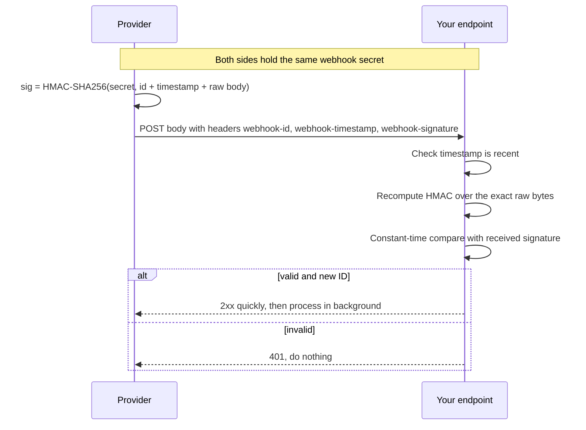
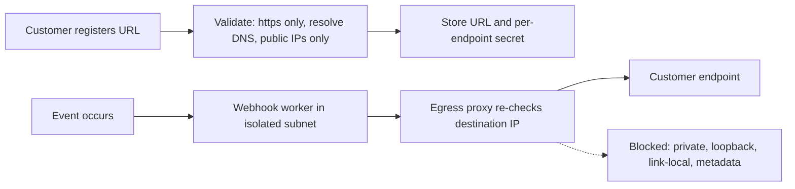

# Webhook Security

## Introduction

A **webhook** is an HTTP request that one system sends to another when something happens: "payment succeeded", "a commit was pushed", "a subscription was cancelled". Instead of your app polling a provider every minute, the provider calls a URL you registered.

That reverses the usual direction of trust. Your webhook endpoint is a **public URL that accepts POST requests from the internet and then does important things**: marks orders as paid, grants access, deploys code. If anyone can send a convincing fake request to it, they can trigger those actions.

Think of webhooks as letters delivered to your office. Anyone can drop a letter in your mailbox and write "From: Your Bank" on the envelope. Before acting on "transfer approved", you check the bank's seal on the letter (signature), the postmark date (timestamp), and whether you already processed that exact letter (idempotency).

There are two sides to webhook security:

- **Receiving** webhooks: verifying that a request really came from the provider and has not been altered or replayed.
- **Sending** webhooks: if your product lets customers register webhook URLs, making sure that feature cannot be turned against your own network (SSRF) and that your signatures are easy to verify.

The cryptography behind webhook signatures (HMACs and digital signatures) is explained in [Digital Signatures and MACs](../1-sec-cryptography/5-sec-digital-signatures.mdx). This page is about using them correctly in a real endpoint.

:::warning Only test what you own
Send test webhooks only to endpoints you run. Providers offer tools for this, such as the Stripe CLI's `stripe listen` and GitHub's "Redeliver" button. Never send forged webhooks to someone else's endpoint.
:::

## What Can Go Wrong

| Attack | What the attacker does | Defense |
| --- | --- | --- |
| Forged event | Posts `{"type": "payment.succeeded"}` to your endpoint | Verify a signature over the raw body |
| Tampered event | Changes the amount or order ID in a real event | Signature covers the whole body |
| Replay | Captures a real, signed event and sends it again later | Signed timestamp with a tolerance window, plus event ID deduplication |
| Endpoint discovery | Guesses `/webhooks/stripe` | Do not rely on secret URLs; verify signatures |
| Denial of service | Floods the endpoint, or sends huge bodies | Body size limits, fast 2xx and queueing, rate limits |
| Malicious content | Valid event with unexpected field values | Validate payload schema; fetch authoritative state from the provider API |
| SSRF (sender side) | Registers `http://169.254.169.254/` as their webhook URL | Validate destinations and send through an egress proxy |

## How Webhook Signatures Work

Most providers use an **HMAC**: a keyed hash computed with a shared secret that only you and the provider know.



Formats differ between providers. Here are three common ones (check each provider's docs, as formats change):

| Provider or spec | Header(s) | What is signed | Encoding |
| --- | --- | --- | --- |
| GitHub | `X-Hub-Signature-256: sha256=...` | Raw body only | Hex HMAC-SHA256 |
| Stripe | `Stripe-Signature: t=...,v1=...` | Timestamp, a dot, then raw body | Hex HMAC-SHA256; verify with the official SDK |
| Standard Webhooks spec | `webhook-id`, `webhook-timestamp`, `webhook-signature: v1,...` | `id.timestamp.body` | Base64 HMAC-SHA256 (`v1`), or Ed25519 (`v1a`) |

[Standard Webhooks](https://www.standardwebhooks.com/) is an open specification that several webhook platforms have adopted, so learning it pays off.

:::caution GitHub signatures do not include a timestamp
GitHub's documented signature covers only the payload. A captured delivery could therefore be replayed. Use the unique delivery ID header (`X-GitHub-Delivery`) to deduplicate, and act idempotently.
:::

## Verifying a GitHub Signature

The simplest case. GitHub publishes a test vector, so you can check your code against it.

```python
# verify_github.py
import hashlib
import hmac

def verify_github(secret: str, body: bytes, header: str | None) -> bool:
    if not header or not header.startswith("sha256="):
        return False
    expected = "sha256=" + hmac.new(secret.encode(), body, hashlib.sha256).hexdigest()
    return hmac.compare_digest(expected, header)

# Test vector from GitHub's "Validating webhook deliveries" docs
secret = "It's a Secret to Everybody"
body = b"Hello, World!"
good = "sha256=757107ea0eb2509fc211221cce984b8a37570b6d7586c22c46f4379c8b043e17"
print(verify_github(secret, body, good))
print(verify_github(secret, b"Hello, World?", good))
print(verify_github(secret, body, None))
```

Output:

```text
True
False
False
```

Two details are critical:

1. **`hmac.compare_digest`**, not `==`. A normal string comparison stops at the first different character, which can leak timing information an attacker can use to guess the signature byte by byte.
2. **The raw body bytes.** Compute the HMAC over exactly what arrived on the wire, before any JSON parsing.

## The Raw Body Trap

The most common reason webhook verification "randomly fails" is that the framework parsed and re-serialized the JSON before you computed the HMAC. Re-serializing changes whitespace, key order or Unicode escapes, so the bytes no longer match. The tempting "fix" is to turn verification off. Do not.

**Vulnerable:**

```python
@app.post("/webhooks/github")
def github_webhook():
    payload = request.get_json()                          # parsed JSON
    body = json.dumps(payload).encode()                    # re-serialized: different bytes
    if not verify_github(SECRET, body, request.headers.get("X-Hub-Signature-256")):
        return "", 200                                     # and failures are silently accepted
    handle(payload)
    return "", 200
```

**Fixed:**

```python
@app.post("/webhooks/github")
def github_webhook():
    body = request.get_data()                              # exact raw bytes
    if not verify_github(SECRET, body, request.headers.get("X-Hub-Signature-256")):
        abort(401)
    handle(json.loads(body))
    return "", 202
```

In Node.js with Express, use a raw body parser on the webhook route only:

```javascript
// webhook.mjs
import crypto from "node:crypto";
import express from "express";

const app = express();
const SECRET = process.env.GITHUB_WEBHOOK_SECRET;

app.post("/webhooks/github", express.raw({ type: "application/json", limit: "256kb" }), (req, res) => {
  const header = req.get("X-Hub-Signature-256") || "";
  const expected = "sha256=" + crypto.createHmac("sha256", SECRET).update(req.body).digest("hex");
  const ok = header.length === expected.length &&
    crypto.timingSafeEqual(Buffer.from(header), Buffer.from(expected));
  if (!ok) return res.sendStatus(401);
  let event;
  try {
    event = JSON.parse(req.body.toString("utf8"));
  } catch {
    return res.sendStatus(400);
  }
  res.sendStatus(202);
  queueEvent(event);   // process after responding
});

app.use(express.json());   // JSON parsing for all other routes, registered after the webhook route

function queueEvent(event) { console.log("queued", event.action); }

app.listen(3000);
```

`crypto.timingSafeEqual` throws if the buffers differ in length, so the length check comes first.

## A Complete Receiver: Signatures, Replay Protection and Idempotency

This Flask receiver follows the Standard Webhooks format. It verifies the signature, rejects old timestamps, supports two secrets during rotation, deduplicates by message ID, and hands work to a queue.

```python
# webhook_receiver.py
import base64, hashlib, hmac, json, os, time
from flask import Flask, request, abort

app = Flask(__name__)
app.config["MAX_CONTENT_LENGTH"] = 256 * 1024

# Secrets look like "whsec_<base64>". Keep two during rotation.
SECRETS = [s for s in os.environ.get("WEBHOOK_SECRETS", "").split(",") if s]
TOLERANCE_SECONDS = 300
seen_ids: set[str] = set()          # use Redis or a DB table in production

def _key(secret: str) -> bytes:
    return base64.b64decode(secret.removeprefix("whsec_"))

def sign(secret: str, msg_id: str, ts: str, body: bytes) -> str:
    signed = f"{msg_id}.{ts}.".encode() + body
    mac = hmac.new(_key(secret), signed, hashlib.sha256).digest()
    return "v1," + base64.b64encode(mac).decode()

def verify(headers, body: bytes) -> str:
    msg_id = headers.get("webhook-id")
    ts = headers.get("webhook-timestamp")
    sig_header = headers.get("webhook-signature", "")
    if not (msg_id and ts and ts.isdigit()):
        abort(400)
    if abs(time.time() - int(ts)) > TOLERANCE_SECONDS:
        abort(401)                                  # too old or from the future
    candidates = sig_header.split()                 # space-delimited list
    for secret in SECRETS:
        expected = sign(secret, msg_id, ts, body)
        if any(hmac.compare_digest(expected, c) for c in candidates):
            return msg_id
    abort(401)

@app.post("/webhooks/payments")
def payments_webhook():
    body = request.get_data()                       # raw bytes, before any JSON parsing
    msg_id = verify(request.headers, body)
    if msg_id in seen_ids:
        return "", 200                              # duplicate delivery: acknowledge, do nothing
    seen_ids.add(msg_id)
    event = json.loads(body)
    enqueue(event)                                  # do the slow work in a background job
    return "", 202

def enqueue(event: dict) -> None:
    print("queued", event["type"], event["data"]["id"])
```

Test it locally by playing the provider:

```python
# try_receiver.py
import base64, json, os, secrets, time
secret = "whsec_" + base64.b64encode(secrets.token_bytes(32)).decode()
os.environ["WEBHOOK_SECRETS"] = secret
from webhook_receiver import app, sign

client = app.test_client()
body = json.dumps({"type": "payment.succeeded", "data": {"id": "pay_123"}}).encode()

def deliver(body, ts=None, msg_id="msg_001", sig=None):
    ts = str(int(time.time())) if ts is None else ts
    sig = sig or sign(secret, msg_id, ts, body)
    headers = {"webhook-id": msg_id, "webhook-timestamp": ts, "webhook-signature": sig,
               "Content-Type": "application/json"}
    return client.post("/webhooks/payments", data=body, headers=headers).status_code

print("valid:", deliver(body))
print("duplicate:", deliver(body))
print("tampered:", deliver(body.replace(b"pay_123", b"pay_999"), msg_id="msg_002",
                          sig=sign(secret, "msg_002", str(int(time.time())), body)))
print("replayed old:", deliver(body, ts=str(int(time.time()) - 3600), msg_id="msg_003"))
print("forged:", deliver(body, msg_id="msg_004", sig="v1,AAAA"))
```

Output:

```text
queued payment.succeeded pay_123
valid: 202
duplicate: 200
tampered: 401
replayed old: 401
forged: 401
```

Why each piece matters:

- **Timestamp inside the signature.** An attacker cannot change the timestamp without breaking the signature, so an old capture cannot be "refreshed". The Standard Webhooks spec requires a tolerance window but leaves the value to you; five minutes is a common choice.
- **Deduplication by ID.** Providers retry deliveries, and retries are legitimate. Storing processed IDs (for at least the tolerance window, often much longer) makes processing idempotent and stops replays within the window.
- **Two secrets.** During rotation the provider may sign with both old and new secrets. Accept either, then remove the old one.
- **Fast response.** Providers time out and retry slow endpoints. Respond with 2xx after verifying and queue the real work. Stripe's docs, for example, say to return 2xx before complex logic.

:::tip Prefer the provider's SDK
When a provider ships a verification helper (such as Stripe's `construct_event`, or the official Standard Webhooks libraries), use it. It matches their exact format and tolerance defaults. Hand-written verification is for understanding, and for providers that have no SDK.
:::

## Defense in Depth for Receivers

Signatures are the main control. These add depth:

- **Treat the payload as a hint, not the truth.** For high-value events, use the event's ID to fetch the current object from the provider's API over an authenticated connection before acting. Some providers offer "thin" events that contain only IDs for exactly this reason.
- **Validate the payload schema.** A valid signature proves who sent it, not that every field is sensible. See [Schema Validation for APIs](./4-sec-api-input-validation.mdx).
- **IP allowlisting.** Some providers publish their source IP ranges. Allowlisting them at the firewall is a useful extra layer, but ranges change, so automate updates and never rely on IPs alone.
- **Separate secrets per endpoint and environment.** A leaked staging secret should not work in production.
- **Exempt the route from CSRF middleware** carefully, only for that route, since the signature replaces the CSRF token.
- **Log and alert** on signature failures. A burst of them may mean probing or a misconfigured secret.

## The Sender Side: Building Webhooks Safely

If your product lets customers register webhook URLs, you now **send** requests to arbitrary URLs from your servers. That is a textbook setup for [Server-Side Request Forgery](../3-sec-web-security/6-sec-ssrf.mdx) (OWASP API7). A customer registers `http://169.254.169.254/latest/meta-data/` or `http://10.0.0.5:8080/admin`, and your webhook worker happily calls it from inside your network.



### Validating destination URLs

```python
# webhook_url_check.py
import ipaddress, socket
from urllib.parse import urlsplit

def check_webhook_url(url: str) -> list[str]:
    """Return the resolved public IPs, or raise ValueError."""
    parts = urlsplit(url)
    if parts.scheme != "https":
        raise ValueError("webhook URLs must use https")
    if not parts.hostname or parts.username or parts.password:
        raise ValueError("invalid host")
    port = parts.port or 443
    infos = socket.getaddrinfo(parts.hostname, port, proto=socket.IPPROTO_TCP)
    ips = sorted({info[4][0] for info in infos})
    for ip in ips:
        addr = ipaddress.ip_address(ip)
        if not addr.is_global:
            raise ValueError(f"{parts.hostname} resolves to non-public address {ip}")
    return ips

for url in ["http://example.com/hook",
            "https://localhost/hook",
            "https://169.254.169.254/latest/meta-data/",
            "https://10.0.0.5:8443/hook",
            "https://[::1]/hook"]:
    try:
        print("OK  ", url, check_webhook_url(url))
    except (ValueError, socket.gaierror) as exc:
        print("DENY", url, "-", exc)
```

Output:

```text
DENY http://example.com/hook - webhook URLs must use https
DENY https://localhost/hook - localhost resolves to non-public address 127.0.0.1
DENY https://169.254.169.254/latest/meta-data/ - 169.254.169.254 resolves to non-public address 169.254.169.254
DENY https://10.0.0.5:8443/hook - 10.0.0.5 resolves to non-public address 10.0.0.5
DENY https://[::1]/hook - ::1 resolves to non-public address ::1
```

`ipaddress`'s `is_global` property rejects private, loopback, link-local and other reserved ranges in one check.

:::caution Validation at registration is not enough
DNS can change between the check and the request (**DNS rebinding**): a hostname resolves to a public IP when validated and to `127.0.0.1` when the worker connects. Re-check at send time and connect to the IP you checked, or, better, send all webhooks through an **egress proxy** that enforces the IP rules on every connection. The Standard Webhooks spec recommends exactly that and names Stripe's open-source Smokescreen proxy as an example.
:::

### Other sender best practices

- **Sign every delivery** with a per-endpoint secret, including an ID and a timestamp in the signed content. Following the Standard Webhooks format makes life easy for your customers.
- **Consider asymmetric signatures** (Ed25519, the `v1a` scheme in Standard Webhooks) if you do not want customers' verification secrets to be able to forge events. The trade-off is more CPU and slightly more complex verification.
- **Do not follow redirects**, or re-validate each hop. A redirect to an internal address is a classic SSRF bypass.
- **Short timeouts and response-size limits.** A customer endpoint that never responds should not tie up your workers.
- **Retries with exponential backoff**, and automatic disabling of endpoints that keep failing, with a notification to the customer.
- **Run workers in an isolated network segment** that cannot reach internal services. See [Network Segmentation](../2-sec-network-security/2-sec-network-segmentation.mdx).
- **Let customers rotate secrets** with an overlap period.

## Real-World Scenario

**Your e-commerce platform** uses a payment provider and receives `payment.succeeded` webhooks to mark orders as paid and ship goods. During a review you find that the handler parses JSON first, then verifies a re-serialized copy, and when verification failed in staging someone set it to log a warning and continue. In other words, anyone who finds the URL can mark orders as paid.

### The fix

1. **Verify on raw bytes** using the provider's SDK, and return `401` on any failure. No "warning only" mode in production.
2. **Respect the signed timestamp** with the SDK's default tolerance, and store processed event IDs in a database table with a unique constraint, so a duplicate insert fails and the handler skips it.
3. **Fetch the payment from the provider's API** before shipping high-value orders, and compare the amount and currency with the order.
4. **Queue the fulfilment work** and respond `2xx` within the provider's timeout.
5. **Alert** on more than a handful of signature failures per hour.

### Why this approach

The signature is the only control that proves the request came from the provider and was not changed. Timestamp checks and ID deduplication address replay. Fetching the authoritative state protects against any remaining surprise, including bugs in your own parsing. Each layer is cheap.

### When to use each control, and when not to

Signatures and idempotency are always required. Fetching state from the provider adds an API call per event, which is worthwhile for money and access changes, and unnecessary for low-value events like "customer updated their avatar". IP allowlisting helps when the provider publishes stable ranges; skip it when they do not, rather than maintaining a list that silently goes stale.

### Alternatives and trade-offs

| Approach | Pros | Cons | Best for |
| --- | --- | --- | --- |
| HMAC signature (shared secret) | Simple, fast, widely supported | Secret on both sides; receiver could forge events | Most webhooks |
| Asymmetric signature (Ed25519) | Receiver holds only a public key | More CPU; fewer libraries | Platforms sending to many customers |
| Mutual TLS | Strong transport-level identity | Certificate management for every customer | Enterprise B2B integrations |
| IP allowlisting | Easy firewall rule | Ranges change; shared cloud IPs; no integrity | Extra layer only |
| Secret token in URL | Trivial to implement | Leaks via logs and proxies; no integrity, no replay protection | Avoid for anything important |
| Thin events plus fetch from API | Payload cannot be trusted wrongly; always current state | Extra API calls and latency | High-value state changes |

## Common Mistakes

1. **Verifying a re-serialized body.** Always use the raw bytes.
2. **Comparing signatures with `==`.** Use `hmac.compare_digest` or `crypto.timingSafeEqual`.
3. **"Log and continue" on failure.** An unverified webhook must not change state.
4. **Ignoring timestamps and IDs.** Without them, captured events can be replayed.
5. **Slow handlers.** Long processing causes timeouts, retries and duplicate processing. Queue the work.
6. **One secret for everything.** Use per-endpoint, per-environment secrets and rotate them.
7. **Sending webhooks from a server that can reach internal systems.** Isolate workers and use an egress proxy.
8. **Validating webhook URLs only at registration.** Re-check at send time because of DNS rebinding.

## Summary

- A webhook endpoint is a public URL that triggers important actions, so every request must be authenticated.
- Verify HMAC (or asymmetric) signatures over the exact raw body with a constant-time comparison.
- Include a timestamp in the signed content, enforce a tolerance window, and deduplicate by event ID.
- Respond fast and process in the background; for high-value events, fetch the authoritative state from the provider.
- If you send webhooks, protect yourself from SSRF with URL validation, an egress proxy and isolated workers, and sign your deliveries using a standard format.

## Further Learning

### Exercises

1. Replace the in-memory `seen_ids` set with a SQLite table that has a unique constraint on the message ID. Make sure two concurrent deliveries of the same ID process the event only once.
2. Rotate the secret in `webhook_receiver.py`: generate a new one, configure both, deliver events signed with each, then remove the old one and confirm its signatures are rejected.
3. Install the Stripe CLI, run `stripe listen --forward-to localhost:5000/webhook`, and write a Flask endpoint that verifies events with the official Python SDK.
4. Extend `check_webhook_url` to reject URLs with a non-default port outside an allowlist (for example only 443 and 8443), and write tests for IPv6 and IPv4-mapped IPv6 addresses.

### Related pages

- [Digital Signatures and MACs](../1-sec-cryptography/5-sec-digital-signatures.mdx)
- [Server-Side Request Forgery (SSRF)](../3-sec-web-security/6-sec-ssrf.mdx)
- [Key Management](../1-sec-cryptography/8-sec-key-management.mdx), for storing and rotating webhook secrets
- [Rate Limiting and Abuse Prevention](./3-sec-rate-limiting.mdx)
- [API Gateways and WAFs](./7-sec-api-gateway-security.mdx)
