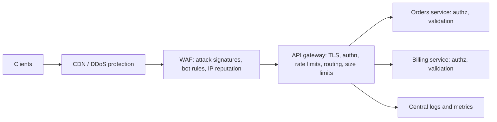
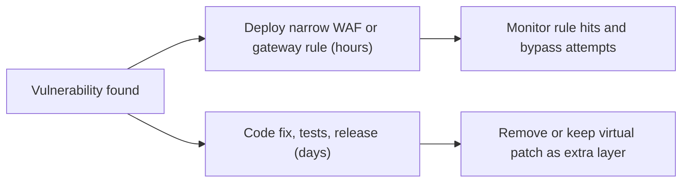

# API Gateways and WAFs

## Introduction

So far this section has focused on controls inside your application: [authorization](./2-sec-bola.mdx), [schema validation](./4-sec-api-input-validation.mdx), and [rate limits](./3-sec-rate-limiting.mdx). Most production APIs also sit behind two kinds of infrastructure:

- An **API gateway**: a reverse proxy that is the single entry point for your APIs. It routes requests to services and applies shared policies such as TLS, authentication, rate limits, request size limits and logging. Examples include Kong, Envoy-based gateways, nginx, AWS API Gateway, Azure API Management and Google Apigee.
- A **web application firewall (WAF)**: a filter that inspects HTTP requests for attack patterns such as SQL injection or cross-site scripting and blocks suspicious ones. Examples include the open-source OWASP Core Rule Set (CRS) on ModSecurity or Coraza, and cloud WAFs from AWS, Cloudflare, Azure and Google Cloud.

Think of an office building. The **gateway** is the reception desk: it checks badges, sends visitors to the right floor, and turns away people without an appointment. The **WAF** is the security scanner at the entrance: it does not know who you are visiting, but it catches people carrying obviously dangerous items. Neither of them knows whether you are allowed to open a specific filing cabinet on the fifth floor. That is the job of the application.

This page explains what each layer is good at, shows working configurations, and helps you decide where each control belongs.

:::warning Only test what you own
The examples run in Docker on your own machine. Sending attack payloads to test someone else's WAF is attacking their system. Use local labs, or deliberately vulnerable targets such as OWASP Juice Shop placed behind your own WAF.
:::

## Where They Sit



In many products the boxes merge. Cloud providers attach a WAF to their load balancer or gateway, and some gateways ship WAF plugins. The responsibilities stay the same.

## What Each Layer Is Good At

| Control | Gateway | WAF | Application |
| --- | --- | --- | --- |
| TLS termination, modern ciphers | Yes | Often | No (or mTLS inside) |
| Token signature and expiry check | Yes | Limited | Yes (defense in depth) |
| Coarse rate limits per IP or API key | Yes | Yes | Business-specific limits |
| Request size and timeout limits | Yes | Yes | Yes |
| Routing allowlist, retired versions | Yes | Partly | No |
| Known attack payloads (SQLi, XSS strings) | Rarely | Yes | Fix the code: parameterize, encode |
| Bot and IP reputation | Some | Yes | No |
| Schema validation | Some (OpenAPI) | Limited | Yes |
| Object-level authorization (BOLA) | No | No | **Only here** |
| Business rules and flows | No | No | **Only here** |
| Central logging and metrics | Yes | Yes | Yes, with business context |

The bottom rows are the most important lesson: **neither a gateway nor a WAF can fix authorization or business logic bugs**, which are the top API risks in the [OWASP API Security Top 10](./1-sec-owasp-api-top-10.mdx).

## A Hardened nginx Gateway

You do not need a commercial product to get gateway benefits. This nginx configuration terminates TLS, authenticates every request with a subrequest to an auth service, limits methods, rates and body sizes, forwards a trusted identity header, retires `/v1`, and returns `404` for every undocumented route.

```nginx
# /etc/nginx/conf.d/api-gateway.conf
limit_req_zone $binary_remote_addr zone=per_ip:10m rate=20r/s;
limit_req_status 429;

upstream orders_api { server orders:8000; }
upstream auth_svc   { server auth:9000; }

server {
    listen 443 ssl;
    http2 on;
    server_name api.example.com;

    ssl_certificate     /etc/nginx/certs/api.crt;
    ssl_certificate_key /etc/nginx/certs/api.key;
    ssl_protocols       TLSv1.2 TLSv1.3;

    client_max_body_size 1m;          # reject bigger bodies with 413
    client_body_timeout  10s;
    server_tokens off;                # hide the nginx version

    # Internal subrequest: the auth service validates the bearer token
    location = /_auth {
        internal;
        proxy_pass http://auth_svc/verify;
        proxy_pass_request_body off;
        proxy_set_header Content-Length "";
        proxy_set_header Authorization $http_authorization;
        proxy_set_header X-Original-URI $request_uri;
    }

    # Only documented routes are proxied
    location /v2/orders/ {
        limit_except GET POST { deny all; }
        auth_request /_auth;
        auth_request_set $user_id $upstream_http_x_user_id;

        limit_req zone=per_ip burst=40 nodelay;

        # Overwrite identity headers so clients cannot set them
        proxy_set_header X-User-Id $user_id;
        proxy_set_header X-Request-Id $request_id;
        proxy_set_header Host $host;
        proxy_set_header X-Forwarded-For $remote_addr;
        proxy_pass http://orders_api;
    }

    location /v1/ {
        return 410;                   # retired version
    }

    location / {
        return 404;                   # everything else is not part of the API
    }
}
```

With small stand-in auth and orders services running behind it (the auth service returns `X-User-Id: 1` for `alice-token`, and the orders service echoes the identity it received), here is what a client sees:

```bash
curl -sk -o /dev/null -w "%{http_code}\n" https://localhost/v2/orders/
curl -sk -H 'Authorization: Bearer alice-token' -H 'X-User-Id: 2' https://localhost/v2/orders/
curl -sk -o /dev/null -w "%{http_code}\n" -X DELETE -H 'Authorization: Bearer alice-token' https://localhost/v2/orders/
curl -sk -o /dev/null -w "%{http_code}\n" https://localhost/v1/orders/
curl -sk -o /dev/null -w "%{http_code}\n" https://localhost/internal/debug
```

Output:

```text
401
{"rid":true,"user":"1"}
403
410
404
```

Look at the second line. The client sent `X-User-Id: 2` to impersonate another user, but the backend received `1`, because the gateway **overwrote** the header with the identity from the auth service. This header-overwrite step is essential whenever a gateway passes identity to backends. A 2 MB body to the same route returns `413`.

:::caution Two classic gateway mistakes
1. **Backends reachable without the gateway.** If the orders service also listens on a public IP, or any other pod can call it, attackers skip the gateway and send their own `X-User-Id`. Restrict backend network access to the gateway (security groups, Kubernetes NetworkPolicies), or have backends verify a signed token themselves.
2. **nginx header inheritance.** `proxy_set_header` directives in a `location` replace **all** headers set at the `server` level, rather than adding to them. Keep identity headers in the same block as `proxy_pass`, as above.
:::

See the site's [nginx tutorial](/docs/middleware/nginx) for more nginx background.

## The Same Policies in Kong

Dedicated gateways express these policies as plugins. Here is a declarative Kong configuration (applied with `deck gateway sync`) that requires an API key, rate limits per consumer, and caps request size.

```yaml
# kong.yaml
_format_version: "3.0"
services:
  - name: orders
    url: http://orders:8000
    routes:
      - name: orders-v2
        paths: ["/v2/orders"]
        methods: ["GET", "POST"]
        strip_path: false
    plugins:
      - name: key-auth
        config:
          key_names: ["X-API-Key"]
          hide_credentials: true       # do not forward the key to the backend
      - name: rate-limiting
        config:
          minute: 100
          limit_by: consumer
          policy: redis                # shared counters across Kong nodes
          redis:
            host: redis
            port: 6379
      - name: request-size-limiting
        config:
          allowed_payload_size: 1
          size_unit: megabytes
consumers:
  - username: partner-acme
    keyauth_credentials:
      - key: replace-with-a-long-random-key
```

When the limit is exceeded, Kong's rate-limiting plugin returns `429` with a `Retry-After` header. Plugin field names change between Kong versions (for example, Redis settings moved into a nested `redis` object), so check the [Kong plugin reference](https://developer.konghq.com/plugins/rate-limiting/) for your version. In a real deployment, keep credentials out of the file and load them from a secrets manager. The site's [Kong tutorial](/docs/middleware/kong) covers installation and routing.

## How a WAF Works

A WAF inspects each request (and sometimes response) against rules. The **OWASP Core Rule Set (CRS)** is the most widely used open-source rule set. It runs on the ModSecurity engine (stewarded by OWASP since 2024) and on **Coraza**, a newer engine written in Go.

CRS uses **anomaly scoring** rather than blocking on the first match:

1. Each matching rule adds points based on its severity. In CRS, a critical match adds 5, an error 4, a warning 3 and a notice 2.
2. At the end of the request phase, the total is compared with the **inbound anomaly threshold**, which defaults to 5.
3. If the score reaches the threshold, the request is blocked, usually with `403`.

The **paranoia level** (1 to 4) controls how many rules are active. Level 1 is the default and aims for very few false positives. Higher levels catch more obfuscated attacks but block more legitimate traffic and need much more tuning.

### Trying CRS locally

The CRS project publishes Docker images that put nginx plus ModSecurity plus CRS in front of any backend. Here we put it in front of a plain nginx container on a private Docker network.

```bash
docker network create waflab
docker run -d --rm --name backend --network waflab nginx:alpine
docker run -d --rm --name waf --network waflab -p 8080:8080 \
  -e BACKEND=http://backend:80 \
  -e BLOCKING_PARANOIA=1 \
  -e ANOMALY_INBOUND=5 \
  owasp/modsecurity-crs:nginx-alpine

curl -s -o /dev/null -w "normal: %{http_code}\n" "http://localhost:8080/api/products?q=keyboard"
curl -s -o /dev/null -w "sqli: %{http_code}\n" "http://localhost:8080/api/products?q=1%27%20OR%20%271%27%3D%271"
curl -s -o /dev/null -w "xss: %{http_code}\n" "http://localhost:8080/api/search?q=%3Cscript%3Ealert(1)%3C/script%3E"
curl -s -o /dev/null -w "json sqli: %{http_code}\n" -X POST "http://localhost:8080/api/login" \
  -H 'Content-Type: application/json' -d '{"user":"admin'"'"' OR 1=1--","password":"x"}'
curl -s -o /dev/null -w "bola: %{http_code}\n" "http://localhost:8080/api/invoices/inv_a1"
```

Example output (CRS 4.30.0 on ModSecurity 3.0.17, tested October 2026):

```text
normal: 404
sqli: 403
xss: 403
json sqli: 403
bola: 404
```

- `normal` and `bola` pass through the WAF. The `404` comes from the plain nginx backend, which has no `/api` routes.
- The SQL injection and XSS probes are blocked with `403`, including the one inside a JSON body.
- The BOLA request looks completely normal, because it **is** a normal request with a different ID. No WAF rule can catch it.

The container logs explain each block, for example `SQL Injection Attack Detected via libinjection` followed by `Inbound Anomaly Score Exceeded (Total Score: 5)`. Use tagged stable image tags in production rather than the rolling `nginx-alpine` tag, as the project's README advises. Stop the lab with `docker stop waf backend && docker network rm waflab`.

### Tuning and false positives

A WAF that blocks legitimate customers will be switched off by the business within a week. Roll out carefully:

1. Start in **detection-only** mode (`MODSEC_RULE_ENGINE=DetectionOnly` in the CRS image) and log matches.
2. Review matches on real traffic. Legitimate content such as code snippets in a support ticket, SQL in a reporting tool, or rich text in a CMS often triggers rules.
3. Write narrow **rule exclusions**, for example "disable rule X for the `body` parameter on `/v2/tickets` only". Avoid disabling rules globally.
4. Switch to blocking at paranoia level 1, then consider raising the level for sensitive endpoints.
5. Keep the rule set updated. CRS releases regularly fix bypasses.

## Cloud WAF Example: Rate-Based Rule in AWS WAF

Cloud WAFs combine managed rule groups (similar in spirit to CRS) with your own rules. This AWS WAF rule blocks clients that send more than 100 requests to the login endpoint within a 5-minute window, and returns `429`.

```json
{
  "Name": "login-rate-limit",
  "Priority": 1,
  "Action": { "Block": { "CustomResponse": { "ResponseCode": 429 } } },
  "Statement": {
    "RateBasedStatement": {
      "Limit": 100,
      "EvaluationWindowSec": 300,
      "AggregateKeyType": "IP",
      "ScopeDownStatement": {
        "ByteMatchStatement": {
          "SearchString": "/v1/login",
          "FieldToMatch": { "UriPath": {} },
          "TextTransformations": [{ "Priority": 0, "Type": "NONE" }],
          "PositionalConstraint": "EXACTLY"
        }
      }
    }
  },
  "VisibilityConfig": {
    "SampledRequestsEnabled": true,
    "CloudWatchMetricsEnabled": true,
    "MetricName": "login-rate-limit"
  }
}
```

According to the AWS documentation, the evaluation window can be 60, 120, 300 or 600 seconds (300 is the default), the lowest allowed limit is 10, and enforcement is approximate rather than exact. Aggregation can also use custom keys such as a header or a forwarded IP. Pricing and limits change, so check the [AWS WAF developer guide](https://docs.aws.amazon.com/waf/latest/developerguide/waf-rule-statement-type-rate-based.html) before relying on specific numbers.

## WAF Limitations for APIs

WAFs were designed for classic HTML form traffic. Keep these limits in mind for APIs:

- **No knowledge of your data model.** BOLA, BFLA, mass assignment and business-flow abuse look like normal traffic.
- **JSON, GraphQL and binary formats.** Rules have improved for JSON, but GraphQL queries, Protobuf (gRPC) and deeply nested payloads are harder to inspect, and some WAFs only inspect the first part of large bodies.
- **Encoding bypasses.** Attackers try double encoding, Unicode tricks and parser differences between the WAF and your framework. Rule sets fix these over time, which is why updates matter.
- **False positives on legitimate data.** APIs for developer tools or content often carry text that looks like attacks.
- **Encrypted end-to-end traffic.** The WAF must terminate TLS to see the request.

That is why the right mental model is: **the WAF reduces noise and buys time; the code fix removes the vulnerability.**

## Virtual Patching

When a vulnerability is found in an application you cannot fix immediately (a vendor product, a legacy system, or a fix that needs a week of testing), a targeted WAF or gateway rule can block the specific exploit path in the meantime. This is called **virtual patching**.



A good virtual patch is narrow (one route, one parameter), logged, and has an owner and an expiry date. It is a bridge to the real fix, not a replacement for it.

## Real-World Scenario

**Your team** runs a public REST API for a B2B SaaS product. An external pentest reports two findings on the same day:

1. **SQL injection** in the `sort` parameter of `GET /v2/reports`, because the column name is concatenated into the query.
2. **BOLA** on `GET /v2/reports/{id}/export`, where any customer can export any other customer's report.

The release process needs three days for a hotfix. Your manager asks: "Can't we just turn on the WAF?"

### The response

- **SQL injection:** deploy a virtual patch **today**. A gateway or WAF rule allows only known column names in `sort` (an allowlist such as `created_at`, `name` or `total`) and blocks everything else on that route. CRS at paranoia level 1 may also catch common SQLi payloads, but an allowlist rule is tighter. Then fix the code by mapping `sort` values to column names from a fixed dictionary, and keep the rule as defense in depth.
- **BOLA:** no WAF rule can tell whose report `rep_7731` is. Ship the code fix as an emergency release with a tenant-scoped query and two-tenant tests. If even a one-day exposure is unacceptable, temporarily **disable** the export route at the gateway (`return 503` for that location) until the fix is out.
- **Afterwards:** review logs for exploitation of both issues during the exposure window, and add both cases to your test suite.

### Why this approach

Each control is matched to what it can actually do. The WAF is good at blocking a narrow, recognizable input pattern on one parameter, so it buys time for the SQL injection fix. It is useless for BOLA, so the options there are "fix in code now" or "turn the feature off".

### When to use a WAF, and when not to

Use a WAF in front of public web applications and APIs as a baseline filter, for virtual patching, and for bot and reputation rules. Be cautious on internal service-to-service traffic, where the cost of false positives is high and attack payloads are rare; mTLS and authorization matter more there. Never accept "the WAF covers it" as the resolution of a code-level vulnerability.

### Alternatives and trade-offs

| Approach | Pros | Cons | Best for |
| --- | --- | --- | --- |
| Code fix only | Removes root cause; testable | Takes time to ship; no generic protection | Every vulnerability, eventually |
| WAF virtual patch, then code fix | Immediate risk reduction | Possible bypasses; must remember to fix code | Injection-style flaws with release delays |
| Self-managed gateway (nginx, Kong, Envoy) | Full control, no per-request fees, portable | You operate and patch it | Teams with platform engineering capacity |
| Managed cloud gateway and WAF | Fast to start, scales, managed rule updates | Cost per request; vendor lock-in; less visibility into rules | Cloud-native teams, spiky traffic |
| Open-source WAF (CRS on ModSecurity or Coraza) | Free, transparent rules, large community | Tuning effort; you run it | Self-hosted apps, learning, cost-sensitive teams |
| Disable the feature at the gateway | Certain protection | Feature unavailable | Severe unfixable-today flaws such as BOLA |

## Common Mistakes

1. **"We have a WAF, so we're secure."** WAFs miss authorization and logic flaws, and every WAF has bypasses.
2. **Trusting identity headers without overwriting them.** Clients can send `X-User-Id` too. The gateway must overwrite it, and backends must be unreachable except through the gateway.
3. **Blocking mode on day one.** Start in detection-only mode, tune, then block.
4. **Global rule exclusions.** Exclude narrowly by route and parameter, or you lose protection everywhere.
5. **Never updating rules.** Rule sets and engines release security fixes regularly.
6. **Gateway and backend disagreeing.** Different parsing of paths, encodings or duplicate parameters lets requests slip through. Normalize at the gateway and validate in the app.
7. **No logs from the edge.** Gateway and WAF logs are key evidence in incidents. Ship them to your SIEM. See [Security Logging and SIEM](../11-sec-defensive-operations/1-sec-logging-and-siem.mdx).

## Summary

- An API gateway centralizes TLS, authentication, rate limits, size limits, routing and logging. It must overwrite identity headers, and backends must not be reachable around it.
- A WAF blocks requests that match known attack patterns. OWASP CRS uses anomaly scoring and paranoia levels, and needs tuning to avoid false positives.
- Neither layer can fix BOLA, BFLA or business logic flaws; those need code.
- Use WAF rules for virtual patching while code fixes ship, and keep them narrow and time-limited.
- Layer edge controls with application controls rather than choosing one.

## Further Learning

### Exercises

1. Run the CRS Docker lab with OWASP Juice Shop as the backend instead of plain nginx. Browse the app normally and note any false positives in the WAF logs. Then try the Juice Shop login SQL injection challenge and see whether the WAF blocks it.
2. Switch the CRS container to `BLOCKING_PARANOIA=2`, repeat your normal browsing, and compare the number of false positives with level 1.
3. Extend the nginx gateway with a second service, `/v2/invoices/`, that allows only `GET`, and write a curl test script that checks every status code from the example above.
4. Write a virtual patch for the `sort` parameter scenario: in nginx, return `400` when `$arg_sort` is not one of three allowed values. Test it with curl.

### Related pages

- [API Security Introduction](./0-sec-api-security-introduction.mdx)
- [Rate Limiting and Abuse Prevention](./3-sec-rate-limiting.mdx)
- [Firewalls and Security Groups](../2-sec-network-security/1-sec-firewalls.mdx)
- [Defense in Depth](../0-sec-fundamentals/4-sec-defense-in-depth.mdx)
- [Kubernetes Security](../8-sec-cloud-and-container/5-sec-kubernetes-security.mdx), for NetworkPolicies that keep backends behind the gateway
