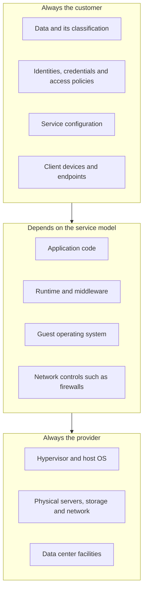
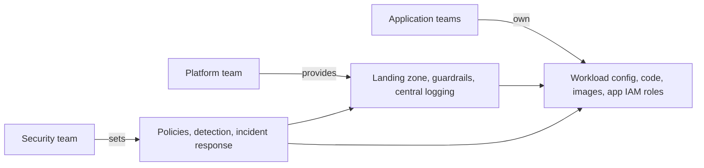

# The Shared Responsibility Model

## Introduction

When you move an application to AWS, Azure or Google Cloud, you hand part of the security work to the provider. The provider guards the data centers, the physical servers, the hypervisors and the global network. You still own a large part of the job: your data, your identities, your configuration and your code.

The **shared responsibility model** is the agreement that describes this split. Every major provider publishes one. AWS sums it up in two phrases:

- **Security *of* the cloud** is the provider's job: the hardware, software, networking and facilities that run the cloud services.
- **Security *in* the cloud** is your job: everything you build, configure and store on top of those services.

An analogy helps. Think about the difference between owning a house, renting an apartment and staying in a hotel:

| Living arrangement | Cloud equivalent | Who fixes the roof? | Who locks your door? |
| --- | --- | --- | --- |
| Owning a house | On-premises data center | You | You |
| Renting an apartment | IaaS (virtual machines) | Landlord | You, plus you maintain everything inside |
| Staying in a hotel | PaaS / serverless | Hotel | Hotel locks the building, you still guard your room key and valuables |
| Eating at a restaurant | SaaS | Restaurant | You only choose who sits at your table |

Even in the hotel, nobody else can stop you from leaving your key card on the bar or inviting a stranger up. In the cloud, the equivalent mistakes are leaked access keys, public storage buckets and over-powerful roles. They are always on the customer's side of the line.

This page explains where that line sits for each service model, which controls are shared, and how to turn the model into a practical checklist for your team. The rest of this section then covers the customer-side controls in depth.

## The Model by Service Type

The line moves depending on how much of the stack the provider runs for you. The more managed the service, the less you have to patch, but you **never** hand off your data, your identities or your access decisions.



The middle layer is where most confusion happens. Here is how it splits across the common models:

| Layer | On-premises | IaaS (EC2, Azure VM, Compute Engine) | Containers on managed Kubernetes (EKS, AKS, GKE) | PaaS / serverless (Lambda, App Service, Cloud Run) | SaaS (Microsoft 365, Salesforce) |
| --- | --- | --- | --- | --- | --- |
| Data, identities, access | You | You | You | You | You |
| Application code | You | You | You | You | Provider |
| Container images | n/a | n/a | You | You (if you ship images) | Provider |
| Runtime and libraries | You | You | You (inside the image) | Mostly provider, you pick versions | Provider |
| Guest OS patching | You | You | Shared: you update node images, provider ships them | Provider | Provider |
| Kubernetes control plane | n/a | n/a | Provider | n/a | n/a |
| Network firewall rules | You | You (security groups, NSGs) | You (security groups, NetworkPolicy) | Mostly you (ingress settings, VPC access) | Provider |
| Hypervisor, hardware, facility | You | Provider | Provider | Provider | Provider |

:::note
Exact boundaries differ per service and change over time. For example, a managed Kubernetes "auto mode" can take over node patching that you would otherwise do. Always read the provider's own security documentation for each service you use.
:::

### Shared controls

Some controls are split between both sides. AWS lists three examples that apply to almost every provider:

- **Patch management:** the provider patches the infrastructure. You patch your guest operating systems, container images and applications.
- **Configuration management:** the provider configures its own devices. You configure your operating systems, databases, storage and applications.
- **Awareness and training:** the provider trains its staff. You train yours.

### "Shared fate" and secure defaults

Google Cloud describes its approach as **shared fate**: the provider takes an active part in helping customers be secure, through secure-by-default settings, blueprints and guidance. You see this trend across all providers. Some examples you can verify in the official docs:

- Since **January 5, 2023**, Amazon S3 encrypts all new object uploads with SSE-S3 by default.
- New S3 buckets are created with **Block Public Access** turned on and **ACLs disabled** (Object Ownership set to "Bucket owner enforced").
- EC2 lets you set **IMDSv2 as the account default** and even enforce it, which blocks the old metadata service version abused in several breaches.

Secure defaults help, but they do not move the line. You can still turn Block Public Access off, attach a wildcard IAM policy or open SSH to the internet. The model only works when you treat your side as seriously as the provider treats theirs.

## Where Things Go Wrong

Providers rarely have their infrastructure breached in ways that expose customer data. Public cloud incidents much more often trace back to problems on the customer side:

1. **Stolen or leaked credentials:** access keys pushed to a public repository, tokens stolen from CI pipelines, phished console passwords without MFA.
2. **Misconfiguration:** public storage buckets, databases exposed to the internet, overly broad firewall rules.
3. **Excessive permissions:** a compromised web server whose role can read every bucket in the account.
4. **Vulnerable workloads:** unpatched VMs, container images full of known CVEs, application bugs such as [SSRF](../3-sec-web-security/6-sec-ssrf.mdx) that reach the metadata service.
5. **Missing logs:** nobody turned on audit logging, so nobody can tell what happened.

Every item on that list is "security in the cloud". The next pages in this section cover them one by one: [IAM](./1-sec-cloud-iam.mdx), [misconfigurations](./2-sec-cloud-misconfigurations.mdx), [storage](./3-sec-cloud-storage-security.mdx), [container images](./4-sec-container-security.mdx), [Kubernetes](./5-sec-kubernetes-security.mdx), [Infrastructure as Code](./6-sec-infrastructure-as-code-security.mdx) and [CSPM](./7-sec-cspm.mdx).

## Trust, but Verify Both Sides

### Verifying the provider's side

You cannot inspect a provider's data center yourself, so you rely on independent audits. Each provider publishes its compliance reports (SOC 2, ISO 27001, PCI DSS attestations and more) through a portal:

- **AWS Artifact** in the AWS console
- **Microsoft Service Trust Portal** for Azure and Microsoft 365
- **Google Cloud Compliance Reports Manager**

When an auditor or a customer asks "how do you know the infrastructure is secure?", these reports are your evidence for the provider's layers. Check which services are **in scope** of each report. Not every service is covered by every certification.

### Verifying your side

Your side has no auditor by default, so you check it yourself. A few read-only AWS CLI commands give a quick first look at an account you own. They change nothing.

```bash
#!/usr/bin/env bash
# quick-check.sh - read-only checks on YOUR OWN AWS account
set -euo pipefail

echo "== Account-level S3 Block Public Access =="
ACCOUNT_ID=$(aws sts get-caller-identity --query Account --output text)
aws s3control get-public-access-block --account-id "$ACCOUNT_ID" \
  --query 'PublicAccessBlockConfiguration' --output table || echo "Not configured"

echo "== Default IMDS settings for new EC2 instances (current Region) =="
aws ec2 get-instance-metadata-defaults --query 'AccountLevel' --output table

echo "== CloudTrail trails =="
aws cloudtrail describe-trails --query 'trailList[].[Name,IsMultiRegionTrail]' --output table
```

Example output:

```text
== Account-level S3 Block Public Access ==
-------------------------------------------
|        GetPublicAccessBlock             |
+--------------------------+--------------+
|  BlockPublicAcls         |  True        |
|  BlockPublicPolicy       |  True        |
|  IgnorePublicAcls        |  True        |
|  RestrictPublicBuckets   |  True        |
+--------------------------+--------------+
== Default IMDS settings for new EC2 instances (current Region) ==
---------------------------------------------
|        GetInstanceMetadataDefaults        |
+--------------------------+----------------+
|  HttpPutResponseHopLimit |  2             |
|  HttpTokens              |  required      |
+--------------------------+----------------+
== CloudTrail trails ==
-----------------------------------
|         DescribeTrails          |
+----------------+----------------+
|  org-trail     |  True          |
+----------------+----------------+
```

Three commands are not a security program, but they show the idea: your side of the model is something you can and should measure. [Cloud Security Posture Management](./7-sec-cspm.mdx) automates hundreds of checks like these.

## Turning the Model into a Responsibility Matrix

The model is only useful when it becomes a concrete list for **your** architecture. A simple way to start is a responsibility matrix: for each service you run, list what the customer must do. Here is a small Python tool that builds one from a list of services. It runs locally and does not call any cloud API.

```python
# responsibility_matrix.py
from dataclasses import dataclass, field

ALWAYS_CUSTOMER = [
    "Classify data and choose encryption keys",
    "Manage identities, MFA and least-privilege policies",
    "Configure the service securely and review changes",
    "Enable and retain audit logs",
]

@dataclass
class Service:
    name: str
    model: str  # "iaas", "containers", "serverless", "managed-db", "storage"
    extra: list[str] = field(default_factory=list)

MODEL_DUTIES = {
    "iaas": [
        "Patch the guest OS and installed software",
        "Configure host firewall and security groups",
        "Harden SSH or remove it in favor of a session manager",
        "Require IMDSv2 on instances",
    ],
    "containers": [
        "Build minimal images and scan them for CVEs",
        "Update worker node images",
        "Configure Kubernetes RBAC, NetworkPolicy and Pod Security",
    ],
    "serverless": [
        "Keep function dependencies up to date",
        "Scope the execution role to the exact resources used",
        "Validate every event input",
    ],
    "managed-db": [
        "Keep the database off the public internet",
        "Enforce TLS and manage database users",
        "Choose backup retention and test restores",
    ],
    "storage": [
        "Keep Block Public Access on unless there is a reviewed exception",
        "Write bucket policies for least privilege",
        "Turn on versioning for important data",
    ],
}

def build_matrix(services: list[Service]) -> dict[str, list[str]]:
    matrix = {}
    for svc in services:
        duties = ALWAYS_CUSTOMER + MODEL_DUTIES[svc.model] + svc.extra
        matrix[svc.name] = duties
    return matrix

if __name__ == "__main__":
    architecture = [
        Service("web-api (EC2)", "iaas"),
        Service("orders-db (RDS PostgreSQL)", "managed-db"),
        Service("invoice-pdfs (S3)", "storage", ["Use pre-signed URLs for downloads"]),
    ]
    for name, duties in build_matrix(architecture).items():
        print(f"\n{name}")
        for d in duties:
            print(f"  [ ] {d}")
```

Example output:

```text

web-api (EC2)
  [ ] Classify data and choose encryption keys
  [ ] Manage identities, MFA and least-privilege policies
  [ ] Configure the service securely and review changes
  [ ] Enable and retain audit logs
  [ ] Patch the guest OS and installed software
  [ ] Configure host firewall and security groups
  [ ] Harden SSH or remove it in favor of a session manager
  [ ] Require IMDSv2 on instances

orders-db (RDS PostgreSQL)
  [ ] Classify data and choose encryption keys
  ...
  [ ] Keep the database off the public internet
  [ ] Enforce TLS and manage database users
  [ ] Choose backup retention and test restores

invoice-pdfs (S3)
  ...
  [ ] Use pre-signed URLs for downloads
```

In a real team you would keep this matrix next to your architecture diagram, assign an owner to every line, and review it whenever you add a service. Many teams turn the same list into automated checks later, using the tools in [Cloud Security Posture Management](./7-sec-cspm.mdx).

## Responsibility Inside Your Own Organization

The shared responsibility model also has an internal version. Inside a company, "the customer" is not one person. A common split looks like this:



- The **platform team** builds the "landing zone": account structure, organization-wide guardrails (such as AWS Service Control Policies or Azure Policy), central log collection and a standard network layout.
- **Application teams** own their workloads: code, container images, the IAM role their service uses, and their own data.
- The **security team** writes the standards, runs detection and leads incident response.

If these internal responsibilities are not written down, gaps appear. A classic example: the platform team thinks app teams patch their VMs, the app teams think the platform's "golden image" pipeline handles it, and nobody patches anything for a year.

:::tip
Write the internal split in the same table format as the provider's model. Add a column for "who gets paged" when a control fails. Ambiguity about ownership is itself a vulnerability.
:::

## Real-World Scenario

Your team runs a small B2B invoicing SaaS. Today everything runs on three EC2 instances: two web servers and one self-managed PostgreSQL server. Patching is irregular, and the last audit found the database VM two kernel versions behind. Leadership asks: "Should we move to managed services to reduce our security work?"

### Option analysis

You map each candidate design onto the shared responsibility model:

1. **Stay on EC2, improve the process:** you keep full responsibility for OS and PostgreSQL patching, backups, and hardening. You need automation such as AWS Systems Manager Patch Manager and a hardening baseline.
2. **Move the database to Amazon RDS, keep web servers on EC2:** AWS now patches the database engine and OS during maintenance windows you choose, runs automated backups and handles storage. You still own database users, network exposure, TLS settings, parameter groups and the encryption key choice.
3. **Move the web tier to containers on ECS with AWS Fargate, database to RDS:** no servers to patch at all. You now own container images, the task IAM role and the service configuration.

### Decision

The team chooses option 3 in two phases: database first (lowest effort, biggest reduction in patching risk), then the web tier. The updated responsibility list for the team shrinks from "patch 3 operating systems and PostgreSQL" to "rebuild images weekly, keep RDS minor-version upgrades on, review IAM roles".

**Why this approach:** the team is small and has no dedicated operations engineer. The riskiest gap was OS and database patching, which managed services take over almost entirely. Customer-side duties that remain (IAM, configuration, data) are ones they would have to handle anyway.

**When to use it:** small teams, standard workloads, and when your auditors accept managed-service attestations (for example a provider's SOC 2 report) for the layers the provider runs.

**When not to:** you need kernel-level control (custom drivers, special tuning), a database extension the managed service does not support, or strict data-residency rules that a given managed service cannot meet in your region.

### Alternatives and trade-offs

| Approach | Pros | Cons | Best for |
| --- | --- | --- | --- |
| Self-managed on VMs | Full control, any software, portable | You patch and harden everything | Specialized workloads, teams with strong ops skills |
| Managed database plus VMs | Removes the riskiest patching job | Still patch web VMs; some engine features unavailable | Gradual migrations |
| Containers on serverless compute plus managed DB | No OS patching; immutable deployments | New skills (images, task roles); image hygiene becomes critical | Small teams with standard web apps |
| Fully serverless (functions, managed DB) | Smallest infrastructure surface | Vendor lock-in; cold starts; event-input validation everywhere | Event-driven or spiky workloads |
| SaaS replacement | Provider owns almost everything | Least control; you still own identities and data sharing settings | Commodity functions such as email or CRM |

## Common Mistakes

- **"The cloud is secure, so we are secure."** The provider's certifications cover their layers, not your configuration. A SOC 2 report for AWS says nothing about your public bucket.
- **Assuming "managed" means "configured securely".** A managed database can still be created with a public endpoint and a weak master password. Managed removes patching work, not configuration work.
- **Forgetting identities.** Identity is always on your side of the line, for every model including SaaS. MFA, least privilege and offboarding are yours.
- **Forgetting logs.** Audit logging (CloudTrail, Azure Activity Log, Cloud Audit Logs) exists, but retention, data-event logging and alerting are often off or short by default. Decide what you need. See [Security Logging and SIEM](../11-sec-defensive-operations/1-sec-logging-and-siem.mdx).
- **No internal ownership.** If no team owns a control, nobody runs it.
- **Treating containers as fully managed.** On managed Kubernetes the provider runs the control plane, but your images, RBAC, network policies and often node updates remain yours.

## Summary

- The provider secures the cloud itself: facilities, hardware, hypervisors and the global network.
- You always secure your data, identities, configuration and access policies, no matter which service model you use.
- The middle layers (OS, runtime, network controls) move to the provider as services become more managed.
- Patch management, configuration management and training are shared controls.
- Secure defaults such as S3 Block Public Access and default encryption help, but you can still turn them off.
- Write down both the provider split and your internal split between platform, application and security teams.

## Exercises

1. Pick an application you know (or a sample app) and list every cloud service it uses. Fill in a responsibility matrix like the one above, with an owner for each line.
2. Extend `responsibility_matrix.py` with a `"saas"` model and a `"kubernetes"` model. What duties remain on the customer side for SaaS?
3. Read the security section of one managed service's documentation (for example "Security in Amazon RDS"). List three settings that are the customer's job.
4. Ask your team who would be paged if a storage bucket became public tonight. If there is no clear answer, write one down.

Related pages:

- [Cloud IAM Security](./1-sec-cloud-iam.mdx)
- [Common Cloud Misconfigurations](./2-sec-cloud-misconfigurations.mdx)
- [Defense in Depth](../0-sec-fundamentals/4-sec-defense-in-depth.mdx)
- [Least Privilege and Zero Trust](../0-sec-fundamentals/5-sec-least-privilege.mdx)
- [Patch Management](../9-sec-system-hardening/3-sec-patch-management.mdx)

External reading:

- [AWS Shared Responsibility Model](https://aws.amazon.com/compliance/shared-responsibility-model/)
- [Microsoft: Shared responsibility in the cloud](https://learn.microsoft.com/en-us/azure/security/fundamentals/shared-responsibility)
- [Google Cloud: Shared responsibilities and shared fate](https://cloud.google.com/architecture/framework/security/shared-responsibility-shared-fate)
- [Amazon S3 default encryption FAQ](https://docs.aws.amazon.com/AmazonS3/latest/userguide/default-encryption-faq.html)
