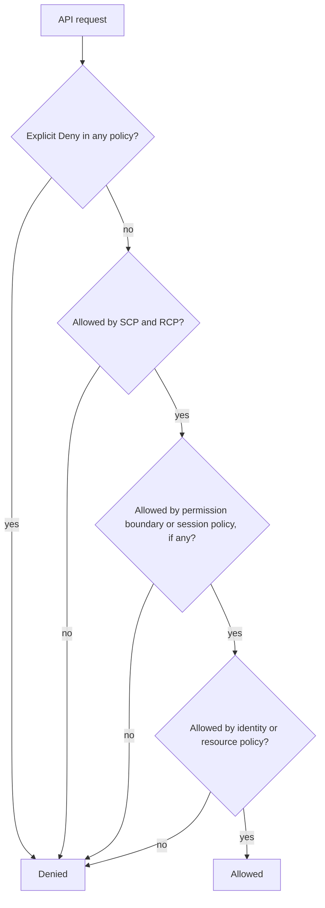
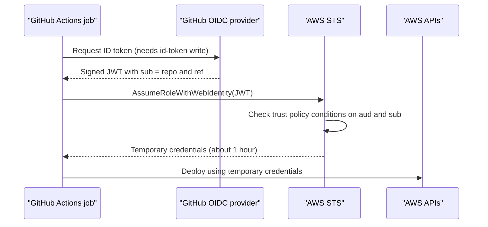

# Cloud IAM Security

## Introduction

In a traditional data center, the network was the main boundary. If you were inside the firewall, you could reach most things. In the cloud, every action is an API call, and every API call is checked against **identity and access management (IAM)**. Creating a server, reading a file from storage, deleting a database: all of it goes through IAM.

That makes IAM the real perimeter of a cloud account. An attacker who steals a set of credentials does not need to break through any firewall. They simply call the same APIs you do, with whatever permissions those credentials carry.

Think of IAM as the key system of a large office building. Each key (credential) opens a set of doors (permissions). Good key management means:

- Each person and each machine has its **own** key.
- Each key opens **only** the doors it needs.
- Keys **expire** and must be renewed, so a lost key stops working on its own.
- Building management can **lock entire floors** no matter what keys exist (organization guardrails).
- Every door logs who opened it.

This page uses AWS for most examples because its policy language is widely used and well documented, then maps the concepts to Azure and Google Cloud.

## IAM Building Blocks

### Principals, policies and resources

| Concept | AWS | Azure | Google Cloud |
| --- | --- | --- | --- |
| Human identity | IAM Identity Center user, federated user (IAM users are discouraged for humans) | Microsoft Entra ID user | Google account or Cloud Identity user |
| Workload identity | IAM role (assumed by EC2, Lambda, ECS tasks, EKS pods) | Managed identity | Service account |
| Permission set | Policy (JSON document) | Role definition | Role (set of permissions) |
| Assigning permissions | Attach policy to role, or resource-based policy | Role assignment at a scope | IAM policy binding on a resource |
| Organization guardrail | Service Control Policy (SCP), Resource Control Policy (RCP) | Azure Policy, management group RBAC | Organization Policy, IAM deny policies |

The vocabulary differs, but the questions are the same: **who** can do **what** on **which resource**, under **which conditions**.

### Anatomy of an AWS policy

An AWS policy is a JSON document made of statements. Each statement has an `Effect` (`Allow` or `Deny`), a list of `Action` values, a list of `Resource` ARNs and optional `Condition` blocks.

```json
{
  "Version": "2012-10-17",
  "Statement": [
    {
      "Sid": "ReadInvoicesOnly",
      "Effect": "Allow",
      "Action": ["s3:GetObject"],
      "Resource": "arn:aws:s3:::acme-invoices/2026/*",
      "Condition": {
        "StringEquals": { "aws:PrincipalOrgID": "o-abc123example" }
      }
    }
  ]
}
```

### How a request is evaluated

When a principal makes a request, AWS combines every policy type that applies. The important rules:

1. Everything is **denied by default**.
2. An **explicit deny** anywhere always wins.
3. Organization guardrails (SCPs, RCPs) and **permission boundaries** set a maximum. They never grant access on their own.
4. Within those limits, an allow in an identity-based or resource-based policy grants access.



This is simplified. Cross-account access, for example, needs an allow on **both** sides. See the AWS documentation on policy evaluation logic for the full flow.

## Rule 1: Prefer Temporary Credentials

Long-lived access keys are the most common way cloud accounts get compromised. They end up in Git history, laptop backups, CI logs and Docker image layers, and they stay valid until someone notices.

Temporary credentials expire after minutes or hours. Every major cloud has a way for workloads to get them automatically:

- **AWS:** IAM roles for EC2 (instance profiles), Lambda execution roles, ECS task roles, EKS Pod Identity or IRSA for Kubernetes pods.
- **Azure:** managed identities.
- **Google Cloud:** attached service accounts and Workload Identity Federation.

**Vulnerable:** keys hardcoded in the application.

```python
# upload_report.py - VULNERABLE: hardcoded long-lived keys
import boto3

s3 = boto3.client(
    "s3",
    aws_access_key_id="AKIAEXAMPLEEXAMPLE",      # leaks with the source code
    aws_secret_access_key="wJalrXUtnFEMI/EXAMPLEKEY",
    region_name="us-east-1",
)
s3.upload_file("report.pdf", "acme-reports", "2026/report.pdf")
```

**Fixed:** no secrets in code. boto3 uses the **default credential chain**, which finds the role credentials provided by the platform (instance profile, task role, Pod Identity, or your local SSO session during development).

```python
# upload_report.py - FIXED: credentials come from the environment's role
import boto3

s3 = boto3.client("s3")  # default credential chain, temporary credentials
s3.upload_file("report.pdf", "acme-reports", "2026/report.pdf")

# Show which identity is actually being used (useful when debugging)
print(boto3.client("sts").get_caller_identity()["Arn"])
```

Example output on an EC2 instance with a role attached:

```text
arn:aws:sts::111122223333:assumed-role/report-uploader/i-0abc123def4567890
```

For developers on laptops, use single sign-on (`aws configure sso`, then `aws sso login`) instead of personal access keys. The SDK then picks up short-lived credentials from the SSO session. For more on keeping secrets out of code, see [Secrets Management in Code](../5-sec-secure-coding/3-sec-secrets-in-code.mdx).

## Rule 2: Write Least-Privilege Policies

**Vulnerable:** the "just make it work" policy.

```json
{
  "Version": "2012-10-17",
  "Statement": [
    { "Effect": "Allow", "Action": "s3:*", "Resource": "*" },
    { "Effect": "Allow", "Action": "iam:PassRole", "Resource": "*" }
  ]
}
```

If this role is compromised (for example through an [SSRF](../3-sec-web-security/6-sec-ssrf.mdx) bug), the attacker can read and delete every bucket in the account, and `iam:PassRole` on all roles may let them hand a more powerful role to a new resource.

**Fixed:** specific actions, specific resources, and conditions.

```json
{
  "Version": "2012-10-17",
  "Statement": [
    {
      "Sid": "WriteReports",
      "Effect": "Allow",
      "Action": ["s3:PutObject"],
      "Resource": "arn:aws:s3:::acme-reports/2026/*"
    },
    {
      "Sid": "PassOnlyTheWorkerRole",
      "Effect": "Allow",
      "Action": "iam:PassRole",
      "Resource": "arn:aws:iam::111122223333:role/report-worker",
      "Condition": {
        "StringEquals": { "iam:PassedToService": "ecs-tasks.amazonaws.com" }
      }
    }
  ]
}
```

### A tiny offline policy linter

Before you reach for a full tool, it helps to see what "risky" looks like in code. This script reads a policy file and flags common problems. It does not call AWS.

```python
# lint_policy.py - flag risky patterns in an AWS IAM policy (offline)
import json
import sys

SENSITIVE_ACTIONS = {
    "iam:passrole", "iam:createpolicyversion", "iam:attachuserpolicy",
    "iam:attachrolepolicy", "iam:putrolepolicy", "iam:createaccesskey",
    "iam:updateassumerolepolicy", "sts:assumerole",
}

def as_list(value):
    return value if isinstance(value, list) else [value]

def lint(policy: dict) -> list[str]:
    findings = []
    for i, stmt in enumerate(as_list(policy.get("Statement", []))):
        sid = stmt.get("Sid", f"statement[{i}]")
        if stmt.get("Effect") != "Allow":
            continue
        if "NotAction" in stmt or "NotResource" in stmt:
            findings.append(f"{sid}: Allow with NotAction/NotResource grants more than it looks")
        actions = [a.lower() for a in as_list(stmt.get("Action", []))]
        resources = as_list(stmt.get("Resource", []))
        if "*" in actions:
            findings.append(f"{sid}: Action '*' grants every permission")
        for a in actions:
            if a.endswith(":*") and a != "*":
                findings.append(f"{sid}: service wildcard '{a}'")
            if a in SENSITIVE_ACTIONS and "*" in resources:
                findings.append(f"{sid}: sensitive action '{a}' on Resource '*'")
        if "*" in resources and "Condition" not in stmt:
            findings.append(f"{sid}: Resource '*' without any Condition")
    return findings

if __name__ == "__main__":
    with open(sys.argv[1]) as f:
        results = lint(json.load(f))
    for r in results:
        print("WARN", r)
    print(f"{len(results)} finding(s)")
    sys.exit(1 if results else 0)
```

Save the vulnerable policy as `bad.json` and the fixed one as `good.json`, then run:

```bash
python3 lint_policy.py bad.json
python3 lint_policy.py good.json
```

Example output:

```text
WARN statement[0]: service wildcard 's3:*'
WARN statement[0]: Resource '*' without any Condition
WARN statement[1]: sensitive action 'iam:passrole' on Resource '*'
WARN statement[1]: Resource '*' without any Condition
4 finding(s)
0 finding(s)
```

The non-zero exit code lets you use it as a CI gate. In practice, use the provider's analyzer, which understands every action and condition key.

### Validating with IAM Access Analyzer

AWS IAM Access Analyzer validates policies against the policy grammar and AWS best practices. It returns findings of four types: errors, security warnings, warnings and suggestions.

```bash
aws accessanalyzer validate-policy \
  --policy-type IDENTITY_POLICY \
  --policy-document file://bad.json \
  --query 'findings[].[findingType,issueCode]' --output table
```

Example output (shortened):

```text
-------------------------------------------------------------
|                      ValidatePolicy                       |
+-------------------+---------------------------------------+
|  SECURITY_WARNING |  PASS_ROLE_WITH_STAR_IN_RESOURCE      |
+-------------------+---------------------------------------+
```

Access Analyzer can also report **unused access** (roles and permissions nobody has used recently) and run **custom policy checks**, such as "does this new version grant any access the old one did not?". Some of these features are paid. Check the current pricing page.

Azure and Google Cloud have equivalents: Microsoft Entra Permissions Management and access reviews, and Google's IAM Recommender, which suggests removing permissions a principal has not used.

## Rule 3: Watch for Privilege Escalation Paths

:::warning Ethics
Study privilege escalation only so you can prevent it. Test only cloud accounts you own or have written permission to test, such as a personal sandbox account or an intentionally vulnerable training environment.
:::

Some permissions let a principal **give itself more permissions**. A role that looks limited can be equivalent to admin. Classic examples in AWS:

| Permission | Why it is dangerous |
| --- | --- |
| `iam:CreatePolicyVersion` on its own policy | Can rewrite its own policy to allow everything |
| `iam:AttachUserPolicy` or `iam:AttachRolePolicy` | Can attach `AdministratorAccess` to itself |
| `iam:PassRole` on `*` plus a compute action such as `lambda:CreateFunction` | Can launch code running as a more powerful role |
| `iam:UpdateAssumeRolePolicy` | Can let itself assume a powerful role |
| `iam:CreateAccessKey` on other users | Can mint keys for a more powerful user |

Defenses:

- Keep IAM-modifying permissions to a small, audited admin path.
- Scope `iam:PassRole` to exact role ARNs and use the `iam:PassedToService` condition.
- Use **permission boundaries** when you must let teams create their own roles: any role they create cannot exceed the boundary.
- Alert on IAM changes in your audit log. See [Detection Engineering](../11-sec-defensive-operations/2-sec-detection-engineering.mdx).

## Rule 4: Federate CI/CD Instead of Storing Keys

CI pipelines need cloud access to deploy. The old way was to store an access key as a CI secret. The modern way is **OIDC federation**: the CI system issues a short-lived signed token describing the job (repository, branch, environment), and the cloud exchanges it for temporary credentials.



The security of this flow depends on the **trust policy** of the role. The `sub` claim identifies which repository and branch is asking.

**Vulnerable:** any repository in the organization, or worse any repository on GitHub, can assume the role.

```json
{
  "Effect": "Allow",
  "Principal": { "Federated": "arn:aws:iam::111122223333:oidc-provider/token.actions.githubusercontent.com" },
  "Action": "sts:AssumeRoleWithWebIdentity",
  "Condition": {
    "StringLike": { "token.actions.githubusercontent.com:sub": "repo:acme/*" }
  }
}
```

**Fixed:** pin the audience and the exact repository plus protected branch or deployment environment.

```json
{
  "Effect": "Allow",
  "Principal": { "Federated": "arn:aws:iam::111122223333:oidc-provider/token.actions.githubusercontent.com" },
  "Action": "sts:AssumeRoleWithWebIdentity",
  "Condition": {
    "StringEquals": {
      "token.actions.githubusercontent.com:aud": "sts.amazonaws.com",
      "token.actions.githubusercontent.com:sub": "repo:acme/billing-api:environment:production"
    }
  }
}
```

The workflow side needs the `id-token: write` permission and an action such as `aws-actions/configure-aws-credentials`. GitHub's documentation pins that action to a full commit SHA, which is a good habit for every third-party action. See [Securing CI/CD Pipelines](../6-sec-appsec-and-devsecops/8-sec-pipeline-security.mdx).

```yaml
# .github/workflows/deploy.yml (excerpt)
permissions:
  id-token: write
  contents: read
jobs:
  deploy:
    runs-on: ubuntu-latest
    environment: production
    steps:
      - uses: aws-actions/configure-aws-credentials@e3dd6a429d7300a6a4c196c26e071d42e0343502
        with:
          role-to-assume: arn:aws:iam::111122223333:role/billing-api-deploy
          aws-region: us-east-1
      - run: aws sts get-caller-identity
```

## Rule 5: Protect Human Access and Add Guardrails

- **Root and global admin accounts:** enable MFA (preferably phishing-resistant, such as passkeys or security keys), do not create access keys for them, and use them only for the few tasks that require them.
- **Single sign-on:** give humans access through an identity provider (IAM Identity Center, Entra ID, Google Workspace) with MFA and group-based roles, so offboarding one user removes all their cloud access. See [Single Sign-On and SAML](../4-sec-authentication/8-sec-sso-and-saml.mdx).
- **Break-glass account:** keep one emergency admin path with strong MFA, stored credentials, and an alert whenever it is used.
- **Organization guardrails:** use SCPs (AWS), Azure Policy, or Organization Policies (Google Cloud) to block actions no team should ever take.

An example SCP that stops anyone in member accounts from disabling audit logging or leaving the organization:

```json
{
  "Version": "2012-10-17",
  "Statement": [
    {
      "Sid": "ProtectAuditTrail",
      "Effect": "Deny",
      "Action": ["cloudtrail:StopLogging", "cloudtrail:DeleteTrail", "cloudtrail:UpdateTrail"],
      "Resource": "*"
    },
    {
      "Sid": "StayInOrg",
      "Effect": "Deny",
      "Action": "organizations:LeaveOrganization",
      "Resource": "*"
    }
  ]
}
```

Because SCPs only restrict, this policy cannot accidentally grant anything. Test SCPs in a non-production organizational unit first, because a deny that is too broad can break deployments.

## Real-World Scenario

Your team deploys a billing API to AWS from GitHub Actions. Today, a CI secret holds the access key of an IAM user called `deployer` with `AdministratorAccess`. The key is three years old. A security review asks you to fix this.

You consider three options:

1. **Rotate the key every 90 days and reduce its permissions.**
2. **OIDC federation** from GitHub Actions to a deploy role scoped to the billing API's resources, trusted only for the `production` environment of one repository.
3. **Self-hosted runner on EC2** with an instance role.

You choose option 2. The `deployer` user and its key are deleted. The new role can only update the billing API's ECS service, push to its ECR repository and pass the single task role. The GitHub `production` environment requires a reviewer approval, so the trust condition `environment:production` also means "a human approved this deploy".

**Why this approach:** there is no long-lived secret left to leak, credentials expire within about an hour, and the trust policy ties cloud access to a specific repository and approval flow. CloudTrail logs show the role session name, so deploys are traceable.

**When to use it:** any CI/CD system that supports OIDC (GitHub Actions, GitLab CI, many others) deploying to a cloud that supports web identity federation.

**When not to:** CI systems without OIDC support, or air-gapped environments. Then use the most restricted key you can, store it in a secrets manager, rotate it automatically, and alert on its use from unexpected IP addresses.

| Approach | Pros | Cons | Best for |
| --- | --- | --- | --- |
| Long-lived access key in CI secrets | Works everywhere, simple | Leaks are long-lived; rotation is manual and often forgotten | Legacy CI without OIDC, as a temporary measure |
| OIDC federation | No stored secret; short-lived; fine-grained trust on repo, branch, environment | Trust policy mistakes (wildcard `sub`) can open the role to other repos | Modern hosted CI |
| Self-hosted runner with instance role | No stored secret; network-private deploys | Runner must be hardened; any job on that runner gets the role | Private networks, heavy builds |
| Separate deploy tool (for example GitOps controller in the cluster) | CI never touches production credentials | More moving parts | Kubernetes-heavy teams |

## Common Mistakes

- **`Action: "*"` "just for now".** Temporary admin policies become permanent. Start from zero and add permissions using access logs or the analyzer's policy generation.
- **One role shared by many services.** A bug in one service then exposes the data of all of them. Give each workload its own role.
- **Wildcard trust policies.** A trust policy that lets any principal in another account, or any repository, assume a role is an open door. Always pin the external identity and use conditions such as `sts:ExternalId` for third-party vendors.
- **Ignoring resource-based policies.** A bucket or KMS key policy can grant access that no identity policy shows. Review both sides.
- **Never removing access.** People change teams, services are retired. Use unused-access reports and periodic access reviews.
- **No MFA on humans.** Stolen passwords remain one of the easiest ways into a cloud console.

## Summary

- In the cloud, IAM is the main security boundary. Every action is an API call checked against policies.
- Prefer temporary credentials from roles, managed identities and service accounts over long-lived keys.
- Write least-privilege policies: specific actions, specific resources, conditions where possible.
- Know the privilege escalation permissions (`iam:PassRole`, policy-editing actions) and lock them down.
- Use OIDC federation for CI/CD, with tightly pinned trust conditions.
- Protect humans with SSO and MFA, and use organization guardrails to block dangerous actions everywhere.

## Exercises

1. Extend `lint_policy.py` to flag `Principal: "*"` in resource-based policies and missing `aws:PrincipalOrgID` conditions.
2. In a personal sandbox account, create a role for a Lambda function that can only write to one DynamoDB table. Validate the policy with `aws accessanalyzer validate-policy`.
3. Write a trust policy for a GitHub Actions role that only allows tags matching `v*` from one repository. Which condition operator do you need?
4. List every IAM principal in a sandbox account that has an access key older than 90 days, using `aws iam generate-credential-report` and reading the CSV.

Related pages:

- [Least Privilege and Zero Trust](../0-sec-fundamentals/5-sec-least-privilege.mdx)
- [RBAC, ABAC and ReBAC](../4-sec-authentication/9-sec-rbac-abac.mdx)
- [OAuth 2.0](../4-sec-authentication/6-sec-oauth2.mdx) and [OpenID Connect](../4-sec-authentication/7-sec-oidc.mdx)
- [Common Cloud Misconfigurations](./2-sec-cloud-misconfigurations.mdx)
- [Kubernetes Security](./5-sec-kubernetes-security.mdx) for workload identity in clusters

External reading:

- [AWS: Policy evaluation logic](https://docs.aws.amazon.com/IAM/latest/UserGuide/reference_policies_evaluation-logic.html)
- [AWS: Validate policies with IAM Access Analyzer](https://docs.aws.amazon.com/IAM/latest/UserGuide/access-analyzer-policy-validation.html)
- [GitHub: Configuring OpenID Connect in Amazon Web Services](https://docs.github.com/en/actions/how-tos/secure-your-work/security-harden-deployments/oidc-in-aws)
- [Amazon EKS Pod Identity](https://docs.aws.amazon.com/eks/latest/userguide/pod-identities.html)
