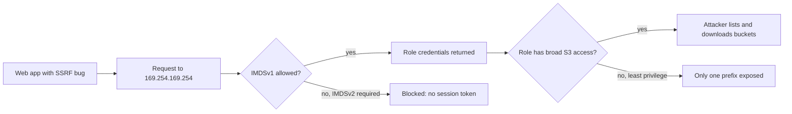

# Common Cloud Misconfigurations

## Introduction

Most cloud security incidents do not start with a clever zero-day exploit. They start with a setting: a database that accepts connections from the whole internet, a storage bucket that anyone can list, a firewall rule added "temporarily" during an outage and never removed.

**Security Misconfiguration** is category A02 in the [OWASP Top 10 2025](../3-sec-web-security/1-sec-owasp-top-10.mdx), and in the cloud it is amplified by three facts:

- **Everything is configurable by API.** One command can expose a resource to the world.
- **Scale.** A company may have thousands of resources across many accounts and regions, created by dozens of people.
- **Speed.** Attackers continuously scan the internet. An exposed service can be found within hours of being created.

A good analogy is a building with thousands of doors and windows, where any employee can open any of them with a click, and burglars drive past every night checking handles. You need both locks (secure configuration) and a night guard who walks the halls (continuous monitoring).

This page covers the most common misconfigurations, shows vulnerable and fixed Terraform for each, and explains how to detect them automatically.

:::warning Ethics
Only scan or test cloud accounts you own or have written permission to assess. Scanning other people's infrastructure for misconfigurations, even "just to look", can be illegal. Use your own sandbox accounts or training platforms such as TryHackMe, HackTheBox or the intentionally vulnerable labs published by cloud security projects.
:::

## The Usual Suspects

| Misconfiguration | What goes wrong | Typical fix |
| --- | --- | --- |
| Admin ports open to `0.0.0.0/0` (SSH 22, RDP 3389) | Brute force, exploitation of remote-access bugs | Remove inbound rule; use a session manager or VPN |
| Databases reachable from the internet | Data theft, ransom notes left in the database | Private subnets; `publicly_accessible = false` |
| Public storage buckets or containers | Data leaks | Block Public Access, private by default, pre-signed URLs |
| Public disk snapshots, machine images or DB snapshots | Anyone can copy your disk and read its data | Keep private; block public sharing at account level |
| Instance metadata service v1 allowed | SSRF bugs can steal role credentials | Require IMDSv2 (token-based) |
| Audit logging disabled or short retention | No evidence after an incident | Organization-wide trail, protected log storage |
| Unencrypted volumes and databases | Data exposed if snapshots leak | Encryption by default at account level |
| Over-permissive IAM roles | Small bugs become full compromises | Least privilege. See [Cloud IAM Security](./1-sec-cloud-iam.mdx) |
| Secrets in instance user data or environment variables | Anyone with read access to config sees them | Secrets manager, fetched at runtime |
| Management interfaces exposed (Kubernetes API, dashboards, Jupyter) | Remote takeover | Private endpoints, authentication, IP allow lists |
| Default VPC and default service accounts used for production | Broad defaults, unclear ownership | Purpose-built networks and identities |

## How Small Settings Chain Together

Misconfigurations are dangerous alone, but worse in combination. A well-known pattern, seen in public breach reports, chains an application bug with two cloud settings:



Each defense breaks the chain at a different point. Fixing the SSRF bug is the root cause fix (see [Server-Side Request Forgery](../3-sec-web-security/6-sec-ssrf.mdx)), but requiring IMDSv2 and scoping the role mean that the **next** SSRF bug, which will come eventually, does far less damage. This is [defense in depth](../0-sec-fundamentals/4-sec-defense-in-depth.mdx) applied to configuration.

## Fixing the Big Ones in Terraform

The examples use the AWS Terraform provider. The same ideas apply to Azure (Network Security Groups, `public_network_access_enabled`) and Google Cloud (firewall rules, authorized networks). For Terraform basics see [/docs/devops/terraform](/docs/devops/terraform).

### 1. Remote administration open to the world

**Vulnerable:**

```hcl
resource "aws_security_group" "web" {
  name   = "web-sg"
  vpc_id = aws_vpc.main.id

  ingress {
    description = "SSH from anywhere"
    from_port   = 22
    to_port     = 22
    protocol    = "tcp"
    cidr_blocks = ["0.0.0.0/0"]
  }

  ingress {
    description = "HTTPS"
    from_port   = 443
    to_port     = 443
    protocol    = "tcp"
    cidr_blocks = ["0.0.0.0/0"]
  }
}
```

**Fixed:** no SSH rule at all. Administrators connect through AWS Systems Manager Session Manager, which needs no inbound port, authenticates with IAM and logs every session.

```hcl
resource "aws_security_group" "web" {
  name   = "web-sg"
  vpc_id = aws_vpc.main.id

  ingress {
    description     = "HTTPS from the load balancer only"
    from_port       = 443
    to_port         = 443
    protocol        = "tcp"
    security_groups = [aws_security_group.alb.id]
  }

  egress {
    description = "Outbound HTTPS for updates and AWS APIs"
    from_port   = 443
    to_port     = 443
    protocol    = "tcp"
    cidr_blocks = ["0.0.0.0/0"]
  }
}
```

Notice the second improvement: the web servers only accept traffic from the load balancer's security group, not from the whole internet.

### 2. IMDSv1 and unencrypted disks on instances

**Vulnerable:** the provider defaults are used, which may allow IMDSv1 depending on the AMI and account settings.

```hcl
resource "aws_instance" "app" {
  ami           = var.ami_id
  instance_type = "t3.small"
}
```

**Fixed:** require session tokens and encrypt the root volume.

```hcl
resource "aws_instance" "app" {
  ami                  = var.ami_id
  instance_type        = "t3.small"
  iam_instance_profile = aws_iam_instance_profile.app.name

  metadata_options {
    http_endpoint               = "enabled"
    http_tokens                 = "required" # IMDSv2 only
    http_put_response_hop_limit = 1          # use 2 if containers on the host need IMDS
  }

  root_block_device {
    encrypted = true
  }
}
```

You can also set IMDSv2 as the **account default** per Region, and even **enforce** it so that instances requiring IMDSv1 fail to launch:

```bash
aws ec2 modify-instance-metadata-defaults \
  --region us-east-1 \
  --http-tokens required \
  --http-tokens-enforced enabled
```

Example output:

```text
{
    "Return": true
}
```

Before enforcing, check that your AMIs and SDKs support IMDSv2. Modern AWS SDKs and the AWS CLI do.

### 3. Databases with public endpoints

**Vulnerable:**

```hcl
resource "aws_db_instance" "orders" {
  identifier          = "orders"
  engine              = "postgres"
  instance_class      = "db.t4g.micro"
  allocated_storage   = 20
  username            = "app"
  password            = "Summer2026!"
  publicly_accessible = true
  storage_encrypted   = false
  skip_final_snapshot = true
}
```

Four problems: a public endpoint, a hardcoded password in code (and in Terraform state), no encryption at rest, and no final snapshot on deletion.

**Fixed:**

```hcl
resource "aws_db_instance" "orders" {
  identifier                  = "orders"
  engine                      = "postgres"
  instance_class              = "db.t4g.micro"
  allocated_storage           = 20
  username                    = "app"
  manage_master_user_password = true # password generated and stored in Secrets Manager
  publicly_accessible         = false
  storage_encrypted           = true
  db_subnet_group_name        = aws_db_subnet_group.private.name
  vpc_security_group_ids      = [aws_security_group.db.id]
  deletion_protection         = true
  backup_retention_period     = 7
  skip_final_snapshot         = false
  final_snapshot_identifier   = "orders-final"
}
```

### 4. Account-wide settings

Some protections are account-level switches that cover every future resource:

```hcl
resource "aws_ebs_encryption_by_default" "this" {
  enabled = true
}

resource "aws_s3_account_public_access_block" "this" {
  block_public_acls       = true
  block_public_policy     = true
  ignore_public_acls      = true
  restrict_public_buckets = true
}
```

Turning these on once is cheaper and more reliable than remembering a setting on every resource. In a multi-account organization, apply them through organization policies (AWS declarative policies or SCPs, Azure Policy, Google Cloud Organization Policy constraints) so that no account can opt out.

## Finding Misconfigurations Automatically

### A small checker on exported data

Real tools (covered in [CSPM](./7-sec-cspm.mdx)) run hundreds of checks. To see how they work, here is a checker for open admin ports. It reads the JSON output of `aws ec2 describe-security-groups`, so you can test it on sample data without an AWS account.

```python
# open_ports.py - flag security group rules that expose admin or DB ports to the internet
import json
import sys

RISKY_PORTS = {22: "SSH", 3389: "RDP", 3306: "MySQL", 5432: "PostgreSQL",
               6379: "Redis", 9200: "Elasticsearch", 27017: "MongoDB"}
WORLD = {"0.0.0.0/0", "::/0"}

def rule_sources(rule):
    v4 = [r["CidrIp"] for r in rule.get("IpRanges", [])]
    v6 = [r["CidrIpv6"] for r in rule.get("Ipv6Ranges", [])]
    return set(v4 + v6)

def check(groups):
    findings = []
    for sg in groups:
        for rule in sg.get("IpPermissions", []):
            if not rule_sources(rule) & WORLD:
                continue
            if rule.get("IpProtocol") == "-1":
                findings.append((sg["GroupId"], "ALL TRAFFIC"))
                continue
            low, high = rule.get("FromPort", 0), rule.get("ToPort", 65535)
            for port, name in RISKY_PORTS.items():
                if low <= port <= high:
                    findings.append((sg["GroupId"], f"{name} ({port})"))
    return findings

if __name__ == "__main__":
    data = json.load(open(sys.argv[1]))
    results = check(data["SecurityGroups"])
    for group_id, what in results:
        print(f"OPEN TO INTERNET: {group_id} -> {what}")
    print(f"{len(results)} finding(s)")
```

Sample input `sgs.json`:

```json
{
  "SecurityGroups": [
    {
      "GroupId": "sg-0a1",
      "IpPermissions": [
        {"IpProtocol": "tcp", "FromPort": 22, "ToPort": 22, "IpRanges": [{"CidrIp": "0.0.0.0/0"}]},
        {"IpProtocol": "tcp", "FromPort": 443, "ToPort": 443, "IpRanges": [{"CidrIp": "0.0.0.0/0"}]}
      ]
    },
    {
      "GroupId": "sg-0b2",
      "IpPermissions": [
        {"IpProtocol": "tcp", "FromPort": 5432, "ToPort": 5432, "IpRanges": [{"CidrIp": "10.0.0.0/16"}]}
      ]
    },
    {
      "GroupId": "sg-0c3",
      "IpPermissions": [
        {"IpProtocol": "-1", "Ipv6Ranges": [{"CidrIpv6": "::/0"}]}
      ]
    }
  ]
}
```

```bash
python3 open_ports.py sgs.json
# On your own account:
# aws ec2 describe-security-groups --output json > sgs.json
```

Example output:

```text
OPEN TO INTERNET: sg-0a1 -> SSH (22)
OPEN TO INTERNET: sg-0c3 -> ALL TRAFFIC
2 finding(s)
```

The private PostgreSQL rule in `sg-0b2` is correctly ignored, and HTTPS on 443 is not flagged because a public web port is often intended.

### Built-in provider services

| Provider | Detect | Prevent |
| --- | --- | --- |
| AWS | AWS Config rules, Security Hub CSPM controls, IAM Access Analyzer | SCPs, declarative policies, account-level defaults |
| Azure | Microsoft Defender for Cloud recommendations, Azure Policy in audit mode | Azure Policy in deny mode |
| Google Cloud | Security Command Center (Security Health Analytics) | Organization Policy constraints |

The strongest programs combine three layers: **prevent** in code review ([IaC scanning](./6-sec-infrastructure-as-code-security.mdx)), **block** at the organization level for the few settings that must never happen, and **detect** continuously for everything else (drift, console changes, new resource types).

## Real-World Scenario

Your company's posture scan reports 14 EC2 instances with SSH open to `0.0.0.0/0`. The developers say they need SSH to debug production issues, and some work from home with changing IP addresses.

You compare the options for remote administration:

| Approach | Pros | Cons | Best for |
| --- | --- | --- | --- |
| SSH open to the world with keys | Simple | Exposed to constant scanning and any future SSH vulnerability; key sprawl | Never for production |
| SSH restricted to office or VPN IP ranges | Familiar tooling | Home IPs change; VPN becomes a critical dependency; keys still to manage | Teams already running a VPN |
| Bastion host | One controlled entry point | The bastion itself must be patched and hardened | Legacy setups |
| Session Manager (AWS SSM) or equivalent (Azure Bastion, Google IAP TCP forwarding) | No inbound port; IAM plus MFA authentication; sessions logged | Needs an agent and outbound connectivity; small learning curve | Most cloud VM fleets |
| EC2 Instance Connect Endpoint | No public IP needed; short-lived SSH keys pushed per session | AWS-specific; still SSH | Teams that want standard SSH clients |
| No interactive access (immutable servers) | Smallest attack surface | Debugging relies on logs and metrics | Mature teams with good observability |

You choose **Session Manager**, rolled out in three steps: add the SSM agent and instance role permissions to the base image, confirm every team can connect, then remove the port 22 rules and add an organization guardrail that alerts on any new `0.0.0.0/0` rule for port 22.

**Why this approach:** it removes the exposure completely instead of narrowing it, ties access to SSO identities with MFA, and logs sessions, which also helps with audits.

**When not to use it:** if instances cannot reach the SSM endpoints (for example, strict egress without VPC endpoints), or for workloads where nobody should log in at all. For those, invest in immutable deployments instead.

## Common Mistakes

- **"Temporary" rules.** Rules opened during an incident are rarely closed. Add an expiry tag and a scheduled check.
- **Fixing in the console only.** If the resource is managed by Terraform, the next apply may revert your fix, or the drift goes unnoticed. Fix it in code.
- **Ignoring IPv6.** A rule for `::/0` exposes the port just as much as `0.0.0.0/0`. Tools and reviews must check both.
- **Trusting non-production.** Staging accounts often contain copies of production data and long-lived credentials. Attackers love them.
- **Alert floods.** Turning on every check at once produces thousands of findings that nobody reads. Start with a short list of critical checks and make each one owned and actionable.
- **Forgetting other regions.** Resources in regions you "don't use" are invisible in daily work. Restrict unused regions with organization policies and scan all regions.

## Summary

- Misconfiguration (OWASP A02:2025) causes many cloud incidents, made worse by API-driven change, scale and constant internet scanning.
- The usual suspects: open admin and database ports, public storage and snapshots, IMDSv1, disabled logging, missing encryption and broad IAM.
- Misconfigurations chain together. Requiring IMDSv2 and least-privilege roles limits the damage of application bugs like SSRF.
- Fix in code, apply account-level secure defaults, block the worst settings with organization policies, and detect the rest continuously.

## Exercises

1. Extend `open_ports.py` to also report security groups that are attached to nothing (unused). Which field in the AWS output tells you that?
2. Write Terraform for an Azure Network Security Group that allows HTTPS from the internet and SSH only from a `10.0.0.0/8` range. Check the resource names in the AzureRM provider docs.
3. In a sandbox account, launch an instance with the default settings and inspect its metadata options with `aws ec2 describe-instances`. Then set the account default to IMDSv2 and launch another. Compare.
4. Pick three rows from "The Usual Suspects" table and find the matching managed check in AWS Config, Azure Policy or Google Security Health Analytics.

Related pages:

- [Securing Cloud Storage](./3-sec-cloud-storage-security.mdx)
- [Infrastructure as Code Security](./6-sec-infrastructure-as-code-security.mdx)
- [Cloud Security Posture Management](./7-sec-cspm.mdx)
- [Firewalls and Security Groups](../2-sec-network-security/1-sec-firewalls.mdx)
- [Secure Defaults and Configuration](../5-sec-secure-coding/6-sec-secure-defaults.mdx)

External reading:

- [OWASP Top 10 2025: A02 Security Misconfiguration](https://owasp.org/Top10/)
- [AWS: Configure instance metadata options for new instances](https://docs.aws.amazon.com/AWSEC2/latest/UserGuide/configuring-IMDS-new-instances.html)
- [AWS Systems Manager Session Manager](https://docs.aws.amazon.com/systems-manager/latest/userguide/session-manager.html)
- [CIS Benchmarks for cloud providers](https://www.cisecurity.org/cis-benchmarks)
