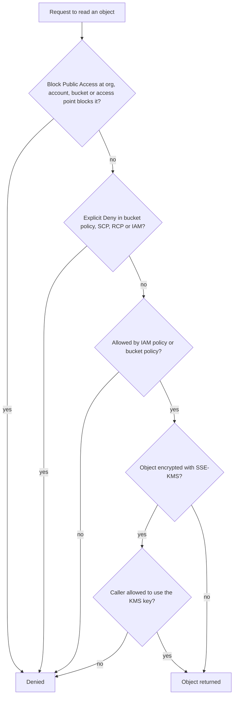

# Securing Cloud Storage

## Introduction

Object storage services such as **Amazon S3**, **Azure Blob Storage** and **Google Cloud Storage** hold an enormous amount of the world's data: backups, logs, user uploads, data lake files, machine learning datasets. They are cheap, durable and reachable over HTTPS from anywhere. That last property is exactly why storage misconfigurations make headlines: a single wrong setting can make millions of files readable by anyone who guesses the bucket name.

Think of a bucket as a warehouse with a loading dock that faces a public street. The warehouse is extremely sturdy. Whether it is safe depends on who has keys, whether the dock door is locked, whether you log every delivery, and whether you keep copies of important boxes somewhere else.

This page covers the main controls, mostly with Amazon S3 examples, and maps them to Azure and Google Cloud:

1. Keep buckets private (block public access, disable ACLs).
2. Grant access with precise policies, and share individual files with short-lived signed URLs.
3. Encrypt data and control the keys.
4. Protect against deletion and ransomware (versioning, Object Lock, backups).
5. Log and monitor access.

## Layer 1: Keep Buckets Private

### Secure defaults you get today

Providers have tightened defaults over the last few years. For Amazon S3, according to the official documentation:

- New buckets, access points and objects **do not allow public access** by default, and S3 Block Public Access is on for new buckets.
- New buckets use the Object Ownership setting **Bucket owner enforced**, which **disables ACLs**. Access is controlled only by policies.
- Since **January 5, 2023**, all new object uploads are encrypted with **SSE-S3** by default.

Equivalent controls exist elsewhere:

| Control | Amazon S3 | Azure Blob Storage | Google Cloud Storage |
| --- | --- | --- | --- |
| Block anonymous/public access | S3 Block Public Access (bucket, account, organization) | Storage account setting "Allow Blob anonymous access" set to disabled | Public access prevention |
| Disable per-object ACLs | Object Ownership: Bucket owner enforced | (Uses RBAC and container access level) | Uniform bucket-level access |
| Temporary sharing link | Pre-signed URL | Shared Access Signature (prefer user delegation SAS) | Signed URL |
| Network restriction | VPC endpoint plus `aws:SourceVpce` condition | Private endpoints, storage firewall | VPC Service Controls |

Defaults only protect new resources, and anyone with enough permissions can turn them off. Older buckets may still have ACLs and public policies from years ago.

### The four Block Public Access settings

S3 Block Public Access has four independent settings. AWS recommends turning on all four at the **account** level (and at the organization level for multi-account setups), so that no bucket can become public even if a bucket policy says otherwise.

| Setting | Effect |
| --- | --- |
| `BlockPublicAcls` | Rejects requests that try to set a public ACL |
| `IgnorePublicAcls` | Ignores any public ACL that already exists |
| `BlockPublicPolicy` | Rejects bucket or access point policies that grant public access |
| `RestrictPublicBuckets` | Limits buckets with public policies to AWS service principals and the owner account |



This diagram is simplified, but it shows an important point: SSE-KMS adds a **second, independent permission check** on the key. A leaked bucket policy alone is then not enough to read the data.

### Vulnerable vs fixed bucket policy

A common reason to make a bucket public is serving website assets.

**Vulnerable:** the whole bucket is world-readable, including anything someone uploads by mistake.

```json
{
  "Version": "2012-10-17",
  "Statement": [
    {
      "Sid": "PublicRead",
      "Effect": "Allow",
      "Principal": "*",
      "Action": "s3:GetObject",
      "Resource": "arn:aws:s3:::acme-site-assets/*"
    }
  ]
}
```

**Fixed:** the bucket stays private. Only the CloudFront distribution can read it, through Origin Access Control (OAC), and the policy also refuses any request that is not over TLS.

```json
{
  "Version": "2012-10-17",
  "Statement": [
    {
      "Sid": "AllowCloudFrontOAC",
      "Effect": "Allow",
      "Principal": { "Service": "cloudfront.amazonaws.com" },
      "Action": "s3:GetObject",
      "Resource": "arn:aws:s3:::acme-site-assets/*",
      "Condition": {
        "StringEquals": {
          "AWS:SourceArn": "arn:aws:cloudfront::111122223333:distribution/EDFDVBD6EXAMPLE"
        }
      }
    },
    {
      "Sid": "DenyInsecureTransport",
      "Effect": "Deny",
      "Principal": "*",
      "Action": "s3:*",
      "Resource": [
        "arn:aws:s3:::acme-site-assets",
        "arn:aws:s3:::acme-site-assets/*"
      ],
      "Condition": { "Bool": { "aws:SecureTransport": "false" } }
    }
  ]
}
```

Because the allow is tied to a fixed `AWS:SourceArn`, S3 does not consider this policy public, so it works with Block Public Access fully enabled.

## Layer 2: Share Files with Pre-Signed URLs

Applications often need to let a user download one private file, such as their invoice. Two wrong ways are common: making the object public, or putting the file under a guessable URL with no authorization check.

**Vulnerable:** the app uploads invoices with a public-read ACL and returns a permanent URL. Anyone who gets the link, or guesses the pattern, can read any invoice forever. (This also fails on new buckets because ACLs are disabled, which pushes developers to disable protections, which is worse.)

```python
# VULNERABLE: permanent public link, no authorization
def invoice_link(invoice_id: str) -> str:
    return f"https://acme-invoices.s3.amazonaws.com/invoices/{invoice_id}.pdf"
```

**Fixed:** check that the logged-in user owns the invoice, then return a **pre-signed URL** that expires after a few minutes. The bucket stays private.

```python
# app.py - FIXED: authorization check plus short-lived pre-signed URL
import boto3
from botocore.config import Config
from flask import Flask, abort, jsonify

app = Flask(__name__)
s3 = boto3.client("s3", region_name="us-east-1",
                  config=Config(signature_version="s3v4"))
BUCKET = "acme-invoices"

# Stand-ins for your real database and session handling
INVOICE_OWNERS = {"inv-1001": "alice", "inv-1002": "bob"}

def current_user() -> str:
    return "alice"  # replace with your session or token lookup

@app.get("/invoices/<invoice_id>/download")
def download(invoice_id: str):
    owner = INVOICE_OWNERS.get(invoice_id)
    if owner is None or owner != current_user():
        abort(404)  # do not reveal whether the invoice exists
    url = s3.generate_presigned_url(
        "get_object",
        Params={
            "Bucket": BUCKET,
            "Key": f"invoices/{invoice_id}.pdf",
            "ResponseContentDisposition": "attachment",
        },
        ExpiresIn=300,  # 5 minutes
    )
    return jsonify({"url": url})

if __name__ == "__main__":
    with app.test_client() as c:
        print(c.get("/invoices/inv-1001/download").get_json()["url"][:120], "...")
        print(c.get("/invoices/inv-1002/download").status_code)
```

Signing happens locally with the app's credentials, so you can run the demo with any credentials configured. Example output:

```text
https://acme-invoices.s3.amazonaws.com/invoices/inv-1001.pdf?response-content-disposition=attachment&X-Amz-Algorithm=AWS ...
404
```

Points to remember about pre-signed URLs:

- **Anyone holding the URL can use it** until it expires. Keep expiry short and never log full URLs.
- A pre-signed URL can never grant more than the signing identity has. If the app's role cannot read the key, the URL fails.
- If the URL is signed with temporary credentials, it stops working when those credentials expire, even if `ExpiresIn` is longer.
- For uploads, use pre-signed `PUT` or POST policies with content-type and size limits, and treat uploaded files as untrusted. See [Secure File Uploads](../3-sec-web-security/10-sec-file-upload-security.mdx).

The authorization check before signing is the real security control. Skipping it creates a [Broken Object Level Authorization](../7-sec-api-security/2-sec-bola.mdx) bug.

## Layer 3: Encryption and Key Control

All three major providers encrypt stored objects by default with provider-managed keys. That protects against stolen physical disks, but it does not stop someone who has API access, because the service decrypts transparently for any authorized request.

Customer-managed keys add a separate control:

| Option (S3 names) | Who controls the key | Extra protection | Trade-offs |
| --- | --- | --- | --- |
| SSE-S3 (default) | AWS | Disk-level theft | None beyond IAM and bucket policy |
| SSE-KMS with a customer managed key | You, through KMS key policy | Separate permission to use the key; key usage logged in CloudTrail; can disable the key | KMS request costs and quotas; use S3 Bucket Keys to reduce calls |
| DSSE-KMS | You | Two layers of encryption for strict compliance rules | Higher cost |
| Client-side encryption | You, fully outside the provider | Provider never sees plaintext | You manage keys and lose server-side features such as some analytics |

Azure Storage and Google Cloud Storage offer the same choice through customer-managed keys in Azure Key Vault or Cloud KMS. For key handling principles, see [Key Management](../1-sec-cryptography/8-sec-key-management.mdx).

## Layer 4: Protect Against Deletion and Ransomware

Attackers who get write access may delete data or overwrite it with encrypted copies and demand payment. Storage features that help:

- **Versioning:** keeps previous versions when objects are overwritten or deleted.
- **Object Lock (WORM):** prevents deletion or overwriting of a version for a retention period. In **compliance mode**, nobody, including the root user, can shorten it.
- **Lifecycle rules:** expire old versions so versioning does not grow costs forever.
- **Cross-account replication or backups:** copies in a separate account that the production account's credentials cannot touch.

Here is a hardened bucket in Terraform, combining the layers so far:

```hcl
resource "aws_s3_bucket" "invoices" {
  bucket              = "acme-invoices"
  object_lock_enabled = true
}

resource "aws_s3_bucket_public_access_block" "invoices" {
  bucket                  = aws_s3_bucket.invoices.id
  block_public_acls       = true
  block_public_policy     = true
  ignore_public_acls      = true
  restrict_public_buckets = true
}

resource "aws_s3_bucket_ownership_controls" "invoices" {
  bucket = aws_s3_bucket.invoices.id
  rule {
    object_ownership = "BucketOwnerEnforced"
  }
}

resource "aws_s3_bucket_versioning" "invoices" {
  bucket = aws_s3_bucket.invoices.id
  versioning_configuration {
    status = "Enabled"
  }
}

resource "aws_s3_bucket_server_side_encryption_configuration" "invoices" {
  bucket = aws_s3_bucket.invoices.id
  rule {
    apply_server_side_encryption_by_default {
      sse_algorithm     = "aws:kms"
      kms_master_key_id = aws_kms_key.invoices.arn
    }
    bucket_key_enabled = true
  }
}

resource "aws_s3_bucket_object_lock_configuration" "invoices" {
  bucket = aws_s3_bucket.invoices.id
  rule {
    default_retention {
      mode = "GOVERNANCE"
      days = 30
    }
  }
}

resource "aws_s3_bucket_lifecycle_configuration" "invoices" {
  bucket = aws_s3_bucket.invoices.id
  rule {
    id     = "expire-old-versions"
    status = "Enabled"
    filter {}
    noncurrent_version_expiration {
      noncurrent_days = 90
    }
  }
}
```

`GOVERNANCE` mode lets specially authorized users override the lock, which is safer while you learn. Switch to `COMPLIANCE` only when you are sure of the retention period, because it cannot be shortened. For a wider view of backup strategy, see [Backups and Ransomware Resilience](../9-sec-system-hardening/6-sec-backups-and-ransomware.mdx).

## Layer 5: Logging and Monitoring

You cannot investigate what you did not record.

- **Management events** (bucket policy changes, Block Public Access changes) are logged by CloudTrail by default for 90 days in event history. Create a trail to keep them longer.
- **Data events** (`GetObject`, `PutObject`, `DeleteObject`) are **not** logged by default. Enable them for sensitive buckets, keeping in mind that they cost money at high volume.
- **S3 server access logs** are an alternative, cheaper but less structured.
- **IAM Access Analyzer for S3** reports buckets shared publicly or with other accounts.
- **Amazon Macie** (and equivalents such as Microsoft Purview or Google Sensitive Data Protection) discovers sensitive data such as personal information in buckets.

Alert on high-signal events: Block Public Access turned off, a bucket policy with `Principal: "*"`, unusually large download volumes, and access from unexpected networks. See [Security Logging and SIEM](../11-sec-defensive-operations/1-sec-logging-and-siem.mdx).

## Real-World Scenario

Your SaaS lets customers download generated PDF reports, some of them several hundred megabytes. Today the app streams each file from S3 through the web server, which is slow and expensive. A developer proposes making the reports bucket public with random 32-character file names "so nobody can guess them".

You compare the options:

| Approach | Pros | Cons | Best for |
| --- | --- | --- | --- |
| Public bucket with random names | Simple, fast | Links never expire; leak once, exposed forever; random names leak via logs, referrers, sharing | Truly public content only |
| Stream through the app server | Full control and logging per request | Server bandwidth and memory cost; slow for large files | Small files, strict per-byte auditing |
| S3 pre-signed URL after authorization check | Bucket stays private; direct download; short expiry | URL is a bearer token while valid | Most per-user private downloads |
| CloudFront signed URLs or cookies with OAC | CDN caching and speed; key pairs separate from AWS credentials; can cover many files with a cookie | More setup; key rotation for signers | High-volume or global downloads |

You choose **pre-signed URLs with a 5 minute expiry**, generated after the ownership check, plus SSE-KMS on the bucket and CloudTrail data events for audit. If download volume grows, moving to CloudFront signed URLs is a natural next step.

**Why this approach:** it removes the server from the data path without making anything public, and every link is tied to an authorization decision. "Unguessable" names are not access control because URLs spread through browser history, logs, chat messages and support tickets.

**When not to use it:** for content that really is public (marketing images, open datasets), a public CDN is fine. For extremely sensitive data where every byte must be audited, stream through the app or use client-side encryption.

## Common Mistakes

- **Turning off Block Public Access to "fix" an access error.** Find out which principal needs access and grant it precisely instead.
- **Relying on obscure bucket or object names.** Names leak. Policies protect.
- **Long-lived SAS tokens or pre-signed URLs.** Azure account-key SAS tokens with expiry dates years in the future are a common finding. Prefer user delegation SAS with short expiry.
- **Wildcard principals with weak conditions.** `Principal: "*"` limited by a broad `aws:SourceIp` range is still considered public.
- **No versioning or backups on critical buckets.** One compromised key can delete everything.
- **Logging bucket in the same account with the same admins.** An attacker can delete the logs together with the data. Send logs to a separate, locked-down account.

## Summary

- Keep storage private by default: account-level Block Public Access, ACLs disabled, uniform access in other clouds.
- Grant access through least-privilege IAM and bucket policies; deny non-TLS requests.
- Share individual files with short-lived pre-signed or signed URLs, generated only after an authorization check.
- Use customer-managed keys when you need an independent access check and key-usage logs.
- Protect against deletion with versioning, Object Lock and copies in a separate account.
- Log management and, for sensitive buckets, data events, and alert on public-access changes.

## Exercises

1. Run the Flask example and change `ExpiresIn` to 10 seconds. Paste the URL into a browser (for a bucket you own) before and after it expires. What error do you get?
2. Write a bucket policy that only allows access through a specific VPC endpoint using `aws:SourceVpce`. Why would you combine it with an IAM-based allow?
3. In the Azure documentation, compare account-key SAS, service SAS and user delegation SAS. Which one can be revoked by removing a role assignment?
4. Design a backup layout for the invoices bucket where a full compromise of the production account cannot delete the backups. Draw it as a diagram.

Related pages:

- [Common Cloud Misconfigurations](./2-sec-cloud-misconfigurations.mdx)
- [Cloud IAM Security](./1-sec-cloud-iam.mdx)
- [Symmetric Encryption](../1-sec-cryptography/3-sec-symmetric-encryption.mdx)
- [Privacy Engineering](../13-sec-governance/4-sec-privacy-engineering.mdx)

External reading:

- [Amazon S3: Blocking public access](https://docs.aws.amazon.com/AmazonS3/latest/userguide/access-control-block-public-access.html)
- [Amazon S3: Controlling object ownership and disabling ACLs](https://docs.aws.amazon.com/AmazonS3/latest/userguide/about-object-ownership.html)
- [Amazon S3: Default encryption FAQ](https://docs.aws.amazon.com/AmazonS3/latest/userguide/default-encryption-faq.html)
- [Google Cloud Storage: Public access prevention](https://cloud.google.com/storage/docs/public-access-prevention)
- [Azure Storage: Prevent anonymous read access](https://learn.microsoft.com/en-us/azure/storage/blobs/anonymous-read-access-prevent)
