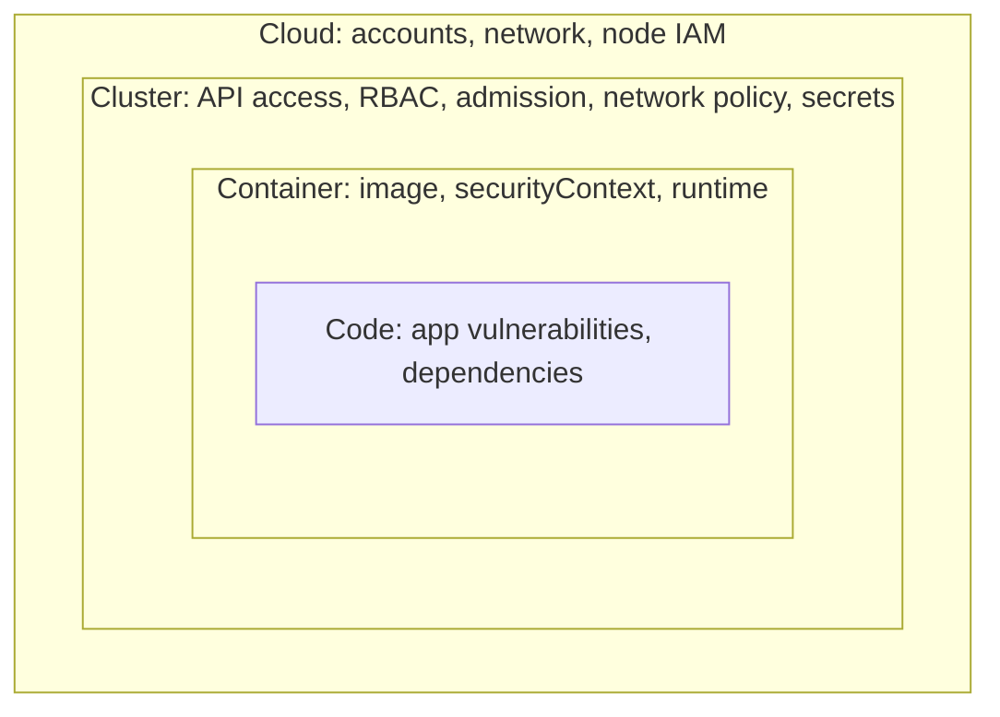

# Kubernetes Security

## Introduction

Kubernetes runs your containers, but it is also a powerful, programmable API that can create workloads, read secrets and change network routing. Out of the box, a cluster favors getting things running over locking things down: pods can usually talk to every other pod, containers may run as root, and a service account token is mounted into every pod by default.

Securing Kubernetes means tightening each of those defaults without stopping teams from shipping. A common way to organize the work is the **4C model** from the Kubernetes documentation: **Cloud**, **Cluster**, **Container** and **Code**. Each layer builds on the one outside it. A perfectly configured pod does not help if anyone on the internet can reach the cluster's API with a stolen admin credential.



This page focuses on the **Cluster** layer and the parts of the **Container** layer that Kubernetes controls. Image hardening is covered in [Container Image Security](./4-sec-container-security.mdx). If you need a refresher on Kubernetes objects, see [/docs/devops/kubernetes](/docs/devops/kubernetes).

:::note Tested setup
The manifests and outputs on this page were tested on a local [kind](https://kind.sigs.k8s.io/) cluster running Kubernetes v1.37.0. As of October 2026 the Kubernetes project supports 1.35, 1.36 and 1.37 (with 1.34 reaching end of life late in the month). Check the official releases page for the current list.
:::

:::warning Ethics
Practice on clusters you own, such as a local kind or minikube cluster. Do not probe other organizations' clusters. Intentionally vulnerable labs such as Kubernetes Goat are designed for learning attacks safely.
:::

## 1. Protect the API Server

Everything in Kubernetes goes through the API server. Whoever controls it controls the cluster.

- **Use a managed control plane** (EKS, AKS, GKE) unless you have strong reasons not to. The provider patches and runs etcd and the API server. You still own access to it.
- **Restrict network access:** use a private API endpoint, or at least an allow list of source IP ranges. A public API endpoint with weak authentication is a classic entry point.
- **Authenticate humans through your identity provider** (cloud IAM, OIDC with SSO and MFA). Avoid long-lived static tokens and shared kubeconfig files with client certificates that cannot be revoked easily.
- **Turn on audit logging** and send it to your SIEM. Alert on things like new ClusterRoleBindings, `pods/exec` into production, and secrets being read by humans.
- **Keep the cluster version supported.** Kubernetes minor versions receive patches for about 14 months.

## 2. RBAC: Who Can Do What

Kubernetes Role-Based Access Control (RBAC) grants permissions through **Roles** (namespaced) and **ClusterRoles** (cluster-wide), attached to users, groups or service accounts with **RoleBindings** and **ClusterRoleBindings**.

**Vulnerable:** the CI pipeline's service account gets `cluster-admin`, "because deploys kept failing".

```yaml
apiVersion: rbac.authorization.k8s.io/v1
kind: ClusterRoleBinding
metadata:
  name: ci-deployer-admin
subjects:
  - kind: ServiceAccount
    name: ci-deployer
    namespace: billing
roleRef:
  kind: ClusterRole
  name: cluster-admin
  apiGroup: rbac.authorization.k8s.io
```

**Fixed:** a namespaced Role that can update deployments and their services and config, and nothing else.

```yaml
apiVersion: v1
kind: ServiceAccount
metadata:
  name: ci-deployer
  namespace: billing
---
apiVersion: rbac.authorization.k8s.io/v1
kind: Role
metadata:
  name: deployer
  namespace: billing
rules:
  - apiGroups: ["apps"]
    resources: ["deployments"]
    verbs: ["get", "list", "watch", "patch", "update"]
  - apiGroups: [""]
    resources: ["services", "configmaps"]
    verbs: ["get", "list", "create", "update", "patch"]
---
apiVersion: rbac.authorization.k8s.io/v1
kind: RoleBinding
metadata:
  name: ci-deployer
  namespace: billing
subjects:
  - kind: ServiceAccount
    name: ci-deployer
    namespace: billing
roleRef:
  kind: Role
  name: deployer
  apiGroup: rbac.authorization.k8s.io
```

Verify what an identity can do with `kubectl auth can-i`, impersonating the service account:

```bash
SA=system:serviceaccount:billing:ci-deployer
kubectl auth can-i patch deployments -n billing --as=$SA
kubectl auth can-i get secrets -n billing --as=$SA
kubectl auth can-i create pods/exec -n billing --as=$SA
kubectl auth can-i get deployments -n kube-system --as=$SA
```

Output with the fixed Role:

```text
yes
no
no
no
```

With the vulnerable ClusterRoleBinding applied, `kubectl auth can-i get secrets -n kube-system --as=$SA` answered `yes`. A leaked CI token would then expose every secret in the cluster.

RBAC permissions that deserve extra care, because they lead to privilege escalation:

| Permission | Why it is risky |
| --- | --- |
| `get`/`list` on `secrets` | Reads every credential in the namespace, including other service account tokens |
| `create` on `pods` (or deployments, jobs) | Can start a pod that mounts any secret or service account in the namespace |
| `create` on `pods/exec` | Shell inside running containers with their credentials |
| `bind`, `escalate`, `impersonate` | Can grant or assume more permissions than you hold |
| `update` on `nodes`, or anything on `*` | Effectively cluster-wide control |

For general RBAC design, see [RBAC, ABAC and ReBAC](../4-sec-authentication/9-sec-rbac-abac.mdx).

### Service account tokens

Every pod runs as a service account. Modern Kubernetes mounts a short-lived, audience-bound **projected token** instead of the old never-expiring Secret tokens, which is a big improvement. Still, most application pods never call the Kubernetes API, so they should not get a token at all:

```yaml
apiVersion: v1
kind: ServiceAccount
metadata:
  name: billing-api
  namespace: billing
automountServiceAccountToken: false
```

## 3. Pod Security Admission

The **Pod Security Standards** define three profiles:

- **Privileged:** no restrictions. For trusted system components only.
- **Baseline:** blocks known privilege escalations (host namespaces, privileged containers, `hostPath` volumes, dangerous capabilities).
- **Restricted:** current hardening best practice. Adds non-root, no privilege escalation, `drop: ["ALL"]` capabilities, a `RuntimeDefault` or `Localhost` seccomp profile, and limited volume types.

The built-in **Pod Security Admission** controller (stable since Kubernetes 1.25, when it replaced PodSecurityPolicy) enforces them per namespace through labels:

```yaml
apiVersion: v1
kind: Namespace
metadata:
  name: billing
  labels:
    pod-security.kubernetes.io/enforce: restricted
    pod-security.kubernetes.io/enforce-version: latest
    pod-security.kubernetes.io/warn: restricted
    pod-security.kubernetes.io/audit: restricted
```

Each mode does something different: `enforce` rejects violating pods, `warn` shows a warning to the user, and `audit` records the violation in the audit log. A safe rollout is to start with `warn` and `audit`, fix workloads, then add `enforce`. You can also pin `enforce-version` to a specific Kubernetes version so a cluster upgrade does not suddenly change the rules.

**Vulnerable:** a "debug" pod with host networking, a privileged container and the node's root filesystem mounted.

```yaml
apiVersion: v1
kind: Pod
metadata:
  name: debug-tools
  namespace: billing
spec:
  hostNetwork: true
  containers:
    - name: app
      image: nginx:latest
      securityContext:
        privileged: true
      volumeMounts:
        - name: host-root
          mountPath: /host
  volumes:
    - name: host-root
      hostPath:
        path: /
```

Applying it to the `billing` namespace fails:

```text
Error from server (Forbidden): error when creating "bad-pod.yaml": pods "debug-tools" is forbidden: violates PodSecurity "restricted:latest": host namespaces (hostNetwork=true), privileged (container "app" must not set securityContext.privileged=true), allowPrivilegeEscalation != false (container "app" must set securityContext.allowPrivilegeEscalation=false), unrestricted capabilities (container "app" must set securityContext.capabilities.drop=["ALL"]), restricted volume types (volume "host-root" uses restricted volume type "hostPath"), runAsNonRoot != true (pod or container "app" must set securityContext.runAsNonRoot=true), seccompProfile (pod or container "app" must set securityContext.seccompProfile.type to "RuntimeDefault" or "Localhost")
```

That pod would have given anyone who could exec into it root access to the node. The error message doubles as a checklist of what to fix.

**Fixed:** a Deployment that passes the restricted profile.

```yaml
apiVersion: apps/v1
kind: Deployment
metadata:
  name: billing-api
  namespace: billing
spec:
  replicas: 2
  selector:
    matchLabels:
      app: billing-api
  template:
    metadata:
      labels:
        app: billing-api
    spec:
      serviceAccountName: billing-api
      automountServiceAccountToken: false
      securityContext:
        runAsNonRoot: true
        runAsUser: 10001
        runAsGroup: 10001
        seccompProfile:
          type: RuntimeDefault
      containers:
        - name: api
          image: nginxinc/nginx-unprivileged:1.29-alpine
          ports:
            - containerPort: 8080
          securityContext:
            allowPrivilegeEscalation: false
            readOnlyRootFilesystem: true
            capabilities:
              drop: ["ALL"]
          resources:
            requests:
              cpu: 100m
              memory: 128Mi
            limits:
              memory: 256Mi
          volumeMounts:
            - name: tmp
              mountPath: /tmp
      volumes:
        - name: tmp
          emptyDir: {}
```

```bash
kubectl apply -f good-deploy.yaml
kubectl -n billing get pods
```

Example output:

```text
NAME                           READY   STATUS    RESTARTS   AGE
billing-api-65c847f449-kmhdq   1/1     Running   0          25s
billing-api-65c847f449-qqxrk   1/1     Running   0          25s
```

`readOnlyRootFilesystem` is not required by the restricted profile, but it is a cheap, valuable extra: an attacker who gets code execution cannot drop tools or modify the app on disk. Resource limits protect neighbors from a runaway or abused pod.

## 4. NetworkPolicy: Default Deny

By default every pod can reach every other pod in the cluster, across namespaces. If an attacker compromises one frontend pod, they can talk directly to databases and internal admin services.

**NetworkPolicies** act as firewalls between pods. They only work if your network plugin (CNI) enforces them. Most production CNIs (Calico, Cilium, and the cloud providers' options when configured) do.

The pattern is: deny everything in the namespace, then allow specific flows.

```yaml
apiVersion: networking.k8s.io/v1
kind: NetworkPolicy
metadata:
  name: default-deny-all
  namespace: billing
spec:
  podSelector: {}
  policyTypes: ["Ingress", "Egress"]
---
apiVersion: networking.k8s.io/v1
kind: NetworkPolicy
metadata:
  name: allow-frontend-to-api
  namespace: billing
spec:
  podSelector:
    matchLabels:
      app: billing-api
  policyTypes: ["Ingress"]
  ingress:
    - from:
        - namespaceSelector:
            matchLabels:
              kubernetes.io/metadata.name: web
          podSelector:
            matchLabels:
              app: frontend
      ports:
        - protocol: TCP
          port: 8080
---
apiVersion: networking.k8s.io/v1
kind: NetworkPolicy
metadata:
  name: allow-dns-egress
  namespace: billing
spec:
  podSelector: {}
  policyTypes: ["Egress"]
  egress:
    - to:
        - namespaceSelector:
            matchLabels:
              kubernetes.io/metadata.name: kube-system
          podSelector:
            matchLabels:
              k8s-app: kube-dns
      ports:
        - protocol: UDP
          port: 53
        - protocol: TCP
          port: 53
```

In the test cluster, a pod labelled `app=frontend` in the `web` namespace could still reach the API, while a pod in another namespace was blocked:

```text
before policies, pod in "other": REACHED
after policies, frontend in "web": REACHED
after policies, pod in "other":    BLOCKED
```

Note the `from` entry combines `namespaceSelector` and `podSelector` in **one** list item, meaning "pods labelled frontend **in** the web namespace". Writing them as two separate list items would mean "any pod in web **or** any frontend pod anywhere", a common and dangerous mistake. Also remember to allow DNS egress, or every name lookup will fail after the default deny. For broader segmentation strategy, see [Network Segmentation](../2-sec-network-security/2-sec-network-segmentation.mdx).

## 5. Secrets and Cloud Credentials

- **Kubernetes Secrets are base64-encoded, not encrypted.** Anyone with `get secrets` can read them, and by default they are stored unencrypted in etcd. Enable encryption at rest with a KMS provider (managed clusters offer this as an option or default; check your provider).
- **Prefer an external secrets manager** (AWS Secrets Manager, Azure Key Vault, Google Secret Manager, HashiCorp Vault) with the External Secrets Operator or the Secrets Store CSI Driver. The secret's source of truth then has its own access control and audit log.
- **Never commit Secret manifests to Git.** If you need GitOps for secrets, use encrypted formats (for example Sealed Secrets or SOPS).

For cloud API access from pods, use **workload identity** so that each service account maps to its own cloud role:

| Platform | Feature |
| --- | --- |
| Amazon EKS | EKS Pod Identity (or the older IAM Roles for Service Accounts) |
| Google GKE | Workload Identity Federation for GKE |
| Azure AKS | Microsoft Entra Workload ID |

And **block pods from the node's metadata service**, otherwise any pod may be able to use the node's own cloud role. The AWS EKS documentation notes that if IMDS is not restricted, containers may reach the node role and possibly other pods' credentials. Use IMDSv2 with a hop limit of 1 on nodes, or NetworkPolicy egress rules that block `169.254.169.254`. See [Cloud IAM Security](./1-sec-cloud-iam.mdx).

## 6. Admission Policies: Guardrails as Code

Pod Security Admission covers pod settings. For other rules, such as "images must come from our registry" or "every deployment needs an owner label", use a policy engine:

- **ValidatingAdmissionPolicy** (built in, stable since Kubernetes 1.30): rules written in CEL, evaluated inside the API server, no extra components.
- **Kyverno:** policies written as Kubernetes YAML, can also mutate resources and verify image signatures.
- **OPA Gatekeeper:** policies written in Rego, popular where OPA is already used elsewhere.

A built-in policy that requires images from an approved registry, pinned by digest:

```yaml
apiVersion: admissionregistration.k8s.io/v1
kind: ValidatingAdmissionPolicy
metadata:
  name: approved-registries
spec:
  failurePolicy: Fail
  matchConstraints:
    resourceRules:
      - apiGroups: ["apps"]
        apiVersions: ["v1"]
        operations: ["CREATE", "UPDATE"]
        resources: ["deployments"]
  validations:
    - expression: >-
        object.spec.template.spec.containers.all(c,
          c.image.startsWith('registry.example.com/') && c.image.contains('@sha256:'))
      message: "Images must come from registry.example.com and be pinned by digest."
---
apiVersion: admissionregistration.k8s.io/v1
kind: ValidatingAdmissionPolicyBinding
metadata:
  name: approved-registries-billing
spec:
  policyName: approved-registries
  validationActions: ["Deny"]
  matchResources:
    namespaceSelector:
      matchLabels:
        kubernetes.io/metadata.name: billing
```

Testing it with a public image:

```bash
kubectl -n billing create deployment test-nginx --image=nginx:1.29
```

Example output:

```text
Warning: would violate PodSecurity "restricted:latest": allowPrivilegeEscalation != false (container "nginx" must set securityContext.allowPrivilegeEscalation=false), unrestricted capabilities (...), runAsNonRoot != true (...), seccompProfile (...)
error: failed to create deployment: deployments.apps "test-nginx" is forbidden: ValidatingAdmissionPolicy 'approved-registries' with binding 'approved-registries-billing' denied request: Images must come from registry.example.com and be pinned by digest.
```

Two layers fired: Pod Security Admission **warned** at the Deployment level (it only enforces on the pods themselves), and the admission policy **denied** the request. A real policy would also cover init containers and other workload types such as StatefulSets, Jobs and CronJobs. Roll out new policies with `validationActions: ["Warn", "Audit"]` first, because existing workloads that violate them will fail on their next update.

## 7. Detect and Maintain

- **Runtime detection:** tools such as Falco watch system calls and alert on suspicious behavior, like a shell spawning in a container or a write to `/etc`. See [Detection Engineering](../11-sec-defensive-operations/2-sec-detection-engineering.mdx).
- **Configuration scanning:** `kube-bench` checks nodes and control plane against the CIS Kubernetes Benchmark. Kubescape and `trivy k8s` scan clusters and manifests for misconfigurations.
- **Upgrades:** stay on supported versions and track deprecations. For example, the community Ingress NGINX controller reached end of maintenance in March 2026, with no further security fixes, and the Kubernetes project points users toward the Gateway API. Unmaintained components in the request path are a long-term risk.

## Real-World Scenario

Your company runs one shared EKS cluster for six product teams. An internal review found that every team's CI uses the same service account with `cluster-admin`, no namespace has Pod Security labels, and there are no NetworkPolicies. Leadership asks whether to split into separate clusters per team or harden the shared one.

| Approach | Pros | Cons | Best for |
| --- | --- | --- | --- |
| Shared cluster, namespaces plus RBAC, PSA, NetworkPolicy, admission policies | Low cost; one platform to run; strong if configured well | Shared kernel and control plane; one bad cluster-wide permission affects all | Teams within one trust boundary (same company, similar data sensitivity) |
| Virtual clusters inside a shared cluster | Teams get their own API server view; cheaper than real clusters | Extra component; still shared nodes unless separated | Platform teams offering self-service |
| Dedicated node pools per team (taints, tolerations) in a shared cluster | Kernel-level separation between teams' workloads | More nodes; scheduling complexity | Mixed sensitivity within one cluster |
| Separate cluster per team or per sensitivity level | Strongest isolation; blast radius limited | Higher cost and operational overhead; more upgrades | Regulated data, untrusted tenants, customer-run code |

You choose to **harden the shared cluster**, plus a **separate cluster for the payments team** because it handles card data under PCI DSS scope. The steps, in order:

1. Give each team its own namespace, CI service account and namespaced Role. Remove the shared `cluster-admin` binding.
2. Label all namespaces with `warn` and `audit` for the restricted profile; fix workloads over two sprints; then add `enforce`.
3. Add default-deny NetworkPolicies per namespace, with explicit allows discovered from flow logs.
4. Move pod cloud access to EKS Pod Identity and block node IMDS from pods.
5. Add admission policies for approved registries and signed images.

**Why this approach:** most of the risk came from configuration, not from the shared architecture itself, so fixing configuration gives the biggest reduction for the least cost. Payments is separated because compliance scope reduction is valuable on its own.

**When not to share:** when tenants are not trusted (for example running customer-provided code), use separate clusters or sandboxed runtimes such as gVisor or Kata Containers. Namespaces are not a hard security boundary.

## Common Mistakes

- **`cluster-admin` for CI or operators "for now".** Scope to namespaces and verbs, and check with `kubectl auth can-i`.
- **Treating namespaces as isolation.** Without RBAC, NetworkPolicy and Pod Security, a namespace is just a naming scope.
- **NetworkPolicies on a CNI that ignores them.** Test that a blocked flow is actually blocked.
- **Exposing dashboards and the API server publicly.** Use private endpoints and SSO.
- **Secrets in plain manifests in Git.** Use an external secrets manager or encrypted secrets.
- **Enforcing policies on day one.** Use warn and audit modes first, or you will block deploys and lose the team's trust.
- **Forgetting the nodes.** Pods that reach node IMDS, `hostPath` mounts, and unpatched node images undo much of the cluster-level work.

## Summary

- Secure the API server first: private access, SSO-backed authentication, audit logs, supported versions.
- Use least-privilege RBAC, check it with `kubectl auth can-i`, and disable service account tokens for pods that do not need them.
- Enforce the restricted Pod Security Standard with namespace labels, rolling out through warn and audit modes.
- Start each namespace with a default-deny NetworkPolicy and allow only required flows, including DNS.
- Keep secrets in an external manager, encrypt etcd, and use workload identity instead of node credentials.
- Add admission policies (ValidatingAdmissionPolicy, Kyverno or Gatekeeper) for registry, signature and labeling rules, and run runtime detection.

## Exercises

1. Create a kind cluster, apply the `billing` namespace with `enforce: restricted`, and try to deploy a popular public image without changes. Fix its `securityContext` until it runs.
2. Extend the ValidatingAdmissionPolicy to also check `initContainers` and to cover StatefulSets and Jobs. Test it with `Warn` before `Deny`.
3. Write NetworkPolicies so that `billing-api` can reach only a PostgreSQL pod on port 5432 and DNS. Prove that it cannot reach anything else with a test pod.
4. Run `kube-bench` or `kubescape` against your test cluster and pick three findings to fix.

Related pages:

- [Container Image Security](./4-sec-container-security.mdx)
- [Infrastructure as Code Security](./6-sec-infrastructure-as-code-security.mdx)
- [Least Privilege and Zero Trust](../0-sec-fundamentals/5-sec-least-privilege.mdx)
- [CIS Benchmarks and Baselines](../9-sec-system-hardening/5-sec-cis-benchmarks.mdx)

External reading:

- [Kubernetes: Security checklist](https://kubernetes.io/docs/concepts/security/security-checklist/)
- [Kubernetes: Pod Security Standards](https://kubernetes.io/docs/concepts/security/pod-security-standards/)
- [Kubernetes: Validating Admission Policy](https://kubernetes.io/docs/reference/access-authn-authz/validating-admission-policy/)
- [Kubernetes: Network Policies](https://kubernetes.io/docs/concepts/services-networking/network-policies/)
- [Kubernetes releases](https://kubernetes.io/releases/)
