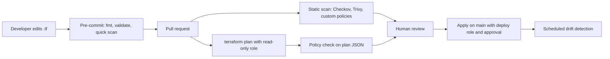

# Infrastructure as Code Security

## Introduction

**Infrastructure as Code (IaC)** describes cloud resources in files, such as Terraform, OpenTofu, CloudFormation, Bicep, Pulumi or Kubernetes manifests, and lets a tool create them. For security, this is a huge opportunity. A misconfiguration that would be invisible in a console click becomes a line in a pull request that a human and a scanner can review **before** anything exists.

It also brings new risks:

- The **pipeline** that applies IaC usually holds very powerful cloud credentials.
- **State files** can contain secrets in plain text.
- **Modules and providers** downloaded from registries are third-party code that runs with those credentials.
- If people also change things by hand, the code and reality **drift** apart.

An analogy: IaC is like architectural blueprints. Reviewing blueprints is far cheaper than tearing down a wall after construction. But blueprints also need protecting. Whoever can change them, or swap the builder's tools, controls what gets built.

This page assumes basic Terraform knowledge. If you need it, see [/docs/devops/terraform](/docs/devops/terraform). The examples were tested with **Checkov 3.3** and **Trivy 0.69.3**. Outputs change between versions.

## Where Security Checks Fit



Each stage catches different problems:

| Stage | Catches | Misses |
| --- | --- | --- |
| Static scan of code | Insecure settings written in the files | Values only known at plan time (variables, module outputs) |
| Policy check on the plan | Final computed values, deletions, changes to protected resources | Resources changed outside IaC |
| Human review | Intent, design problems, business context | Tired reviewers miss details |
| Drift detection and CSPM | Manual changes, resources created outside IaC | Nothing before deploy |

## Static Scanning with Checkov and Trivy

Two widely used open source scanners:

- **Checkov** (Python, by Palo Alto Networks / Prisma Cloud): Terraform, CloudFormation, Kubernetes, Helm, Dockerfiles, GitHub Actions and more.
- **Trivy** (`trivy config`, by Aqua Security): Terraform, CloudFormation, Kubernetes, Helm, Dockerfiles, ARM templates. The older **tfsec** project is now part of Trivy, and its README encourages users to migrate.

Others include KICS (Checkmarx) and Terrascan. Most teams use one scanner well rather than several badly.

### The vulnerable configuration

```hcl
resource "aws_s3_bucket" "logs" {
  bucket = "acme-app-logs"
}

resource "aws_security_group" "db" {
  name        = "db-sg"
  description = "Database access"

  ingress {
    description = "Postgres"
    from_port   = 5432
    to_port     = 5432
    protocol    = "tcp"
    cidr_blocks = ["0.0.0.0/0"]
  }
}

resource "aws_db_instance" "main" {
  identifier          = "main"
  engine              = "postgres"
  instance_class      = "db.t4g.micro"
  allocated_storage   = 20
  username            = "app"
  password            = "Summer2026!"
  publicly_accessible = true
  skip_final_snapshot = true
}
```

Scan it:

```bash
pip install checkov
checkov -d . --framework terraform --compact --quiet

trivy config .
```

Checkov output (shortened):

```text
terraform scan results:

Passed checks: 15, Failed checks: 19, Skipped checks: 0

Check: CKV_AWS_17: "Ensure all data stored in RDS is not publicly accessible"
	FAILED for resource: aws_db_instance.main
Check: CKV_AWS_16: "Ensure all data stored in the RDS is securely encrypted at rest"
	FAILED for resource: aws_db_instance.main
Check: CKV_AWS_293: "Ensure that AWS database instances have deletion protection enabled"
	FAILED for resource: aws_db_instance.main
Check: CKV2_AWS_6: "Ensure that S3 bucket has a Public Access block"
	FAILED for resource: aws_s3_bucket.logs
Check: CKV_AWS_21: "Ensure all data stored in the S3 bucket have versioning enabled"
	FAILED for resource: aws_s3_bucket.logs
...
```

Trivy output (shortened):

```text
Failures: 14 (UNKNOWN: 0, LOW: 3, MEDIUM: 4, HIGH: 7, CRITICAL: 0)
AWS-0080 (HIGH): Instance does not have storage encryption enabled.
AWS-0086 (HIGH): No public access block so not blocking public acls
AWS-0180 (HIGH): Instance has Public Access enabled
AWS-0177 (MEDIUM): Instance does not have Deletion Protection enabled
AWS-0090 (MEDIUM): Bucket does not have versioning enabled
...
```

### What the scanners missed

Look carefully at both reports. In our test, **neither tool flagged two of the worst problems**:

1. The security group that opens PostgreSQL (port 5432) to `0.0.0.0/0`.
2. The hardcoded database password `Summer2026!`.

Built-in rules focus on common patterns (for example SSH and RDP ports), and secret detection usually relies on known key formats or high-entropy strings, which a human-chosen password does not match. Scanners are a safety net, not a guarantee. This is why you add **custom policies** for rules that matter to you, and why human review still matters.

## Writing a Custom Policy

Checkov supports custom policies in YAML. This one fails any security group with an ingress rule from the whole internet:

```yaml
# policies/no_world_ingress.yaml
metadata:
  id: "CKV2_ACME_1"
  name: "Security groups must not allow ingress from 0.0.0.0/0"
  category: "NETWORKING"
  severity: "HIGH"
definition:
  cond_type: attribute
  resource_types: ["aws_security_group"]
  attribute: "ingress.*.cidr_blocks"
  operator: not_contains
  value: "0.0.0.0/0"
```

```bash
checkov -d . --framework terraform --external-checks-dir policies --check CKV2_ACME_1 --compact --quiet
```

Output:

```text
Passed checks: 0, Failed checks: 1, Skipped checks: 0

Check: CKV2_ACME_1: "Security groups must not allow ingress from 0.0.0.0/0"
	FAILED for resource: aws_security_group.db
	Severity: HIGH
	File: /main.tf:5-16
```

Public web traffic should arrive at a load balancer, whose security group is the one place where a documented exception makes sense.

## The Fixed Configuration

```hcl
resource "aws_s3_bucket" "logs" {
  bucket = "acme-app-logs"
}

resource "aws_s3_bucket_public_access_block" "logs" {
  bucket                  = aws_s3_bucket.logs.id
  block_public_acls       = true
  block_public_policy     = true
  ignore_public_acls      = true
  restrict_public_buckets = true
}

resource "aws_s3_bucket_versioning" "logs" {
  bucket = aws_s3_bucket.logs.id
  versioning_configuration {
    status = "Enabled"
  }
}

resource "aws_s3_bucket_server_side_encryption_configuration" "logs" {
  bucket = aws_s3_bucket.logs.id
  rule {
    apply_server_side_encryption_by_default {
      sse_algorithm     = "aws:kms"
      kms_master_key_id = var.kms_key_arn
    }
  }
}

resource "aws_security_group" "db" {
  name        = "db-sg"
  description = "Database access from the app tier only"
  vpc_id      = var.vpc_id

  ingress {
    description     = "Postgres from app servers"
    from_port       = 5432
    to_port         = 5432
    protocol        = "tcp"
    security_groups = [var.app_sg_id]
  }
}

resource "aws_db_instance" "main" {
  identifier                          = "main"
  engine                              = "postgres"
  instance_class                      = "db.t4g.micro"
  allocated_storage                   = 20
  username                            = "app"
  manage_master_user_password         = true
  publicly_accessible                 = false
  storage_encrypted                   = true
  kms_key_id                          = var.kms_key_arn
  deletion_protection                 = true
  backup_retention_period             = 7
  iam_database_authentication_enabled = true
  auto_minor_version_upgrade          = true
  copy_tags_to_snapshot               = true
  vpc_security_group_ids              = [aws_security_group.db.id]
  skip_final_snapshot                 = false
  final_snapshot_identifier           = "main-final"
}
```

Rescanning, Trivy reported only 2 LOW findings, and Checkov 9 remaining failures, now mostly operational extras such as Multi-AZ, cross-region replication and performance insights. Our custom policy passed.

### Handling the findings you accept

Not every finding needs a fix. Multi-AZ doubles the database cost, and cross-region replication of regenerable logs may be pointless. Accept findings **explicitly**, with a reason and a reference, right next to the code:

```hcl
#trivy:ignore:AWS-0089
resource "aws_s3_bucket" "logs" {
  #checkov:skip=CKV_AWS_18:This bucket stores access logs; logging it would loop. Ticket SEC-142
  bucket = "acme-app-logs"
}
```

Checkov then reports the check as skipped, with your reason:

```text
Check: CKV_AWS_18: "Ensure the S3 bucket has access logging enabled"
	SKIPPED for resource: aws_s3_bucket.logs
	Suppress comment: This bucket stores access logs; logging it would loop. Ticket SEC-142
```

Review suppressions like code. A pull request that adds `checkov:skip` to a public-access check deserves a closer look than one that skips an access-logging rule on a log bucket.

## Checking the Plan, Not Just the Code

Static scanners read files. They cannot always know the final value of a variable, or that a change will **delete** a production database. `terraform plan` can be exported as JSON, and you can check that:

```bash
terraform plan -out=tfplan
terraform show -json tfplan > plan.json
```

A small policy script over the plan:

```python
# check_plan.py - fail the pipeline on dangerous planned changes
import json
import sys

PROTECTED_TYPES = {"aws_db_instance", "aws_s3_bucket", "aws_kms_key"}

def violations(plan: dict) -> list[str]:
    found = []
    for rc in plan.get("resource_changes", []):
        actions = rc["change"]["actions"]
        after = rc["change"].get("after") or {}
        addr = rc["address"]
        if "delete" in actions and rc["type"] in PROTECTED_TYPES:
            found.append(f"{addr}: plan deletes a protected resource ({'/'.join(actions)})")
        if rc["type"] == "aws_db_instance" and after.get("publicly_accessible"):
            found.append(f"{addr}: database would be publicly accessible")
        if rc["type"] == "aws_security_group":
            for rule in after.get("ingress") or []:
                if "0.0.0.0/0" in (rule.get("cidr_blocks") or []):
                    found.append(f"{addr}: ingress port {rule.get('from_port')} open to 0.0.0.0/0")
    return found

if __name__ == "__main__":
    plan = json.load(open(sys.argv[1]))
    problems = violations(plan)
    for p in problems:
        print("DENY", p)
    print("OK" if not problems else f"{len(problems)} violation(s)")
    sys.exit(1 if problems else 0)
```

A trimmed example `plan.json` (real plans contain much more):

```json
{
  "resource_changes": [
    {
      "address": "aws_db_instance.main",
      "type": "aws_db_instance",
      "change": { "actions": ["delete", "create"], "after": { "publicly_accessible": false } }
    },
    {
      "address": "aws_security_group.db",
      "type": "aws_security_group",
      "change": {
        "actions": ["update"],
        "after": { "ingress": [ { "from_port": 5432, "cidr_blocks": ["0.0.0.0/0"] } ] }
      }
    }
  ]
}
```

```bash
python3 check_plan.py plan.json
```

Output:

```text
DENY aws_db_instance.main: plan deletes a protected resource (delete/create)
DENY aws_security_group.db: ingress port 5432 open to 0.0.0.0/0
2 violation(s)
```

The first finding is important: a harmless-looking change, such as renaming the database identifier, can force Terraform to **replace** the resource, which deletes the old one. Plan checks catch this; file scanners do not.

In production, teams usually write these rules in a policy language: **OPA/Rego** with `conftest`, **Sentinel** or OPA policies in HCP Terraform, or Checkov and Trivy's own plan-scanning modes. The idea is the same.

## Protecting State and Secrets

Terraform **state** records every managed resource and its attributes, often including secrets such as generated passwords and private keys. Treat state as a secret:

- Use a **remote backend** with encryption and access control (S3 with SSE-KMS, Azure Storage, Google Cloud Storage, HCP Terraform). Restrict who can read it to the pipeline and a few admins.
- Turn on **state locking** to avoid corrupted state from concurrent applies. The S3 backend supports native locking with `use_lockfile = true`, and its documentation marks the older DynamoDB-based locking as deprecated.
- **Version** the state bucket so you can recover from mistakes.
- **Keep secrets out of state where possible.** Let the provider manage them (for example `manage_master_user_password = true` stores the RDS password in Secrets Manager), or use ephemeral values (Terraform 1.10 and later) and write-only arguments (Terraform 1.11 and later, where the provider supports them), which Terraform omits from state and plan files. Marking a variable `sensitive` only hides it from output: it is still stored in state. OpenTofu also offers client-side state encryption.
- Never commit `terraform.tfstate` or `*.tfvars` files with secrets to Git. Add them to `.gitignore` and run [secret scanning](../6-sec-appsec-and-devsecops/7-sec-secret-scanning.mdx).

```hcl
terraform {
  backend "s3" {
    bucket       = "acme-terraform-state"
    key          = "billing/prod.tfstate"
    region       = "us-east-1"
    encrypt      = true
    kms_key_id   = "arn:aws:kms:us-east-1:111122223333:key/1234abcd-12ab-34cd-56ef-1234567890ab"
    use_lockfile = true
  }
}
```

## Securing Modules, Providers and the Pipeline

**Supply chain:**

- Pin provider versions and commit `.terraform.lock.hcl`, which records provider checksums.
- Pin modules to exact versions or commit SHAs, and prefer modules from sources you trust or review.
- A module can contain any resource, including IAM users with access keys. Review module upgrades like code changes. See [Software Supply Chain Security](../6-sec-appsec-and-devsecops/5-sec-supply-chain.mdx).

**Pipeline:**

- **Separate plan and apply roles.** Pull requests run `plan` with a read-only role. Only the protected main branch, after approval, can assume the apply role.
- **No long-lived cloud keys.** Use OIDC federation from CI to the cloud, as shown in [Cloud IAM Security](./1-sec-cloud-iam.mdx).
- **Pin CI actions by commit SHA.** In March 2026, attackers rewrote version tags of the `trivy-action` and `kics-github-action` GitHub Actions to steal CI secrets. Pipelines that pinned to commit SHAs were not affected by the tag rewrite. Your security scanners run with your credentials, so they are supply chain too.
- **Do not run `plan` on untrusted pull requests with real credentials.** A malicious pull request can add an `external` data source or a provider that executes code during plan.

```yaml
# .github/workflows/terraform.yml (excerpt)
on:
  pull_request:
    paths: ["infra/**"]
permissions:
  contents: read
  id-token: write
jobs:
  scan-and-plan:
    runs-on: ubuntu-latest
    steps:
      - uses: actions/checkout@<full-commit-sha>
      - name: Checkov
        run: |
          pip install checkov==3.3.27
          checkov -d infra --framework terraform --external-checks-dir policies --compact
      - name: Plan with read-only role
        run: |
          terraform -chdir=infra init -input=false
          terraform -chdir=infra plan -input=false -out=tfplan
          terraform -chdir=infra show -json tfplan > plan.json
          python3 check_plan.py plan.json
```

Replace `<full-commit-sha>` with the real SHA of the action version you reviewed, and add the OIDC credentials step for the read-only role.

## Real-World Scenario

Your platform team manages about 40 Terraform root modules across three AWS accounts. Last quarter, someone opened a database port to the internet "for a quick test" through a pull request that two reviewers approved. Management asks for automated guardrails without slowing teams down.

| Approach | Pros | Cons | Best for |
| --- | --- | --- | --- |
| Checkov or Trivy with default rules in CI | Fast to adopt; hundreds of rules | Noisy at first; misses org-specific rules (as we saw) | Every team, as a baseline |
| Custom policies (Checkov YAML or Python, Rego) | Encodes your own rules | Must be written, tested and maintained | Org-specific must-never-happen rules |
| Plan-time policy (conftest, Sentinel, HCP policies) | Sees final values and deletions | Needs a plan, so cloud credentials in CI | Production changes |
| Organization guardrails (SCPs, Azure Policy deny) | Enforced even for console changes | Blunt; hard to express nuanced rules | The handful of critical rules |
| CSPM after deployment | Catches drift and non-IaC resources | Finds problems after they exist | Everything, as the last layer |

You choose a layered rollout: Checkov in CI in **soft-fail mode** for two weeks to measure noise; then hard-fail on a curated list of about 30 checks plus three custom policies (no world ingress, no public databases, no IAM users with access keys); plan-time checks for protected-resource deletion in production; and one SCP that denies disabling CloudTrail.

**Why this approach:** soft-fail first builds trust and shows which rules are noisy. Curating the hard-fail list keeps the pipeline meaningful. Custom and plan-time policies cover exactly the gap that caused the incident.

**When not to:** a two-person team with five resources may get more value from careful review and account-level defaults than from a policy program.

## Common Mistakes

- **Turning on every rule as a hard failure.** Teams respond by skipping checks wholesale. Start soft, curate, then enforce.
- **Suppressions without reasons.** Require a justification and ticket in every skip comment.
- **Believing a clean scan means a secure design.** Scanners check settings, not architecture or intent.
- **State files in Git or readable by everyone.** State is a secret.
- **One all-powerful CI role.** Separate plan and apply, and protect the apply path.
- **Ignoring drift.** Run scheduled `terraform plan` (or a drift detection feature) and alert on unexpected differences.

## Summary

- IaC lets you review and test infrastructure security before deployment, but adds pipeline, state and supply chain risks.
- Scan code with Checkov or Trivy (tfsec is now part of Trivy), and add custom policies for rules the defaults miss.
- Check the plan JSON for final values and dangerous deletions.
- Document accepted risks with inline suppressions that include a reason.
- Protect state as a secret, keep secrets out of state where possible, and pin providers, modules and CI actions.
- Separate read-only plan from approved apply, using OIDC instead of stored keys.

## Exercises

1. Run Checkov and `trivy config` on a Terraform project you own. Compare which findings each tool reports and which neither reports.
2. Write a Checkov custom policy that fails any `aws_iam_user` resource, so humans must use SSO instead.
3. Extend `check_plan.py` to block `aws_iam_policy` documents that contain `"Action": "*"`. Hint: the policy is a JSON string inside the plan.
4. Design the IAM roles for a plan/apply pipeline: list the permissions of the plan role and explain why it must not be able to read secrets.

Related pages:

- [Common Cloud Misconfigurations](./2-sec-cloud-misconfigurations.mdx)
- [Static Analysis (SAST)](../6-sec-appsec-and-devsecops/2-sec-sast.mdx)
- [Securing CI/CD Pipelines](../6-sec-appsec-and-devsecops/8-sec-pipeline-security.mdx)
- [Cloud Security Posture Management](./7-sec-cspm.mdx)

External reading:

- [Checkov documentation](https://www.checkov.io/)
- [Checkov: Suppressing and skipping policies](https://www.checkov.io/2.Basics/Suppressing%20and%20Skipping%20Policies.html)
- [Trivy: Misconfiguration scanning](https://trivy.dev/latest/docs/scanner/misconfiguration/)
- [tfsec is now part of Trivy](https://github.com/aquasecurity/tfsec)
- [Terraform: Sensitive data in state](https://developer.hashicorp.com/terraform/language/manage-sensitive-data)
