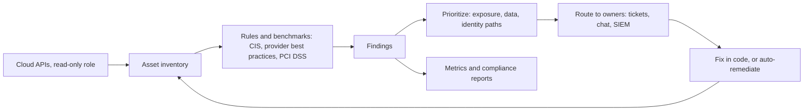

# Cloud Security Posture Management

## Introduction

The previous pages showed how to configure IAM, storage, containers, Kubernetes and Infrastructure as Code securely. But in a real organization, configuration never stands still. Teams create resources every day, some through IaC, some by hand during incidents, some through tools you did not know existed. Settings drift. New accounts appear. A bucket that was private last week is public today.

**Cloud Security Posture Management (CSPM)** is the practice, and the category of tools, that **continuously** inventories your cloud resources, compares their configuration against security rules and benchmarks, and reports what is wrong, ideally ranked by real risk.

A useful analogy is a building inspector who visits every floor, every night, with a checklist. Blueprints (IaC) and locks (guardrails) still matter, but the inspector catches what slipped through, including doors propped open by people who never looked at the blueprints.



CSPM is one part of a larger family that vendors often bundle as a **CNAPP** (Cloud-Native Application Protection Platform):

| Acronym | Focus | Example question it answers |
| --- | --- | --- |
| CSPM | Cloud configuration | Is any storage bucket public? Is logging on everywhere? |
| KSPM | Kubernetes configuration | Do any pods run privileged? Who has cluster-admin? |
| CIEM | Cloud identities and entitlements | Which roles have unused admin permissions? |
| CWPP | Workload protection (VMs, containers, serverless) | Which running images have exploitable CVEs? |
| DSPM | Data security posture | Where is personal data stored, and who can reach it? |

## What a CSPM Tool Does

1. **Inventory.** It lists every resource in every account, subscription, project and region it can read. This alone often surprises teams: forgotten test accounts, resources in unused regions, shadow projects.
2. **Assessment.** It runs hundreds of checks, often mapped to standards such as the CIS Benchmarks for AWS, Azure, GCP and Kubernetes, the provider's own best-practice standard, PCI DSS, ISO 27001 or NIST frameworks.
3. **Prioritization.** Better tools combine findings into **attack paths** or "toxic combinations": a VM that is internet-exposed **and** has a critical CVE **and** has a role that can read a sensitive bucket is far more urgent than any of those three alone.
4. **Workflow.** It sends findings to owners (tickets, chat, SIEM), tracks exceptions, and measures progress.
5. **Remediation.** It suggests fixes, sometimes as IaC snippets, and some tools can fix issues automatically.

CSPM works through **read-only** API access, usually with a role you grant it. It does not need agents on your machines, which makes it fast to roll out. The trade-off is that it only sees configuration, not what is happening inside a running process.

## The Tool Landscape

Tools and names in this space change often. The facts below were checked against official documentation in October 2026. Check current docs and pricing before you choose.

### Native provider tools

- **AWS:** in 2025, AWS renamed the original Security Hub to **AWS Security Hub CSPM**. It runs automated best-practice checks against standards such as AWS Foundational Security Best Practices, the CIS AWS Foundations Benchmark and PCI DSS, and produces findings in the ASFF format. The name **AWS Security Hub** now belongs to a broader service that correlates signals from Security Hub CSPM, Amazon Inspector, Amazon GuardDuty and Amazon Macie into prioritized risks and attack paths, using the OCSF format. **AWS Config** provides the underlying configuration history and rules.
- **Azure:** **Microsoft Defender for Cloud** offers **Foundational CSPM** at no cost (asset inventory, security recommendations, secure score based on the Microsoft Cloud Security Benchmark) and the paid **Defender CSPM** plan (attack path analysis, cloud security explorer, agentless scanning, data security posture and more). It can also connect to AWS and GCP.
- **Google Cloud:** **Security Command Center** includes misconfiguration detection (Security Health Analytics) and, in higher tiers, risk features such as attack exposure scores and attack paths. Google's documentation lists Standard and Premium tiers, and states that the Enterprise tier is deprecated and will shut down on May 21, 2027.

### Open source tools

- **Prowler:** a popular open source security tool (Apache 2.0) that scans AWS, Azure, Google Cloud, Kubernetes, Microsoft 365, GitHub and other providers, with many compliance frameworks built in.
- **Cloud Custodian:** a policy-as-code engine (a CNCF project) for finding **and fixing** resources that break your rules.
- **Steampipe and Powerpipe:** query cloud APIs with SQL and run benchmark checks.

### Commercial platforms

Many vendors sell multi-cloud CNAPP platforms with CSPM at their core. They differ mainly in how well they prioritize (attack paths, data context), how many clouds and services they cover, and how they integrate with your workflow. This page does not recommend a specific vendor.

### Turning on a native tool

Native tools are usually a few commands away. For example, enabling Security Hub CSPM with its default standards in one AWS account and Region, then listing active critical findings:

```bash
# Uses the "securityhub" CLI namespace, which serves Security Hub CSPM (ASFF findings)
aws securityhub enable-security-hub --enable-default-standards

aws securityhub get-findings \
  --filters '{"SeverityLabel":[{"Value":"CRITICAL","Comparison":"EQUALS"}],"RecordState":[{"Value":"ACTIVE","Comparison":"EQUALS"}]}' \
  --query 'Findings[].[Title,Resources[0].Id]' --output table --max-items 5
```

Example output (shortened):

```text
-----------------------------------------------------------------------------------
|                                   GetFindings                                   |
+------------------------------------------------------+--------------------------+
|  S3 general purpose buckets should block public ...  |  arn:aws:s3:::acme-tmp   |
|  Security groups should not allow unrestricted ...   |  arn:aws:ec2:...:sg-0a1  |
+------------------------------------------------------+--------------------------+
```

In a multi-account organization, do not enable it account by account. Designate a **delegated administrator** account and use central configuration so new accounts are enrolled automatically, and aggregate findings from all Regions into one home Region. The same pattern exists in Azure (Defender for Cloud at management group level) and Google Cloud (Security Command Center at organization level). Check the current setup guides, because the AWS console and APIs for the newer Security Hub differ from Security Hub CSPM.

## Hands-On: Scanning with Prowler

:::warning Ethics
Run posture scanners only against accounts, subscriptions and clusters you own or are authorized to assess. Even read-only scanning of someone else's cloud environment without permission can break laws and terms of service.
:::

Prowler can be installed with pip or run as a container. For AWS, it uses your normal credentials (ideally an SSO session with a read-only security audit role):

```bash
pip install prowler
prowler -v

# Scan only critical and high severity checks, write CSV, HTML and OCSF JSON reports
prowler aws --severity critical high --output-formats csv html json-ocsf

# List the compliance frameworks available, then run one
prowler aws --list-compliance
prowler aws --compliance cis_6.0_aws
```

Compliance framework names change as new versions are published. Use `--list-compliance` to see the names in your installed version.

To try Prowler without any cloud account, scan a local Kubernetes cluster. We ran it against the kind test cluster from [Kubernetes Security](./5-sec-kubernetes-security.mdx):

```bash
docker run --rm --network host \
  -v "$PWD/kubeconfig:/kc:ro" -v "$PWD/out:/out" \
  prowlercloud/prowler:latest kubernetes --kubeconfig-file /kc \
  --severity critical high --output-formats csv -o /out --no-banner
```

Example output (shortened):

```text
Executing 69 checks, please wait...
-> Scan completed! | 69/69 [100%] in 0.3s

Overview Results:
│ 13.72% (73) Failed │ 84.4% (449) Passed │ 0.0% (0) Muted │

│ Service           │ Status    │ Critical │ High │
│ apiserver         │ FAIL (8)  │        1 │    7 │
│ controllermanager │ PASS (5)  │        0 │    0 │
│ core              │ FAIL (24) │        0 │   24 │
│ etcd              │ PASS (6)  │        0 │    0 │
│ kubelet           │ FAIL (1)  │        0 │    1 │
│ rbac              │ FAIL (40) │        0 │   40 │
│ scheduler         │ PASS (1)  │        0 │    0 │
```

73 high or critical findings sounds alarming. But look closer: in our test, **none** came from the hardened `billing` namespace. They came from the control plane, the network plugin, and Kubernetes' built-in roles. Raw counts tell you very little until you triage them.

## Triage: From Findings to Work

A good triage process answers three questions for each finding: **Is it real? Does it matter here? Who owns it?** Here is a small script that reads Prowler's CSV output, separates findings you have consciously accepted (with a reason) from findings that need an owner, and sorts the rest by severity.

```python
# triage.py - group Prowler CSV findings and separate expected noise from real work
import csv
import sys
from collections import Counter, defaultdict

# Findings we accept on purpose, each with a reason (review these quarterly)
ACCEPTED = [
    {
        "where": "namespace: kube-system",
        "checks": {"core_minimize_hostNetwork_containers", "core_minimize_hostpath_volume_mounts",
                   "core_minimize_privileged_containers", "core_minimize_containers_added_capabilities",
                   "core_minimize_containers_capabilities_assigned", "core_seccomp_profile_docker_default"},
        "reason": "control plane and CNI pods need host access",
    },
    {"name_prefix": "system:", "reason": "built-in Kubernetes controller roles"},
    {"name_prefix": "cluster-admin", "reason": "built-in role, bindings reviewed separately"},
]
SEVERITY_ORDER = {"critical": 0, "high": 1, "medium": 2, "low": 3, "informational": 4}

def accepted_reason(row):
    for rule in ACCEPTED:
        if "where" in rule and row["REGION"] == rule["where"] and row["CHECK_ID"] in rule["checks"]:
            return rule["reason"]
        if "name_prefix" in rule and row["RESOURCE_NAME"].startswith(rule["name_prefix"]):
            return rule["reason"]
    return None

def main(path):
    with open(path, newline="") as f:
        rows = [r for r in csv.DictReader(f, delimiter=";") if r["STATUS"] == "FAIL"]

    muted = Counter()
    todo = defaultdict(list)
    for r in rows:
        reason = accepted_reason(r)
        if reason:
            muted[reason] += 1
        else:
            todo[(r["SEVERITY"], r["CHECK_ID"])].append(r["RESOURCE_NAME"])

    print(f"Total failed findings: {len(rows)}")
    for reason, n in muted.most_common():
        print(f"  accepted ({n}): {reason}")
    print("Needs an owner:")
    for (sev, check), resources in sorted(todo.items(), key=lambda kv: SEVERITY_ORDER.get(kv[0][0], 9)):
        print(f"  [{sev.upper()}] {check}: {', '.join(sorted(set(resources)))}")

if __name__ == "__main__":
    main(sys.argv[1])
```

```bash
python3 triage.py out/prowler-output-*.csv
```

Output from our scan (shortened):

```text
Total failed findings: 73
  accepted (23): control plane and CNI pods need host access
  accepted (21): built-in Kubernetes controller roles
  accepted (3): built-in role, bindings reviewed separately
Needs an owner:
  [CRITICAL] apiserver_kubelet_cert_auth: kube-apiserver-sec8-control-plane
  [HIGH] apiserver_audit_log_path_set: kube-apiserver-sec8-control-plane
  [HIGH] apiserver_encryption_provider_config_set: kube-apiserver-sec8-control-plane
  [HIGH] core_seccomp_profile_docker_default: local-path-provisioner-75f7fc7dc5-fzqr9
  [HIGH] rbac_minimize_pod_creation_access: admin, edit, local-path-provisioner-role
  ...
```

Two lessons from building this script:

- **Our first version muted every finding in `kube-system`.** That silently hid the API server findings for missing audit logging and missing encryption at rest for secrets, which are real gaps in a default kind cluster. Accept findings by **specific check and scope**, never by broad location.
- **Not every remaining finding is a true problem.** Some checks look for explicit command-line flags, and a setting may already be on by default. Verify against the documentation before you file a ticket. On a managed cluster (EKS, AKS, GKE) the provider controls API server flags, so many of these checks do not apply at all.

In a real tool, accepted findings are handled with the tool's own suppression feature (Prowler calls it a **mutelist**), with an owner, a reason and an expiry date.

### Prioritizing by risk, not by count

Severity labels come from the rule author, who does not know your environment. Raise or lower priority with context:

| Factor | Raises priority | Lowers priority |
| --- | --- | --- |
| Exposure | Reachable from the internet | Isolated private network |
| Data | Production customer data, secrets | Empty sandbox |
| Identity | Resource's role can reach sensitive data or admin actions | Role with minimal permissions |
| Exploitability | Known exploited vulnerability (for example on CISA's KEV list) | Theoretical, no known exploit |
| Environment | Production | Short-lived test account |

The attack path and risk-scoring features in commercial tools and in the newer native services automate this combination. Without them, a simple rule like "internet-exposed **and** production first" still beats sorting by raw severity. See [Vulnerability Management and CVSS](../11-sec-defensive-operations/6-sec-vulnerability-management.mdx).

## Remediation: Manual, Code-First or Automatic

There are three ways to close a finding:

1. **Fix it in IaC** and let the pipeline apply it. This is the default for resources managed by code, because a console fix would be reverted or cause drift. See [Infrastructure as Code Security](./6-sec-infrastructure-as-code-security.mdx).
2. **Fix it manually** for resources outside IaC, then bring them under code management.
3. **Auto-remediate** for a small set of rules where the fix is safe, fast and well understood.

Here is an auto-remediation policy in Cloud Custodian that turns on all four S3 Block Public Access settings for any bucket where one is off, unless the bucket carries an approved-exception tag:

```yaml
policies:
  - name: s3-enforce-block-public-access
    resource: aws.s3
    description: |
      Find buckets where any Block Public Access setting is off and turn
      all four on, unless the bucket is tagged as an approved exception.
    filters:
      - "tag:public-approved": absent
      - type: check-public-block
    actions:
      - type: set-public-block
        BlockPublicAcls: true
        IgnorePublicAcls: true
        BlockPublicPolicy: true
        RestrictPublicBuckets: true
```

```bash
pip install c7n
custodian validate custodian.yml
custodian run --dryrun -s out custodian.yml   # report matches without changing anything
```

Example output of the validation:

```text
custodian.commands:INFO Configuration valid: custodian.yml
```

Always start with `--dryrun` and review the matched resources. A static website bucket without the exception tag would go offline the moment this policy runs. Auto-remediation that breaks production destroys trust in the security program faster than any finding.

| Remediation style | Pros | Cons | Best for |
| --- | --- | --- | --- |
| Ticket to owner, fixed in IaC | Durable, reviewed, no drift | Slow; depends on team capacity | Most findings |
| Manual console fix | Fast for one-offs | Drift; no review; easy to forget | Emergencies, non-IaC resources |
| Automatic remediation | Seconds to fix; consistent | Can break things; can fight with IaC | A few high-risk, low-ambiguity rules (public buckets, open admin ports) |
| Preventive guardrail (SCP, Azure Policy deny, Org Policy) | Problem cannot happen | Blunt; exceptions are harder | Rules that must never be broken |

## Running a CSPM Program

Tools are the easy part. The program around them decides whether posture improves:

- **Ownership:** every finding must map to a team, usually through account structure or required owner tags.
- **SLAs by priority:** for example, internet-exposed critical issues fixed within days, low-severity issues in the normal backlog. Agree on them with engineering leadership.
- **Exceptions:** documented, approved, with an expiry date, and visible in reports.
- **Metrics:** open critical findings over time, mean time to remediate, percentage of resources managed by IaC, percentage of accounts covered by the scanner.
- **Feedback loop:** when the same finding keeps reappearing, fix the root cause: a module default, a missing guardrail, or a pipeline check.

## Real-World Scenario

Your company has grown to 15 AWS accounts and two Azure subscriptions, managed by one platform team of four people and one security engineer. An enterprise customer's security questionnaire asks how you monitor cloud configuration continuously. Today you run an ad hoc script once a quarter.

| Approach | Pros | Cons | Best for |
| --- | --- | --- | --- |
| Native tools per cloud (Security Hub CSPM, Defender for Cloud Foundational CSPM) | Deep service coverage; low or no extra cost for basics; easy compliance evidence | Two consoles; different formats; advanced prioritization often paid | Single-cloud or cloud-native-first teams |
| Open source (Prowler, scheduled in CI or a container job) | Free; multi-cloud; CSV, HTML and OCSF output; full control | You run, upgrade and triage it yourself; no built-in workflow | Small teams with engineering time |
| Commercial CNAPP | One view across clouds; attack paths; workflow integrations | Significant cost; vendor lock-in; onboarding effort | Larger multi-cloud estates |
| Hybrid: native tools plus Prowler, findings sent to SIEM or ticketing | Covers both clouds; cheap; standard formats | Integration work | Growing companies like this one |

You choose the **hybrid**: enable Security Hub CSPM with the AWS Foundational Security Best Practices and CIS standards across all AWS accounts through a delegated administrator, enable Defender for Cloud's free Foundational CSPM on Azure, and run Prowler weekly across both clouds as a second opinion and for a single CSV export for the questionnaire. Critical findings create tickets automatically. Two Cloud Custodian policies auto-remediate public buckets and open SSH, in dry-run mode for the first month.

**Why this approach:** it gives continuous monitoring with almost no licensing cost, uses each provider's deepest checks, and provides multi-cloud evidence. The team can reconsider a commercial platform when the estate or budget grows.

**When not to:** with dozens of cloud accounts across several providers and no capacity to integrate tools, a commercial platform's single workflow may save more engineer time than it costs.

## Common Mistakes

- **Turning everything on and drowning.** Thousands of findings on day one with no owners leads to ignored dashboards. Start with a short, high-value set of checks.
- **Muting broadly.** As our triage example showed, a wide mute rule can hide the most important findings.
- **Not covering every account and region.** Attackers like the forgotten sandbox account. Enroll accounts automatically when they are created.
- **Treating compliance scores as security.** A 95% CIS score can still include the one public bucket full of customer data. Prioritize by risk.
- **Auto-remediating without dry runs.** Test every remediation policy and keep an exception mechanism.
- **Fixing in the console when IaC owns the resource.** The fix will be undone at the next apply.

## Summary

- CSPM continuously inventories cloud resources and checks their configuration against rules and benchmarks.
- Native options: AWS Security Hub CSPM (with the broader AWS Security Hub on top), Microsoft Defender for Cloud, Google Security Command Center. Open source: Prowler, Cloud Custodian, Steampipe.
- Raw finding counts are misleading. Triage by exposure, data, identity reach and environment, and accept findings only narrowly, with reasons and expiry dates.
- Prefer fixing in IaC, auto-remediate only a few clear-cut rules after dry runs, and turn recurring findings into guardrails.
- The program (ownership, SLAs, exceptions, metrics) matters as much as the tool.

## Exercises

1. Create a kind cluster, deploy one deliberately insecure pod in a test namespace, and run Prowler's Kubernetes scan. Does your pod's finding stand out from the system noise? Adjust `triage.py` so that it does.
2. Extend `triage.py` to read an `owners.csv` mapping namespaces (or AWS account IDs) to team names, and print findings grouped by team.
3. Write a Cloud Custodian policy that reports (without changing anything) security groups that allow SSH from `0.0.0.0/0`. Validate it with `custodian validate`.
4. Draft a one-page CSPM policy for a small company: which checks block, SLA per priority, how exceptions are approved, and which three metrics you report monthly.

Related pages:

- [The Shared Responsibility Model](./0-sec-cloud-shared-responsibility.mdx)
- [Common Cloud Misconfigurations](./2-sec-cloud-misconfigurations.mdx)
- [CIS Benchmarks and Baselines](../9-sec-system-hardening/5-sec-cis-benchmarks.mdx)
- [Security Frameworks: NIST CSF, ISO 27001 and CIS Controls](../13-sec-governance/1-sec-security-frameworks.mdx)
- [Security Logging and SIEM](../11-sec-defensive-operations/1-sec-logging-and-siem.mdx)

External reading:

- [AWS Security Hub FAQs (Security Hub and Security Hub CSPM)](https://aws.amazon.com/security-hub/faqs/)
- [Microsoft Defender for Cloud: Cloud security posture management](https://learn.microsoft.com/en-us/azure/defender-for-cloud/concept-cloud-security-posture-management)
- [Google Security Command Center overview](https://docs.cloud.google.com/security-command-center/docs/security-command-center-overview)
- [Prowler on GitHub](https://github.com/prowler-cloud/prowler)
- [Cloud Custodian documentation](https://cloudcustodian.io/docs/)
