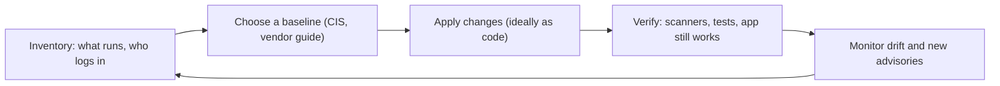
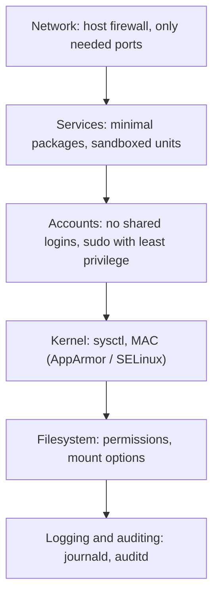

# Linux Hardening

## Introduction

A freshly installed Linux server is built to be *useful*, not to be *safe on the internet*. It may run services you never use, let any local user read logs that reveal kernel addresses, or run your application as root. **Hardening** means removing what you do not need and locking down what you keep, so an attacker has fewer ways in and can do less damage once inside.

Think of moving into a new house. Before you put anything valuable inside, you change the locks, close the windows nobody uses, put the spare key somewhere other than under the mat, and install a smoke detector. None of these steps alone makes the house safe. Together they make it a much harder target.

On this page you will:

- Follow a repeatable hardening workflow instead of a random checklist.
- Lock down accounts, sudo, packages, services, the filesystem and kernel parameters.
- Sandbox an application service with systemd and measure the result.
- Add mandatory access control (AppArmor or SELinux), audit logging and automatic updates.
- Decide in a realistic scenario how far to go and which tooling to use.

:::note Prerequisites
You should be comfortable with the Linux command line, `sudo`, `systemctl` and editing files in `/etc`. The [Ubuntu tutorial](/docs/os/ubuntu) covers these basics. Examples use **Ubuntu 24.04/26.04 LTS** and mention the Red Hat family (RHEL, Rocky, Alma, Fedora) where commands differ.
:::

:::caution Practice safely
Try every change on a disposable VM or a lab server first. Some hardening steps (firewall rules, SSH settings, `noexec` mounts) can lock you out or break applications. Keep a console session open while you test.
:::

## The Hardening Workflow

Hardening is not a one-time script. It is a loop: decide what "good" looks like, apply it, verify it, and keep checking for drift.



Each step answers a different question:

| Step | Question | Typical tools |
| --- | --- | --- |
| Inventory | What is installed, listening and logging in? | `ss`, `systemctl`, `dpkg -l` / `rpm -qa`, `last` |
| Baseline | What settings should this kind of server have? | [CIS Benchmarks](./5-sec-cis-benchmarks.mdx), distro security guides |
| Apply | How do we make it so on every server? | Ansible, cloud-init, golden images |
| Verify | Did it work, and did we break anything? | Lynis, OpenSCAP, `systemd-analyze security`, smoke tests |
| Monitor | Is it still true next month? | auditd, a SIEM, configuration management runs |

The layers you harden look like this. Each one is a separate line of defense, which is the idea behind [Defense in Depth](../0-sec-fundamentals/4-sec-defense-in-depth.mdx).



## Step 1: Take an Inventory

You cannot harden what you have not looked at. Start with three questions: what is listening, what is running, and who can log in.

```bash
# What is listening on the network?
sudo ss -tulpn

# Which services start at boot?
systemctl list-unit-files --type=service --state=enabled

# Which accounts have a login shell?
awk -F: '$7 !~ /(nologin|false)$/ {print $1, $3, $7}' /etc/passwd

# Who logged in recently?
last -n 10
```

Example output (trimmed):

```text
Netid State  Local Address:Port  Process
tcp   LISTEN 0.0.0.0:22          users:(("sshd",pid=812))
tcp   LISTEN 0.0.0.0:5432        users:(("postgres",pid=990))
tcp   LISTEN 127.0.0.1:6379      users:(("redis-server",pid=1001))
udp   UNCONN 0.0.0.0:111         users:(("rpcbind",pid=640))

root 0 /bin/bash
deploy 1000 /bin/bash
```

Two findings already stand out: PostgreSQL listens on every interface (`0.0.0.0:5432`) although only the local app uses it, and `rpcbind` runs although nothing uses NFS. Each is an unnecessary piece of [attack surface](../0-sec-fundamentals/3-sec-attack-surface.mdx).

## Step 2: Remove and Disable What You Do Not Need

Every package and service is code that might have a vulnerability. The safest service is the one that is not installed.

```bash
# Stop and disable a service you do not need
sudo systemctl disable --now rpcbind.service rpcbind.socket

# Remove packages you never use (Ubuntu/Debian)
sudo apt purge telnet rsh-client
sudo apt autoremove --purge

# RHEL family equivalent
# sudo dnf remove telnet rsh
```

For a service you *do* need but only locally, bind it to loopback instead of all interfaces. For PostgreSQL, set this in `postgresql.conf`:

```text
listen_addresses = 'localhost'
```

:::tip Bind first, firewall second
A host firewall is a second layer, not a substitute. If a service only needs local access, make it listen on `127.0.0.1` or a Unix socket. Then a firewall mistake cannot expose it. See [Firewalls and Security Groups](../2-sec-network-security/1-sec-firewalls.mdx) for nftables and `ufw` rules.
:::

## Step 3: Accounts, Sudo and Authentication

Most real intrusions use valid credentials at some point. Lock down who can log in and what they can do.

### Personal accounts, no shared root

- Give every administrator their **own account**, so logs show who did what.
- Lock the root password so nobody logs in as root directly: `sudo passwd -l root`.
- Remove or lock accounts for people who have left: `sudo usermod -L -e 1 olduser`.
- Check that only root has UID 0: `awk -F: '$3 == 0' /etc/passwd`.

### Least-privilege sudo

Full `sudo` for everyone defeats the purpose of separate accounts. Grant only the commands a role needs, in a drop-in file under `/etc/sudoers.d/`.

**Vulnerable** (`/etc/sudoers.d/deploy`):

```text
deploy ALL=(ALL) NOPASSWD: ALL
```

Anyone who steals the `deploy` user's SSH key is instantly root, with no password prompt.

**Fixed** (`/etc/sudoers.d/deploy`):

```text
# The deploy user may only restart the app and read its logs.
Cmnd_Alias APP_OPS = /usr/bin/systemctl restart orders.service, \
                     /usr/bin/journalctl -u orders.service *
deploy ALL=(root) APP_OPS
Defaults:deploy timestamp_timeout=5
```

Always edit sudoers with `visudo`, which checks the syntax before saving. A broken sudoers file can lock everyone out of administration.

```bash
sudo visudo -f /etc/sudoers.d/deploy
sudo visudo -c   # check every sudoers file
```

Example output:

```text
/etc/sudoers: parsed OK
/etc/sudoers.d/deploy: parsed OK
```

:::warning Watch for shell escapes
Allowing commands such as `vim`, `less`, `find`, `python3` or `tar` through sudo is effectively full root, because each can start a shell. Allow narrow commands with fixed arguments. The [Privilege Escalation Concepts](../10-sec-offensive-security/6-sec-privilege-escalation.mdx) page explains why from the attacker's side.
:::

:::note sudo-rs on newer Ubuntu
Ubuntu 25.10 and 26.04 LTS ship **sudo-rs**, a memory-safe Rust reimplementation of sudo, as the default `sudo`. The sudoers syntax shown here is supported, but sudo-rs intentionally leaves out some rarely used features. Check `sudo --version` and the [sudo-rs documentation](https://github.com/trifectatechfoundation/sudo-rs) if an old sudoers option is rejected.
:::

### Remote login

SSH is the front door to most Linux servers. It gets its own page: [SSH Security](./2-sec-ssh-security.mdx). The short version is keys instead of passwords, no direct root login, and a restricted set of users.

## Step 4: Filesystem Permissions and Mount Options

### Find risky permissions

```bash
# World-writable files outside /proc and /sys
sudo find / -xdev -type f -perm -0002 -not -path '/proc/*' 2>/dev/null

# SUID/SGID binaries: these run with the owner's privileges
sudo find / -xdev \( -perm -4000 -o -perm -2000 \) -type f 2>/dev/null

# Files with no valid owner (often left behind by deleted users)
sudo find / -xdev \( -nouser -o -nogroup \) 2>/dev/null
```

Keep a list of the SUID binaries on a clean install. A new one appearing later is worth investigating.

### Mount options

Temporary and user-writable directories are favorite places for attackers to drop tools. Mount options limit what can happen there:

| Option | Effect | Typical mounts |
| --- | --- | --- |
| `nodev` | Device files are not interpreted | `/tmp`, `/var/tmp`, `/home`, `/dev/shm` |
| `nosuid` | SUID/SGID bits are ignored | `/tmp`, `/var/tmp`, `/home`, `/dev/shm` |
| `noexec` | Binaries cannot be executed directly | `/tmp`, `/var/tmp`, `/dev/shm` (test first) |

Example `/etc/fstab` lines:

```text
tmpfs  /tmp      tmpfs  defaults,rw,nosuid,nodev,noexec,size=1G  0 0
tmpfs  /dev/shm  tmpfs  defaults,rw,nosuid,nodev,noexec          0 0
```

`noexec` is not a strong security boundary (an attacker can still run `bash script.sh`), and some installers and package hooks expect to execute from `/tmp`. Treat it as a speed bump and test your workloads.

## Step 5: Kernel Parameters with sysctl

The kernel exposes hundreds of tunables under `/proc/sys`. A handful matter for security. Put them in a drop-in file so they survive reboots and are easy to review.

`/etc/sysctl.d/60-hardening.conf`:

```text
# Hide kernel pointers from all users, including root, in /proc
kernel.kptr_restrict = 2
# Only privileged users can read the kernel log
kernel.dmesg_restrict = 1
# Processes may only ptrace their own descendants
kernel.yama.ptrace_scope = 1
# Disable unprivileged eBPF
kernel.unprivileged_bpf_disabled = 1
# Protect against symlink/hardlink tricks in world-writable directories
fs.protected_symlinks = 1
fs.protected_hardlinks = 1
fs.suid_dumpable = 0

# Network: this host is not a router
net.ipv4.ip_forward = 0
net.ipv4.conf.all.accept_redirects = 0
net.ipv4.conf.default.accept_redirects = 0
net.ipv6.conf.all.accept_redirects = 0
net.ipv4.conf.all.send_redirects = 0
net.ipv4.conf.all.accept_source_route = 0
net.ipv4.conf.all.rp_filter = 1
net.ipv4.conf.all.log_martians = 1
net.ipv4.tcp_syncookies = 1
```

Apply and check:

```bash
sudo sysctl --system
sysctl kernel.kptr_restrict net.ipv4.conf.all.accept_redirects
```

Example output:

```text
* Applying /etc/sysctl.d/60-hardening.conf ...
kernel.kptr_restrict = 2
net.ipv4.conf.all.accept_redirects = 0
```

:::caution Containers and routers are different
Docker, Kubernetes nodes and VPN gateways **need** `net.ipv4.ip_forward = 1`. Setting it to 0 on such hosts breaks networking. Always tailor kernel settings to the server's role.
:::

Many of these values are already the default on modern Ubuntu and RHEL. Writing them down anyway documents your intent and catches the server where someone changed them.

## Step 6: Sandbox Your Services with systemd

The application you deploy is usually the most exposed code on the server. If it has a bug like [command injection](../3-sec-web-security/7-sec-command-injection.mdx), the attacker gets whatever the service process can do. systemd can shrink that a lot without changing a line of application code.

**Vulnerable** (`/etc/systemd/system/orders.service`):

```text
[Unit]
Description=Orders API
After=network-online.target

[Service]
ExecStart=/usr/bin/python3 -m http.server 8000
WorkingDirectory=/opt/orders
Restart=on-failure

[Install]
WantedBy=multi-user.target
```

With no `User=` line, this runs as **root** with full access to the filesystem, devices and kernel interfaces. (The `ExecStart` is a stand-in for your real app, for example a Gunicorn command.)

**Fixed**:

```text
[Unit]
Description=Orders API
After=network-online.target

[Service]
ExecStart=/usr/bin/python3 -m http.server 8000
WorkingDirectory=/opt/orders
Restart=on-failure
User=orders
Group=orders

# Privileges
NoNewPrivileges=yes
CapabilityBoundingSet=
AmbientCapabilities=
RestrictSUIDSGID=yes

# Filesystem: read-only OS, private /tmp, one writable data dir
ProtectSystem=strict
ProtectHome=yes
PrivateTmp=yes
PrivateDevices=yes
ReadWritePaths=/var/lib/orders
UMask=0077

# Kernel and process visibility
ProtectKernelTunables=yes
ProtectKernelModules=yes
ProtectKernelLogs=yes
ProtectControlGroups=yes
ProtectClock=yes
ProtectHostname=yes
ProtectProc=invisible
ProcSubset=pid

# Network and system calls
RestrictAddressFamilies=AF_INET AF_INET6 AF_UNIX
RestrictNamespaces=yes
RestrictRealtime=yes
LockPersonality=yes
MemoryDenyWriteExecute=yes
SystemCallArchitectures=native
SystemCallFilter=@system-service
SystemCallFilter=~@privileged @resources

[Install]
WantedBy=multi-user.target
```

Measure the difference with `systemd-analyze security`. The `--offline=true` flag scores a unit file without installing it:

```bash
systemd-analyze security --offline=true before.service | tail -1
systemd-analyze security --offline=true after.service | tail -1
```

Example output (systemd 259):

```text
→ Overall exposure level for before.service: 9.4 UNSAFE 😨
→ Overall exposure level for after.service: 1.3 OK 🙂
```

The score is a heuristic, not a guarantee, but it shows exactly which directives are missing. Add settings one group at a time and restart the service after each, because some apps need extra permissions. For example, a JIT runtime such as Node.js or Java breaks under `MemoryDenyWriteExecute=yes`. Use `sudo systemctl edit orders.service` to put overrides in a drop-in instead of editing vendor unit files.

## Step 7: Mandatory Access Control

Normal Linux permissions are *discretionary*: the owner of a file decides who can access it, and root bypasses everything. **Mandatory access control (MAC)** adds a second policy that even root processes must obey.

| | AppArmor | SELinux |
| --- | --- | --- |
| Default on | Ubuntu, Debian, SUSE | RHEL, Fedora, Rocky, Alma |
| Model | Path-based profiles per program | Labels on every file and process |
| Learning curve | Gentler | Steeper, more powerful |
| Check status | `sudo aa-status` | `getenforce`, `sestatus` |
| Troubleshoot | `/var/log/syslog` or `journalctl` for `apparmor="DENIED"` | `ausearch -m avc`, `sealert` |

The most common SELinux "fix" found online is `setenforce 0`. Do not do that. Read the denial and add the narrow permission instead:

```bash
# RHEL family: let nginx connect to an upstream app port
sudo setsebool -P httpd_can_network_connect on

# Ubuntu: put a noisy profile in complain mode while you write rules, then enforce again
sudo aa-complain /etc/apparmor.d/usr.sbin.nginx
sudo aa-enforce  /etc/apparmor.d/usr.sbin.nginx
```

## Step 8: Logging and Auditing

Hardening reduces the chance of compromise. Logging tells you when it happens anyway. Make sure that:

- `journald` keeps logs persistently (`Storage=persistent` in `/etc/systemd/journald.conf`).
- Logs are shipped off the host to a central system. An attacker with root can delete local logs. See [Security Logging and SIEM](../11-sec-defensive-operations/1-sec-logging-and-siem.mdx).
- **auditd** records security-relevant events the normal logs miss.

Example audit rules, `/etc/audit/rules.d/50-hardening.rules`:

```text
# Changes to accounts and privileges
-w /etc/passwd -p wa -k identity
-w /etc/shadow -p wa -k identity
-w /etc/group -p wa -k identity
-w /etc/sudoers -p wa -k privilege
-w /etc/sudoers.d/ -p wa -k privilege
# SSH configuration changes
-w /etc/ssh/sshd_config -p wa -k sshd_config
-w /etc/ssh/sshd_config.d/ -p wa -k sshd_config
# Every command run with root privileges by a real (logged-in) user
-a always,exit -F arch=b64 -S execve -F euid=0 -F auid>=1000 -F auid!=unset -k root_cmd
```

Load and query them:

```bash
sudo augenrules --load
sudo ausearch -k identity --start today -i | tail -5
```

Example output:

```text
type=SYSCALL msg=audit(10/11/2026 09:14:02.331:812) : arch=x86_64 syscall=openat success=yes
  ... auid=alice uid=root comm=useradd exe=/usr/sbin/useradd key=identity
```

The `auid` (audit user ID) stays set to the person who logged in, even after `sudo`. That is what lets you answer "who really did this?" during an [incident](../12-sec-incident-response/0-sec-incident-response-lifecycle.mdx).

## Step 9: Automatic Security Updates

Most hardening guides put patching first, and for good reason: a perfectly configured server running a vulnerable OpenSSL is still vulnerable. On Ubuntu, `unattended-upgrades` installs security updates daily. It is enabled by default on recent server images. Check it:

```bash
cat /etc/apt/apt.conf.d/20auto-upgrades
systemctl is-enabled unattended-upgrades
```

Example output:

```text
APT::Periodic::Update-Package-Lists "1";
APT::Periodic::Unattended-Upgrade "1";
enabled
```

On the RHEL family, the equivalent is `dnf-automatic` (`sudo systemctl enable --now dnf-automatic.timer`, with `apply_updates = yes` in its config). Kernel updates still need a reboot or live patching. [Patch Management](./3-sec-patch-management.mdx) covers scheduling, testing and reboots.

## Step 10: Verify with a Quick Audit Script

Scanners like Lynis and OpenSCAP check hundreds of items (see [CIS Benchmarks and Baselines](./5-sec-cis-benchmarks.mdx)). It is still useful to understand how such a check works. This read-only script spot-checks a few of the settings from this page:

```bash
#!/usr/bin/env bash
# quick-audit.sh - read-only hardening spot checks for a Linux host you own.
set -uo pipefail

pass() { printf '[PASS] %s\n' "$1"; }
fail() { printf '[FAIL] %s\n' "$1"; }

check_sysctl() {
  local key=$1 want=$2 got
  got=$(sysctl -n "$key" 2>/dev/null || echo "missing")
  if [[ "$got" == "$want" ]]; then pass "$key = $got"; else fail "$key = $got (want $want)"; fi
}

echo "== Kernel parameters =="
check_sysctl kernel.kptr_restrict 2
check_sysctl kernel.dmesg_restrict 1
check_sysctl kernel.yama.ptrace_scope 1
check_sysctl net.ipv4.conf.all.accept_redirects 0
check_sysctl net.ipv4.tcp_syncookies 1

echo "== Accounts =="
uid0=$(awk -F: '$3 == 0 {print $1}' /etc/passwd | tr '\n' ' ')
[[ "$uid0" == "root " ]] && pass "only root has UID 0" || fail "UID 0 accounts: $uid0"

echo "== Listening services =="
ss -Htlnu | awk '{print $1, $5}' | sort -u | while read -r proto addr; do
  case "$addr" in
    127.0.0.*|"[::1]"*) pass "$proto $addr (loopback only)" ;;
    *) fail "$proto $addr is reachable from the network - is it needed?" ;;
  esac
done

echo "== Mandatory access control =="
if [[ -d /sys/kernel/security/apparmor ]]; then pass "AppArmor is loaded"
elif command -v getenforce >/dev/null && [[ $(getenforce) == Enforcing ]]; then pass "SELinux enforcing"
else fail "no MAC system enforcing"; fi

echo "== Automatic security updates =="
if systemctl is-enabled --quiet unattended-upgrades 2>/dev/null \
   || systemctl is-enabled --quiet dnf-automatic.timer 2>/dev/null; then
  pass "automatic updates enabled"
else
  fail "automatic updates not enabled"
fi
```

Example output on a partly hardened server:

```text
== Kernel parameters ==
[FAIL] kernel.kptr_restrict = 1 (want 2)
[PASS] kernel.dmesg_restrict = 1
[PASS] kernel.yama.ptrace_scope = 1
[PASS] net.ipv4.conf.all.accept_redirects = 0
[PASS] net.ipv4.tcp_syncookies = 1
== Accounts ==
[PASS] only root has UID 0
== Listening services ==
[FAIL] tcp 0.0.0.0:22 is reachable from the network - is it needed?
[FAIL] tcp 0.0.0.0:5432 is reachable from the network - is it needed?
[PASS] tcp 127.0.0.1:6379 (loopback only)
== Mandatory access control ==
[PASS] AppArmor is loaded
== Automatic security updates ==
[PASS] automatic updates enabled
```

SSH on port 22 is expected to be reachable, so a real tool would let you record accepted exceptions. PostgreSQL on `0.0.0.0` is a real finding.

## Real-World Scenario

Your team runs a small B2B invoicing SaaS. Production is three Ubuntu 24.04 VMs at a cloud provider: two app servers running a Flask API behind nginx, and one PostgreSQL server. A new enterprise customer's security questionnaire asks how the servers are hardened, and today the honest answer is "we installed Ubuntu and deployed the app."

### The solution

1. **Inventory** each VM with `ss -tulpn` and `systemctl list-unit-files`. You find PostgreSQL listening on all interfaces and a leftover `rpcbind`.
2. **Pick a baseline**: CIS Ubuntu Linux Level 1 - Server, adjusted for your app. Write down every exception and why.
3. **Encode it** as an Ansible role (accounts, sudoers drop-ins, sysctl file, auditd rules, systemd overrides, `unattended-upgrades`) so all three VMs and any new one get the same settings. The [Ansible tutorial](/docs/devops/ansible) covers roles.
4. **Sandbox the app** with a systemd unit like the one above and confirm `systemd-analyze security` scores it below 2.
5. **Restrict the network**: cloud security group allows 443 to the app servers from the load balancer only, 5432 to the database from the app servers only, and SSH only through a bastion or VPN.
6. **Verify** with Lynis or OpenSCAP in CI against a test VM built from the same role, and keep the report as evidence for the questionnaire.
7. **Monitor**: ship journald and auditd logs to your SIEM and alert on changes to sudoers and SSH config.

### Why this approach

The biggest risks for a small team are an exposed service, an over-privileged app process and drift between servers. Configuration as code handles drift. Binding and security groups handle exposure. systemd sandboxing contains a bug in your own code. All three are cheap and do not need new products.

### When to use it, and when not to

- **Use it** for long-lived VMs you manage yourself, and for the base image of anything else.
- **Go lighter** on short-lived, immutable hosts, for example autoscaled nodes rebuilt from an image every deploy. Harden the image once in the build pipeline and never log in to running instances.
- **Go further** (CIS Level 2, SELinux custom policies, FIPS mode) when regulation or a high-value target justifies the extra operational cost.

### Alternatives and trade-offs

| Approach | Pros | Cons | Best for |
| --- | --- | --- | --- |
| Manual hardening from a checklist | No tooling to learn, fast for one server | Not repeatable, drifts, hard to prove | A single lab or hobby server |
| Configuration management (Ansible role) | Repeatable, reviewable, fixes drift on each run | Needs discipline and testing | Small to medium fleets of long-lived VMs |
| Pre-hardened image (CIS Hardened Image, your own golden image) | Secure from first boot, fast scaling | Image must be rebuilt for every change; licensing cost for vendor images | Autoscaling groups, immutable infrastructure |
| Vendor compliance tool (Ubuntu Security Guide, OpenSCAP remediation) | Maps directly to CIS/STIG, generates reports | Can apply settings that break apps if used blindly | Regulated environments needing audit evidence |
| Managed platform (PaaS, serverless, managed DB) | Provider hardens and patches the OS | Less control, provider lock-in | Teams that do not want to run servers at all |

## Common Mistakes

- **Applying a hardening script you have not read.** Scripts from the internet often disable features your app needs, or worse. Read every line and test on a copy.
- **Hardening once and never checking again.** Packages, admins and quick fixes change servers. Re-run your configuration management and scanners on a schedule.
- **Disabling SELinux or AppArmor to fix one denial.** You lose a whole layer to solve a one-line policy problem.
- **Running apps as root "for now."** Create a dedicated service user on day one. It costs a minute.
- **Wildcard sudo rules.** `deploy ALL=(ALL) NOPASSWD: ALL` or allowing editors and interpreters through sudo is equivalent to sharing the root password.
- **Logs only on the box.** The first thing an intruder with root does is clean local logs. Ship them elsewhere.
- **Locking yourself out.** Test SSH and firewall changes with a second session open and know how to reach the console.

## Summary

- Hardening is a loop: inventory, baseline, apply as code, verify, monitor.
- Remove unused packages and services, and bind internal services to loopback.
- Use personal accounts, lock root, and grant narrow sudo rules in `/etc/sudoers.d/`, checked with `visudo`.
- Use `nosuid`, `nodev` and `noexec` on temporary directories, and audit SUID binaries.
- Set security-relevant `sysctl` values in a drop-in file, tailored to the server's role.
- Sandbox services with systemd directives and measure them with `systemd-analyze security`.
- Keep AppArmor or SELinux enforcing, record security events with auditd, and ship logs off the host.
- Keep automatic security updates on and plan for reboots.

## Exercises

1. On a lab VM, run the inventory commands from Step 1. List every listening service and decide whether to remove it, bind it to loopback, or keep it public.
2. Write a systemd unit for a small Flask app, then add sandboxing directives until `systemd-analyze security --offline=true` reports an exposure level below 3. Note which directive broke the app, if any.
3. Add the auditd rules from Step 8, create a test user with `useradd`, and find the event with `ausearch -k identity -i`.
4. Extend `quick-audit.sh` to check that `/tmp` is mounted with `nosuid` and `nodev` (hint: `findmnt -no OPTIONS /tmp`).

Related pages:

- [SSH Security](./2-sec-ssh-security.mdx) to lock down remote access
- [Patch Management](./3-sec-patch-management.mdx) for keeping packages and kernels current
- [CIS Benchmarks and Baselines](./5-sec-cis-benchmarks.mdx) for scanning against a standard
- [Project: Hardening a Linux Server](../14-sec-projects/5-sec-project-hardened-server.mdx) to put it all together
