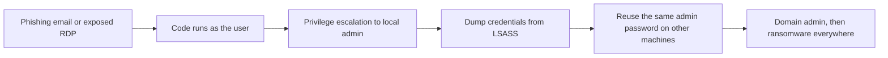

# Windows Hardening Basics

## Introduction

Windows runs most corporate laptops and a large share of business servers, which makes it the most common starting point for ransomware and credential theft. The good news is that modern Windows ships with strong security features built in. The bad news is that many of them are off by default, half-configured, or switched off "temporarily" by someone years ago.

Hardening Windows is like securing an office building that already has good locks, alarms and safes: the work is mostly *turning them on*, *setting them consistently*, and *taking away master keys from people who do not need them*.

On this page you will:

- Use Microsoft security baselines instead of inventing settings yourself.
- Remove standing admin rights and give every machine a unique local admin password with Windows LAPS.
- Protect credentials in memory with Credential Guard and LSA protection.
- Shrink the attack surface with Defender, attack surface reduction (ASR) rules, the firewall and by disabling legacy protocols.
- Encrypt disks with BitLocker and turn on the logging you need for investigations.
- Choose between Group Policy, Intune and OSConfig in a realistic scenario.

:::note Prerequisites
You should know how to open an elevated PowerShell session ("Run as administrator") and what Active Directory or Microsoft Entra ID is at a high level. Commands are for **Windows 11** and **Windows Server 2025**. Many also work on Windows Server 2019/2022.
:::

:::caution Supported versions only
Windows 10 reached end of support on **October 14, 2025**. Devices that still run it only receive security updates through the paid Extended Security Updates (ESU) program. No amount of hardening makes up for missing patches, so plan upgrades first. Check the [Windows lifecycle FAQ](https://learn.microsoft.com/en-us/lifecycle/faq/windows) for current dates.
:::

## Where Windows Attacks Usually Go

Most Windows intrusions follow a similar path. Knowing it tells you which controls matter most.



Each hardening control on this page breaks one or more links in that chain:

| Attack step | Control that breaks it |
| --- | --- |
| Malicious attachment or macro runs | ASR rules, Office macro policy, App Control for Business |
| User has admin rights | Standard user accounts, separate admin accounts |
| Credential dumping from LSASS | Credential Guard, LSA protection (RunAsPPL), ASR LSASS rule |
| Lateral movement with a shared password | Windows LAPS (unique, rotated local admin passwords) |
| Legacy protocol abuse (SMBv1, LLMNR, NTLMv1) | Disable legacy protocols via baseline |
| Exposed RDP or SMB | Windows Firewall default-deny, VPN or gateway for remote access |
| Stolen laptop | BitLocker with TPM |
| "We don't know what happened" | Audit policy, PowerShell logging, Sysmon, central log collection |

## Step 1: Start From a Security Baseline

Windows has thousands of Group Policy settings. Choosing them one by one is slow and error-prone. Microsoft publishes **security baselines**: tested sets of recommended settings for Windows client, Windows Server, Microsoft Edge and Microsoft 365 Apps.

You can get and apply them in several ways:

| Option | What it is | Best for |
| --- | --- | --- |
| [Security Compliance Toolkit (SCT)](https://www.microsoft.com/download/details.aspx?id=55319) | Downloadable GPO backups, plus Policy Analyzer and LGPO tools | Active Directory environments, offline review |
| Intune security baselines | The same idea delivered through Microsoft Intune (MDM) | Cloud-managed laptops, Entra ID joined devices |
| OSConfig | PowerShell-driven baselines with drift control for Windows Server 2025 | Windows Server 2025, including non-domain servers |
| CIS Benchmarks | Independent consensus baselines | Organizations that standardize on CIS across all OSes ([CIS Benchmarks and Baselines](./5-sec-cis-benchmarks.mdx)) |

Microsoft's own guidance is to start from a well-known baseline rather than build your own. You then document the few settings you change and why.

### Applying the Windows Server 2025 baseline with OSConfig

On Windows Server 2025, OSConfig applies a role-specific baseline and keeps it from drifting:

```powershell
# Elevated PowerShell on Windows Server 2025
Install-Module -Name Microsoft.OSConfig -Scope AllUsers -Force

# Apply the member-server baseline (use DomainController or WorkgroupMember as needed)
Set-OSConfigDesiredConfiguration -Scenario SecurityBaseline/WindowsServer/2025/MemberServer -Default

# Check compliance per setting
Get-OSConfigDesiredConfiguration -Scenario SecurityBaseline/WindowsServer/2025/MemberServer |
    Format-Table Name, @{ Name = "Status"; Expression = { $_.Compliance.Status } } -AutoSize
```

Example output (trimmed):

```text
Name                                         Status
----                                         ------
AuditCredentialValidation                    Compliant
EnableSMB1Protocol                           Compliant
LmCompatibilityLevel                         Compliant
RemoteDesktopServicesDoNotAllowDriveRedirection Compliant
...
```

A restart is required after applying or removing the baseline. Microsoft warns that the baseline changes default behaviour (for example, requiring TLS 1.2 or later and SMB 3.0 or later), so test it before production. See [Configure security baselines for Windows Server 2025](https://learn.microsoft.com/en-us/windows-server/security/osconfig/osconfig-how-to-configure-security-baselines).

## Step 2: Take Away Standing Admin Rights

The single most effective Windows hardening step is to stop people working as administrators all day.

- **Daily accounts are standard users.** Email and browsing never happen with admin rights.
- **Admins get a separate admin account**, used only for admin tasks, ideally from a dedicated admin workstation.
- **Keep User Account Control (UAC) on.** It is not a security boundary, but it stops a lot of silent elevation.
- **Domain admins never log on to regular workstations.** Their credentials would be left in memory on a machine an attacker can reach.

### Unique local admin passwords with Windows LAPS

Many organizations image every PC with the same local Administrator password. Steal it once and you can log in to every machine. **Windows LAPS** (Local Administrator Password Solution) gives each device a random password, rotates it, and backs it up to Microsoft Entra ID or Active Directory, where only authorized admins can read it.

**Vulnerable**: one local admin password for the whole fleet, set in the golden image and never changed.

**Fixed**: Windows LAPS manages the password per device.

Windows LAPS is built into supported versions of Windows 11, Windows Server 2019 and later (since the April 2023 updates). The old downloadable "legacy Microsoft LAPS" is deprecated, and newer Windows versions block its installer. You configure Windows LAPS through Intune (LAPS CSP) or Group Policy, then retrieve passwords with the LAPS PowerShell module:

```powershell
# Active Directory-backed devices
Get-LapsADPassword -Identity "LAPTOP-0142" -AsPlainText

# Entra ID-backed devices (uses Microsoft Graph; requires the right Entra role)
Get-LapsAADPassword -DeviceIds "LAPTOP-0142" -IncludePasswords -AsPlainText

# Force the device to process LAPS policy now (run on the device)
Invoke-LapsPolicyProcessing
```

Example output (AD):

```text
ComputerName        : LAPTOP-0142
DistinguishedName   : CN=LAPTOP-0142,OU=Laptops,DC=corp,DC=example
Account             : Administrator
Password            : 7h@Kq2...redacted
PasswordUpdateTime  : 10/09/2026 02:14:11
ExpirationTimestamp : 11/08/2026 02:14:11
Source              : EncryptedPassword
```

Configure the policy to rotate the password **after it is used** ("post-authentication actions"), so a password a technician viewed does not stay valid. Check the exact cmdlet parameters in the [LAPS PowerShell reference](https://learn.microsoft.com/en-us/powershell/module/laps/), because they can change between releases.

## Step 3: Protect Credentials in Memory

Once an attacker has admin rights on one machine, their next move is usually to read password hashes and Kerberos tickets from the memory of `lsass.exe`. Two features make that much harder.

| Feature | What it does | Default status (verify for your version) |
| --- | --- | --- |
| **Credential Guard** | Moves NTLM hashes and Kerberos TGTs into an isolated, virtualization-based process (`LSAIso.exe`) that even admin malware cannot read | On by default on Windows 11 22H2+ and Windows Server 2025 for domain-joined, non-DC systems that meet hardware and license requirements (Enterprise/Education) |
| **LSA protection (RunAsPPL)** | Runs LSASS as a Protected Process Light, so non-protected processes cannot read its memory or inject code | On by default on *new* installs of Windows 11 22H2+ that are enterprise-joined and HVCI-capable |

Check both with PowerShell:

```powershell
# Credential Guard: 1 in SecurityServicesRunning means it is running
(Get-CimInstance -ClassName Win32_DeviceGuard -Namespace root\Microsoft\Windows\DeviceGuard).SecurityServicesRunning

# LSA protection: 1 = enabled with UEFI lock, 2 = enabled without UEFI lock
Get-ItemProperty -Path "HKLM:\SYSTEM\CurrentControlSet\Control\Lsa" -Name RunAsPPL -ErrorAction SilentlyContinue |
    Select-Object RunAsPPL
```

Example output:

```text
1
2

RunAsPPL
--------
       2
```

To enable LSA protection on a single machine, set `RunAsPPL` and restart. In production, use Group Policy or Intune instead:

```powershell
New-ItemProperty -Path "HKLM:\SYSTEM\CurrentControlSet\Control\Lsa" `
    -Name RunAsPPL -PropertyType DWord -Value 2 -Force
```

:::caution Test LSA plug-ins first
LSA protection blocks plug-ins and drivers (for example, some smart card drivers or password filters) that are not signed appropriately by Microsoft. Windows 11 22H2+ already logs these in audit mode to the CodeIntegrity Operational log (events 3065/3066). Review those events before enforcing. Credential Guard also breaks apps that need NTLMv1, Kerberos DES or unconstrained delegation.
:::

## Step 4: Reduce the Attack Surface

### Microsoft Defender Antivirus and tamper protection

Defender Antivirus is built in. Make sure real-time and cloud-delivered protection are on, and that **tamper protection** stops malware (or a hurried admin) from turning them off.

```powershell
Get-MpComputerStatus |
    Select-Object AMRunningMode, RealTimeProtectionEnabled, IsTamperProtected, AntivirusSignatureAge
```

Example output:

```text
AMRunningMode RealTimeProtectionEnabled IsTamperProtected AntivirusSignatureAge
------------- ------------------------- ----------------- ---------------------
Normal                             True              True                     0
```

If you run a third-party endpoint product, Defender may be in passive mode instead. See [Endpoint Protection and EDR](./4-sec-endpoint-protection.mdx).

### Attack surface reduction (ASR) rules

ASR rules block behaviours that malware commonly uses but normal users rarely need, such as Office spawning child processes. Each rule has a GUID. Start in **audit mode**, review what would have been blocked, then switch to **block**.

```powershell
# Audit mode first: log, but do not block
$rules = @(
    "9e6c4e1f-7d60-472f-ba1a-a39ef669e4b2", # Block credential stealing from LSASS
    "56a863a9-875e-4185-98a7-b882c64b5ce5", # Block abuse of exploited vulnerable signed drivers
    "be9ba2d9-53ea-4cdc-84e5-9b1eeee46550", # Block executable content from email client and webmail
    "d4f940ab-401b-4efc-aadc-ad5f3c50688a", # Block all Office applications from creating child processes
    "c1db55ab-c21a-4637-bb3f-a12568109d35"  # Use advanced protection against ransomware
)
foreach ($id in $rules) {
    Add-MpPreference -AttackSurfaceReductionRules_Ids $id -AttackSurfaceReductionRules_Actions AuditMode
}

# Review the configured rules
$p = Get-MpPreference
for ($i = 0; $i -lt $p.AttackSurfaceReductionRules_Ids.Count; $i++) {
    "{0}  {1}" -f $p.AttackSurfaceReductionRules_Ids[$i], $p.AttackSurfaceReductionRules_Actions[$i]
}
```

Example output (2 means audit, 1 means block):

```text
9e6c4e1f-7d60-472f-ba1a-a39ef669e4b2  2
56a863a9-875e-4185-98a7-b882c64b5ce5  2
be9ba2d9-53ea-4cdc-84e5-9b1eeee46550  2
d4f940ab-401b-4efc-aadc-ad5f3c50688a  2
c1db55ab-c21a-4637-bb3f-a12568109d35  2
```

After a week or two in audit, change the action to `Enabled` for rules that did not flag legitimate software. Microsoft lists the full set and their GUIDs in the [ASR rules reference](https://learn.microsoft.com/en-us/defender-endpoint/attack-surface-reduction-rules-reference). In larger fleets, deploy ASR through Intune or Group Policy rather than per-machine PowerShell.

### Disable legacy protocols

| Legacy feature | Risk | Fix |
| --- | --- | --- |
| SMBv1 | Old, unauthenticated-by-design protocol abused by worms such as WannaCry (via EternalBlue) | Remove the feature; Windows baselines require SMB signing and newer SMB versions |
| LLMNR and NetBIOS name resolution | Attackers on the LAN answer name lookups and capture password hashes | Disable via baseline / GPO; rely on DNS |
| NTLMv1 and LM hashes | Easily cracked or relayed | `LmCompatibilityLevel` = 5 (NTLMv2 only) |
| WDigest plaintext caching | Plaintext passwords in LSASS memory | Off by default on modern Windows; make sure nothing re-enables it |

```powershell
# Is SMBv1 enabled on this server?
Get-SmbServerConfiguration | Select-Object EnableSMB1Protocol, RequireSecuritySignature

# Remove SMBv1 support entirely (client and server features)
Disable-WindowsOptionalFeature -Online -FeatureName SMB1Protocol -NoRestart
```

Example output:

```text
EnableSMB1Protocol RequireSecuritySignature
------------------ ------------------------
             False                     True
```

### Application control

The strongest control is to run only approved software. **App Control for Business** (formerly Windows Defender Application Control) and the older **AppLocker** let you allow software by publisher, path or hash. App control is powerful but needs careful rollout. Start with audit mode on a pilot group, and consider **Smart App Control** on consumer-style devices.

## Step 5: Windows Firewall

The Windows Firewall is a solid host firewall. Make sure it is on for every profile, blocks inbound traffic by default, and only allows what each machine needs.

```powershell
Get-NetFirewallProfile | Select-Object Name, Enabled, DefaultInboundAction, DefaultOutboundAction

Set-NetFirewallProfile -Profile Domain,Private,Public -Enabled True -DefaultInboundAction Block

# Allow RDP only from the admin subnet, not from everywhere
New-NetFirewallRule -DisplayName "RDP from admin subnet" -Direction Inbound `
    -Protocol TCP -LocalPort 3389 -RemoteAddress 10.20.0.0/24 -Action Allow
```

Example output of the first command:

```text
Name    Enabled DefaultInboundAction DefaultOutboundAction
----    ------- -------------------- ---------------------
Domain     True                Block         NotConfigured
Private    True                Block         NotConfigured
Public     True                Block         NotConfigured
```

:::warning Never expose RDP directly to the internet
Internet-facing RDP is one of the most common ransomware entry points. Put it behind a VPN, a remote-access gateway or a zero-trust access service, require MFA, and enable Network Level Authentication. See [VPNs and Secure Tunnels](../2-sec-network-security/3-sec-vpn.mdx).
:::

## Step 6: BitLocker Disk Encryption

If a laptop is stolen, BitLocker keeps the data unreadable. On devices with a TPM, it is close to invisible to users.

```powershell
Get-BitLockerVolume -MountPoint "C:" | Select-Object MountPoint, VolumeStatus, ProtectionStatus, EncryptionMethod

# Enable with TPM and a recovery password (back the recovery key up to Entra ID/AD first via policy)
Enable-BitLocker -MountPoint "C:" -EncryptionMethod XtsAes256 -TpmProtector
Add-BitLockerKeyProtector -MountPoint "C:" -RecoveryPasswordProtector
```

Example output:

```text
MountPoint VolumeStatus     ProtectionStatus EncryptionMethod
---------- ------------     ---------------- ----------------
C:         FullyEncrypted                 On        XtsAes256
```

The most common BitLocker failure is not cryptographic. It is a lost recovery key. Enforce recovery key escrow to Entra ID or Active Directory through policy before you encrypt anything.

## Step 7: Logging You Will Need Later

Default Windows logging misses many things investigators need. Turn on:

- **Advanced audit policy** for logon, account management, privilege use and process creation.
- **Command line in process creation events** (event 4688), so you see *what* ran, not just *that* something ran.
- **PowerShell Script Block Logging** (event 4104), which records the script content PowerShell actually executes.
- **Sysmon** from Sysinternals for richer process, network and file events, with a tuned configuration.
- Larger event log sizes and forwarding to a central collector or SIEM.

```powershell
# Process creation auditing
auditpol /set /subcategory:"Process Creation" /success:enable

# Include the command line in 4688 events
New-ItemProperty -Path "HKLM:\SOFTWARE\Microsoft\Windows\CurrentVersion\Policies\System\Audit" `
    -Name ProcessCreationIncludeCmdLine_Enabled -PropertyType DWord -Value 1 -Force

# PowerShell Script Block Logging
New-Item -Path "HKLM:\SOFTWARE\Policies\Microsoft\Windows\PowerShell\ScriptBlockLogging" -Force | Out-Null
Set-ItemProperty -Path "HKLM:\SOFTWARE\Policies\Microsoft\Windows\PowerShell\ScriptBlockLogging" `
    -Name EnableScriptBlockLogging -Value 1

auditpol /get /subcategory:"Process Creation"
```

Example output:

```text
System audit policy
Category/Subcategory                      Setting
Detailed Tracking
  Process Creation                        Success
```

In a managed environment, set these through the baseline GPO or Intune rather than by hand. [Security Logging and SIEM](../11-sec-defensive-operations/1-sec-logging-and-siem.mdx) explains where to send them.

## Step 8: A Read-Only Posture Check

Pull the checks together into one script you can run on any machine you administer. It changes nothing.

```powershell
# win-posture.ps1 - read-only Windows hardening spot check. Run elevated.
function Show-Check($Name, $Ok, $Detail) {
    $tag = if ($Ok) { "[PASS]" } else { "[FAIL]" }
    "{0} {1} {2}" -f $tag, $Name, $Detail
}

$mp = Get-MpComputerStatus
Show-Check "Defender real-time" $mp.RealTimeProtectionEnabled ""
Show-Check "Tamper protection" $mp.IsTamperProtected ""

$dg = Get-CimInstance -ClassName Win32_DeviceGuard -Namespace root\Microsoft\Windows\DeviceGuard
Show-Check "Credential Guard running" ($dg.SecurityServicesRunning -contains 1) ""

$ppl = (Get-ItemProperty "HKLM:\SYSTEM\CurrentControlSet\Control\Lsa" -ErrorAction SilentlyContinue).RunAsPPL
Show-Check "LSA protection" ($ppl -in 1, 2) "(RunAsPPL=$ppl)"

$smb1 = (Get-SmbServerConfiguration).EnableSMB1Protocol
Show-Check "SMBv1 disabled" (-not $smb1) ""

$fw = Get-NetFirewallProfile | Where-Object { -not $_.Enabled -or $_.DefaultInboundAction -ne "Block" }
Show-Check "Firewall on, inbound default block" (-not $fw) ""

$bl = Get-BitLockerVolume -MountPoint $env:SystemDrive
Show-Check "BitLocker on system drive" ($bl.ProtectionStatus -eq "On") ""

$admins = Get-LocalGroupMember -Group "Administrators" | Select-Object -ExpandProperty Name
Show-Check "Local Administrators members" ($admins.Count -le 2) "($($admins -join ', '))"
```

Example output on a laptop that still needs work:

```text
[PASS] Defender real-time
[PASS] Tamper protection
[FAIL] Credential Guard running
[PASS] LSA protection (RunAsPPL=2)
[PASS] SMBv1 disabled
[PASS] Firewall on, inbound default block
[FAIL] BitLocker on system drive
[FAIL] Local Administrators members (LAPTOP-0142\Administrator, CORP\jdoe, CORP\Helpdesk)
```

The last line is the most important finding: a regular user (`jdoe`) is a local admin.

## Real-World Scenario

You are the first IT and security hire at a 60-person architecture firm. Everyone has a Windows 11 Pro laptop and is a local administrator "so they can install plugins." There is one Windows Server 2025 file server in the office and Microsoft 365 for email. Last month a staff member opened a fake invoice, and an outside responder found the attacker had collected the shared local admin password. The partners want to know what to fix first.

### The solution, in order

1. **Remove local admin rights** from daily accounts. Use an approved software catalogue (Intune Company Portal or winget-based deployment) for the plugins people need.
2. **Deploy Windows LAPS** through Intune with passwords backed up to Entra ID and rotation after use. This kills the shared-password lateral movement path.
3. **Apply the Intune Windows security baseline** to a pilot group of five laptops, then everyone. It covers SMBv1, LLMNR, NTLM settings, firewall and much more.
4. **Turn on ASR rules in audit mode**, review for two weeks, then block. Focus first on the Office and email rules, since phishing was the entry point.
5. **Enforce BitLocker** with recovery keys escrowed to Entra ID.
6. **Apply the OSConfig member-server baseline** to the file server, and allow SMB only from the office and VPN subnets.
7. **Forward logs** (Defender alerts, 4688 with command lines, 4104) to a central place someone actually reviews.

Note the licensing reality: Credential Guard requires Enterprise or Education licensing, so on Windows 11 Pro you rely more on LSA protection, ASR rules and removing admin rights. Check current licensing with Microsoft, as entitlements change.

### Why this approach

The attack that already happened used admin rights and a shared password. Removing those two weaknesses breaks the path directly. Baselines then cover hundreds of smaller settings in one step, and Intune works for laptops that rarely visit the office.

### When to use it, and when not to

- **Use Intune** when devices are mostly remote or Entra ID joined.
- **Use Group Policy** when you already run Active Directory and most devices are on-premises.
- **Do not jump straight to application allow-listing** in a firm with many creative tools and plugins. It is the strongest control, but without a pilot and an exception process it will cause outages and rebellion. Revisit it after the basics.

### Alternatives and trade-offs

| Approach | Pros | Cons | Best for |
| --- | --- | --- | --- |
| Manual settings per machine | No infrastructure | Inconsistent, no reporting, drifts | One or two machines at home |
| Group Policy + SCT baselines | Mature, free with AD, very granular | Needs AD and line of sight to a DC; weak for remote laptops | On-premises domain environments |
| Intune security baselines | Cloud-managed, works anywhere, compliance reports | Licensing cost; fewer settings than GPO in some areas | Remote or hybrid workforces |
| OSConfig (Server 2025) | Drift control, role-aware, scriptable | Windows Server 2025 only | Modern server fleets, including workgroup servers |
| CIS Benchmarks with a scanner | Vendor-neutral, auditor-friendly, Level 1/Level 2 profiles | Must still deploy settings with GPO/Intune | Mixed Windows/Linux estates with compliance needs |

## Common Mistakes

- **Leaving users as local admins.** Almost every other control is weaker when the user can turn it off.
- **One local admin password everywhere.** Use Windows LAPS. Retire legacy Microsoft LAPS on newer Windows.
- **Enforcing ASR or app control without audit mode.** You will block a critical business app on day one and lose trust in the program.
- **Turning on BitLocker without key escrow.** A firmware update or TPM reset becomes permanent data loss.
- **Internet-facing RDP or SMB.** Put remote access behind VPN or a gateway with MFA.
- **Not logging command lines or PowerShell.** Responders end up guessing what the attacker ran.
- **Treating hardening as a project instead of a policy.** Baselines get new versions with new Windows releases. Review them at least once a year.

## Summary

- Start from Microsoft security baselines (SCT, Intune, or OSConfig on Server 2025) rather than building your own.
- Remove standing admin rights and use Windows LAPS for unique, rotated local admin passwords.
- Protect credentials with Credential Guard and LSA protection, and know their licensing and compatibility limits.
- Keep Defender and tamper protection on, roll out ASR rules from audit to block, and disable SMBv1, LLMNR and NTLMv1.
- Keep the firewall on with inbound default-deny, and never expose RDP directly.
- Encrypt with BitLocker and escrow recovery keys first.
- Turn on process command-line auditing, PowerShell script block logging and central log collection.

## Exercises

1. In a Windows 11 VM, run the posture script from Step 8. Fix two failing checks and run it again.
2. Enable three ASR rules in audit mode. Open a Word document that runs a harmless macro launching `notepad.exe`, then find the audit event in Event Viewer under Microsoft-Windows-Windows Defender/Operational (event ID 1122).
3. Download the Security Compliance Toolkit, open the Windows 11 baseline in Policy Analyzer, and compare it with your VM's local policy. List five differences and decide which ones you would accept.
4. Write a one-page plan to remove local admin rights from a team of developers, including how they will install tools they need.

Related pages:

- [Patch Management](./3-sec-patch-management.mdx) for Windows Update rings and Patch Tuesday
- [Endpoint Protection and EDR](./4-sec-endpoint-protection.mdx) for Defender for Endpoint and alternatives
- [Backups and Ransomware Resilience](./6-sec-backups-and-ransomware.mdx) for what to do when prevention fails
- [Least Privilege and Zero Trust](../0-sec-fundamentals/5-sec-least-privilege.mdx) for the principle behind removing admin rights
