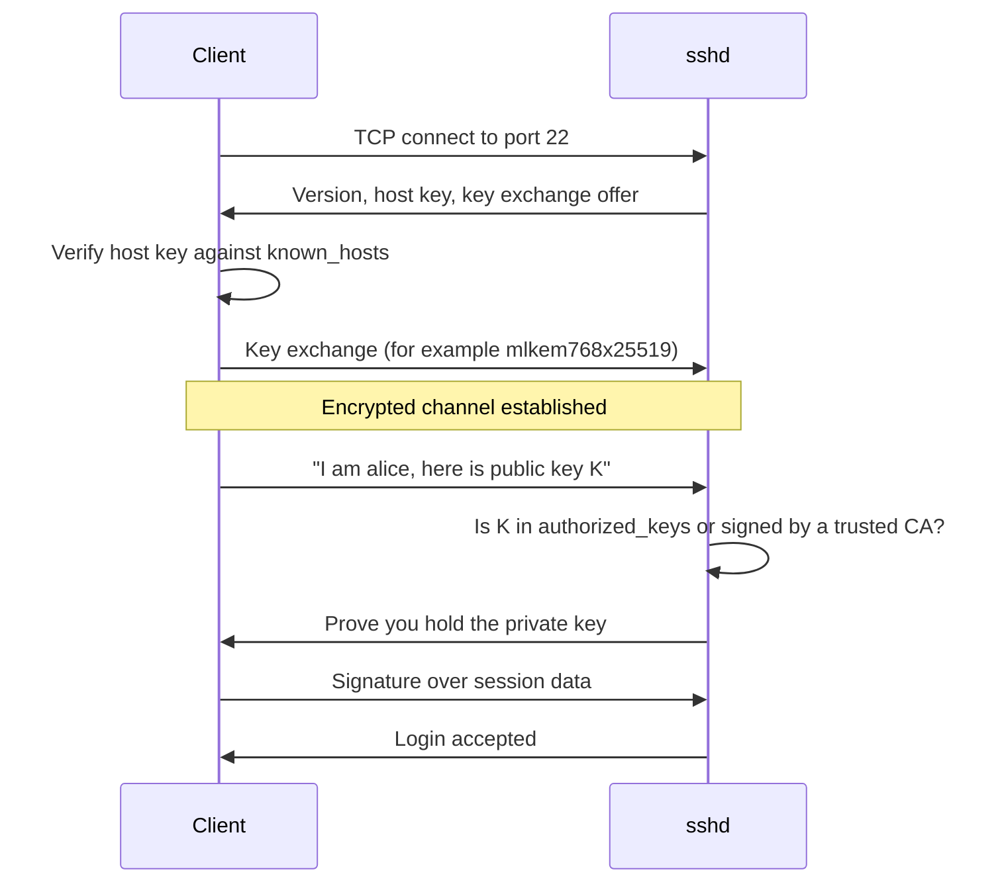
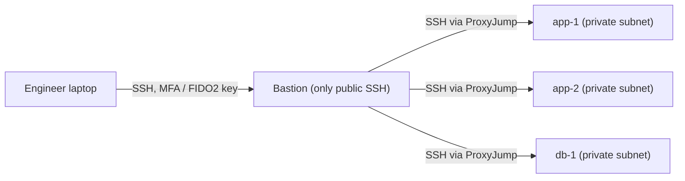
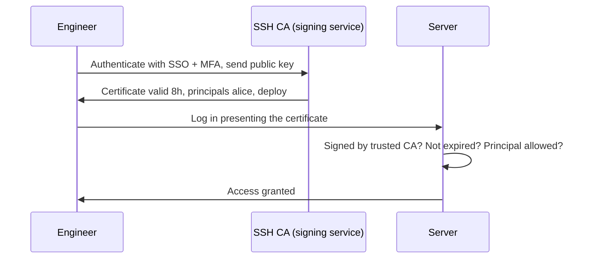

# SSH Security

## Introduction

SSH (Secure Shell) is how almost everyone administers Linux servers, network devices and Git repositories. It is the front door to your infrastructure, and internet-facing SSH servers receive automated login attempts within minutes of going online.

The protocol itself is strong. Problems come from *how it is used*:

- Password logins that bots can guess.
- Private keys without passphrases, copied between laptops and never revoked.
- Root logins, agent forwarding to untrusted hosts, and every engineer's key on every server.
- Unpatched `sshd` versions with known vulnerabilities.

Think of SSH keys as physical keys to a building. A strong lock does not help if copies of the key are lying in old laptops, nobody knows who has one, and the same key opens every door. This page covers making the lock strong, then managing the keys.

You will learn to:

- Create strong client keys, including hardware-backed FIDO2 keys.
- Write and test a hardened `sshd_config`.
- Understand SSH's current cryptography, including the post-quantum default.
- Reach private servers safely through a bastion with `ProxyJump`.
- Replace key sprawl with short-lived **SSH certificates**.

:::note Prerequisites
You should have used `ssh user@host` before and know what public-key cryptography is. If not, read [Asymmetric Encryption](../1-sec-cryptography/4-sec-asymmetric-encryption.mdx) first. Examples were tested with **OpenSSH 10.2** on Ubuntu 26.04. Older versions support almost everything here except where noted.
:::

:::caution Do not lock yourself out
Before restarting `sshd` with a new config, keep your current session open, test the config with `sshd -t`, and open a **second** session to confirm you can still log in. Make sure you have console access (cloud serial console or hypervisor console) as a fallback.
:::

## How SSH Authentication Works



Two separate trust decisions happen:

1. **The client trusts the server** by checking its host key. That is what the "authenticity of host can't be established" prompt is about. Blindly typing `yes` gives up protection against man-in-the-middle attacks.
2. **The server trusts the client** through a password, a public key, or a certificate.

## Step 1: Strong Client Keys

### Use Ed25519

```bash
ssh-keygen -t ed25519 -a 100 -C "alice@laptop-2026"
```

- `-t ed25519` uses a modern, fast elliptic-curve key. Prefer it over RSA for new keys. If you must use RSA, use at least 3072 bits.
- `-a 100` increases the number of key-derivation rounds that protect the private key file with your passphrase, which slows down offline guessing if the file is stolen.
- **Always set a passphrase**, and use `ssh-agent` (or your OS keychain) so you only type it once per session.

DSA keys are gone: OpenSSH 10.0 removed DSA support entirely. If anything still uses `ssh-dss`, replace it.

### Better: hardware-backed FIDO2 keys

A FIDO2 security key (such as a YubiKey or similar device) can hold an SSH key whose private part never leaves the hardware. Malware on your laptop cannot copy it, and each login requires a physical touch.

```bash
# Requires a FIDO2 key plugged in; you will be asked to touch it
ssh-keygen -t ed25519-sk -O resident -O verify-required -C "alice-yubikey"
```

Example output:

```text
Generating public/private ed25519-sk key pair.
You may need to touch your authenticator to authorize key generation.
Enter PIN for authenticator:
You may need to touch your authenticator again to authorize key generation.
Your identification has been saved in /home/alice/.ssh/id_ed25519_sk
Your public key has been saved in /home/alice/.ssh/id_ed25519_sk.pub
```

- `-O resident` stores the key handle on the token, so you can use it from another computer with `ssh-keygen -K`.
- `-O verify-required` requires the PIN as well as a touch.

The server needs OpenSSH 8.2 or later to accept `-sk` keys. Keep a backup key enrolled, because a lost token means a lost login.

### Restrict what a key can do

Lines in `~/.ssh/authorized_keys` can carry options. A backup job's key does not need a shell:

```text
restrict,from="10.20.0.15",command="/usr/local/bin/run-backup" ssh-ed25519 AAAAC3Nza... backup@db1
```

- `restrict` disables port, agent and X11 forwarding and PTY allocation.
- `from=` limits the source address.
- `command=` forces a single command no matter what the client asks for.

## Step 2: A Hardened sshd_config

Modern distributions read drop-in files from `/etc/ssh/sshd_config.d/*.conf` (check for an `Include` line near the top of `/etc/ssh/sshd_config`). Put your settings in a drop-in instead of editing the main file, so package updates do not overwrite them.

:::tip First match wins
For most `sshd_config` keywords, the **first** value read wins. Files in `sshd_config.d` are read in name order, and the `Include` sits at the top of the main file. Name your file so it sorts early (for example `10-hardening.conf`), and check the effective result with `sshd -T`.
:::

**Vulnerable** (settings often found on old or hand-built servers):

```text
PermitRootLogin yes
PasswordAuthentication yes
X11Forwarding yes
AllowTcpForwarding yes
MaxAuthTries 6
```

Root can log in directly, passwords can be guessed by bots, and anyone who logs in can tunnel traffic into your internal network.

**Fixed** (`/etc/ssh/sshd_config.d/10-hardening.conf`):

```text
# Who may log in, and how
PermitRootLogin no
PasswordAuthentication no
KbdInteractiveAuthentication no
PubkeyAuthentication yes
AuthenticationMethods publickey
PermitEmptyPasswords no
AllowGroups ssh-users

# Slow down guessing and drop dead sessions
MaxAuthTries 3
LoginGraceTime 30
MaxStartups 10:30:60
ClientAliveInterval 300
ClientAliveCountMax 2

# Turn off features most servers do not need
X11Forwarding no
AllowAgentForwarding no
AllowTcpForwarding no
PermitTunnel no
PermitUserEnvironment no

# Log key fingerprints so you know which key was used
LogLevel VERBOSE

# Bastion admins still need forwarding for ProxyJump
Match Group bastion-admins
    AllowTcpForwarding yes
```

Test, check the effective values, then reload:

```bash
sudo sshd -t && echo "config OK"
sudo sshd -T | grep -E '^(permitrootlogin|passwordauthentication|maxauthtries|allowtcpforwarding) '
sudo systemctl reload ssh      # the unit is "sshd" on RHEL-family systems
```

Example output:

```text
config OK
maxauthtries 3
permitrootlogin no
passwordauthentication no
allowtcpforwarding no
```

:::warning Cloud images may override you
Some cloud images ship their own drop-ins, such as `50-cloud-init.conf` that sets `PasswordAuthentication`. Because the first value wins, a file that sorts before yours can silently re-enable passwords. Always confirm with `sshd -T` instead of trusting the file you wrote.
:::

Create the group and add your admins before reloading, or nobody will be able to log in:

```bash
sudo groupadd --system ssh-users
sudo usermod -aG ssh-users alice
```

### Built-in brute-force protection

Since OpenSSH 9.8, `sshd` has **PerSourcePenalties**, which temporarily refuses connections from addresses that repeatedly fail authentication or crash the pre-authentication process. It is on by default. You can see the defaults with `sshd -T`:

```bash
sudo sshd -T | grep persourcepenalties
```

Example output (OpenSSH 10.2):

```text
persourcepenalties crash:90 authfail:5 noauth:1 grace-exceeded:10 refuseconnection:10 max:600 min:15 max-sources4:65536 max-sources6:65536 overflow:permissive overflow6:permissive
```

Tools like **fail2ban** still help when you want bans enforced in the firewall, shared across services, or reported to a SIEM. With key-only authentication, brute-force attempts mostly create log noise rather than real risk.

### Should you move SSH off port 22?

Moving SSH to a high port reduces log noise from bots, but it is not real protection: scanners find the new port quickly. Restricting **who can reach** the port is what matters. Allow SSH only from a VPN, a bastion host or specific admin IPs using your firewall or cloud security group. See [Firewalls and Security Groups](../2-sec-network-security/1-sec-firewalls.mdx).

## Step 3: Cryptography Defaults and Post-Quantum Key Exchange

Older hardening guides tell you to paste long `KexAlgorithms`, `Ciphers` and `MACs` lists into `sshd_config`. For a current OpenSSH, that is usually unnecessary and can even make things worse, because your hand-written list will not pick up improvements in later releases.

Recent changes worth knowing:

| Version | Change |
| --- | --- |
| OpenSSH 9.0 (2022) | Hybrid post-quantum key exchange `sntrup761x25519-sha512` became the default |
| OpenSSH 9.8 (2024) | Fixed CVE-2024-6387 ("regreSSHion"), a remote code execution race in `sshd` on glibc Linux; added PerSourcePenalties |
| OpenSSH 10.0 (2025) | `mlkem768x25519-sha256` (ML-KEM, standardized by NIST in FIPS 203, combined with X25519) became the default key exchange; DSA removed |
| OpenSSH 10.1 (2025) | The `ssh` client warns when a connection uses key exchange that is not post-quantum safe |
| OpenSSH 10.6 (October 2026) | `WarnWeakCrypto` became an `sshd_config` option, on by default, logging clients that use non-post-quantum key exchange |

Check what your server offers:

```bash
sudo sshd -T | grep -i ^kexalgorithms
```

Example output (OpenSSH 10.2):

```text
kexalgorithms mlkem768x25519-sha256,sntrup761x25519-sha512,sntrup761x25519-sha512@openssh.com,curve25519-sha256,curve25519-sha256@libssh.org,ecdh-sha2-nistp256,ecdh-sha2-nistp384,ecdh-sha2-nistp521
```

Why post-quantum now? Attackers can record encrypted SSH sessions today and decrypt them later if large quantum computers arrive ("harvest now, decrypt later"). Hybrid key exchange protects against that while keeping classical X25519 as a safety net. [Post-Quantum Cryptography](../1-sec-cryptography/11-sec-post-quantum.mdx) explains the background.

**Practical rule:** keep OpenSSH patched and use the defaults. Only restrict algorithms when a compliance standard requires it, and test with a scanner such as [ssh-audit](https://github.com/jtesta/ssh-audit) against your own servers. Versions and defaults change, so check the [OpenSSH release notes](https://www.openssh.org/releasenotes.html).

## Step 4: Reaching Private Servers with a Bastion

Production servers should not accept SSH from the internet at all. A common pattern is a single hardened **bastion** (jump host) that is the only machine reachable from outside.



Configure the client in `~/.ssh/config`:

```text
Host *
    IdentitiesOnly yes
    ForwardAgent no
    HashKnownHosts yes
    StrictHostKeyChecking ask
    UpdateHostKeys yes

Host bastion
    HostName bastion.example.com
    User alice
    IdentityFile ~/.ssh/id_ed25519_sk

Host app-*
    User alice
    ProxyJump bastion
    IdentityFile ~/.ssh/id_ed25519_sk
```

Check what `ssh` will actually do for a host:

```bash
ssh -G app-1 | grep -E '^(proxyjump|forwardagent|identitiesonly) '
```

Example output:

```text
identitiesonly yes
forwardagent no
proxyjump bastion
```

### ProxyJump instead of agent forwarding

`ForwardAgent yes` lets the remote server use your local agent to authenticate onward. Anyone with root on that server can then use your keys while you are connected. `ProxyJump` avoids that: the bastion only forwards an encrypted TCP stream, and your keys never leave your laptop.

**Vulnerable**:

```bash
ssh -A alice@bastion.example.com
# then, on the bastion:
ssh app-1
```

**Fixed**:

```bash
ssh -J alice@bastion.example.com alice@app-1
```

## Step 5: SSH Certificates Instead of authorized_keys Sprawl

With plain keys, every server has an `authorized_keys` file listing every engineer's key. When someone leaves, you have to find and remove their key on every server. Keys never expire.

**SSH certificates** fix this. You create an SSH **certificate authority (CA)** key. Servers trust the CA. Users get their public key *signed* for a short time, with a list of allowed usernames ("principals").



### Try it locally

```bash
# 1. Create the user CA (in production, keep this key in an HSM or a signing service)
ssh-keygen -t ed25519 -a 100 -C "user-ca" -f user_ca

# 2. Alice creates her normal key
ssh-keygen -t ed25519 -a 100 -C "alice@laptop" -f alice

# 3. The CA signs Alice's public key: identity, principals, 8-hour validity, serial
ssh-keygen -s user_ca -I alice@example.com -n alice,deploy -V +8h -z 1001 alice.pub

# 4. Inspect the certificate
ssh-keygen -L -f alice-cert.pub
```

Example output:

```text
Signed user key alice-cert.pub: id "alice@example.com" serial 1001 for alice,deploy valid from 2026-10-11T04:07:00 to 2026-10-11T12:08:00
alice-cert.pub:
        Type: ssh-ed25519-cert-v01@openssh.com user certificate
        Public key: ED25519-CERT SHA256:tpaoTEf30G5+PJpt9msECCsnxIiGmOqSUDeDcSV70+o
        Signing CA: ED25519 SHA256:r7zjRIEZFl/XU6sDyMEogjBexb+YPtsF9afEm7b0W+I (using ssh-ed25519)
        Key ID: "alice@example.com"
        Serial: 1001
        Valid: from 2026-10-11T04:07:00 to 2026-10-11T12:08:00
        Principals:
                alice
                deploy
        Critical Options: (none)
        Extensions:
                permit-X11-forwarding
                permit-agent-forwarding
                permit-port-forwarding
                permit-pty
                permit-user-rc
```

On each server, trust the CA and map principals to accounts:

```text
# /etc/ssh/sshd_config.d/20-user-ca.conf
TrustedUserCAKeys /etc/ssh/user_ca.pub
AuthorizedPrincipalsFile /etc/ssh/auth_principals/%u
```

```bash
# Only the "deploy" principal may log in as the deploy user
echo "deploy" | sudo tee /etc/ssh/auth_principals/deploy
```

Now Alice's access expires on its own after 8 hours. Removing her from the SSO group that the signing service checks is enough to cut off future access. No server needs editing.

To limit extensions, add `-O clear` and then only the ones you need, for example `-O clear -O permit-pty`. Revocation for emergencies uses a key revocation list (`RevokedKeys` in `sshd_config`, built with `ssh-keygen -k`).

You can also sign **host keys** with a host CA (`ssh-keygen -s host_ca -h ...`) and add a `@cert-authority` line to clients' `known_hosts`. That removes the "trust this host key?" prompt in a safe way.

## Step 6: Monitor SSH

- With `LogLevel VERBOSE`, `sshd` logs the fingerprint of the key or certificate ID used for each login.
- Alert on logins from unusual sources, logins as shared accounts, and changes to `sshd_config` or `authorized_keys` (the auditd rules on [Linux Hardening](./0-sec-linux-hardening.mdx) cover this).
- Patch `sshd` quickly when advisories appear. Pre-authentication bugs like regreSSHion are exactly what attackers scan the internet for.

```bash
journalctl -u ssh --since "1 hour ago" | grep -E 'Accepted|Failed' | tail -3
```

Example output:

```text
Oct 11 09:12:03 app-1 sshd[4121]: Accepted publickey for alice from 10.20.0.5 port 50122 ssh2: ED25519-CERT SHA256:tpao... ID alice@example.com (serial 1001) CA ED25519 SHA256:r7zj...
Oct 11 09:20:44 app-1 sshd[4190]: Connection closed by authenticating user root 203.0.113.50 port 41822 [preauth]
Oct 11 09:20:45 app-1 sshd[4192]: Failed publickey for invalid user admin from 203.0.113.50 port 41830 ssh2
```

## Real-World Scenario

Your company has 12 engineers and about 40 Linux VMs across staging and production. Every engineer's public key is in `authorized_keys` on every VM, pushed by a Terraform template two years ago. An engineer left last week. Nobody is sure their key is gone everywhere, and two VMs still allow password login because they were built by hand.

### The solution

1. **Immediate cleanup:** use your configuration management to deploy the hardened drop-in (no passwords, no root, `AllowGroups`) and to rewrite `authorized_keys` from a single source of truth. Verify with `sshd -T` on every host.
2. **Network:** move all VMs to private subnets. Only the bastion accepts SSH, only from the company VPN.
3. **Identity:** issue FIDO2 keys to engineers.
4. **Short-lived access:** stand up an SSH CA behind your SSO. Engineers request an 8-hour certificate after SSO login with MFA. Servers trust the CA and use principals per role (`deploy`, `dba`, `readonly`).
5. **Retire static keys** once everyone uses certificates, except tightly restricted automation keys.

### Why this approach

The real problem is not cryptography. It is **access lifecycle**: knowing who can log in and removing access reliably. Certificates tie access to the SSO identity and expire automatically, which solves offboarding. The bastion and FIDO2 keys make stolen laptops and leaked keys much less useful.

### When to use it, and when not to

- **Certificates** pay off once you have more than a handful of engineers or servers. For one personal VPS, a single FIDO2 key in `authorized_keys` is fine.
- If you run entirely in one cloud, **the provider's session manager** (for example AWS Systems Manager Session Manager, or Azure Bastion) may let you close port 22 completely, at the price of lock-in.
- If you cannot run your own CA safely, use a managed access product rather than a CA key on someone's laptop. A stolen CA key is a skeleton key for the whole fleet.

### Alternatives and trade-offs

| Approach | Pros | Cons | Best for |
| --- | --- | --- | --- |
| Static keys in `authorized_keys` | Simple, no extra infrastructure | No expiry, offboarding is error-prone, sprawl | Very small teams, personal servers |
| Static keys managed by config management | Central list, repeatable | Still no expiry; depends on every host being reachable for updates | Small fleets with good automation |
| SSH certificates from a CA tied to SSO | Short-lived, no per-server edits, audit by key ID | CA must be protected; needs a signing service | Teams of 10+ engineers or 20+ servers |
| Cloud session manager (no inbound SSH) | Port 22 closed, IAM-based, session logging | Cloud-specific, agent required, different workflow | Single-cloud fleets |
| Identity-aware access proxy (commercial or open source) | SSO, MFA, recording, works across clouds | Another critical system to run or buy | Larger or regulated environments |

## Common Mistakes

- **Leaving password authentication on** "just for emergencies." Use console access for emergencies instead.
- **Private keys without passphrases**, or copied onto shared servers and CI runners.
- **Agent forwarding to servers you do not fully trust.** Use `ProxyJump`.
- **Accepting unknown host keys blindly.** Use host certificates or distribute `known_hosts` from a trusted source.
- **Hand-written cipher lists from old blog posts**, which may disable post-quantum key exchange or keep weak algorithms.
- **Trusting the config file instead of `sshd -T`**, and missing a cloud-init drop-in that re-enables passwords.
- **Never removing keys** for people and systems that no longer need access.
- **Exposing SSH to the whole internet** when only a few admins need it.

## Summary

- Use Ed25519 keys with passphrases, or better, FIDO2 hardware keys (`ed25519-sk`).
- Harden `sshd` with a drop-in: no root login, no passwords, `AllowGroups`, no forwarding by default, verbose logging. Verify with `sshd -t` and `sshd -T`.
- Keep OpenSSH patched and prefer its current defaults, which already include hybrid post-quantum key exchange.
- Restrict network access to SSH and use a bastion with `ProxyJump`, not agent forwarding.
- Use SSH certificates from a CA tied to SSO for short-lived access and painless offboarding.
- Monitor logins and configuration changes.

## Exercises

1. On a lab VM, write the hardened drop-in from Step 2. Use `sshd -T` to prove that password authentication is off, even if a `50-cloud-init.conf` file says otherwise.
2. Create a user CA, sign a certificate valid for 10 minutes with the principal `deploy`, configure `TrustedUserCAKeys` and `AuthorizedPrincipalsFile`, log in, and confirm the login fails after the certificate expires.
3. Build a two-VM lab (bastion + private server) and connect with `ssh -J`. Then try agent forwarding and use `ssh-add -l` on the bastion to see why it is risky.
4. Run `ssh-audit` against your own lab server and explain each warning it prints.

Related pages:

- [Linux Hardening](./0-sec-linux-hardening.mdx) for the rest of the host
- [Key Management](../1-sec-cryptography/8-sec-key-management.mdx) for protecting CA keys
- [Network Segmentation](../2-sec-network-security/2-sec-network-segmentation.mdx) for private subnets and bastions
- [Project: Hardening a Linux Server](../14-sec-projects/5-sec-project-hardened-server.mdx)
