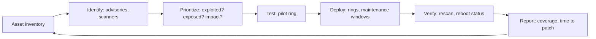
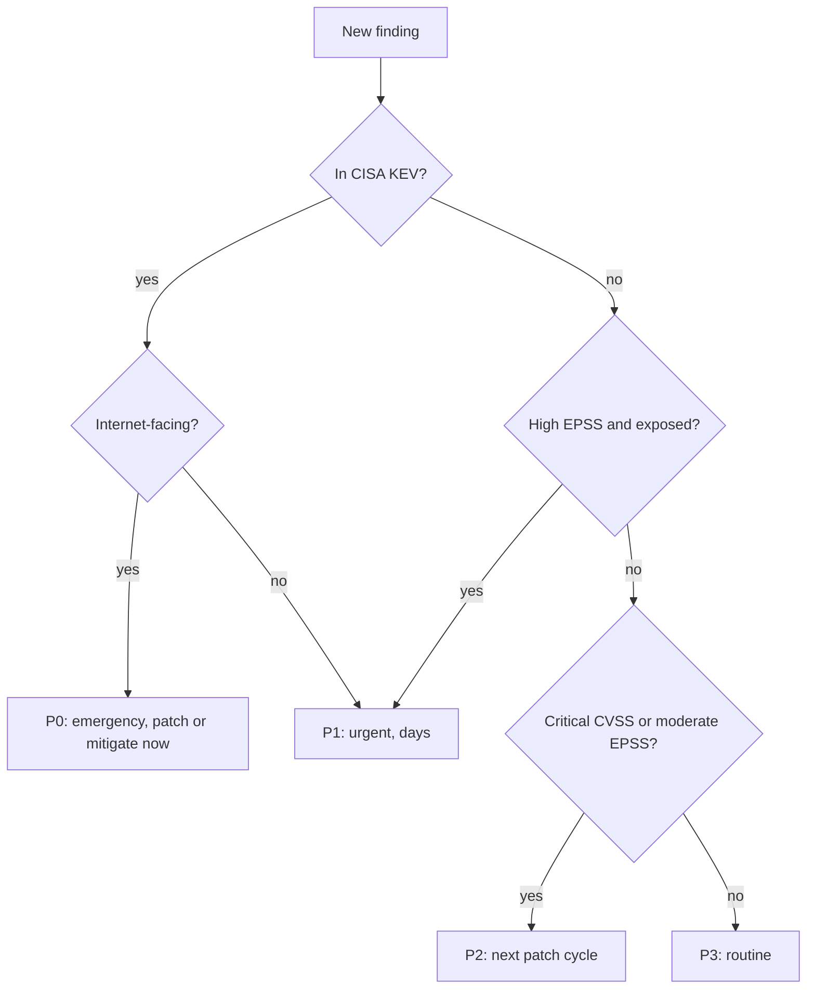

# Patch Management

## Introduction

Most successful attacks do not use brand-new, unknown vulnerabilities. They use known ones that already have a fix, on systems where nobody installed it. A **patch** is a vendor's fix. **Patch management** is the process that gets the right fixes onto the right systems quickly, without breaking production.

It sounds simple: "just install updates." In practice it means answering hard questions every week:

- Which of our thousands of systems are affected?
- Which of the hundreds of new CVEs actually matter to us?
- How do we update fast without a bad patch taking down production?
- What do we do when no patch exists yet, or the system cannot be patched?

Think of it like a car recall. The manufacturer announces a fix, but nothing happens until owners know their car is affected, book the repair, and get it done. Patch management is the system that tracks every car, prioritizes the dangerous recalls, and gets them fixed.

On this page you will:

- Walk through the patch management lifecycle.
- Prioritize with CVSS, EPSS and the CISA Known Exploited Vulnerabilities (KEV) catalog, using a small Python script against the real feeds.
- Configure automatic updates and reboots on Linux, and understand Windows update rings.
- Roll out patches safely with rings and an Ansible rolling update.
- Handle emergencies and systems you cannot patch.

:::note Prerequisites
This page builds on [Linux Hardening](./0-sec-linux-hardening.mdx) and [Windows Hardening Basics](./1-sec-windows-hardening.mdx). Scoring systems like CVSS are covered in more depth in [Vulnerability Management and CVSS](../11-sec-defensive-operations/6-sec-vulnerability-management.mdx). Library and dependency updates in your own code are covered in [Dependency Scanning and SCA](../6-sec-appsec-and-devsecops/4-sec-dependency-scanning.mdx).
:::

## The Patch Management Lifecycle



| Stage | Key question | Common mistakes |
| --- | --- | --- |
| Inventory | What do we have, and who owns it? | Forgotten servers, appliances and shadow IT never get patched |
| Identify | Which vulnerabilities affect our assets? | Relying only on vendor emails; not scanning |
| Prioritize | What must be fixed first? | Sorting by CVSS alone |
| Test | Will this patch break something? | Testing so long that patches never ship |
| Deploy | How do we roll it out safely? | All servers at once; no rollback plan |
| Verify | Did it actually apply? | Package updated but service or kernel never restarted |
| Report | Are we getting better? | No metrics, so no one notices drift |

### Inventory comes first

You cannot patch what you do not know exists. Your inventory should include servers, laptops, network devices, VPN and firewall appliances, container images, cloud services you configure, and the software running on each. Edge devices like VPN gateways and firewalls deserve special attention: they face the internet, often run outdated firmware, and are a favorite target. In 2026, CISA issued a directive specifically about end-of-support edge devices (BOD 26-02) for US federal agencies.

## Prioritizing: Not Every CVE Is Equal

Thousands of CVEs are published every month. You cannot fix them all at once, so you need a ranking. Three public signals work well together:

| Signal | Source | Answers | Limitation |
| --- | --- | --- | --- |
| **CVSS** base score (v4.0 current, v3.1 still common) | FIRST, NVD, vendors | How bad could it be in theory? | Says nothing about whether anyone is exploiting it |
| **EPSS** | [FIRST EPSS](https://www.first.org/epss/) | Probability of exploitation activity in the next 30 days | A model; updated daily, so scores move |
| **CISA KEV** | [Known Exploited Vulnerabilities catalog](https://www.cisa.gov/known-exploited-vulnerabilities-catalog) | Is it *known* to be exploited in the wild? | Only confirmed cases; US-government focused |

Then add **your context**: Is the asset internet-facing? Does it hold sensitive data? Is there a compensating control, such as the vulnerable feature being disabled?



### A small prioritizer against the real feeds

Both KEV and EPSS are free and public. This script uses only the Python standard library:

```python
"""Prioritize vulnerability findings using CISA KEV and FIRST EPSS (both free, public feeds)."""
import json
import urllib.request

KEV_URL = "https://www.cisa.gov/sites/default/files/feeds/known_exploited_vulnerabilities.json"
EPSS_URL = "https://api.first.org/data/v1/epss?cve="

# Findings from your scanner: CVE, asset, whether the asset is internet-facing, CVSS base score
FINDINGS = [
    {"cve": "CVE-2024-3400", "asset": "vpn-gw-1", "internet_facing": True, "cvss": 10.0},
    {"cve": "CVE-2024-6387", "asset": "app-7", "internet_facing": False, "cvss": 8.1},
    {"cve": "CVE-2023-48795", "asset": "app-7", "internet_facing": False, "cvss": 5.9},
    {"cve": "CVE-2021-44228", "asset": "legacy-reporting", "internet_facing": False, "cvss": 10.0},
]


def fetch_json(url: str) -> dict:
    req = urllib.request.Request(url, headers={"User-Agent": "patch-prioritizer/1.0"})
    with urllib.request.urlopen(req, timeout=30) as resp:
        return json.load(resp)


def load_kev() -> dict:
    data = fetch_json(KEV_URL)
    return {v["cveID"]: v for v in data["vulnerabilities"]}


def load_epss(cves: list[str]) -> dict:
    data = fetch_json(EPSS_URL + ",".join(cves))
    return {row["cve"]: float(row["epss"]) for row in data["data"]}


def priority(finding: dict, kev: dict, epss: dict) -> str:
    in_kev = finding["cve"] in kev
    score = epss.get(finding["cve"], 0.0)
    if in_kev and finding["internet_facing"]:
        return "P0 emergency"
    if in_kev or (score >= 0.5 and finding["internet_facing"]):
        return "P1 urgent"
    if score >= 0.1 or finding["cvss"] >= 9.0:
        return "P2 next cycle"
    return "P3 routine"


def main() -> None:
    kev = load_kev()
    epss = load_epss([f["cve"] for f in FINDINGS])
    order = {"P0 emergency": 0, "P1 urgent": 1, "P2 next cycle": 2, "P3 routine": 3}
    rows = []
    for f in FINDINGS:
        k = kev.get(f["cve"])
        rows.append((priority(f, kev, epss), f["cve"], f["asset"], f["cvss"],
                     epss.get(f["cve"], 0.0), "yes" if k else "no",
                     k["knownRansomwareCampaignUse"] if k else "-"))
    rows.sort(key=lambda r: (order[r[0]], -r[4]))
    print(f"{'PRIORITY':14} {'CVE':16} {'ASSET':17} {'CVSS':>4} {'EPSS':>6} KEV RANSOMWARE")
    for r in rows:
        print(f"{r[0]:14} {r[1]:16} {r[2]:17} {r[3]:>4} {r[4]:>6.3f} {r[5]:3} {r[6]}")


if __name__ == "__main__":
    main()
```

Example output (run in October 2026; EPSS scores change daily):

```text
PRIORITY       CVE              ASSET             CVSS   EPSS KEV RANSOMWARE
P0 emergency   CVE-2024-3400    vpn-gw-1          10.0  1.000 yes Known
P1 urgent      CVE-2021-44228   legacy-reporting  10.0  1.000 yes Known
P2 next cycle  CVE-2024-6387    app-7              8.1  0.995 no  -
P2 next cycle  CVE-2023-48795   app-7              5.9  0.935 no  -
```

Notice what context changes. Log4Shell (CVE-2021-44228) has the same CVSS score as the VPN bug, but the VPN gateway is internet-facing, so it goes first. The OpenSSH regreSSHion bug (CVE-2024-6387) has a very high EPSS score but is not in KEV and is on an internal host, so it lands in the next cycle. Your thresholds are a policy decision. Tune them, write them down, and apply them consistently.

### Example remediation targets

Many organizations write target times into policy. The numbers below are an **example**, not a standard. Choose yours based on risk appetite and any regulatory or contractual requirements.

| Priority | Example target | Example trigger |
| --- | --- | --- |
| P0 | 48 to 72 hours, or mitigate immediately | KEV and internet-facing |
| P1 | 7 days | KEV on internal asset, or high EPSS on exposed asset |
| P2 | 30 days | Critical CVSS or moderate EPSS |
| P3 | Next routine cycle (up to 90 days) | Everything else |

For US federal agencies, CISA's **BOD 26-04** (June 2026) replaced BOD 22-01 and sets remediation timelines based on KEV status, asset exposure, exploit automation and technical impact. Even if it does not apply to you, it is a useful model. Read the [current directive](https://www.cisa.gov/news-events/directives) for its exact timelines.

## Patching Linux Servers

### Automatic security updates

For most servers, automatic installation of **security** updates is the right default. The risk of a security update breaking something is usually lower than the risk of leaving a known hole open for weeks.

On Ubuntu and Debian, `unattended-upgrades` does this. A typical `/etc/apt/apt.conf.d/52-local-unattended` override:

```text
Unattended-Upgrade::Allowed-Origins {
    "${distro_id}:${distro_codename}-security";
    "${distro_id}ESMApps:${distro_codename}-apps-security";
    "${distro_id}ESM:${distro_codename}-infra-security";
};
Unattended-Upgrade::Remove-Unused-Kernel-Packages "true";
Unattended-Upgrade::Automatic-Reboot "true";
Unattended-Upgrade::Automatic-Reboot-Time "03:30";
Unattended-Upgrade::Mail "ops@example.com";
Unattended-Upgrade::MailReport "only-on-error";
```

The `${distro_id}` placeholders are expanded by `unattended-upgrades` itself. Do a dry run to see what it would do:

```bash
sudo unattended-upgrade --dry-run --debug 2>&1 | tail -5
```

Example output:

```text
Packages that will be upgraded: libssl3t64 openssl
Writing dpkg log to /var/log/unattended-upgrades/unattended-upgrades-dpkg.log
All upgrades installed
```

On the RHEL family, use `dnf-automatic`. In `/etc/dnf/automatic.conf` set `upgrade_type = security` and `apply_updates = yes`, then enable the timer:

```bash
sudo dnf install dnf-automatic
sudo systemctl enable --now dnf-automatic.timer
```

### Restarts: the step everyone forgets

Installing a patched library does not fix processes that already loaded the old version. Installing a new kernel does not help until you boot it.

```bash
# Ubuntu/Debian: is a reboot pending, and which packages asked for it?
cat /var/run/reboot-required /var/run/reboot-required.pkgs 2>/dev/null

# Which services still use old libraries? (needrestart is installed by default on Ubuntu Server)
sudo needrestart -r l

# RHEL family
sudo dnf needs-restarting -r
```

Example output:

```text
*** System restart required ***
linux-image-6.8.0-86-generic
Running kernel seems to be up-to-date (ABI upgrades are not detected).
Services to be restarted:
 systemctl restart nginx.service
```

### Live kernel patching

Live patching applies critical kernel fixes to the running kernel, so you can delay the reboot to a planned window. Options include **Canonical Livepatch** (part of Ubuntu Pro, which is free for personal use on a small number of machines) and **kpatch** on RHEL. Live patches cover selected high and critical kernel CVEs, not every update, so you still need regular reboots. Check the vendor's current coverage and pricing.

## Patching Windows

Microsoft releases most security updates on **Patch Tuesday**, the second Tuesday of each month, with out-of-band releases for emergencies. Windows updates are cumulative: one monthly update brings a device fully current.

Use **rings** (deployment groups) so problems show up on a few devices first:

| Ring | Who | Delay after release | Purpose |
| --- | --- | --- | --- |
| Ring 0: Test | IT lab VMs | Day 0 | Catch obvious breakage |
| Ring 1: Pilot | IT staff and volunteers, about 5% | 1 to 3 days | Real-world apps and hardware |
| Ring 2: Broad | Most users and non-critical servers | About 7 days | Bulk of the fleet |
| Ring 3: Critical | Sensitive servers and kiosks | About 10 to 14 days | Highest change control |

You implement rings with Windows Update for Business policies in Intune or Group Policy, WSUS or Configuration Manager on-premises, or **Windows Autopatch**, which automates ring management. Windows 11 Enterprise and Windows Server 2025 also support **hotpatch** updates, which install some security updates without a restart. Hotpatch has licensing and platform requirements that change over time, so check Microsoft's current documentation before you plan on it.

:::tip Expedite for emergencies
Rings are for routine patches. For an actively exploited zero-day, use your tool's expedite option (Intune can expedite quality updates) to reach every device within a day or two. Decide *in advance* who can trigger it.
:::

## Rolling Updates for Server Fleets

For services behind a load balancer, patch a slice of servers at a time, test, and continue only if everything is healthy. This Ansible playbook drains each batch, patches, reboots if needed, runs a smoke test, and stops the whole rollout on the first failure:

```yaml
- name: Rolling security patching for web servers
  hosts: web
  serial: "25%"
  max_fail_percentage: 0
  become: true
  tasks:
    - name: Take host out of the load balancer
      ansible.builtin.uri:
        url: "http://lb.internal/api/drain/{{ inventory_hostname }}"
        method: POST
      delegate_to: localhost

    - name: Apply all pending updates
      ansible.builtin.apt:
        update_cache: true
        upgrade: dist
        autoremove: true

    - name: Check whether a reboot is required
      ansible.builtin.stat:
        path: /var/run/reboot-required
      register: reboot_flag

    - name: Reboot if needed
      ansible.builtin.reboot:
        reboot_timeout: 600
      when: reboot_flag.stat.exists

    - name: Smoke test the application
      ansible.builtin.uri:
        url: "http://{{ inventory_hostname }}:8000/healthz"
        status_code: 200
      retries: 10
      delay: 6
      register: health
      until: health.status == 200

    - name: Put host back into the load balancer
      ansible.builtin.uri:
        url: "http://lb.internal/api/enable/{{ inventory_hostname }}"
        method: POST
      delegate_to: localhost
```

The load balancer URLs are placeholders for whatever API your load balancer offers. `serial: "25%"` limits each batch to a quarter of the hosts, and `max_fail_percentage: 0` aborts as soon as any host fails, leaving most of the fleet untouched. See the [Ansible tutorial](/docs/devops/ansible) for inventories and roles.

Example output (trimmed):

```text
PLAY [Rolling security patching for web servers] *******************
TASK [Apply all pending updates] ***********************************
changed: [web-1]
TASK [Reboot if needed] ********************************************
changed: [web-1]
TASK [Smoke test the application] **********************************
ok: [web-1]
...
PLAY RECAP *********************************************************
web-1 : ok=6 changed=3 unreachable=0 failed=0 skipped=0
web-2 : ok=6 changed=3 unreachable=0 failed=0 skipped=0
web-3 : ok=5 changed=2 unreachable=0 failed=0 skipped=1
web-4 : ok=5 changed=2 unreachable=0 failed=0 skipped=1
```

### Immutable infrastructure: replace instead of patch

With containers and autoscaling groups, you often do not patch running machines at all. You rebuild the image with updated packages, run tests in CI, and roll out new instances. The idea is the same (rings, health checks, rollback), but the unit is an image version. A container image that is not rebuilt regularly quietly collects vulnerabilities, so schedule rebuilds even when your code has not changed. See [Container Image Security](../8-sec-cloud-and-container/4-sec-container-security.mdx).

## When You Cannot Patch

Sometimes a patch does not exist yet, the vendor is out of business, or the system runs medical or industrial equipment that cannot be changed. Use **compensating controls** and record the accepted risk:

- **Mitigate the specific vulnerability**: vendor workarounds, disabling the vulnerable feature, a WAF or IPS rule for the attack pattern.
- **Reduce exposure**: remove internet access, put the system in its own network segment, allow only required connections ([Network Segmentation](../2-sec-network-security/2-sec-network-segmentation.mdx)).
- **Increase monitoring**: extra logging and alerts on that system.
- **Plan replacement**: put a date on retiring end-of-life systems.

Every exception should have an owner, a reason, the compensating controls, and an expiry date when it gets reviewed.

## Measuring the Program

| Metric | What it tells you |
| --- | --- |
| Patch coverage (% of assets fully patched) | How much of the fleet is current |
| Mean time to remediate, per priority | Whether you meet your targets |
| % of KEV findings past target | Your most dangerous backlog |
| Assets not seen by scanner or agent in 30 days | Gaps in inventory |
| Number of open exceptions, and expired exceptions | Whether "temporary" is becoming permanent |

## Real-World Scenario

Your company runs a SaaS platform: 200 Ubuntu VMs, a Kubernetes cluster, two VPN gateway appliances, and 300 Windows 11 laptops. On a Thursday morning, CISA adds a VPN appliance vulnerability to KEV. The vendor has released a fixed firmware version, plus a mitigation that disables the affected web portal feature. Your VPN serves all remote staff.

### The solution

1. **Triage within an hour.** Confirm the model and firmware version from your inventory. Both gateways are affected and internet-facing, so this is P0.
2. **Mitigate immediately.** Apply the vendor's workaround (disable the vulnerable feature) on both gateways. This takes minutes and has minimal user impact.
3. **Check for compromise.** Because the bug was exploited before you mitigated, follow the vendor's and CISA's indicators of compromise and review gateway logs. A patch does not remove an attacker who is already in. See [Incident Response Playbooks](../12-sec-incident-response/1-sec-incident-playbooks.mdx).
4. **Patch in a controlled way.** Upgrade the secondary gateway first during the evening, fail over, test, then upgrade the primary.
5. **Verify** with a rescan and document the timeline.

Meanwhile, routine patching continues: unattended-upgrades on VMs every night with staggered reboot times, monthly Windows rings, and weekly container image rebuilds.

### Why this approach

The mitigation closes the hole within minutes, while a firmware upgrade on the only remote access path needs care. Splitting "reduce risk now" from "fix properly soon" avoids the false choice between reckless speed and dangerous delay.

### When to use it, and when not to

- **Mitigate first, patch second** when a vendor mitigation exists and patching carries real outage risk.
- **Patch directly** when the patch is low risk and quick, or when the mitigation is incomplete. Vendors sometimes revise mitigations after attackers bypass them.
- **Do not wait for the next maintenance window** for P0 issues. Emergency change processes exist for this.

### Alternatives and trade-offs

| Approach | Pros | Cons | Best for |
| --- | --- | --- | --- |
| Patch immediately everywhere | Fastest real fix | Risk of outage from an untested patch | Actively exploited bugs with simple, low-risk patches |
| Ring-based rollout | Catches bad patches early, controlled | Slower to reach the whole fleet | Routine monthly patching |
| Vendor mitigation or workaround | Minutes to apply, little disruption | Partial; may be bypassed; must be removed later | Bridging the gap before a patch is safely deployed |
| Virtual patching (WAF/IPS rule) | No change to the vulnerable system | Only blocks known attack patterns; evasion possible | Unpatchable or legacy apps, emergency cover |
| Isolate or retire the system | Removes exposure completely | May disrupt business processes | End-of-life systems and appliances |
| Rebuild from updated image | Clean, repeatable, no drift | Needs mature CI/CD and immutable design | Containers, autoscaling groups |

## Common Mistakes

- **No complete inventory**, so appliances, old VMs and cloud services never get patched.
- **Prioritizing by CVSS alone**, ignoring exploitation evidence and exposure.
- **Patching without restarting**, leaving old kernels and libraries running.
- **Testing forever.** A long manual test cycle for every patch leaves you exposed for weeks. Automate smoke tests instead.
- **All at once.** Patching every server simultaneously turns a bad patch into a full outage.
- **Patching without checking for compromise** when the vulnerability was exploited before you fixed it.
- **Permanent "temporary" exceptions** with no owner or expiry date.
- **Forgetting firmware**, BIOS, network gear and hypervisors.

## Summary

- Patch management is a lifecycle: inventory, identify, prioritize, test, deploy, verify, report.
- Prioritize using CVSS for severity, EPSS for likelihood, CISA KEV for confirmed exploitation, plus your own exposure context.
- Turn on automatic security updates for most servers, and handle restarts with reboot windows, `needrestart` and live patching.
- Roll out in rings with health checks, and keep an expedite path for emergencies.
- When you cannot patch, mitigate, isolate, monitor, and track the exception with an expiry date.
- Measure coverage and time to remediate so the program improves.

## Exercises

1. Run the prioritizer script with five CVEs from your own environment or from recent advisories. Change the thresholds and explain how the order changes.
2. On an Ubuntu VM, configure unattended-upgrades with an automatic reboot at 03:30. Use `--dry-run --debug` to see what would be installed, then confirm what happens after a kernel update.
3. Design a ring structure for 50 Windows laptops and 10 servers, including who approves moving between rings and how to expedite an emergency patch.
4. Pick a system you cannot patch (for example, an old printer or a lab instrument) and write an exception record with compensating controls and an expiry date.

Related pages:

- [Vulnerability Management and CVSS](../11-sec-defensive-operations/6-sec-vulnerability-management.mdx) for scanning and scoring in depth
- [Vulnerability Scanning](../10-sec-offensive-security/3-sec-vulnerability-scanning.mdx) for finding missing patches
- [CIS Benchmarks and Baselines](./5-sec-cis-benchmarks.mdx) for configuration, the other half of hardening
- [Backups and Ransomware Resilience](./6-sec-backups-and-ransomware.mdx) for recovering when a patch or attack goes wrong
