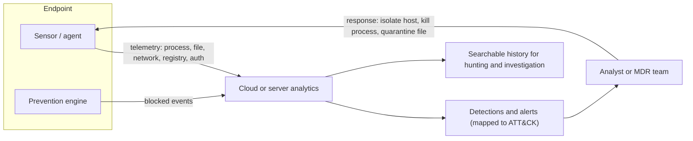

# Endpoint Protection and EDR

## Introduction

An **endpoint** is any device that runs code: laptops, desktops, servers, virtual machines and sometimes phones. Endpoints are where attacks actually *execute*. A phishing email becomes a threat when someone opens the attachment on a laptop. A web exploit becomes a breach when it runs a command on a server.

Endpoint security has evolved in layers:

- **Antivirus (AV)** compares files against known-bad signatures.
- **Endpoint protection platforms (EPP)** add heuristics, machine-learning file scoring, exploit protection, device control and host firewall management. Their job is to **prevent**.
- **Endpoint detection and response (EDR)** records what happens on the device (processes, files, network connections, registry and logins), detects suspicious behaviour, and lets responders **investigate and act** remotely.
- **XDR** (extended detection and response) correlates endpoint data with identity, email, cloud and network signals.
- **MDR** (managed detection and response) is a service: someone else's analysts watch your EDR alerts around the clock.

An analogy: antivirus is a lock that rejects known bad keys. EDR is the CCTV system plus a security guard who can rewind the tapes, see exactly how an intruder got in, and lock the doors remotely.

On this page you will learn:

- How EDR sensors collect telemetry and turn it into detections and responses.
- How behavioural detection works, by building a toy detector mapped to MITRE ATT&CK.
- Open-source endpoint visibility with osquery and Wazuh.
- How to deploy and operate endpoint protection without breaking things, including lessons from a major 2024 outage.
- How to choose between built-in, commercial, managed and open-source options.

:::note Prerequisites
Read [Linux Hardening](./0-sec-linux-hardening.mdx) and [Windows Hardening Basics](./1-sec-windows-hardening.mdx) first. Hardening reduces what endpoint tools have to catch. This page links to the [Security Operations Center](../11-sec-defensive-operations/0-sec-soc.mdx) and [Detection Engineering](../11-sec-defensive-operations/2-sec-detection-engineering.mdx) pages for the people and processes behind the tools.
:::

:::info Defensive focus
This page explains how endpoint defenses work so you can deploy and tune them. It does not cover evading security tools. Practice detections only on lab machines you own, with harmless test activity such as the files and procedures your vendor provides.
:::

## How EDR Works



An EDR product has four parts:

1. **Sensor (agent).** Runs on the endpoint with high privileges. It hooks into OS facilities (on Windows, kernel callbacks and Event Tracing for Windows; on Linux, often eBPF or the audit subsystem; on macOS, the Endpoint Security framework) to see process launches, file writes, network connections and more.
2. **Analytics.** Usually in the vendor's cloud. Rules, behavioural models and threat intelligence turn raw events into detections.
3. **Console and history.** Responders search weeks or months of telemetry: "Which machines ran this hash?", "What did this process do after it started?"
4. **Response actions.** Isolate a host from the network (except the EDR channel), kill a process, quarantine a file, collect forensic data, or open a remote shell for investigation.

### Prevention vs detection

| | Prevention (EPP) | Detection and response (EDR) |
| --- | --- | --- |
| Goal | Stop known-bad before it runs | Spot suspicious behaviour and contain it |
| Works on | Files, exploits, known techniques | Sequences of events over time |
| Output | Block or allow | Alerts, timelines, response actions |
| Weakness | New or "living off the land" attacks using legitimate tools | Needs people to triage and respond |

Attackers increasingly use built-in tools such as PowerShell, `rundll32`, WMI and remote management software, sometimes called "living off the land." A file scanner sees nothing malicious, because every binary is legitimate. Behaviour is what gives the attack away: Word starting PowerShell, PowerShell running an encoded command, a DLL loaded from a temp folder, shadow copies deleted. That is where EDR shines.

## Behavioral Detection: A Toy Example

Real EDR products use thousands of rules and models, but the core idea is simple: match patterns in process events. Here is a tiny detector that reads process events (one JSON object per line) and flags four well-known suspicious behaviours. Each rule records the related [MITRE ATT&CK](../11-sec-defensive-operations/3-sec-mitre-attack.mdx) technique.

Sample telemetry, `events.jsonl`:

```json
{"ts": "2026-10-11T09:01:12Z", "host": "LAPTOP-0142", "user": "jdoe", "parent": "explorer.exe", "image": "WINWORD.EXE", "cmdline": "WINWORD.EXE /n Invoice_8812.docm"}
{"ts": "2026-10-11T09:01:19Z", "host": "LAPTOP-0142", "user": "jdoe", "parent": "WINWORD.EXE", "image": "powershell.exe", "cmdline": "powershell.exe -NoP -W Hidden -EncodedCommand SQBFAFgA..."}
{"ts": "2026-10-11T09:02:03Z", "host": "LAPTOP-0142", "user": "jdoe", "parent": "powershell.exe", "image": "rundll32.exe", "cmdline": "rundll32.exe C:\\Users\\jdoe\\AppData\\Local\\Temp\\upd.dll,Start"}
{"ts": "2026-10-11T09:05:44Z", "host": "SRV-FILE-01", "user": "svc_backup", "parent": "services.exe", "image": "vssadmin.exe", "cmdline": "vssadmin.exe delete shadows /all /quiet"}
{"ts": "2026-10-11T09:06:10Z", "host": "LAPTOP-0077", "user": "asmith", "parent": "explorer.exe", "image": "chrome.exe", "cmdline": "chrome.exe https://intranet.example.com"}
```

The detector, `mini_edr.py`:

```python
"""A toy behavioral detector: reads process events (JSON lines) and flags suspicious patterns."""
import json
import sys
from dataclasses import dataclass

OFFICE = {"winword.exe", "excel.exe", "powerpnt.exe", "outlook.exe"}
SHELLS = {"powershell.exe", "pwsh.exe", "cmd.exe", "wscript.exe", "cscript.exe", "mshta.exe"}


@dataclass
class Rule:
    name: str
    attack_id: str      # MITRE ATT&CK technique
    severity: str

    def matches(self, e: dict) -> bool:
        raise NotImplementedError


class OfficeSpawnsShell(Rule):
    def matches(self, e):
        return e["parent"].lower() in OFFICE and e["image"].lower() in SHELLS


class EncodedPowerShell(Rule):
    def matches(self, e):
        cmd = e["cmdline"].lower()
        return e["image"].lower() in {"powershell.exe", "pwsh.exe"} and (
            "-encodedcommand" in cmd or " -enc " in cmd)


class Rundll32FromTemp(Rule):
    def matches(self, e):
        cmd = e["cmdline"].lower()
        return e["image"].lower() == "rundll32.exe" and ("\\temp\\" in cmd or "\\downloads\\" in cmd)


class ShadowCopyDeletion(Rule):
    def matches(self, e):
        cmd = e["cmdline"].lower()
        return ("vssadmin" in cmd and "delete shadows" in cmd) or ("wmic" in cmd and "shadowcopy delete" in cmd)


RULES = [
    OfficeSpawnsShell("Office app spawned a shell", "T1204.002", "high"),
    EncodedPowerShell("Encoded PowerShell command", "T1059.001", "medium"),
    Rundll32FromTemp("rundll32 loading DLL from user temp", "T1218.011", "high"),
    ShadowCopyDeletion("Shadow copies deleted", "T1490", "critical"),
]


def main(path: str) -> None:
    with open(path, encoding="utf-8") as f:
        for line in f:
            event = json.loads(line)
            for rule in RULES:
                if rule.matches(event):
                    print(f"[{rule.severity.upper():8}] {event['ts']} {event['host']:12} "
                          f"{rule.name} ({rule.attack_id}): {event['image']}")


if __name__ == "__main__":
    main(sys.argv[1] if len(sys.argv) > 1 else "events.jsonl")
```

Run it:

```bash
python3 mini_edr.py events.jsonl
```

Output:

```text
[HIGH    ] 2026-10-11T09:01:19Z LAPTOP-0142  Office app spawned a shell (T1204.002): powershell.exe
[MEDIUM  ] 2026-10-11T09:01:19Z LAPTOP-0142  Encoded PowerShell command (T1059.001): powershell.exe
[HIGH    ] 2026-10-11T09:02:03Z LAPTOP-0142  rundll32 loading DLL from user temp (T1218.011): rundll32.exe
[CRITICAL] 2026-10-11T09:05:44Z SRV-FILE-01  Shadow copies deleted (T1490): vssadmin.exe
```

Three alerts on `LAPTOP-0142` within a minute tell one story: a macro document launched hidden PowerShell, which loaded a DLL from the temp folder. A real EDR would group these into one **incident** with a process tree, and could automatically isolate the laptop. The shadow copy deletion on the file server is a classic step right before ransomware encrypts files, which is why EDRs treat it as critical.

What the toy version lacks shows why commercial products are hard to build:

- **Context and baselining.** Some admin tools legitimately use encoded PowerShell. Real products learn what is normal per environment.
- **Tamper resistance.** Attackers try to stop or blind the sensor. Production agents protect themselves and alert when they go silent.
- **Correlation over time** across processes, users and machines.
- **Response**: detection without containment just documents the breach.

## Endpoint Visibility with osquery

[osquery](https://osquery.io/) exposes the operating system as SQL tables. It is not a full EDR, but it is excellent for inventory, hardening checks and hunting, and it is free and open source. Many commercial and open-source tools build on it.

```sql
-- Processes whose executable was deleted from disk after starting (often suspicious)
SELECT pid, name, path, cmdline FROM processes WHERE on_disk = 0;

-- Which processes are listening on the network?
SELECT p.name, l.port, l.address, p.path
FROM listening_ports l JOIN processes p USING (pid)
WHERE l.address NOT IN ('127.0.0.1', '::1');

-- SSH keys that grant access to this host
SELECT u.username, k.key_file, k.algorithm
FROM users u CROSS JOIN authorized_keys k USING (uid);
```

Run them interactively with `osqueryi`:

```bash
osqueryi --line "SELECT p.name, l.port, l.address FROM listening_ports l JOIN processes p USING (pid) WHERE l.address NOT IN ('127.0.0.1', '::1');"
```

Example output:

```text
   name = sshd
   port = 22
address = 0.0.0.0

   name = nginx
   port = 443
address = 0.0.0.0
```

In a fleet, you schedule queries with `osqueryd` and send the results to a central log store. Fleet managers such as FleetDM manage osquery across many devices.

## Open-Source Endpoint Security with Wazuh

[Wazuh](https://wazuh.com/) is a free, open-source security platform with an agent for Linux, Windows and macOS. It has an indexer, a server (manager) and a dashboard. Its endpoint features include:

- **File integrity monitoring (FIM)**: alerts when monitored files change.
- **Security configuration assessment (SCA)**: checks hosts against hardening policies, including CIS-based ones.
- **Vulnerability detection** from installed package inventory.
- **Log analysis and rules** mapped to MITRE ATT&CK.
- **Active response**: run scripts to block an IP or disable an account.

A FIM configuration snippet for a Linux agent (`ossec.conf`):

```xml
<syscheck>
  <frequency>43200</frequency>
  <directories check_all="yes" realtime="yes">/etc,/usr/bin,/usr/sbin</directories>
  <directories check_all="yes" realtime="yes" report_changes="yes">/etc/ssh/sshd_config.d</directories>
  <directories check_all="yes" whodata="yes">/var/www/app</directories>
  <ignore>/etc/mtab</ignore>
  <ignore type="sregex">.log$|.swp$</ignore>
</syscheck>
```

Example alert when someone edits an SSH drop-in:

```text
Rule: 550 (level 7) -> 'Integrity checksum changed.'
File '/etc/ssh/sshd_config.d/10-hardening.conf' modified
What changed:
< PasswordAuthentication no
---
> PasswordAuthentication yes
```

Wazuh is a strong choice for learning and for teams with time to run it. It is closer to "host IDS plus SIEM" than to a commercial EDR with deep kernel telemetry and one-click isolation. Check the [Wazuh documentation](https://documentation.wazuh.com/current/) for the current version and features.

Other open-source tools worth knowing: **Falco** for runtime detection in containers and Kubernetes, **auditd** for Linux audit events, **Sysmon** (free from Microsoft Sysinternals) for detailed Windows telemetry, and **ClamAV** for signature scanning of files, for example uploads.

## Deploying and Operating Endpoint Protection

### Rollout checklist

1. **Coverage first.** Every endpoint and server gets an agent. Track coverage as a metric. The machine without an agent is the one the attacker will use.
2. **Start in detect or audit mode** for aggressive prevention features, then move to block, as with [ASR rules](./1-sec-windows-hardening.mdx).
3. **Turn on tamper protection** so local admins and malware cannot disable the agent.
4. **Integrate** alerts with your SIEM and ticketing, and decide who responds at 3 a.m. (an internal on-call rotation or an MDR provider).
5. **Agree on response actions in advance.** Can the SOC isolate a production database server without asking? Write it down in your [playbooks](../12-sec-incident-response/1-sec-incident-playbooks.mdx).
6. **Test detection** with safe tests: the industry-standard EICAR test file for antivirus, and your vendor's documented test procedures or an open-source framework such as Atomic Red Team in a lab.

### Exclusions: the silent killer

Teams add exclusions to fix performance or false positives, for example "exclude `C:\Temp`" or "exclude everything in the build directory." Attackers know common exclusions and drop tools there.

**Vulnerable** exclusion policy:

```text
Exclude folder:   C:\Temp\*
Exclude folder:   C:\Users\*\Downloads\*
Exclude process:  powershell.exe
```

**Fixed** exclusion policy:

```text
Exclude file:     D:\SQLData\*.mdf        (database files, vendor-documented, reviewed 2026-09)
Exclude file:     D:\SQLData\*.ldf
Exclude process:  D:\BuildAgent\bin\agent.exe  (signed by our build vendor, path not user-writable)
```

Rules of thumb: exclude the narrowest path or file type possible, never user-writable locations or scripting engines, follow vendor guidance for databases and backup software, record a reason and a review date, and review all exclusions regularly.

### Lessons from the July 2024 outage

On July 19, 2024, a faulty content update for CrowdStrike's Falcon sensor caused Windows machines to crash and fail to boot. Microsoft estimated about 8.5 million Windows devices were affected. Airlines, hospitals, banks and broadcasters were disrupted, and many machines needed manual recovery.

The lessons apply to any endpoint agent:

- **Security agents are high-privilege, high-blast-radius software.** Treat their updates like any other change.
- **Ask vendors how content and sensor updates are staged**, and use deployment rings or update policies where the product offers them (N-1 sensor versions for critical servers, for example).
- **Have a recovery plan for mass boot failures**: BitLocker recovery keys you can actually retrieve, console access, and tested runbooks.
- **Platform changes follow.** Microsoft's Windows Resiliency Initiative includes a platform that lets security products run more of their logic in user mode instead of the kernel, and Quick Machine Recovery for devices that cannot boot. Check Microsoft's current documentation for status and availability.

## Real-World Scenario

You lead IT at a 150-person logistics company: 140 Windows 11 laptops, 25 Windows and Linux servers, a few Macs, and Microsoft 365 Business Premium licenses. A peer company was hit by ransomware that began with a phishing email. Your board asks whether "the antivirus" would catch that. You have one other IT colleague and nobody works nights.

### The solution

1. **Use what you already pay for.** Microsoft 365 Business Premium includes Defender for Business (an EDR for small and medium businesses; check current licensing). Onboard all Windows and Mac devices and the Windows servers.
2. **Cover Linux servers** with an EDR that supports Linux. If the budget is tight, add Wazuh for FIM, SCA and log analysis, and plan to evaluate a commercial Linux sensor later.
3. **Turn on prevention** features: tamper protection, ASR rules (audit, then block), network protection, automatic attack disruption where available.
4. **Buy 24/7 coverage.** With two IT staff and no night shift, an MDR service that triages alerts and can isolate hosts is worth more than a fancier tool nobody watches.
5. **Write the response agreement**: the MDR may isolate laptops automatically, but must call you before isolating servers.
6. **Test**: run safe detection tests quarterly and check that alerts reach both the MDR and you.

### Why this approach

The real gap is not detection technology but **people to respond at 2 a.m.** Ransomware operators often strike at night or on weekends. Using bundled EDR keeps costs down, and the MDR provides the missing response capacity.

### When to use it, and when not to

- **Built-in EDR plus MDR** suits small and mid-sized teams without a SOC.
- **A commercial EDR with an in-house SOC** suits larger organizations that want control over detections and threat hunting.
- **Open-source only** suits labs, students and teams with strong engineering time but tight budgets. Be honest about the gaps in response capability and 24/7 coverage.

### Alternatives and trade-offs

| Approach | Pros | Cons | Best for |
| --- | --- | --- | --- |
| Built-in AV only (Defender Antivirus, no EDR) | Free, low maintenance | No investigation history or remote response | Home users, very small offices |
| EDR bundled with existing licenses | Low extra cost, integrated with identity and email | May lack features of top-tier products; you still need people | Small and mid-sized Microsoft-centric organizations |
| Stand-alone commercial EDR | Deep telemetry, strong detections, cross-platform | License cost; still needs staff to respond | Organizations with a security team |
| EDR plus MDR service | 24/7 expert triage and response | Ongoing cost; you must define what they may do | Teams without night and weekend coverage |
| Open-source (Wazuh, osquery, Sysmon, Falco) | No license cost, transparent, very flexible | You build and run everything; weaker response actions | Labs, learning, engineering-heavy teams |

## Common Mistakes

- **Incomplete coverage.** Servers, build agents and "temporary" VMs without agents become the attacker's base.
- **Alerts nobody reads.** An EDR without a responder is an expensive logging tool.
- **Broad exclusions** for user-writable folders or script interpreters.
- **No tamper protection**, so a local admin or malware can uninstall the agent.
- **Blind trust in vendor updates** with no rings or recovery plan.
- **Skipping hardening because "EDR will catch it."** EDR is a safety net, not a substitute for removing admin rights and patching.
- **Never testing.** You only find out detections are broken during a real incident.

## Summary

- AV and EPP focus on prevention. EDR records behaviour, detects suspicious sequences and lets you respond remotely. XDR correlates more sources, and MDR provides the people.
- Behavioural detection catches attacks that use legitimate tools, such as Office spawning PowerShell or shadow copy deletion.
- osquery and Wazuh provide strong open-source visibility. Commercial EDRs add deeper telemetry and response.
- Deploy with full coverage, tamper protection, careful exclusions, defined response actions and regular safe testing.
- Endpoint agents are high-privilege software. Stage their updates and plan for mass recovery.

## Exercises

1. Add a rule to `mini_edr.py` that flags `certutil.exe` with `-urlcache` in its command line (ATT&CK T1105, Ingress Tool Transfer). Add a test event and confirm it fires.
2. Install osquery on a lab VM and write three queries: listening ports not on loopback, users with a login shell, and crontab entries. Save them as a scheduled query pack.
3. Install a single-node Wazuh lab (following the official quickstart), enroll one Linux agent, add FIM on `/etc/ssh`, change a file and find the alert.
4. Write a one-page exclusion policy for your team, including who approves exclusions and how often they are reviewed.

Related pages:

- [Security Logging and SIEM](../11-sec-defensive-operations/1-sec-logging-and-siem.mdx) for where endpoint alerts go
- [Threat Hunting](../11-sec-defensive-operations/5-sec-threat-hunting.mdx) for using EDR history proactively
- [Malware Analysis Basics](../11-sec-defensive-operations/7-sec-malware-basics.mdx) for what happens after a sample is quarantined
- [Backups and Ransomware Resilience](./6-sec-backups-and-ransomware.mdx) for when prevention and detection both fail
