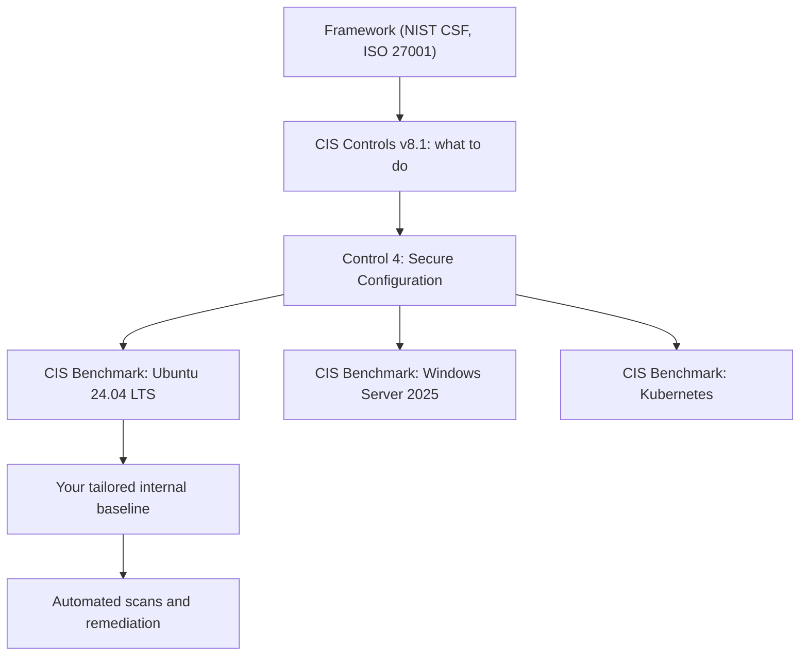
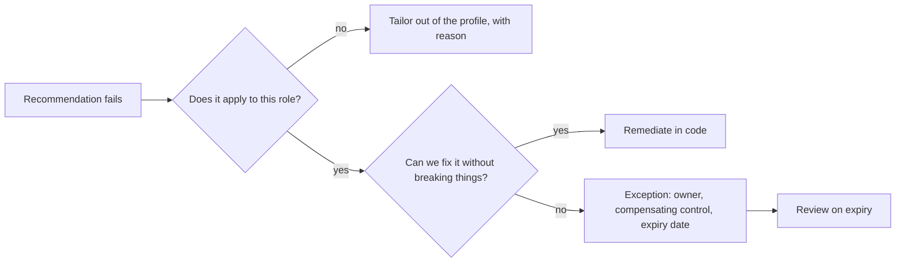

# CIS Benchmarks and Baselines

## Introduction

The previous pages showed dozens of hardening settings. Real systems have hundreds more: password policies, audit rules, file permissions, service settings, kernel parameters. Two questions follow quickly:

1. **Which settings should we use?** You do not want every team inventing their own list.
2. **How do we prove our servers actually have them?** Auditors, customers and your own incident responders will ask.

A **security baseline** answers both. It is a written, versioned definition of how a type of system should be configured, plus a way to check it. Instead of writing one from scratch, most organizations start from a published standard, such as the **CIS Benchmarks**, and tailor it.

Think of a baseline like a building code. An electrician does not decide personally how thick the wires should be. The code says so, inspectors check against it, and documented exceptions exist for unusual buildings.

On this page you will:

- Learn what CIS Benchmarks are, how they are structured, and how they relate to CIS Controls, DISA STIGs and vendor baselines.
- Scan a Linux system with Lynis, OpenSCAP and the Ubuntu Security Guide.
- Build a tiny "baseline as code" checker in Python to see how scanners work.
- Tailor a baseline, handle exceptions, and keep systems from drifting.

:::note Prerequisites
Read [Linux Hardening](./0-sec-linux-hardening.mdx) and [Windows Hardening Basics](./1-sec-windows-hardening.mdx) first. For how benchmarks fit into wider compliance programs, see [Security Frameworks: NIST CSF, ISO 27001 and CIS Controls](../13-sec-governance/1-sec-security-frameworks.mdx).
:::

## The Baseline Landscape

| Source | What it is | Typical users | Cost |
| --- | --- | --- | --- |
| **CIS Benchmarks** | Consensus-built configuration guides for operating systems, cloud platforms, databases, browsers, containers and more | Most private-sector organizations | PDFs free for non-commercial use; tools and some formats for members |
| **DISA STIGs** | US Department of Defense Security Technical Implementation Guides | US government and defense contractors | Free |
| **Vendor baselines** | Microsoft security baselines, Red Hat and Canonical security guides, cloud provider best practices | Teams standardized on one vendor | Free |
| **CIS Hardened Images** | Cloud VM images pre-configured to a CIS Benchmark | Teams that want hardened images on day one | Pay per use in cloud marketplaces |
| **Your internal baseline** | One of the above, tailored and documented | Everyone, eventually | Your time |

### CIS Benchmarks vs CIS Controls

The names are similar, but they answer different questions:

- **CIS Controls** (currently **version 8.1**) are a prioritized list of 18 security practices, like "Inventory and Control of Enterprise Assets" and "Secure Configuration of Enterprise Assets and Software." They tell you **what** to do as an organization and group safeguards into Implementation Groups (IG1 to IG3) by organization maturity.
- **CIS Benchmarks** are product-specific. They tell you **how** to configure Ubuntu 24.04, Windows Server 2025 or PostgreSQL 16. Following benchmarks is one way to implement the "secure configuration" control.



## Anatomy of a CIS Benchmark

A benchmark is a long document, often hundreds of pages, made up of numbered **recommendations**. Each one typically includes:

| Field | Purpose |
| --- | --- |
| Title | For example, "Ensure SSH root login is disabled" |
| Profile applicability | Level 1 or Level 2, server or workstation |
| Assessment status | **Automated** (a tool can check it) or **Manual** (a human must) |
| Description and rationale | What the setting does and why it matters |
| Impact | What might break if you apply it |
| Audit | Commands to check the current state |
| Remediation | Commands or policy settings to fix it |
| Default value | What the product ships with |
| References and CIS Controls mapping | Links back to standards and controls |

Always read the **Impact** section. It is where the benchmark tells you a setting may break your application.

### Profiles: Level 1 and Level 2

| Profile | Goal | Effect on usability | When to choose |
| --- | --- | --- | --- |
| **Level 1** | Practical, broadly applicable security with little disruption | Low | Default for most servers and workstations |
| **Level 2** | Defense in depth for high-security environments | Can break features and slow operations | Systems holding sensitive data, regulated workloads |

Some benchmarks also include a STIG-aligned profile. Benchmarks are versioned separately from the OS. For example, at the time of writing CIS lists Ubuntu Linux 24.04 LTS at benchmark version 2.0.0 and a new 26.04 LTS benchmark at 1.0.0. Check the [CIS Benchmarks site](https://www.cisecurity.org/cis-benchmarks) for the current versions before you plan work, and record which version your baseline follows.

## Scanning Tools

| Tool | Platforms | Maps to | Remediation | License |
| --- | --- | --- | --- | --- |
| **CIS-CAT Lite / Pro** | Many OSes and products | CIS Benchmarks (official) | Pro adds more benchmarks and reporting | Lite free (limited); Pro for members |
| **OpenSCAP + ComplianceAsCode** | Linux (RHEL family, Ubuntu, Debian, SUSE) | CIS, STIG, PCI DSS and other profiles | Can generate Bash or Ansible remediation | Open source |
| **Ubuntu Security Guide (USG)** | Ubuntu LTS | CIS and DISA-STIG | `usg fix` | Requires Ubuntu Pro |
| **Lynis** | Linux, macOS, Unix | Its own tests, informed by many guides | Suggestions only | Open source (GPL) |
| **Microsoft Policy Analyzer / OSConfig / Intune** | Windows | Microsoft security baselines | GPO, Intune or OSConfig | Free with Windows tooling |
| **Cloud and container scanners** (kube-bench, Prowler and others) | Kubernetes, cloud accounts | CIS Kubernetes and cloud foundations benchmarks | Varies | Mostly open source |

### Lynis: a quick health check

Lynis needs no configuration and is a good first look at any Linux host:

```bash
sudo apt install lynis       # or download the latest release from cisofy.com
sudo lynis audit system --quick
```

Example output (trimmed):

```text
[+] SSH Support
------------------------------------
  - Checking running SSH daemon                               [ FOUND ]
    - OpenSSH option: PermitRootLogin                         [ OK ]
    - OpenSSH option: AllowTcpForwarding                      [ SUGGESTION ]

  Lynis security scan details:

  Hardening index : 68 [#############       ]
  Tests performed : 262
  Plugins enabled : 0

  Suggestions (34):
  * Consider hardening SSH configuration [SSH-7408]
  * Install a file integrity tool to monitor changes to critical and sensitive files [FINT-4350]
```

The **hardening index** is Lynis's own score, useful for tracking progress on a host over time. It is not a CIS compliance percentage, so do not report it as one.

### Ubuntu Security Guide (USG)

On Ubuntu with an Ubuntu Pro subscription, USG audits and remediates against CIS or DISA-STIG profiles:

```bash
sudo pro enable usg
sudo apt install usg
sudo usg audit cis_level1_server
```

Example output (trimmed):

```text
Rule 'Ensure permissions on /etc/ssh/sshd_config are configured'    pass
Rule 'Ensure sshd PermitRootLogin is disabled'                       pass
Rule 'Ensure auditd service is enabled'                              fail
...
CIS audit scan results:
Compliance score: 87.21%
Wrote HTML report to /var/lib/usg/usg-report-20261011.0912.html
```

`usg fix cis_level1_server` applies the remediations. Run it on a test VM first, and use a **tailoring file** (`usg generate-tailoring`) to switch off rules that do not fit your system. Commands and profile names can change between Ubuntu releases, so check the [USG documentation](https://documentation.ubuntu.com/security/compliance/usg/).

### OpenSCAP with ComplianceAsCode

On the RHEL family, OpenSCAP and the SCAP Security Guide (built from the ComplianceAsCode project) are packaged by the distribution:

```bash
sudo dnf install openscap-scanner scap-security-guide
oscap info /usr/share/xml/scap/ssg/content/ssg-rhel9-ds.xml | grep -i cis

sudo oscap xccdf eval \
  --profile xccdf_org.ssgproject.content_profile_cis_server_l1 \
  --results results.xml --report report.html \
  /usr/share/xml/scap/ssg/content/ssg-rhel9-ds.xml
```

Example output (trimmed):

```text
Title   Ensure SSH root login is disabled
Rule    xccdf_org.ssgproject.content_rule_sshd_disable_root_login
Result  pass

Title   Ensure auditd Collects System Administrator Actions
Rule    xccdf_org.ssgproject.content_rule_audit_rules_sysadmin_actions
Result  fail
```

The `oscap info` step shows the exact profile IDs available in your content version. Use those instead of copying IDs from blog posts. OpenSCAP can also generate an Ansible playbook for the failing rules (`oscap xccdf generate fix --fix-type ansible`), which you should review before running.

## How Scanners Work: A Tiny Baseline as Code

Every scanner does the same thing: read a list of expected settings, check the system, and report. Building a miniature version helps you understand reports and write custom checks for things the standard benchmark does not cover.

The baseline, `baseline.yaml`:

```yaml
name: web-server-baseline
version: 1.2.0
based_on: CIS Ubuntu Linux 24.04 LTS Benchmark, Level 1 - Server
checks:
  - id: NET-01
    title: Ensure IP forwarding is disabled
    type: sysctl
    key: net.ipv4.ip_forward
    expected: "0"
  - id: NET-02
    title: Ensure ICMP redirects are not accepted
    type: sysctl
    key: net.ipv4.conf.all.accept_redirects
    expected: "0"
  - id: KRN-01
    title: Ensure kernel pointers are hidden
    type: sysctl
    key: kernel.kptr_restrict
    expected: "2"
  - id: FS-01
    title: Ensure permissions on /etc/shadow are configured
    type: file_mode
    path: /etc/shadow
    max_mode: "0640"
  - id: SSH-01
    title: Ensure sshd PermitRootLogin is disabled
    type: command
    command: ["sshd", "-T"]
    pattern: "^permitrootlogin no$"
exceptions:
  KRN-01: "Accepted: kptr_restrict=1 is the distro default; reviewed 2026-09-30, expires 2027-03-31"
```

The IDs are internal. In a real baseline, also record the matching recommendation number from the exact benchmark version you follow, because numbering changes between versions.

The checker, `check_baseline.py` (install PyYAML with `pip install pyyaml`):

```python
"""Check a host against a small YAML baseline. Read-only. Requires PyYAML (pip install pyyaml)."""
import os
import re
import stat
import subprocess
import sys

import yaml


def check_sysctl(c):
    path = "/proc/sys/" + c["key"].replace(".", "/")
    try:
        with open(path) as f:
            actual = f.read().strip()
    except OSError as e:
        return False, f"cannot read: {e.strerror}"
    return actual == c["expected"], f"actual={actual} expected={c['expected']}"


def check_file_mode(c):
    try:
        mode = stat.S_IMODE(os.stat(c["path"]).st_mode)
    except OSError as e:
        return False, f"cannot stat: {e.strerror}"
    allowed = int(c["max_mode"], 8)
    ok = (mode & ~allowed) == 0          # no permission bits beyond the allowed ones
    return ok, f"mode={oct(mode)} max={c['max_mode']}"


def check_command(c):
    try:
        out = subprocess.run(c["command"], capture_output=True, text=True, timeout=10).stdout
    except (OSError, subprocess.TimeoutExpired) as e:
        return False, f"cannot run: {e}"
    ok = re.search(c["pattern"], out, re.MULTILINE) is not None
    return ok, "pattern found" if ok else "pattern not found"


CHECKS = {"sysctl": check_sysctl, "file_mode": check_file_mode, "command": check_command}


def main(path):
    with open(path) as f:
        baseline = yaml.safe_load(f)
    exceptions = baseline.get("exceptions", {})
    passed = failed = excepted = 0
    print(f"Baseline: {baseline['name']} v{baseline['version']} ({baseline['based_on']})")
    for c in baseline["checks"]:
        ok, detail = CHECKS[c["type"]](c)
        if ok:
            status, passed = "PASS", passed + 1
        elif c["id"] in exceptions:
            status, excepted = "EXCEPTION", excepted + 1
            detail += f" | {exceptions[c['id']]}"
        else:
            status, failed = "FAIL", failed + 1
        print(f"  [{status:9}] {c['id']:6} {c['title']}: {detail}")
    total = passed + failed
    score = 100 * passed / total if total else 100.0
    print(f"Result: {passed} passed, {failed} failed, {excepted} accepted exceptions, score {score:.0f}%")
    sys.exit(1 if failed else 0)


if __name__ == "__main__":
    main(sys.argv[1] if len(sys.argv) > 1 else "baseline.yaml")
```

Output when run as a normal user on a developer workstation that also runs Docker:

```text
Baseline: web-server-baseline v1.2.0 (CIS Ubuntu Linux 24.04 LTS Benchmark, Level 1 - Server)
  [FAIL     ] NET-01 Ensure IP forwarding is disabled: actual=1 expected=0
  [PASS     ] NET-02 Ensure ICMP redirects are not accepted: actual=0 expected=0
  [EXCEPTION] KRN-01 Ensure kernel pointers are hidden: actual=1 expected=2 | Accepted: kptr_restrict=1 is the distro default; reviewed 2026-09-30, expires 2027-03-31
  [PASS     ] FS-01  Ensure permissions on /etc/shadow are configured: mode=0o640 max=0640
  [FAIL     ] SSH-01 Ensure sshd PermitRootLogin is disabled: pattern not found
Result: 2 passed, 2 failed, 1 accepted exceptions, score 50%
```

This small run teaches three real lessons:

1. **Baselines must match the role.** IP forwarding is on because Docker needs it. On a container host, NET-01 should be tailored out, not "fixed."
2. **A check that cannot run must fail, not pass.** `sshd -T` needs root to read the host keys, so without `sudo` the pattern is not found. Silent passes on errors are a classic scanner bug.
3. **Exceptions are data.** KRN-01 is documented, reasoned and has an expiry date, so it does not hide in the failure count. The non-zero exit code lets CI block a build when anything fails.

## Tailoring and Exceptions

No organization applies a benchmark unchanged. Some recommendations break applications, some do not apply, and some are already covered by a different control. Tailoring is normal. **Undocumented** tailoring is the problem.



A good exception record contains:

- The recommendation ID **and benchmark version**.
- The system or role it applies to.
- Why it cannot be applied.
- Compensating controls.
- An owner and an expiry or review date.

## Keeping Systems in Line: Drift

A server that passed the scan in January may fail in March: someone enabled password SSH to debug an issue, a package changed a default, or an old VM was restored. To manage drift:

- **Apply baselines as code** with Ansible, Puppet, Chef, Salt, Group Policy, Intune or OSConfig, and re-apply on a schedule.
- **Scan continuously or on a schedule** and send results to a dashboard or your SIEM.
- **Scan images in CI**, before they reach production. Build a VM or container image, run the scanner, and fail the pipeline on regressions.
- **Alert on changes** to high-value files with file integrity monitoring ([Endpoint Protection and EDR](./4-sec-endpoint-protection.mdx)).

For cloud accounts, the same idea is called Cloud Security Posture Management. See [Cloud Security Posture Management](../8-sec-cloud-and-container/7-sec-cspm.mdx).

## Real-World Scenario

You work at a payments startup preparing for its first PCI DSS assessment. PCI DSS requires configuration standards for system components that address known security vulnerabilities and are consistent with industry-accepted hardening standards. You run 60 Ubuntu 24.04 VMs (web, API, workers, PostgreSQL) and a managed Kubernetes cluster. Nobody has written a configuration standard yet, and the assessment is in four months.

### The solution

1. **Pick the standard**: CIS Ubuntu Linux 24.04 LTS Benchmark, **Level 1 - Server** profile, plus the CIS Kubernetes Benchmark for the cluster (as far as it applies to a managed service). Record the benchmark versions.
2. **Baseline scan**: run USG or OpenSCAP on one VM per role, and kube-bench on the cluster. Expect a lot of failures at first.
3. **Triage the results** into three groups: fix (most), tailor out (does not apply to the role, such as IP forwarding on Kubernetes nodes), and exception (needs a compensating control).
4. **Encode the fixes** in your Ansible roles and your VM image build, not by running `usg fix` on production servers by hand.
5. **Write the configuration standard**: a short document per role that says "CIS Level 1 Server version X, with these tailorings and exceptions," linked to the tailoring file in Git.
6. **Automate evidence**: weekly scans store HTML reports. CI scans every new image and fails on new findings.
7. **Consider Level 2** for the database servers that hold cardholder data, where the extra friction is justified.

### Why this approach

An assessor wants to see an industry-accepted standard, a documented rationale for deviations, and proof that systems actually match. A recognized benchmark gives you the first, tailoring records give you the second, and automated scans give you the third. Encoding everything in Ansible and images keeps you compliant after the assessment, too.

### When to use it, and when not to

- **Use CIS Level 1** as the default for general servers and workstations.
- **Use Level 2 or STIG** for high-risk or regulated systems, accepting more operational friction.
- **Do not chase a 100% score.** A score of 100% with a broken app, or achieved by blindly applying remediations, is worse than 92% with documented, reasoned exceptions.
- **Do not let benchmarks replace threat thinking.** Benchmarks cover configuration, not application bugs, weak business logic or missing monitoring.

### Alternatives and trade-offs

| Approach | Pros | Cons | Best for |
| --- | --- | --- | --- |
| CIS Benchmarks (Level 1) | Widely recognized, balanced, many products covered | Long documents; official tooling needs membership | Most commercial organizations |
| DISA STIG | Very thorough, free, required in US defense | Strict; can be heavy for commercial systems | Government and defense work |
| Vendor baselines (Microsoft, Red Hat, Canonical) | Tested by the vendor, integrated tooling | Vendor-specific; mixed estates need several | Single-vendor environments |
| CIS Hardened Images | Compliant from first boot | Per-hour cost; less control over contents | Cloud teams that want speed |
| Custom internal baseline from scratch | Exactly fits your environment | Hard to justify to auditors; easy to miss things | Rarely; better to tailor a public standard |

## Common Mistakes

- **Running remediation scripts directly on production.** Remediations can disable services, change SSH and break logins. Test on a copy and encode the result.
- **Treating the score as the goal.** The goal is reduced risk with a working system.
- **Not recording the benchmark version**, so nobody knows what the baseline means a year later.
- **Undocumented exceptions** that become permanent.
- **Scanning once for an audit** and never again, so drift goes unnoticed.
- **One baseline for every role.** A Kubernetes node, a database server and a developer laptop need different tailoring.
- **Confusing Lynis's hardening index with CIS compliance.** They measure different things.

## Summary

- A baseline is a versioned definition of secure configuration plus a way to check it.
- CIS Controls say **what** to do. CIS Benchmarks say **how** to configure specific products. STIGs and vendor baselines are alternatives.
- Benchmarks contain numbered recommendations with Level 1 and Level 2 profiles. Always read the Impact section.
- Scan with CIS-CAT, OpenSCAP, USG, Lynis or Windows tooling, and understand that scanners just compare expected and actual settings.
- Tailor deliberately, record exceptions with owners and expiry dates, and manage drift with configuration as code and scheduled scans.

## Exercises

1. Run `lynis audit system` on a lab VM. Fix three suggestions and run it again. Note how the hardening index changes and which tests improved.
2. Extend `check_baseline.py` with a new check type `service_disabled` that uses `systemctl is-enabled`. Add a check that `rpcbind` is disabled.
3. On a RHEL-family or Ubuntu Pro lab VM, run an OpenSCAP or USG CIS Level 1 audit. Pick five failing rules and classify each as fix, tailor out or exception, with a one-line reason.
4. Write an exception record for a real-looking case: a legacy app that requires TLS 1.0 on one internal server.

Related pages:

- [Linux Hardening](./0-sec-linux-hardening.mdx) for what many CIS recommendations actually do
- [Infrastructure as Code Security](../8-sec-cloud-and-container/6-sec-infrastructure-as-code-security.mdx) for scanning templates before deployment
- [Compliance: SOC 2, PCI DSS, HIPAA and GDPR](../13-sec-governance/2-sec-compliance.mdx) for how baselines support audits
- [Project: Hardening a Linux Server](../14-sec-projects/5-sec-project-hardened-server.mdx)
