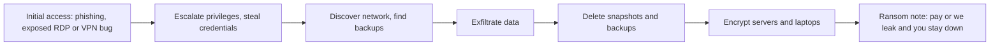
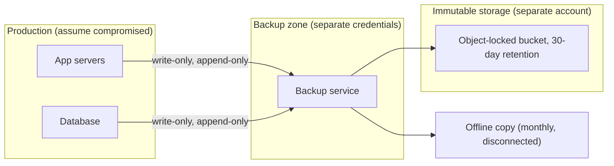
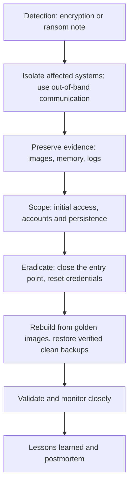

# Backups and Ransomware Resilience

## Introduction

Every page in this section so far has been about keeping attackers out. This one is about the day that fails. **Ransomware** encrypts your files and systems and demands payment for the key. Most modern groups also steal data first and threaten to publish it ("double extortion"). Your ability to recover without paying comes down to one question: **do you have backups the attacker could not reach, and can you restore them fast enough?**

Attackers know this too. Before encrypting, ransomware operators commonly search for backup servers, delete snapshots and shadow copies, and use stolen admin credentials to wipe backup repositories. A backup that the attacker can delete is not a ransomware defense.

Think of it like a fire safe. Keeping copies of important papers in the same filing cabinet is not a backup. Copies in a fireproof safe in another building, that you check once in a while, are.

On this page you will:

- Define recovery goals with RPO and RTO.
- Apply the 3-2-1-1-0 rule and understand why replication and sync are not backups.
- Make backups immutable with object locking, append-only repositories and offline copies.
- Run a complete backup workflow with restic, including automated restore tests.
- Plan the rest of ransomware resilience: prevention, detection and a recovery runbook.

:::note Prerequisites
This page ties together [Linux Hardening](./0-sec-linux-hardening.mdx), [Windows Hardening Basics](./1-sec-windows-hardening.mdx) and [Endpoint Protection and EDR](./4-sec-endpoint-protection.mdx). Business-level planning is in [Business Continuity and Disaster Recovery](../12-sec-incident-response/5-sec-business-continuity.mdx).
:::

## How Ransomware Attacks Unfold



The steps between initial access and encryption can take hours or weeks. That gives defenders two kinds of chances:

- **Detect early** (credential theft, unusual admin activity, mass file reads, shadow copy deletion) and contain before encryption.
- **Recover** from backups the attacker could not touch, if detection fails.

Backups do **not** solve the data-theft half of double extortion. Preventing exfiltration and having an incident response plan still matter.

## Recovery Goals: RPO and RTO

Before choosing tools, decide what "recovered" means for each system.

| Term | Question | Example |
| --- | --- | --- |
| **RPO** (Recovery Point Objective) | How much data can we afford to lose? | 15 minutes for orders, 24 hours for the wiki |
| **RTO** (Recovery Time Objective) | How long can we be down? | 4 hours for checkout, 3 days for internal reporting |

RPO drives **backup frequency**. RTO drives **restore speed**: how fast you can get the data back and rebuild the servers around it.

A common surprise during real incidents: the data restore is fast, but rebuilding 200 servers, reissuing credentials and checking everything for persistence takes days. Your RTO has to include rebuilding, not just copying files.

## The 3-2-1-1-0 Rule

The classic **3-2-1** rule is: 3 copies of your data, on 2 different types of storage, with 1 copy off-site. For ransomware, the industry extended it to **3-2-1-1-0**:

| Number | Meaning | Why |
| --- | --- | --- |
| **3** | Three copies of the data (production plus two backups) | One failure never leaves you with nothing |
| **2** | Two different media or storage systems | A single storage bug or outage cannot hit every copy |
| **1** | One copy off-site | Fire, flood or regional cloud outage |
| **1** | One copy **offline, air-gapped or immutable** | Attackers with admin credentials cannot delete or encrypt it |
| **0** | Zero errors in restore verification | A backup you have not tested is a hope, not a backup |

### Replication and sync are not backups

RAID, database replicas, cloud file sync and storage replication copy changes **instantly**, including deletions and encrypted files. They protect against hardware failure, not against ransomware or a bad `DELETE` statement.

| Mechanism | Protects against hardware failure | Protects against deletion or encryption |
| --- | --- | --- |
| RAID or replicated storage | Yes | No, changes are copied immediately |
| Database replica | Yes | No |
| File sync (cloud drive) | Partly | Only with version history, and only if the attacker cannot purge it |
| Snapshots on the same system | Partly | Only if admin credentials cannot delete them |
| Versioned, immutable, separate backups | Yes | **Yes** |

## Designing Backups Attackers Cannot Reach



Key design principles:

1. **Separate credentials.** Backups must not be deletable with the same domain admin, cloud admin or root account used for production. Use a separate identity system or cloud account for backup administration, with MFA.
2. **Write-only or append-only access from production.** A compromised server should be able to *add* backups but not delete or overwrite them.
3. **Immutability.** Storage enforces retention so even an admin cannot delete data before it expires.
4. **Isolation.** Backup servers are not domain-joined to the production domain, and are reachable only on the ports they need.
5. **Encryption.** Backups contain everything an attacker wants. Encrypt them, and keep the keys somewhere that survives the incident ([Key Management](../1-sec-cryptography/8-sec-key-management.mdx)).

### Vulnerable vs fixed backup access

**Vulnerable**: each server pushes backups with full read, write and delete rights to the repository, and the credentials sit on the server.

```bash
# Runs on the production server, which holds keys that can also delete backups
export AWS_ACCESS_KEY_ID=AKIA...FULLACCESS
export AWS_SECRET_ACCESS_KEY=...
restic -r s3:s3.amazonaws.com/company-backups backup /srv/app/data
restic -r s3:s3.amazonaws.com/company-backups forget --keep-last 7 --prune
```

An attacker with root on this server can run `restic forget` or delete the bucket contents, using the server's own credentials.

**Fixed**: production can only append. Deletion and pruning happen elsewhere.

- The bucket has **S3 Object Lock** with a default retention period, so objects cannot be deleted before they expire.
- Production servers use credentials that can **put objects** but not delete them, or they push to a restic **rest-server running with `--append-only`**.
- A separate, locked-down backup admin host with different credentials runs `forget` and `prune`, and only for data past its retention.

### Immutable storage with S3 Object Lock

Amazon S3 Object Lock stores object versions in a write-once-read-many (WORM) model. It requires bucket versioning. It has two retention modes:

| Mode | Who can delete before expiry | Use when |
| --- | --- | --- |
| **Governance** | Only users with the special `s3:BypassGovernanceRetention` permission | Testing retention, or when a break-glass delete must remain possible |
| **Compliance** | Nobody, including the account root user | Ransomware-proof backups and regulatory WORM requirements |

A **legal hold** is a separate lock with no expiry date, which stays until someone removes it.

Creating a bucket with Object Lock and a default 30-day compliance retention (example commands; do not run them against an account you are not responsible for, and note that storage costs apply):

```bash
aws s3api create-bucket --bucket example-corp-backups-immutable \
    --region us-east-1 --object-lock-enabled-for-bucket

aws s3api put-object-lock-configuration --bucket example-corp-backups-immutable \
    --object-lock-configuration '{"ObjectLockEnabled": "Enabled", "Rule": {"DefaultRetention": {"Mode": "COMPLIANCE", "Days": 30}}}'
```

:::warning Compliance mode is really permanent
In compliance mode, AWS documents that the only way to delete a locked object before its retention date is to delete the whole AWS account. Test with governance mode and short retention first, and calculate the storage cost of keeping every version for the full period.
:::

Two details matter for backup tools:

- A simple delete on a locked object adds a **delete marker** but the locked version remains, so you can still restore it.
- Not every backup tool works well with object-locked storage, because pruning wants to delete old data. Check that your tool explicitly supports it. Kopia and several commercial backup products document Object Lock support. Other clouds offer equivalents, such as Azure immutable blob storage and Google Cloud Storage bucket lock.

## Hands-On: Backups with restic

[restic](https://restic.net/) is a free, open-source backup tool with encryption, deduplication and many storage backends. The examples below use restic 0.18 and a local repository, so you can run them safely on a laptop. Swap the repository path for an S3, SFTP or rest-server URL in production.

### Initialize and back up

```bash
export RESTIC_REPOSITORY=/tmp/restic-demo-repo
export RESTIC_PASSWORD_FILE=$HOME/.restic-demo-pass   # a file containing a long random password
restic init
restic backup ./data --exclude '*.cache' --tag nightly
```

Output:

```text
created restic repository e9cd972129 at /tmp/restic-demo-repo

Please note that knowledge of your password is required to access
the repository. Losing your password means that your data is
irrecoverably lost.
no parent snapshot found, will read all files

Files:           1 new,     0 changed,     0 unmodified
Dirs:            2 new,     0 changed,     0 unmodified
Added to the repository: 1.075 KiB (966 B stored)

processed 1 files, 6 B in 0:00
snapshot 68d4b709 saved
```

The repository password encrypts everything. **Store it in a password manager or secrets vault outside the systems you are backing up.** If it only exists on the server that gets encrypted, your backups are useless.

### Retention, verification and restore

```bash
# Keep 7 daily, 4 weekly and 12 monthly snapshots, delete the rest
restic forget --keep-daily 7 --keep-weekly 4 --keep-monthly 12 --prune

# Check repository structure and actually read a random 10% of the data
restic check --read-data-subset=10%

# Restore the latest snapshot to a separate directory
restic restore latest --target ./restore
```

Output (trimmed):

```text
Applying Policy: keep 7 daily, 4 weekly, 12 monthly snapshots
keep 1 snapshots:
...
read 10.0% of data packs
[0:00] 100.00%  1 / 1 packs
no errors were found
...
Summary: Restored 3 files/dirs (6 B) in 0:00
```

`restic check` without `--read-data-subset` only checks the structure. Reading data over time (for example 5% per night) catches silent corruption in storage.

### Automate it

A nightly script that also records a checksum manifest, so restores can be verified later:

```bash
#!/usr/bin/env bash
# nightly-backup.sh - back up app data with restic and keep a checksum manifest for restore tests.
set -euo pipefail

: "${RESTIC_REPOSITORY:?set RESTIC_REPOSITORY}"
: "${RESTIC_PASSWORD_FILE:?set RESTIC_PASSWORD_FILE}"
DATA_DIR=${DATA_DIR:-/srv/app/data}

# 1. Write a manifest of checksums so restores can be verified later
(cd "$DATA_DIR" && find . -type f ! -name .backup-manifest.sha256 ! -name '*.cache' -print0 \
   | sort -z | xargs -0 sha256sum > .backup-manifest.sha256)

# 2. Back up, excluding caches
restic backup "$DATA_DIR" --exclude '*.cache' --tag nightly --host "$(hostname -s)"

# 3. Verify repository structure plus a random 5% of the data
restic check --read-data-subset=5%
```

Schedule it with a systemd timer. `/etc/systemd/system/app-backup.service`:

```text
[Unit]
Description=Nightly restic backup of app data
Wants=network-online.target
After=network-online.target

[Service]
Type=oneshot
User=backup
EnvironmentFile=/etc/restic/app.env
ExecStart=/usr/local/bin/nightly-backup.sh
Nice=10
IOSchedulingClass=idle
```

`/etc/systemd/system/app-backup.timer`:

```text
[Unit]
Description=Run app backup nightly

[Timer]
OnCalendar=*-*-* 01:30:00
RandomizedDelaySec=15m
Persistent=true

[Install]
WantedBy=timers.target
```

```bash
sudo systemctl daemon-reload
sudo systemctl enable --now app-backup.timer
systemctl list-timers app-backup.timer
```

Example output:

```text
NEXT                        LEFT     LAST PASSED UNIT             ACTIVATES
Mon 2026-10-12 01:38:12 PDT 21h left -    -      app-backup.timer app-backup.service
```

`/etc/restic/app.env` holds `RESTIC_REPOSITORY`, `RESTIC_PASSWORD_FILE` and storage credentials. Make it readable only by the `backup` user (`chmod 600`). Alert when the service fails, for example with an `OnFailure=` unit or by monitoring the age of the newest snapshot.

### Prove you can restore

The "0" in 3-2-1-1-0 means testing restores, not just backups. This script restores the latest snapshot to a temporary directory and checks every file against the manifest:

```bash
#!/usr/bin/env bash
# restore-test.sh - restore the latest snapshot to a scratch dir and verify it against a checksum manifest.
set -euo pipefail

: "${RESTIC_REPOSITORY:?set RESTIC_REPOSITORY}"
: "${RESTIC_PASSWORD_FILE:?set RESTIC_PASSWORD_FILE}"
SOURCE_DIR=${1:?usage: restore-test.sh /path/that/was/backed/up}
WORK=$(mktemp -d)
trap 'rm -rf "$WORK"' EXIT

start=$(date +%s)
restic restore latest --target "$WORK" --include "$SOURCE_DIR" > /dev/null
restored="$WORK$SOURCE_DIR"

# Compare restored files against the manifest written at backup time
(cd "$restored" && sha256sum --quiet -c "$restored/.backup-manifest.sha256")
files=$(find "$restored" -type f ! -name .backup-manifest.sha256 | wc -l)
echo "Restore test OK: $files files verified in $(( $(date +%s) - start ))s"
```

Output on success:

```text
Restore test OK: 3 files verified in 1s
```

Output when a restored file does not match what was backed up:

```text
./invoices/inv-2.pdf: FAILED
sha256sum: WARNING: 1 computed checksum did NOT match
```

The script exits with a non-zero status on failure, so you can run it weekly from CI or a timer and alert on errors. Record how long the restore took. That number is your real-world input for RTO.

### Databases need special care

Copying a running database's files can produce a corrupt backup. Use the database's own tools:

- **PostgreSQL**: `pg_dump` for logical backups of small databases, or physical backups with continuous WAL archiving (for example with pgBackRest) for point-in-time recovery and a small RPO.
- **MySQL/MariaDB**: `mysqldump` or physical backup tools.
- **Managed databases**: enable automated backups and point-in-time recovery, and also export copies to storage in a **separate account**, because an attacker with cloud admin rights can delete the managed backups along with the database.

## Beyond Backups: A Ransomware Resilience Plan

The joint CISA, FBI, NSA and MS-ISAC [#StopRansomware Guide](https://www.cisa.gov/stopransomware/ransomware-guide) recommends offline, encrypted, tested backups, golden images for rebuilding systems, and infrastructure as code with templates kept offline. Its checklist is a good starting point for your plan.

### Prevent

- Patch internet-facing systems quickly, especially VPNs and remote access ([Patch Management](./3-sec-patch-management.mdx)).
- Require phishing-resistant MFA for remote access and admin accounts ([Multi-Factor Authentication](../4-sec-authentication/2-sec-mfa.mdx)).
- Remove local admin rights and use unique local admin passwords ([Windows Hardening Basics](./1-sec-windows-hardening.mdx)).
- Segment networks so one infected laptop cannot reach every server ([Network Segmentation](../2-sec-network-security/2-sec-network-segmentation.mdx)).

### Detect

- EDR with alerts on shadow copy deletion, mass file renames, disabling of security tools and unusual remote management software ([Endpoint Protection and EDR](./4-sec-endpoint-protection.mdx)).
- Alerts on backup job failures, retention changes and deletion attempts in the backup system. These are early warning signs.
- Monitoring for large, unusual outbound data transfers (exfiltration).

### Respond and recover



Important recovery points:

- **Do not restore into an environment the attacker still controls.** Close the entry point and reset credentials first, or the attacker will encrypt your restored systems again.
- **Choose a clean restore point.** Attackers may have been inside for weeks. Restoring last night's backup may restore their backdoor too, which is why retention of 30 days or more matters.
- **Rebuild, do not clean.** Reinstall systems from known-good images and then restore data, rather than trying to remove malware from encrypted hosts.
- **Involve law enforcement and legal counsel.** They may have decryptors or intelligence about the group. Paying a ransom does not guarantee recovery or deletion of stolen data, and in the US the Treasury's Office of Foreign Assets Control (OFAC) has warned that payments to sanctioned groups can violate sanctions. Get legal advice before any decision.

See [Incident Response Playbooks](../12-sec-incident-response/1-sec-incident-playbooks.mdx) and practice with a [tabletop exercise](../14-sec-projects/6-sec-project-incident-simulation.mdx).

## Real-World Scenario

You run IT for a 40-person accounting firm. Data lives on a Windows file server and in a PostgreSQL-backed practice management app on a Linux VM, both in a small cloud account. Current backups are nightly VM snapshots in the same cloud account, created and managed with the same admin login everyone in IT uses. A partner asks: "If we got hit like that firm across town, how long until we are working again?" Honestly, nobody knows.

### The solution

1. **Set goals with the partners**: the practice app needs RPO 1 hour and RTO 8 hours during tax season. The file server needs RPO 24 hours and RTO 2 days.
2. **Separate the backup account**: create a dedicated cloud account for backups with its own MFA-protected admin identities that nobody uses day to day.
3. **Immutable copies**: back up to an object-locked bucket in that account (compliance mode, 35-day retention), using write-only credentials from production.
4. **Database point-in-time recovery**: continuous WAL archiving for PostgreSQL to the same immutable bucket to meet the 1-hour RPO.
5. **Offline copy**: a monthly encrypted copy to removable drives kept in a safe at a partner's office, rotated between two drives.
6. **Keep VM snapshots** for quick recovery from ordinary mistakes, but stop counting them as the ransomware defense.
7. **Test quarterly**: restore the practice app into an isolated network from the immutable copy, time it, and check data integrity. Document the runbook, including where the repository passwords and keys are kept.

### Why this approach

The current design fails in exactly the way ransomware attacks work: one compromised admin account can delete both production and backups. Separate credentials and immutability remove that single point of failure. Restore tests turn "we have backups" into a measured recovery time the partners can rely on.

### When to use it, and when not to

- **Immutable cloud backups** suit almost every organization with cloud or internet connectivity.
- **Offline media** adds protection against cloud-account compromise or provider issues, but needs physical discipline. If nobody will reliably rotate drives, a second immutable copy in a different provider or region may be more realistic.
- **Do not rely on SaaS providers' own retention** (for email, CRM or file sharing) as your only copy. Read their shared responsibility terms and consider a third-party SaaS backup.

### Alternatives and trade-offs

| Approach | Pros | Cons | Best for |
| --- | --- | --- | --- |
| Snapshots in the same account | Fast, cheap, simple restores | Deletable by anyone with admin in that account | Quick recovery from mistakes, not ransomware |
| Immutable object storage (Object Lock, WORM) | Cannot be deleted before expiry, off-site, automatable | Storage cost of retention; tool must support it | Primary ransomware-resistant copy |
| Append-only backup server (for example restic rest-server) | Simple, self-hosted, prevents deletion from clients | The server itself must be well protected | Small teams self-hosting backups |
| Offline media (tape, rotated drives) | True air gap | Manual handling, slow restores, easy to neglect | Last-resort copy, regulated industries |
| Managed backup service or vendor | Expertise, monitoring, often immutability built in | Cost, lock-in, must still test restores yourself | Teams without backup expertise |
| Replication only | Near-zero RPO for hardware failure | Replicates encryption and deletion instantly | High availability, never alone as backup |

## Common Mistakes

- **Backups reachable with production admin credentials.** The most common reason ransomware victims cannot recover.
- **Never testing restores**, then discovering missing files, corrupt archives or unknown passwords during an incident.
- **Encryption keys and repository passwords stored only on the encrypted systems.**
- **Treating sync, RAID or replicas as backups.**
- **Retention too short.** If attackers were inside for three weeks, seven days of backups may all be compromised.
- **Ignoring rebuild time.** Data restores in hours; rebuilding identity, servers and trust takes much longer.
- **Not monitoring backup jobs.** Silent failures for months are common.
- **Backing up only servers** while critical data lives in SaaS apps and laptops.

## Summary

- Ransomware operators target backups first. Your backups must survive an attacker with admin rights.
- Set RPO and RTO per system. Include rebuild time in RTO.
- Follow 3-2-1-1-0: three copies, two media, one off-site, one offline or immutable, zero restore errors.
- Use separate credentials, append-only or write-only access, and immutable storage such as S3 Object Lock in compliance mode.
- Automate backups, verify data with `restic check --read-data-subset`, and run regular restore tests with checksums.
- Combine backups with prevention, detection and a rehearsed recovery runbook. Rebuild from clean images and restore from a point before the compromise.

## Exercises

1. Run the restic workflow on your laptop with a local repository. Then delete a file, restore it from the previous snapshot with `restic restore <snapshot-id> --target ... --include ...`, and confirm the content matches.
2. Set up a restic rest-server in `--append-only` mode in a lab, back up to it, and confirm that `restic forget` from the client fails.
3. Write RPO and RTO targets for three systems you know (for example a website, an email system and a code repository) and design a backup approach for each.
4. Run a 30-minute tabletop exercise: "All servers are encrypted and the domain admin account is compromised. Walk through the first 24 hours." Note every point where you were unsure what to do.

Related pages:

- [Business Continuity and Disaster Recovery](../12-sec-incident-response/5-sec-business-continuity.mdx) for organization-wide recovery planning
- [Incident Response Lifecycle](../12-sec-incident-response/0-sec-incident-response-lifecycle.mdx) for the full response process
- [Securing Cloud Storage](../8-sec-cloud-and-container/3-sec-cloud-storage-security.mdx) for bucket policies and access control
- [Project: Incident Response Tabletop Exercise](../14-sec-projects/6-sec-project-incident-simulation.mdx)
