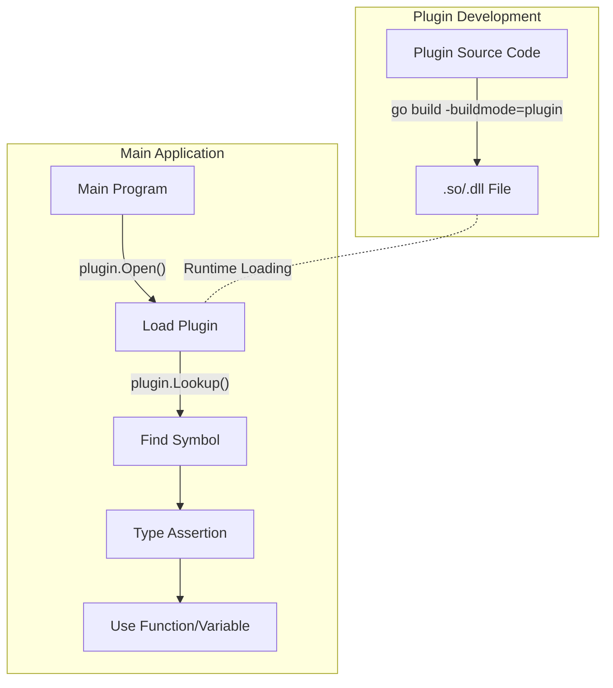

# Go Plugins

## Introduction

When building large applications, you might want to extend functionality without recompiling the entire program. Go's plugin system provides a way to dynamically load compiled code at runtime, allowing for modular and extensible applications.

Plugins in Go enable you to:
- Add features to your application after deployment
- Allow third-party extensions to your software
- Create a modular architecture where components can be swapped or updated independently
- Separate core functionality from optional features

This tutorial will guide you through understanding, creating, and using Go plugins effectively.

## What Are Go Plugins?

A Go plugin is a Go package compiled with special flags that produce a shared object file (a `.so` file). This file can be loaded at runtime by a Go program, which can then access the functions, variables, and types exported by the plugin.

> **Important Note**: Go plugins are supported only on Linux, FreeBSD, and macOS. They are not available on Windows.

## Prerequisites

Before diving into plugins, make sure you have:
- Go 1.8 or later installed (plugins were introduced in Go 1.8)
- Basic understanding of Go packages and modules
- Familiarity with Go's compile process

## Creating Your First Plugin

Let's create a simple plugin that exports a greeting function:

### Step 1: Create the Plugin Package

Create a new directory for your plugin:

```bash
mkdir greeting-plugin
cd greeting-plugin
```

Create a file named `greeting.go`:

```go
package main

import "fmt"

// Greeting returns a personalized greeting message
// Export functions must start with uppercase letter
func Greeting(name string) string {
    return fmt.Sprintf("Hello, %s! Welcome to Go Plugins.", name)
}

// This variable will be exported
var Version = "1.0.0"

// This unexported function won't be accessible
func internalHelper() string {
    return "I'm internal to the plugin"
}

// Required: empty main function
func main() {}
```

### Step 2: Compile the Plugin

Compile your plugin with the `-buildmode=plugin` flag:

```bash
go build -buildmode=plugin -o greeting.so greeting.go
```

This creates a shared object file named `greeting.so` that can be loaded at runtime.

### Step 3: Create the Main Application

Now, let's create an application that will load and use our plugin. Create a new directory:

```bash
mkdir plugin-user
cd plugin-user
```

Create a file named `main.go`:

```go
package main

import (
    "fmt"
    "plugin"
)

func main() {
    // Load the plugin
    plug, err := plugin.Open("../greeting-plugin/greeting.so")
    if err != nil {
        fmt.Printf("Error loading plugin: %v\n", err)
        return
    }
    
    // Look up the Greeting function
    greetingSymbol, err := plug.Lookup("Greeting")
    if err != nil {
        fmt.Printf("Error looking up Greeting function: %v\n", err)
        return
    }
    
    // Assert that the symbol is a function
    greeting, ok := greetingSymbol.(func(string) string)
    if !ok {
        fmt.Println("Unexpected type for Greeting function")
        return
    }
    
    // Call the function
    message := greeting("Gopher")
    fmt.Println(message)
    
    // Look up the Version variable
    versionSymbol, err := plug.Lookup("Version")
    if err != nil {
        fmt.Printf("Error looking up Version variable: %v\n", err)
        return
    }
    
    // Assert that the symbol is a string pointer
    version, ok := versionSymbol.(*string)
    if !ok {
        fmt.Println("Unexpected type for Version variable")
        return
    }
    
    fmt.Printf("Plugin version: %s\n", *version)
}
```

### Step 4: Run the Application

Compile and run the main application:

```bash
go build -o app
./app
```

Output:
```
Hello, Gopher! Welcome to Go Plugins.
Plugin version: 1.0.0
```

## How Plugins Work in Go


The process has three stages:

1. **Build**: the plugin package (which must be `package main`) is compiled with `-buildmode=plugin` into a shared object.
2. **Load**: `plugin.Open` loads the shared object into the running process. Opening the same path twice returns the same `*plugin.Plugin`, and the plugin's `init` functions run only once.
3. **Lookup**: `Lookup` finds an exported symbol by name and returns a `plugin.Symbol`. A function symbol holds the function value itself, while a variable symbol holds a *pointer* to the variable, which is why `Version` was asserted as `*string`.

## Building a Plugin System with Interfaces

Looking up individual functions by name works, but it becomes fragile as plugins grow. A cleaner approach is to define a shared interface that every plugin implements, and have each plugin export a single symbol that satisfies it.

### Step 1: Define the Shared Interface

Put the interface in its own package that both the application and the plugins import:

```go
// file: shapes/shape.go
package shapes

type Shape interface {
    Name() string
    Area() float64
}
```

### Step 2: Implement Plugins

```go
// file: plugins/square/square.go
package main

import "example.com/pluginapp/shapes"

type square struct {
    side float64
}

func (s square) Name() string  { return "square" }
func (s square) Area() float64 { return s.side * s.side }

// Shape is the exported symbol the application looks up
var Shape shapes.Shape = square{side: 3}
```

```go
// file: plugins/circle/circle.go
package main

import (
    "math"

    "example.com/pluginapp/shapes"
)

type circle struct {
    radius float64
}

func (c circle) Name() string  { return "circle" }
func (c circle) Area() float64 { return math.Pi * c.radius * c.radius }

var Shape shapes.Shape = circle{radius: 2}
```

Build both plugins:

```bash
go build -buildmode=plugin -o build/square.so ./plugins/square
go build -buildmode=plugin -o build/circle.so ./plugins/circle
```

### Step 3: Load All Plugins from a Directory

```go
// file: main.go
package main

import (
    "fmt"
    "log"
    "path/filepath"
    "plugin"

    "example.com/pluginapp/shapes"
)

func loadShape(path string) (shapes.Shape, error) {
    p, err := plugin.Open(path)
    if err != nil {
        return nil, err
    }

    sym, err := p.Lookup("Shape")
    if err != nil {
        return nil, err
    }

    // Shape is a variable, so Lookup returns a pointer to it
    shapePtr, ok := sym.(*shapes.Shape)
    if !ok {
        return nil, fmt.Errorf("%s: Shape has unexpected type %T", path, sym)
    }
    return *shapePtr, nil
}

func main() {
    files, err := filepath.Glob("build/*.so")
    if err != nil {
        log.Fatal(err)
    }

    for _, f := range files {
        s, err := loadShape(f)
        if err != nil {
            log.Printf("skipping plugin: %v", err)
            continue
        }
        fmt.Printf("%-8s area = %.2f\n", s.Name(), s.Area())
    }
}
```

Build and run the application from the module root:

```bash
go build -o app .
./app
```

Output:
```text
circle   area = 12.57
square   area = 9.00
```

Adding a new shape now only requires building a new `.so` file into the `build` directory. The application itself does not need to be recompiled.

## Limitations of Go Plugins

The standard `plugin` package has strict requirements that make it hard to use in many real projects:

- **Platform support**: plugins work only on Linux, FreeBSD, and macOS. They are not available on Windows.
- **cgo required**: plugins rely on dynamic linking, so `CGO_ENABLED=1` and a C toolchain are required.
- **Exact toolchain match**: the plugin and the application must be built with the same Go version and compatible build flags.
- **Exact dependency match**: every package shared by the plugin and the application must be built from the same version of the source. A different version of a common dependency causes `plugin.Open` to fail with an error such as "plugin was built with a different version of package".
- **No unloading**: once loaded, a plugin stays in memory until the process exits.
- **Limited tooling support**: race detector and some debugging tools have limited or no support for plugins.

In practice, this means plugins work best when the application and all plugins are built together from the same repository, in the same build pipeline.

## Alternatives to the plugin Package

If the limitations above are a problem, consider one of these approaches:

| Approach | How it works | Trade-offs |
| --- | --- | --- |
| Compile-time registration | Plugins are ordinary packages that register themselves in `init()`; you choose them with blank imports or build tags | Requires recompiling, but is simple, portable, and type-safe |
| RPC-based plugins (for example `hashicorp/go-plugin`) | Each plugin is a separate process that communicates over gRPC or net/rpc | Works on all platforms and isolates crashes; slower than in-process calls |
| WebAssembly | Plugins compiled to Wasm run in an embedded runtime | Sandboxed and language-agnostic; requires a Wasm runtime library |
| Embedded scripting | Load Lua, JavaScript, or Go scripts through an interpreter | Very flexible; slower and less type-safe |

The compile-time registration pattern is used by the standard library itself, for example image decoders register through blank imports such as `import _ "image/png"`.

## Best Practices

1. **Define a narrow interface** for plugins and keep it in a stable, separate package.
2. **Export a single entry symbol** (such as `Shape` or `Plugin`) instead of many loose functions.
3. **Check every type assertion** and return clear errors, since a mismatched plugin should not crash the host application.
4. **Version your plugin API**, for example by exporting an `APIVersion` constant and checking it after loading.
5. **Build plugins and the host together** in CI to avoid version mismatches.

## Summary

Go plugins let a program load compiled Go code at runtime. In this tutorial you learned how to:

- Build a plugin with `go build -buildmode=plugin`
- Load it with `plugin.Open` and access exported functions and variables with `Lookup`
- Use type assertions correctly, remembering that variables are returned as pointers
- Design a plugin system around a shared interface and load plugins from a directory
- Recognize the platform, toolchain, and dependency limitations of the `plugin` package
- Choose alternatives such as compile-time registration or RPC-based plugins when those limitations matter

## Exercises

1. Extend the shapes example with a `triangle` plugin and confirm that it is picked up without rebuilding the application.
2. Add an `APIVersion` constant to each plugin and make the host skip plugins with an incompatible version.
3. Build a plugin with a different version of a shared dependency and observe the error returned by `plugin.Open`.
4. Rewrite the shapes example using compile-time registration: each shape package calls a `shapes.Register` function in `init()`.
5. Write a plugin that exports a `func(string) (string, error)` text transformer, and build a command-line tool that applies all available transformers to its input.

## Additional Resources

- [plugin package documentation](https://pkg.go.dev/plugin)
- [Go build modes (`go help buildmode`)](https://pkg.go.dev/cmd/go#hdr-Build_modes)
- [hashicorp/go-plugin](https://github.com/hashicorp/go-plugin)
