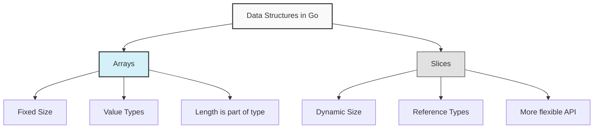

# Go Arrays

Arrays are one of the fundamental data structures in Go that allow you to store multiple values of the same type in a sequential collection. Unlike slices, arrays in Go have a fixed size that must be defined at creation time.

## Introduction to Arrays

An array in Go is a numbered sequence of elements of a specific length. The key characteristics of Go arrays are:

- **Fixed size**: The length of an array is part of its type and cannot be changed after declaration
- **Same type**: All elements in an array must be of the same data type
- **Zero-indexed**: Array indices start at 0, not 1
- **Memory efficiency**: Arrays are stored in contiguous memory locations

## Declaring and Initializing Arrays

### Basic Array Declaration

The syntax for declaring an array in Go is:

```go
var arrayName [size]dataType
```

For example:

```go
var numbers [5]int // Declares an array of 5 integers
```

When you declare an array without initialization, Go automatically initializes each element to the zero value of the array's type (0 for numbers, false for booleans, "" for strings).

### Array Initialization with Values

You can initialize an array with values at declaration time:

```go
var fruits [3]string = [3]string{"apple", "banana", "orange"}
```

Go also provides shorthand syntax:

```go
fruits := [3]string{"apple", "banana", "orange"}
```

### Using the Ellipsis Operator

If you don't want to count the elements, you can use the ellipsis operator (`...`):

```go
colors := [...]string{"red", "green", "blue", "yellow"} // Length is determined by number of elements
```

### Example: Array Declaration and Initialization

```go
package main

import "fmt"

func main() {
    // Declare an array of 5 integers (initialized to zeros)
    var scores [5]int
    fmt.Println("Empty scores array:", scores)
    
    // Initialize with values
    grades := [4]int{98, 87, 92, 83}
    fmt.Println("Grades:", grades)
    
    // Using ellipsis
    cities := [...]string{"New York", "London", "Tokyo", "Paris", "Sydney"}
    fmt.Println("Cities:", cities)
    fmt.Println("Number of cities:", len(cities))
}
```

Output:
```
Empty scores array: [0 0 0 0 0]
Grades: [98 87 92 83]
Cities: [New York London Tokyo Paris Sydney]
Number of cities: 5
```

## Accessing and Modifying Array Elements

### Accessing Elements

You can access individual elements of an array using the index syntax:

```go
arrayName[index]
```

Remember that indices start from 0, so the first element is at index 0.

### Modifying Elements

You can modify the value of an array element by assigning a new value to a specific index:

```go
arrayName[index] = newValue
```

### Example: Accessing and Modifying Array Elements

```go
package main

import "fmt"

func main() {
    temperatures := [7]float64{23.5, 25.1, 24.8, 26.3, 27.9, 26.2, 24.5}
    
    // Accessing elements
    fmt.Println("First day temperature:", temperatures[0])
    fmt.Println("Third day temperature:", temperatures[2])
    
    // Modifying elements
    temperatures[1] = 25.8
    fmt.Println("Updated temperatures:", temperatures)
    
    // Getting the last element
    lastIndex := len(temperatures) - 1
    fmt.Println("Last day temperature:", temperatures[lastIndex])
}
```

Output:
```
First day temperature: 23.5
Third day temperature: 24.8
Updated temperatures: [23.5 25.8 24.8 26.3 27.9 26.2 24.5]
Last day temperature: 24.5
```

## Array Operations

### Finding the Length of an Array

The `len()` function returns the number of elements in an array:

```go
arrayLength := len(arrayName)
```

### Iterating Over Arrays

You can iterate over arrays using loops. The two most common approaches are:

1. Using a **for loop with index**:

```go
for i := 0; i < len(arrayName); i++ {
    // Access elements with arrayName[i]
}
```

2. Using a **for-range loop**:

```go
for index, value := range arrayName {
    // Process index and value
}
```

### Example: Array Iteration

```go
package main

import "fmt"

func main() {
    prices := [4]float64{10.99, 8.75, 15.50, 7.25}
    
    // Using traditional for loop
    fmt.Println("Using traditional for loop:")
    sum := 0.0
    for i := 0; i < len(prices); i++ {
        fmt.Printf("Item %d: $%.2f\n", i+1, prices[i])
        sum += prices[i]
    }
    
    // Using for-range loop
    fmt.Println("\nUsing for-range loop:")
    total := 0.0
    for index, price := range prices {
        fmt.Printf("Item %d: $%.2f\n", index+1, price)
        total += price
    }
    
    fmt.Printf("
Total price: $%.2f
", total)
}
```

Output:
```
Using traditional for loop:
Item 1: $10.99
Item 2: $8.75
Item 3: $15.50
Item 4: $7.25

Using for-range loop:
Item 1: $10.99
Item 2: $8.75
Item 3: $15.50
Item 4: $7.25

Total price: $42.49
```

## Multi-dimensional Arrays

Go supports multi-dimensional arrays, which are essentially arrays of arrays. The most common type is the two-dimensional array, which can be visualized as a table with rows and columns.

### Declaring a 2D Array

```go
var matrix [rows][columns]dataType
```

### Example: 2D Arrays

```go
package main

import "fmt"

func main() {
    // Declare a 3x3 matrix
    var matrix [3][3]int
    
    // Initialize with values
    grid := [2][3]int{
        {1, 2, 3},
        {4, 5, 6},
    }
    
    fmt.Println("Empty matrix:", matrix)
    fmt.Println("Grid:", grid)
    
    // Accessing elements
    fmt.Println("Grid[0][2]:", grid[0][2])  // Outputs: 3
    
    // Modifying elements
    grid[1][0] = 10
    fmt.Println("Modified grid:", grid)
    
    // Iterating over a 2D array
    fmt.Println("\nGrid values:")
    for i := 0; i < len(grid); i++ {
        for j := 0; j < len(grid[i]); j++ {
            fmt.Printf("%d ", grid[i][j])
        }
        fmt.Println()
    }
}
```

Output:
```
Empty matrix: [[0 0 0] [0 0 0] [0 0 0]]
Grid: [[1 2 3] [4 5 6]]
Grid[0][2]: 3
Modified grid: [[1 2 3] [10 5 6]]

Grid values:
1 2 3 
10 5 6 
```

## Arrays vs. Slices in Go


The most important practical difference is that **arrays are values**. Assigning an array to another variable, or passing it to a function, copies every element. A slice, by contrast, refers to an underlying array, so changes made through one slice are visible through others that share that array.

```go
package main

import "fmt"

func main() {
	// Arrays are copied on assignment
	original := [3]int{1, 2, 3}
	copied := original
	copied[0] = 100

	fmt.Println("original array:", original)
	fmt.Println("copied array:  ", copied)

	// Slices share the underlying data
	s1 := []int{1, 2, 3}
	s2 := s1
	s2[0] = 100

	fmt.Println("s1 slice:", s1)
	fmt.Println("s2 slice:", s2)

	// The length is part of the array's type
	var a [3]int
	var b [5]int
	fmt.Printf("%T vs %T\n", a, b)
}
```

**Output:**
```text
original array: [1 2 3]
copied array:   [100 2 3]
s1 slice: [100 2 3]
s2 slice: [100 2 3]
[3]int vs [5]int
```

Because `[3]int` and `[5]int` are different types, a function that accepts `[3]int` cannot be called with a `[5]int`. This is one reason most Go code uses slices for general-purpose collections.

## Passing Arrays to Functions

Since arrays are copied when passed to a function, the function works on its own copy. To modify the caller's array, pass a pointer to it:

```go
package main

import "fmt"

func doubleCopy(arr [3]int) {
	for i := range arr {
		arr[i] *= 2
	}
}

func doublePointer(arr *[3]int) {
	for i := range arr {
		arr[i] *= 2
	}
}

func main() {
	numbers := [3]int{1, 2, 3}

	doubleCopy(numbers)
	fmt.Println("After doubleCopy:   ", numbers)

	doublePointer(&numbers)
	fmt.Println("After doublePointer:", numbers)
}
```

**Output:**
```text
After doubleCopy:    [1 2 3]
After doublePointer: [2 4 6]
```

Copying is cheap for small arrays, but for large arrays passing a pointer (or a slice) avoids copying all of the data.

## Comparing Arrays

Arrays of the same type can be compared directly with `==` and `!=` if their element type is comparable. Two arrays are equal when all of their corresponding elements are equal:

```go
package main

import "fmt"

func main() {
	a := [3]string{"red", "green", "blue"}
	b := [3]string{"red", "green", "blue"}
	c := [3]string{"red", "green", "yellow"}

	fmt.Println("a == b:", a == b)
	fmt.Println("a == c:", a == c)
}
```

**Output:**
```text
a == b: true
a == c: false
```

Slices cannot be compared with `==` (except against `nil`), so this is a capability unique to arrays. It also means arrays can be used as map keys, for example `map[[2]int]string` to store values by grid coordinates.

## When to Use Arrays

Arrays are a good fit when:

- The number of elements is fixed and known at compile time, such as the days of the week, RGB color components, or a 3x3 game board
- You want value semantics, so that copies are independent
- You need a comparable type, for example as a map key

For collections that grow or shrink, or when the size is only known at runtime, use slices instead.

## Summary

In this article, we covered the essentials of arrays in Go:

- **Declaration and initialization**: arrays are declared with a fixed size, such as `[5]int`, and can be initialized with literals or with `...` to let the compiler count the elements
- **Accessing elements**: elements are accessed and modified by zero-based index, and `len()` returns the array's length
- **Iteration**: arrays can be traversed with a classic `for` loop or with `for ... range`
- **Multi-dimensional arrays**: arrays of arrays, such as `[3][3]int`, represent grids and matrices
- **Value semantics**: arrays are copied on assignment and when passed to functions, unless you use a pointer
- **Arrays vs. slices**: the length is part of an array's type, which makes arrays less flexible than slices but useful for fixed-size, comparable data

## Exercises

1. Declare an array of five integers, fill it with values entered in code, and print the sum and average of its elements.
2. Write a function that takes a `[5]int` and returns a new array with the elements in reverse order.
3. Create a 3x3 tic-tac-toe board as a `[3][3]string` and write a function that checks whether any row contains three identical non-empty marks.
4. Write a function that finds the largest and smallest value in a `[10]float64` array.
5. Use a `map[[2]int]string` to store labels for a few grid coordinates and print the label at position `[1, 2]`.

## Additional Resources

- [A Tour of Go: Arrays](https://go.dev/tour/moretypes/6)
- [The Go Programming Language Specification: Array types](https://go.dev/ref/spec#Array_types)
- [Go Blog: Arrays, slices (and strings): The mechanics of 'append'](https://go.dev/blog/slices)
- [Go Blog: Go Slices: usage and internals](https://go.dev/blog/slices-intro)
