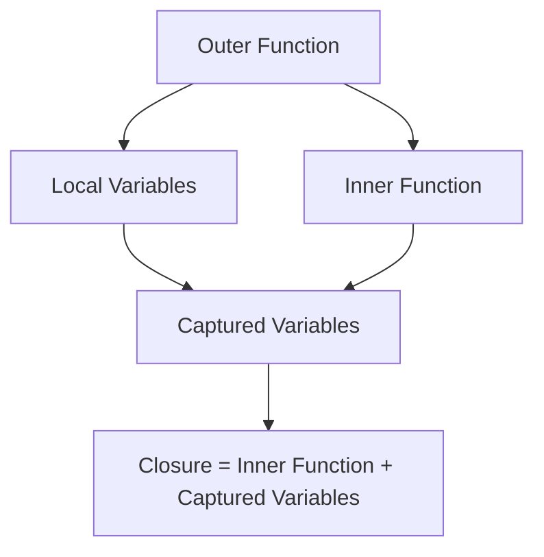

# Go Closures

## Introduction

In Go, a **closure** is a function value that references variables from outside its body. The function can access and assign values to these referenced variables, even when executed outside the scope in which they were created. Closures are a powerful concept in functional programming that allows for elegant and compact code.

Think of a closure as a function that "closes over" or "captures" the variables it needs from its surrounding environment. This creates a special relationship between the function and those variables, allowing the function to remember and manipulate them even after the outer function has finished executing.

## Understanding Closures

To understand closures, we first need to remember that functions in Go are first-class citizens. This means you can:

- Assign functions to variables
- Pass functions as arguments to other functions
- Return functions from other functions

A closure is created when a function is declared inside another function and references variables from the outer function. Let's start with a simple example:

```go
package main

import "fmt"

func main() {
    // Variable declared in the outer function
    message := "Hello, World!"
    
    // This function is a closure because it references 'message'
    // from the outer function
    displayMessage := func() {
        fmt.Println(message)
    }
    
    // Call the closure
    displayMessage()
}
```

**Output:**
```
Hello, World!
```

In this example, the anonymous function assigned to `displayMessage` is a closure because it "closes over" the `message` variable from its surrounding scope.

## The Power of Variable Capture

What makes closures powerful is that they not only capture variables by reference but also maintain access to those variables even after the outer function has returned. Let's see this in action:

```go
package main

import "fmt"

// Function that returns another function (a closure)
func createCounter() func() int {
    // This variable is captured by the closure
    count := 0
    
    // Return a function that has access to the 'count' variable
    return func() int {
        count++
        return count
    }
}

func main() {
    // Create two separate counters
    counter1 := createCounter()
    counter2 := createCounter()
    
    fmt.Println(counter1()) // 1
    fmt.Println(counter1()) // 2
    fmt.Println(counter1()) // 3
    
    fmt.Println(counter2()) // 1 (separate instance)
    fmt.Println(counter2()) // 2
    
    fmt.Println(counter1()) // 4 (continues from previous value)
}
```

**Output:**
```
1
2
3
1
2
4
```

In this example:

1. `createCounter` defines a local variable `count` initialized to 0
2. It returns an anonymous function (closure) that increments and returns `count`
3. Even though `createCounter` has finished executing, the returned function still has access to the `count` variable
4. Each call to `createCounter` creates a new instance of `count`, so each counter maintains its own state

This demonstrates one of the key features of closures: they maintain their own independent copies of the variables they capture.

## Visualizing Closures

Closures can be visualized as functions that carry a hidden backpack of variables:



A closure is the combination of a function and the environment it captured. In Go, captured variables are shared by reference, not copied. If the closure modifies a captured variable, the change is visible to the outer function, and the reverse is also true:

```go
package main

import "fmt"

func main() {
    x := 10

    increment := func() {
        x++ // modifies the outer variable directly
    }

    increment()
    increment()
    fmt.Println("x after two increments:", x)

    x = 100
    increment()
    fmt.Println("x after reassignment and increment:", x)
}
```

**Output:**
```text
x after two increments: 12
x after reassignment and increment: 101
```

Because the closure and `main` refer to the same variable `x`, both see every change.

## Closures with Parameters

Closures can take parameters and return values just like ordinary functions. A common pattern is a function that creates specialized functions:

```go
package main

import "fmt"

// makeMultiplier returns a function that multiplies its input by factor
func makeMultiplier(factor int) func(int) int {
    return func(n int) int {
        return n * factor
    }
}

func main() {
    double := makeMultiplier(2)
    triple := makeMultiplier(3)

    fmt.Println(double(5))  // 10
    fmt.Println(triple(5))  // 15
    fmt.Println(double(10)) // 20
}
```

**Output:**
```text
10
15
20
```

Each call to `makeMultiplier` captures a different `factor`, producing a family of related functions from one definition.

## Practical Use Cases

### Generators

A closure can produce a sequence of values on demand, remembering where it left off:

```go
package main

import "fmt"

// fibonacci returns a function that yields successive Fibonacci numbers
func fibonacci() func() int {
    a, b := 0, 1
    return func() int {
        result := a
        a, b = b, a+b
        return result
    }
}

func main() {
    next := fibonacci()
    for i := 0; i < 10; i++ {
        fmt.Print(next(), " ")
    }
    fmt.Println()
}
```

**Output:**
```text
0 1 1 2 3 5 8 13 21 34 
```

### Middleware and Function Wrappers

Closures are widely used to wrap behavior around another function. This is the basis of HTTP middleware in Go:

```go
package main

import (
    "fmt"
    "log"
    "net/http"
    "time"
)

// logging wraps a handler and logs how long each request takes
func logging(next http.HandlerFunc) http.HandlerFunc {
    return func(w http.ResponseWriter, r *http.Request) {
        start := time.Now()
        next(w, r)
        log.Printf("%s %s took %v", r.Method, r.URL.Path, time.Since(start))
    }
}

func hello(w http.ResponseWriter, r *http.Request) {
    fmt.Fprintln(w, "Hello!")
}

func main() {
    http.HandleFunc("/", logging(hello))
    log.Fatal(http.ListenAndServe(":8080", nil))
}
```

The returned function captures `next`, so every request first runs the timing code and then calls the original handler.

### Memoization

A closure can keep a private cache that no other code can touch:

```go
package main

import "fmt"

func memoize(f func(int) int) func(int) int {
    cache := make(map[int]int)
    return func(n int) int {
        if v, ok := cache[n]; ok {
            return v
        }
        result := f(n)
        cache[n] = result
        return result
    }
}

func main() {
    calls := 0
    slowSquare := func(n int) int {
        calls++
        return n * n
    }

    square := memoize(slowSquare)
    fmt.Println(square(4), square(4), square(5))
    fmt.Println("underlying function called", calls, "times")
}
```

**Output:**
```text
16 16 25
underlying function called 2 times
```

The `cache` map is only reachable through the returned closure, which makes closures a simple way to encapsulate state.

### Custom Sorting

Closures make it easy to pass comparison logic to library functions such as `sort.Slice`:

```go
package main

import (
    "fmt"
    "sort"
)

type Person struct {
    Name string
    Age  int
}

func main() {
    people := []Person{
        {"Alice", 30},
        {"Bob", 25},
        {"Carol", 35},
    }

    sort.Slice(people, func(i, j int) bool {
        return people[i].Age < people[j].Age
    })

    fmt.Println(people)
}
```

**Output:**
```text
[{Bob 25} {Alice 30} {Carol 35}]
```

The comparison function captures the `people` slice so it can index into it.

## Closures in Loops

Closures created inside loops deserve special attention. Starting with Go 1.22, each iteration of a `for` loop gets its own copy of the loop variable, so this code behaves as you would expect:

```go
package main

import "fmt"

func main() {
    var funcs []func()

    for i := 0; i < 3; i++ {
        funcs = append(funcs, func() {
            fmt.Println(i)
        })
    }

    for _, f := range funcs {
        f()
    }
}
```

**Output (Go 1.22 and later):**
```text
0
1
2
```

The new behavior applies when the `go` line in your module's `go.mod` file is `go 1.22` or later. In Go 1.21 and earlier, the loop variable was shared across all iterations, so this program printed `3` three times. If you maintain code that must build with older Go versions, create a new variable inside the loop body:

```go
for i := 0; i < 3; i++ {
    i := i // new variable for each iteration
    funcs = append(funcs, func() {
        fmt.Println(i)
    })
}
```

The same issue applies to goroutines started inside loops. Passing the value as a function argument is another clear way to avoid it:

```go
for i := 0; i < 3; i++ {
    go func(n int) {
        fmt.Println(n)
    }(i)
}
```

## Closures and Goroutines

When several goroutines share a captured variable, access must be synchronized just like any other shared memory:

```go
package main

import (
    "fmt"
    "sync"
)

func main() {
    var (
        mu    sync.Mutex
        wg    sync.WaitGroup
        total int
    )

    for i := 1; i <= 100; i++ {
        wg.Add(1)
        go func(n int) {
            defer wg.Done()
            mu.Lock()
            total += n // total is captured by every goroutine
            mu.Unlock()
        }(i)
    }

    wg.Wait()
    fmt.Println("Total:", total)
}
```

**Output:**
```text
Total: 5050
```

Without the mutex, the goroutines would race on `total`. Running the program with `go run -race` would report the problem.

## Best Practices

- **Keep closures short.** If a closure grows large, consider turning it into a named function or a method on a struct.
- **Be explicit about shared state.** Remember that captured variables are shared, not copied.
- **Synchronize access across goroutines.** Captured variables are ordinary shared memory.
- **Watch memory lifetime.** A closure keeps its captured variables alive as long as the closure itself is reachable, which can keep large objects in memory longer than expected.
- **Prefer a struct when state becomes complex.** A struct with methods is often clearer than a closure that captures many variables.

## Summary

In this guide, you learned:

- A closure is a function value that references variables from outside its body
- Captured variables are shared by reference and outlive the function that declared them
- Each call to a function that returns a closure creates a fresh set of captured variables
- Closures are useful for generators, function factories, middleware, memoization, and callbacks such as `sort.Slice`
- Since Go 1.22, each loop iteration has its own loop variable, which removes a classic closure bug
- Captured variables shared between goroutines need synchronization

Closures let you bundle behavior with private state in a lightweight way, and they appear throughout idiomatic Go code.

## Exercises

1. Write a function `makeAccumulator(start int) func(int) int` that returns a closure adding each argument to a running total and returning the new total.
2. Create a generator that returns successive even numbers each time it is called.
3. Write a `rateLimit` wrapper that returns a closure which only calls the wrapped function if at least one second has passed since the last call.
4. Write a `makeIDGenerator(prefix string)` function that returns IDs like `user-1`, `user-2`, and so on.
5. Use `sort.Slice` with a closure to sort a slice of strings by length, and then alphabetically for strings of equal length.

## Additional Resources

- [A Tour of Go: Function closures](https://go.dev/tour/moretypes/25)
- [The Go Programming Language Specification: Function literals](https://go.dev/ref/spec#Function_literals)
- [Go Blog: Fixing For Loops in Go 1.22](https://go.dev/blog/loopvar-preview)
- [Go by Example: Closures](https://gobyexample.com/closures)
